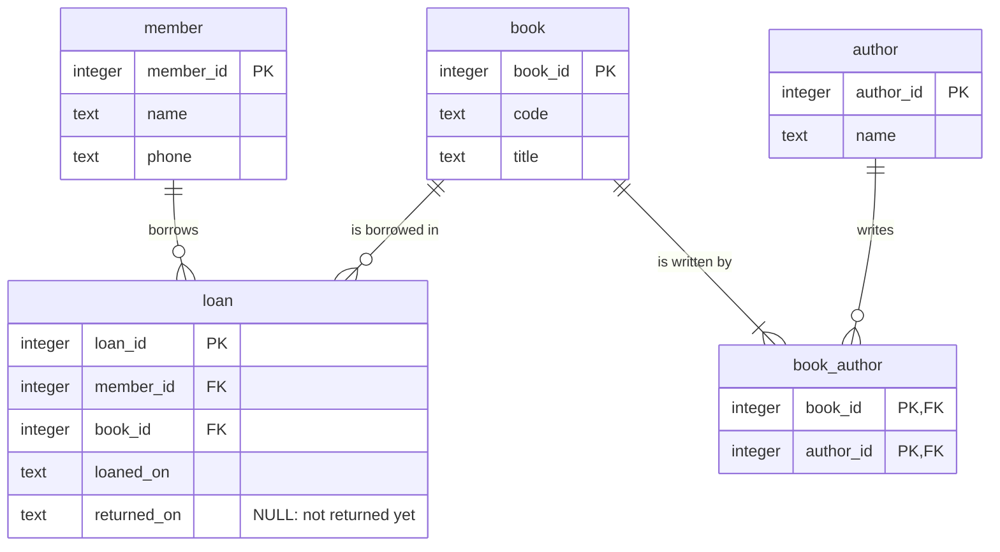

# Assignment: the loans of a library - a solution

The assignment at the end of the lecture
[Introduction to databases and the relational model](../../presentations/05-01-relational-model.md).
A small library keeps its loans in one spreadsheet:

| loan | member | phone | book | title | authors | loaned | returned |
|---|---|---|---|---|---|---|---|
| 1 | Ana Petrović | 064 111 222 | B-101 | Good Omens | Pratchett, Gaiman | 2026-10-01 | 2026-10-15 |
| 2 | Marko Ilić | 065 333 444 | B-102 | Mort | Pratchett | 2026-10-03 | |
| 3 | Ana Petrović | 064 111 222 | B-103 | Coraline | Gaiman | 2026-10-16 | |
| 4 | Jelena Kostić | 063 555 666 | B-101 | Good Omens | Pratchett, Gaiman | 2026-10-20 | |

The task: find what is wrong, normalize the table step by step, draw the E-R diagram, write the physical model,
and move the four loans into the new tables.

| File | Content |
|---|---|
| `README.md` | the analysis, the normalization, the E-R diagram and the tables with their rows |
| `create-tables.sql` | the physical model, in SQLite (the "bonus" part of the assignment) |
| `insert-data.sql` | the four loans, moved into the tables |

## 1. What is wrong?

- **Redundancy**: Ana's phone number is written twice; *Good Omens* with its two authors is written twice.
- **Update anomaly**: if Ana gets a new phone number, two rows must be changed.
- **Insertion anomaly**: a new book cannot be stored before somebody borrows it; neither can a new member.
- **Deletion anomaly**: delete loan 2, and the library forgets the book *Mort* and the member Marko.
- The column `authors` holds a list, and an empty `returned` should be NULL: the book is not back yet.

## 2. Normalization

**1NF - one value in every field.** One row for every loan and author: 6 rows instead of 4
(loans 1 and 4 have two rows each). The key is now the pair (`loan`, `author`).

**2NF - every non-key column describes the whole key.** `member`, `phone`, `book`, `title`, `loaned` and
`returned` describe the loan alone - a part of the key. They move to the table `loan`, whose key is `loan`.
What is left is the pair (loan, author). But the author is not a fact about the loan: the authors of
*Good Omens* are the same for loan 1 and loan 4. The authors belong to the **book**: the pair becomes
(`book`, `author`).

**3NF - no non-key column describes another non-key column.** In `loan`:

- `phone` describes the member, not the loan → the table `member`;
- `title` describes the book, not the loan → the table `book`.

The names of the authors get a table of their own as well, so that every name is written once.

## 3. The E-R diagram



- A member has **zero or many** loans; a loan has **one and only one** member. The same holds for a book.
- Book and author are **many-to-many**: in the logical model a line between them, in the physical model the
  junction table `book_author`. A book has **one or many** authors; an author has **zero or many** books
  in this library.

## 4. The physical model

| Table | Primary key | Foreign keys | NULL allowed |
|---|---|---|---|
| `member` | `member_id` | - | - |
| `book` | `book_id` | - | - |
| `author` | `author_id` | - | - |
| `book_author` | (`book_id`, `author_id`) | `book_id` → `book`, `author_id` → `author` | - |
| `loan` | `loan_id` | `member_id` → `member`, `book_id` → `book` | `returned_on` |

All the keys are surrogate keys, as in the course databases. The code of a book (`B-101`) could be a natural key
instead; a phone number could not - it changes, and a family may share one.

## 5. The rows

| member_id | name | phone |
|---|---|---|
| 1 | Ana Petrović | 064 111 222 |
| 2 | Marko Ilić | 065 333 444 |
| 3 | Jelena Kostić | 063 555 666 |

| book_id | code | title |
|---|---|---|
| 1 | B-101 | Good Omens |
| 2 | B-102 | Mort |
| 3 | B-103 | Coraline |

| author_id | name |
|---|---|
| 1 | Pratchett |
| 2 | Gaiman |

| book_id | author_id |
|---|---|
| 1 | 1 |
| 1 | 2 |
| 2 | 1 |
| 3 | 2 |

| loan_id | member_id | book_id | loaned_on | returned_on |
|---|---|---|---|---|
| 1 | 1 | 1 | 2026-10-01 | 2026-10-15 |
| 2 | 2 | 2 | 2026-10-03 | NULL |
| 3 | 1 | 3 | 2026-10-16 | NULL |
| 4 | 3 | 1 | 2026-10-20 | NULL |

3 members, 3 books, 2 authors, 4 pairs of a book and an author, 4 loans.

## Trying the model in SQLite

```text
cd exercises/05-01-relational-model
sqlite3 library.db
.read create-tables.sql
.read insert-data.sql
SELECT * FROM loan;
.quit
```

The shell `sqlite3` and SQL are the topics of the next two lectures. The file `library.db` is not kept in git.
