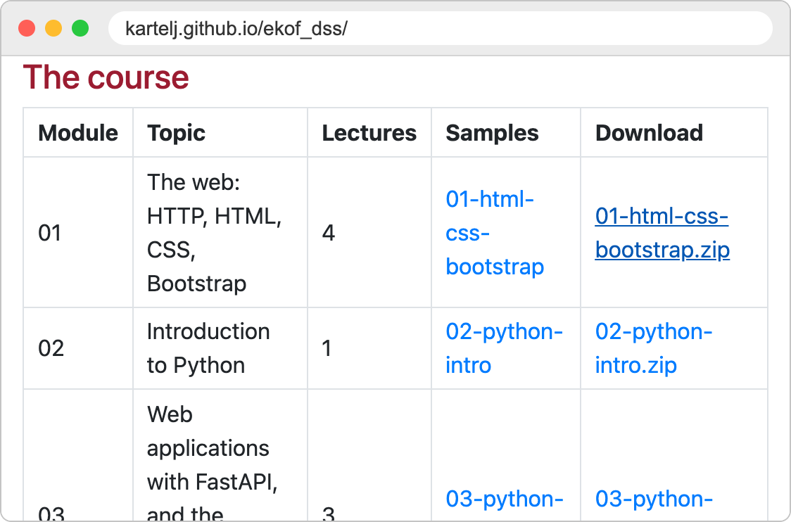
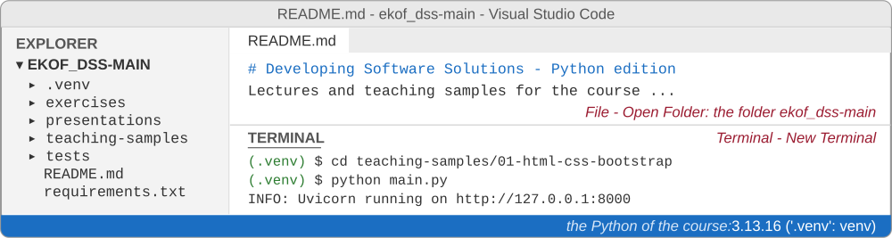

# Introduction to web applications and the HTTP protocol

Developing Software Solutions

---

## What happens when you open a web page?

1. A **web client** (usually a web browser) sends a *request* to a **web server**.
2. The server receives the request and sends back a *response* - most often an HTML page.
3. The client looks at what it has received:
   - an HTML page is parsed and shown on the screen,
   - a file the browser understands (an image, a video, a PDF) is displayed or played,
   - any other file is offered for download.

One page usually needs many requests: one for the HTML, and one for every image, style sheet and script that the HTML mentions.

---

## Client and server


---

## One page, many requests


---

## The protocol: HTTP

- HTTP stands for **HyperText Transfer Protocol**.
- A *protocol* is a set of rules that both sides of a conversation agree to follow.
- HTTP defines:
  - what a request looks like,
  - what a response looks like,
  - what the two sides may expect from each other.
- **HTTPS** is the same protocol, sent through an encrypted connection.

Because both sides follow the same rules, any browser can talk to any web server.

---

## The HTTP client

- The program that **starts** the conversation.
- It builds an HTTP request, sends it to a server, and interprets the response.
- The best known clients are web browsers: Chrome, Firefox, Safari, Edge.
- A browser is not the only kind of client:
  - command-line tools, such as `curl`,
  - mobile applications,
  - our own Python programs (we will write some later in the course).

---

## The HTTP server

- A **program**, not a computer - although the computer that runs it is usually called "the server" as well.
- The server program:
  - *listens* for incoming requests,
  - reads and interprets each request,
  - sends back a response.
- Well known server programs: nginx, Apache HTTP Server, Microsoft IIS.
- In this course the server is a Python program, run by **Uvicorn**.

---

## What do we need to publish a web site?

1. A computer that is always on and connected to the internet.
2. A web server program installed on it.
3. The files of the site (HTML pages, images, style sheets) copied to that computer.
4. An address by which the others can find it - a *domain name*.

A busy site uses many computers in several data centres. A site for a few visitors can run on a single small computer - or, while we are developing it, on our own laptop.

---

## A web server on your own computer

Python comes with a simple web server. In a folder that contains HTML files, type:

```text
python -m http.server 8000
```

and open `http://localhost:8000` in the browser.

<div class="columns"><div>

- `localhost` is the name by which every computer calls **itself**.
- `8000` is the **port**: one computer can run several server programs, and the port tells which one we want.
- Only you can see this site. That is exactly what we want during development.

</div><div>


</div></div>

---

## Static and dynamic content

**Static content**: the server sends a file exactly as it is stored on the disk.

- HTML pages, images, style sheets
- every visitor gets the same thing

**Dynamic content**: a program on the server *creates* the response at the moment of the request.

- search results, a shopping basket, your bank account
- the response depends on who asks, on what they ask for, and on the data in a database

The first part of the course uses static content. From the second part on, we write the programs that create the pages.

---

## Where does the response come from?


---

## The course on your computer

From now on every lecture has exercises, and we do them on our own computers. We need:

1. **Python** and **Visual Studio Code** - installed once;
2. **the samples of the module** - one ZIP archive from the page of the course, unzipped into a folder;
3. **the packages** of the course - installed once into that folder.

Then, at every lecture: open the folder in VS Code, open a terminal, and start the server of the samples.

The next five slides show how, step by step.

---

## 1. Install Python and Visual Studio Code

- **Python 3.12 or newer** - `python.org`, the page *Downloads*.<br>
  On Windows tick **Add python.exe to PATH** in the first window of the installer.
- **Visual Studio Code** - `code.visualstudio.com`.<br>
  In VS Code open *Extensions* (the icon with four squares on the left) and install **Python** (by Microsoft).
- Check Python in a terminal:

```text
python --version
Python 3.13.16
```

On macOS the command is `python3`. Any version from 3.12 on is fine.

---

## 2. Download the samples of the module

<div class="columns"><div>

1. Open the page of the course, `kartelj.github.io/ekof_dss`.
2. In the table *The course*, click `01-html-css-bootstrap.zip`.
3. Unzip it - Windows: right click, *Extract All...*; macOS: double click. You get the folder `01-html-css-bootstrap`.
4. Move the folder to a place where you will find it again, e.g. *Documents*.

Every module has its own archive. Download it when the module starts: then you get its latest version.

</div><div>



</div></div>

Note:
The whole course - all the lectures, samples and solutions - is the repository github.com/kartelj/ekof_dss (Code - Download ZIP, or git clone); the samples are in its folder teaching-samples. For the students one archive per module is simpler, and it always has the latest version of the module.

---

## 3. Open the folder in VS Code

- *File - Open Folder...* and choose the folder `01-html-css-bootstrap` - the one with `main.py` and `requirements.txt` in it. If unzipping has made a folder inside a folder, choose the inner one. If VS Code asks whether you trust the authors: *Yes*.
- *Terminal - New Terminal*: a terminal opens at the bottom of the window, already in that folder.



---

## 4. The packages of the course - once for every folder

In the terminal of VS Code:

```text
python -m venv .venv
.venv\Scripts\activate                (macOS:  source .venv/bin/activate)
pip install -r requirements.txt
```

- The first line makes the folder `.venv`, a place for the packages (on macOS: `python3 -m venv .venv`).
- The second line *activates* it: the line of the terminal now begins with `(.venv)`. **Activate it again in every new terminal.**
- The third line installs the packages, such as FastAPI - a minute or two. The folders of the next modules need the same three lines; the second time it goes faster.

Windows: if PowerShell answers *running scripts is disabled on this system*, type once `Set-ExecutionPolicy -Scope CurrentUser RemoteSigned`, and activate again.

---

## 5. Start the server of the samples

```text
python main.py
```

<div class="columns"><div>

- Open `http://localhost:8000`: the folders of the samples.
- The terminal writes one line for every request that the server receives.
- `Ctrl+C` in the terminal stops the server.

**At every lecture:** open the folder in VS Code, *New Terminal*, activate, `python main.py`.

</div><div>


</div></div>

---

<!-- .slide: class="exercise" -->
## Exercise 1: the course on your computer

Go through the steps 1 to 5. You are done when:

1. `http://localhost:8000` shows the folders `01-html`, `02-css` and `03-bootstrap`;
2. a click on `01-html`, then `01-basic-elements`, then `04-headers.html` shows a page with a big heading;
3. the terminal shows a line with `GET` and `200 OK` for every click.

Then stop the server with `Ctrl+C`, and reload the page. What does the browser say now, and why? *About 15 minutes.*

<details><summary>Solution</summary>

| The terminal says | What to do |
|---|---|
| `python` is not recognized, or *command not found* | Windows: install Python again, with *Add python.exe to PATH*; macOS: `python3` |
| `No module named 'uvicorn'` (or `'fastapi'`) | the line does not begin with `(.venv)`: activate the environment; or run the `pip install` of step 4 |
| `can't open file '...main.py'` | VS Code has another folder open: *File - Open Folder...* and the folder with `main.py` in it |
| `address already in use` | a server is already running at port 8000, e.g. in another terminal: stop it with `Ctrl+C` |

- After `Ctrl+C` the browser says *This site can't be reached* (*localhost refused to connect*): no program listens at port 8000 any more. A client needs a server to talk to.

</details>

Note:
Give this exercise time: everything after it depends on it. Students who are done can help their neighbours. The most frequent problems on Windows are a Python without PATH, PowerShell refusing the activation, and a folder inside a folder after unzipping.

---

## The request - response cycle

- The client always speaks first; the server only answers.
- One request, one response - then the conversation is over.
- HTTP is **stateless**: the server does not remember earlier requests. Every request has to carry everything the server needs in order to answer it.


Note:
Statelessness comes back twice in the course: when we keep the state of a page on the server, and as one of the REST constraints.

---

## The HTTP request

```http
GET /01-html/01-basic-elements/04-headers.html HTTP/1.1
Host: localhost:8000
User-Agent: Mozilla/5.0 (Macintosh) Chrome/154.0
Accept: text/html,application/xhtml+xml
Accept-Language: en,sr;q=0.8
```

- The **request line**: the method (`GET`), the path of the resource, the version of the protocol.
- The **headers**: additional information, one `Name: value` pair per line - who asks, what kinds of answers are welcome, in which language.
- An optional **body**: the data that the client sends, for example the values typed into a form.

---

## HTTP methods

The method tells the server what the client wants to do with the resource.

| Method | Meaning |
|---|---|
| `GET` | give me this resource; nothing changes on the server |
| `POST` | here is some data - create something, or carry out an action |
| `PUT` | replace the resource with the data I am sending |
| `DELETE` | remove the resource |

Typing an address or clicking a link always sends a `GET`. Forms can send `GET` or `POST`.

---

## The HTTP response

```http
HTTP/1.1 200 OK
Content-Type: text/html; charset=utf-8
Content-Length: 309
Last-Modified: Fri, 02 Oct 2026 10:15:02 GMT

<!DOCTYPE html>
<html>
...
```

- The **status line**: the version of the protocol and a status code with a short description.
- The **headers**: the type of the content (`Content-Type`), its length, the date ...
- An empty line, and then the **body**: the requested resource itself.

---

## Request and response have the same shape

Both are plain text: a first line, the headers, an empty line, and the body.


---

<!-- .slide: class="exercise" -->
## Exercise 2: read the messages

A form was sent, and this is the whole conversation:

<div class="columns"><div>

```http
POST /process-form HTTP/1.1
Host: localhost:8000
Content-Type: application/x-www-form-urlencoded
Content-Length: 33

first_name=Holly&last_name=Hunter
```

</div><div>

```http
HTTP/1.1 200 OK
server: uvicorn
content-length: 1742
content-type: text/html; charset=utf-8

<!DOCTYPE html>
...
```

</div></div>

1. Which **method** does the client use, and which **resource** does it ask for?
2. Where are the values that were typed into the form?
3. Did it work? How do you know?

Write the answers down, then compare. *About 5 minutes.*

<details><summary>Solution</summary>

1. `POST`, the resource `/process-form` - the first line of the request.
2. In the **body** of the request, after the empty line: `first_name=Holly` and `last_name=Hunter`.
3. Yes: the status line says `200 OK`, and the body of the response is an HTML page (`text/html`).

</details>

---

## Status codes

The first digit tells the kind of the answer.

| Code | Kind | Examples |
|---|---|---|
| `2xx` | success | `200 OK`, `201 Created`, `204 No Content` |
| `3xx` | look elsewhere | `301 Moved Permanently`, `303 See Other` |
| `4xx` | the client made a mistake | `400 Bad Request`, `404 Not Found` |
| `5xx` | the server failed | `500 Internal Server Error` |

---

## 404 Not Found

- The server understood the request, but it has nothing at that address.
- The usual cause is a mistake in the address:

```text
http://localhost:8000/01-html/01-basic-elements/04-headers.html    200 OK
http://localhost:8000/01-html/01-basic-elements/04-heders.html     404 Not Found
```


- A 404 is a perfectly valid answer: the conversation between the client and the server worked, only the resource is missing.

---

## Anatomy of a URL

A URL (*Uniform Resource Locator*) is the address of a resource on the web.


- If the port is left out, `http` uses port 80 and `https` uses port 443.
- The query is the usual way to send a few values with a `GET` request.

---

<!-- .slide: class="exercise" -->
## Exercise 3: status codes and addresses

**Which status code** do you expect?

1. The address has a typing mistake.
2. The page is found and sent.
3. The server program has a bug, and stops while it is answering.
4. The server sends the browser to another address.

**Take the address apart** - scheme, host, port, path, query, fragment:

```text
https://shop.example.com:8443/search/lamps?colour=red&page=2#results
```

Which port does `https://www.ekof.bg.ac.rs/` use? *About 5 minutes.*

<details><summary>Solution</summary>

1. `404 Not Found` - a `4xx`: the mistake is the client's.
2. `200 OK`.
3. `500 Internal Server Error` - a `5xx`: the server has failed.
4. A `3xx`, for example `301 Moved Permanently` or `303 See Other`.

| scheme | host | port | path | query | fragment |
|---|---|---|---|---|---|
| `https` | `shop.example.com` | `8443` | `/search/lamps` | `colour=red&page=2` | `results` |

- `https://www.ekof.bg.ac.rs/` gives no port, so `https` uses its usual port, 443.

</details>

---

## See HTTP with your own eyes

**In the browser** - open the developer tools (F12) and choose the *Network* tab:

- every request made by the page, with its method and status code,
- the headers of the request and of the response.

**In the terminal** - the tool `curl` shows the whole conversation:

```text
curl -v http://localhost:8000/01-html/01-basic-elements/04-headers.html
```

**In the terminal of the server** - every request that arrives is written in one line:

```text
INFO:     127.0.0.1:52144 - "GET /01-html/ HTTP/1.1" 200 OK
```

---

## curl shows the whole conversation

`>` - what the client has sent, `<` - what the server has answered, `*` - what curl itself reports.


---

## Try it

The server of the samples is running (step 5). Open the developer tools (F12), the tab *Network*.

<div class="columns"><div>

Open `http://localhost:8000` and:

1. browse to one of the HTML samples and find its request in the *Network* tab;
2. change one letter in the address and look at the status code;
3. look at the terminal - which requests has the server received?

</div><div>


</div></div>

---

<!-- .slide: class="exercise" -->
## Exercise 4: count the requests

The server of the samples is running, the tab *Network* is open. Open these two pages:

1. `http://localhost:8000/01-html/03-images/03-img-out-of-current-dir/index.html` -
   how many requests does the page make? How many of them are pictures?
2. `http://localhost:8000/01-html/03-images/04-img-broken/index.html` -
   which status codes do you see? What does the page show instead of the pictures?

Compare with the lines in the terminal of the server. *About 10 minutes.*

<details><summary>Solution</summary>

1. Five requests: the page itself (type *document*) and four pictures (type *jpeg*). The browser asks for every picture separately, after it has read the page.
2. `200` for the page, and `404 Not Found` for the four pictures: their names are wrong. Instead of each picture the page shows the icon of a broken picture, and a word: *Lake*, *Mountain*, *Castle*, *Lake 2*.

</details>

Note:
If the pictures come from the cache of the browser after a reload (Network shows "memory cache"), tick Disable cache in the tab Network and reload again. The terminal also shows /favicon.ico - the little icon of the site, which the browser asks for by itself.

---

## Summary

- The web is a conversation between **clients** and **servers**.
- They speak **HTTP**: a request (method, path, headers, body) is answered by a response (status code, headers, body).
- HTTP is **stateless** - every request stands on its own.
- A **URL** tells which protocol to use, which server to ask, and which resource to ask for.
- During development the client and the server are on the same computer: `http://localhost:8000`.

---

<!-- .slide: class="exercise" -->
## Assignment: watch the conversation

The server of the samples is running; the developer tools are open on the tab *Network*.
For every step write down the **method**, the **address**, the **status code** and the **type** of each request:

1. Open `/01-html/01-basic-elements/04-headers.html`.
2. Open `/01-html/03-images/03-img-out-of-current-dir/index.html`. How many requests are pictures?
3. Change one letter in the address of step 1. What does the page show now?
4. Open `/01-html/06-forms/01-form-text-submit.html`, type your name, and click the button. Where are your values?
5. Stop the server with `Ctrl+C`, and reload the page. What happens?

For every step, also find the lines in the terminal of the server. *About 30 minutes.*

Answers: [exercises/01-01-client-server-web](https://github.com/kartelj/ekof_dss/tree/main/exercises/01-01-client-server-web)

---

# Thanks for your attention!
