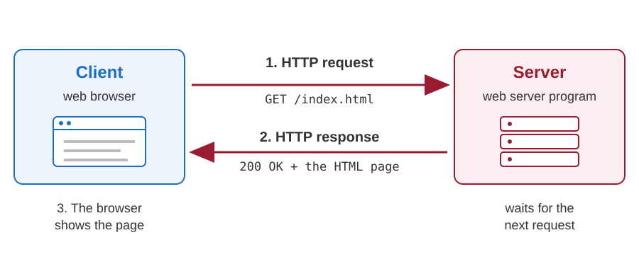
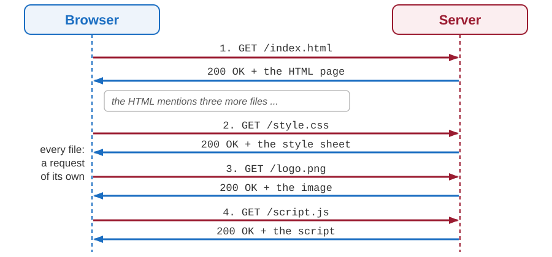
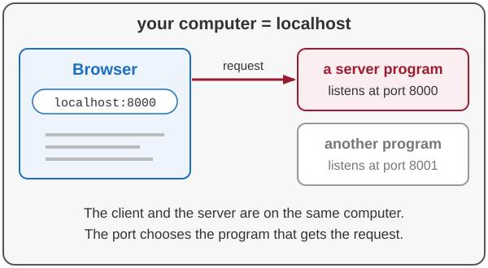
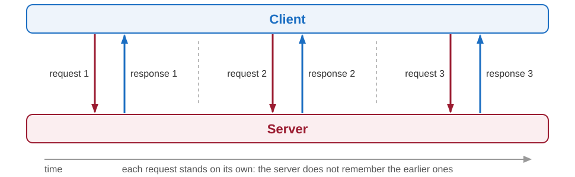
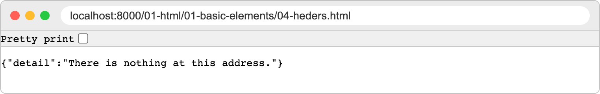
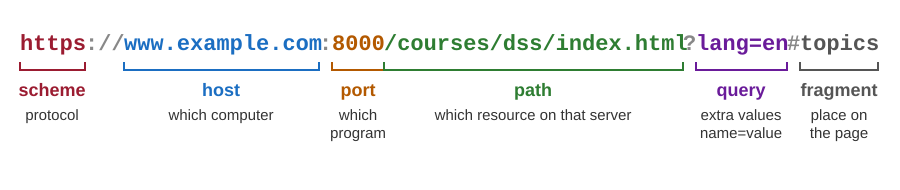
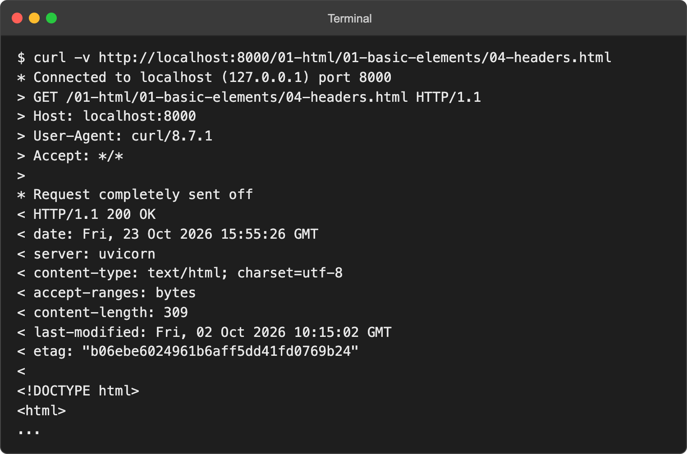
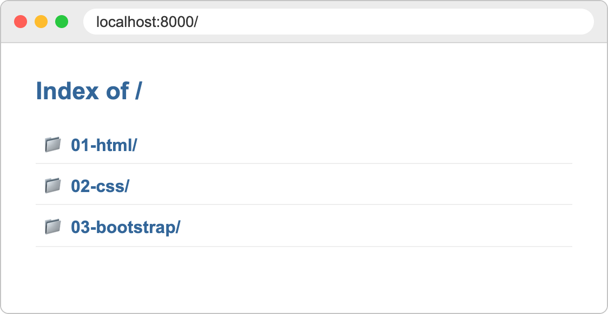

# Introduction to web applications and the HTTP protocol

Developing Software Solutions

---

## What happens when you open a web page?

1. A **web client** (usually a web browser) sends a *request* to a **web server**.
2. The server receives the request and sends back a *response* - most often an HTML page.
3. The client looks at what it has received:
   - an HTML page is parsed and shown on the screen,
   - a file the browser understands (an image, a video, a PDF) is displayed or played,
   - any other file is offered for download.

One page usually needs many requests: one for the HTML, and one for every image, style sheet and script that the HTML mentions.

---

## Client and server



---

## One page, many requests



---

## The protocol: HTTP

- HTTP stands for **HyperText Transfer Protocol**.
- A *protocol* is a set of rules that both sides of a conversation agree to follow.
- HTTP defines:
  - what a request looks like,
  - what a response looks like,
  - what the two sides may expect from each other.
- **HTTPS** is the same protocol, sent through an encrypted connection.

Because both sides follow the same rules, any browser can talk to any web server.

---

## The HTTP client

- The program that **starts** the conversation.
- It builds an HTTP request, sends it to a server, and interprets the response.
- The best known clients are web browsers: Chrome, Firefox, Safari, Edge.
- A browser is not the only kind of client:
  - command-line tools, such as `curl`,
  - mobile applications,
  - our own Python programs (we will write some later in the course).

---

## The HTTP server

- A **program**, not a computer - although the computer that runs it is usually called "the server" as well.
- The server program:
  - *listens* for incoming requests,
  - reads and interprets each request,
  - sends back a response.
- Well known server programs: nginx, Apache HTTP Server, Microsoft IIS.
- In this course the server is a Python program, run by **Uvicorn**.

---

## What do we need to publish a web site?

1. A computer that is always on and connected to the internet.
2. A web server program installed on it.
3. The files of the site (HTML pages, images, style sheets) copied to that computer.
4. An address by which the others can find it - a *domain name*.

A busy site uses many computers in several data centres. A site for a few visitors can run on a single small computer - or, while we are developing it, on our own laptop.

---

## A web server on your own computer

Python comes with a simple web server. In a folder that contains HTML files, type:

```text
python -m http.server 8000
```

and open `http://localhost:8000` in the browser.

<div class="columns"><div>

- `localhost` is the name by which every computer calls **itself**.
- `8000` is the **port**: one computer can run several server programs, and the port tells which one we want.
- Only you can see this site. That is exactly what we want during development.

</div><div>



</div></div>

---

## Static and dynamic content

**Static content**: the server sends a file exactly as it is stored on the disk.

- HTML pages, images, style sheets
- every visitor gets the same thing

**Dynamic content**: a program on the server *creates* the response at the moment of the request.

- search results, a shopping basket, your bank account
- the response depends on who asks, on what they ask for, and on the data in a database

The first part of the course uses static content. From the second part on, we write the programs that create the pages.

---

## Where does the response come from?


---

<!-- .slide: class="exercise" -->
## Exercise 1: a web server of your own

1. Make a new folder, for example `myweb`, and in it a text file `hello.txt` with one sentence.
2. In a terminal, in that folder: `python -m http.server 8000` (on macOS `python3`).
3. Open `http://localhost:8000`, and then click `hello.txt`.
4. Look at the terminal: which requests has the server received, with which status codes?
5. Open `http://localhost:8001`. What happens, and why?
6. Is the list of files static or dynamic content? And `hello.txt`?

The browser first shows *Directory listing for /* with `hello.txt`, then your sentence. Stop the server with `Ctrl+C`. *About 10 minutes.*

<details><summary>Solution</summary>

```text
"GET / HTTP/1.1" 200 -
"GET /favicon.ico HTTP/1.1" 404 -
"GET /hello.txt HTTP/1.1" 200 -
```

- Three requests: the list of files, the little icon of the site - the browser asks for it by itself, and there is none, so `404` - and the file.
- At port 8001 the browser cannot connect at all (*This site can't be reached*): no program listens there. That is not a `404` - there is nobody to answer.
- The list is **dynamic**: the server writes it at the moment of the request, from the files in the folder. Add a file and reload - it appears. `hello.txt` is **static**: it is sent exactly as it is stored.

</details>

Note:
At the start of every line, the server also writes the address of the client (::1 or 127.0.0.1) and the time. If port 8000 is taken, any other port works, e.g. 8080.

---

## The request - response cycle

- The client always speaks first; the server only answers.
- One request, one response - then the conversation is over.
- HTTP is **stateless**: the server does not remember earlier requests. Every request has to carry everything the server needs in order to answer it.



Note:
Statelessness comes back twice in the course: when we keep the state of a page on the server, and as one of the REST constraints.

---

## The HTTP request

```http
GET /01-html/01-basic-elements/04-headers.html HTTP/1.1
Host: localhost:8000
User-Agent: Mozilla/5.0 (Macintosh) Chrome/154.0
Accept: text/html,application/xhtml+xml
Accept-Language: en,sr;q=0.8
```

- The **request line**: the method (`GET`), the path of the resource, the version of the protocol.
- The **headers**: additional information, one `Name: value` pair per line - who asks, what kinds of answers are welcome, in which language.
- An optional **body**: the data that the client sends, for example the values typed into a form.

---

## HTTP methods

The method tells the server what the client wants to do with the resource.

| Method | Meaning |
|---|---|
| `GET` | give me this resource; nothing changes on the server |
| `POST` | here is some data - create something, or carry out an action |
| `PUT` | replace the resource with the data I am sending |
| `DELETE` | remove the resource |

Typing an address or clicking a link always sends a `GET`. Forms can send `GET` or `POST`.

---

## The HTTP response

```http
HTTP/1.1 200 OK
Content-Type: text/html; charset=utf-8
Content-Length: 309
Last-Modified: Fri, 02 Oct 2026 10:15:02 GMT

<!DOCTYPE html>
<html>
...
```

- The **status line**: the version of the protocol and a status code with a short description.
- The **headers**: the type of the content (`Content-Type`), its length, the date ...
- An empty line, and then the **body**: the requested resource itself.

---

## Request and response have the same shape

Both are plain text: a first line, the headers, an empty line, and the body.


---

<!-- .slide: class="exercise" -->
## Exercise 2: read the messages

A form was sent, and this is the whole conversation:

<div class="columns"><div>

```http
POST /process-form HTTP/1.1
Host: localhost:8000
Content-Type: application/x-www-form-urlencoded
Content-Length: 33

first_name=Holly&last_name=Hunter
```

</div><div>

```http
HTTP/1.1 200 OK
server: uvicorn
content-length: 1742
content-type: text/html; charset=utf-8

<!DOCTYPE html>
...
```

</div></div>

1. To which server, and to which port, does the request go?
2. What does the client want to do, and with which resource?
3. What does the body of the request contain? Why has a `GET` for a page usually no body?
4. Did it work? What has the server sent back, and how long is it?

Write the answers down, then compare. *About 10 minutes.*

<details><summary>Solution</summary>

1. To `localhost`, port `8000` - the header `Host`.
2. `POST`: it sends data to the resource `/process-form`, which should do something with it.
3. Two pairs *name=value*, `first_name=Holly` and `last_name=Hunter` - the values typed into a form. `Content-Length` is their length: 33 characters. A `GET` only asks for something, so it has nothing to send.
4. Yes - `200 OK`. The body is an HTML page (`text/html`), 1742 bytes long.

</details>

---

## Status codes

The first digit tells the kind of the answer.

| Code | Kind | Examples |
|---|---|---|
| `2xx` | success | `200 OK`, `201 Created`, `204 No Content` |
| `3xx` | look elsewhere | `301 Moved Permanently`, `303 See Other` |
| `4xx` | the client made a mistake | `400 Bad Request`, `404 Not Found` |
| `5xx` | the server failed | `500 Internal Server Error` |

---

## 404 Not Found

- The server understood the request, but it has nothing at that address.
- The usual cause is a mistake in the address:

```text
http://localhost:8000/01-html/01-basic-elements/04-headers.html    200 OK
http://localhost:8000/01-html/01-basic-elements/04-heders.html     404 Not Found
```



- A 404 is a perfectly valid answer: the conversation between the client and the server worked, only the resource is missing.

---

## Anatomy of a URL

A URL (*Uniform Resource Locator*) is the address of a resource on the web.



- If the port is left out, `http` uses port 80 and `https` uses port 443.
- The query is the usual way to send a few values with a `GET` request.

---

<!-- .slide: class="exercise" -->
## Exercise 3: status codes and addresses

**Which status code** do you expect?

1. The address has a typing mistake.
2. The page is found and sent.
3. The server program has a bug, and stops while it is answering.
4. The server sends the browser to another address.

**Take the address apart** - scheme, host, port, path, query, fragment:

```text
https://shop.example.com:8443/search/lamps?colour=red&page=2#results
```

Which port does `https://www.ekof.bg.ac.rs/` use? *About 5 minutes.*

<details><summary>Solution</summary>

1. `404 Not Found` - a `4xx`: the mistake is the client's.
2. `200 OK`.
3. `500 Internal Server Error` - a `5xx`: the server has failed.
4. A `3xx`, for example `301 Moved Permanently` or `303 See Other`.

| scheme | host | port | path | query | fragment |
|---|---|---|---|---|---|
| `https` | `shop.example.com` | `8443` | `/search/lamps` | `colour=red&page=2` | `results` |

- `https://www.ekof.bg.ac.rs/` gives no port, so `https` uses its usual port, 443.

</details>

---

## See HTTP with your own eyes

**In the browser** - open the developer tools (F12) and choose the *Network* tab:

- every request made by the page, with its method and status code,
- the headers of the request and of the response.

**In the terminal** - the tool `curl` shows the whole conversation:

```text
curl -v http://localhost:8000/01-html/01-basic-elements/04-headers.html
```

**In the terminal of the server** - every request that arrives is written in one line:

```text
INFO:     127.0.0.1:52144 - "GET /01-html/ HTTP/1.1" 200 OK
```

---

## curl shows the whole conversation

`>` - what the client has sent, `<` - what the server has answered, `*` - what curl itself reports.



---

## Try it

The samples for the first part of the course are in the folder `teaching-samples/01-html-css-bootstrap`.

<div class="columns"><div>

```text
cd teaching-samples/01-html-css-bootstrap
python main.py
```

Then open `http://localhost:8000` and:

1. browse to one of the HTML samples and find its request in the *Network* tab;
2. change one letter in the address and look at the status code;
3. look at the terminal - which requests has the server received?

</div><div>



</div></div>

---

<!-- .slide: class="exercise" -->
## Exercise 4: count the requests

The server of the samples is running. Open the developer tools, the tab *Network*, and then these addresses:

1. `http://localhost:8000/01-html/03-images/03-img-out-of-current-dir/index.html` -
   how many requests does the page make, and of which types?
2. `http://localhost:8000/01-html/03-images/04-img-broken/index.html` -
   which status codes do you see? What does the page show instead of the pictures?
3. `http://localhost:8000/01-html` - without the `/` at the end.
   Which two requests are made, with which status codes?

Compare with the lines in the terminal of the server. *About 10 minutes.*

<details><summary>Solution</summary>

1. Five: the page itself (`text/html`) and four pictures (`image/jpeg`): `images/lake.jpg`, `images/mountain.jpg`, `images/caste.jpg` and `../lake2.jpg`. The terminal also shows `/favicon.ico` - the little icon of the site; our server answers it with `204 No Content`.
2. `200` for the page, and `404 Not Found` for all four pictures: their names are wrong. Instead of each picture, the page shows a small icon of a broken picture and a word: *Lake*, *Mountain*, *Castle*, *Lake 2*.
3. `GET /01-html` gets `307 Temporary Redirect` with the header `location: /01-html/`. The browser then asks for `GET /01-html/` and gets `200 OK` - the list of the folder. A `3xx`: *look elsewhere*.

</details>

Note:
If the pictures come from the cache of the browser after a reload (Network shows "memory cache"), tick Disable cache in the tab Network and reload again.

---

## Summary

- The web is a conversation between **clients** and **servers**.
- They speak **HTTP**: a request (method, path, headers, body) is answered by a response (status code, headers, body).
- HTTP is **stateless** - every request stands on its own.
- A **URL** tells which protocol to use, which server to ask, and which resource to ask for.
- During development the client and the server are on the same computer: `http://localhost:8000`.

---

<!-- .slide: class="exercise" -->
## Assignment: one conversation, in detail

The server of the samples is running. With `curl -v`, the tab *Network* and the terminal of the server, find out - and write down - the following:

1. `curl -v` for `/01-html/01-basic-elements/04-headers.html`: the request line, the status line, `content-type` and `content-length`. Compare the length with the size of the file.
2. The same for the picture `/01-html/03-images/lake2.jpg` - add `-o lake.jpg`, so that the picture goes into a file.
3. `curl -v` for `/01-html`: what does curl show, and what does the browser do with the same address? Then try `curl -v -L`.
4. A wrong address: the status, the type and the text of the body.

*The assignment continues on the next slide.*

---

<!-- .slide: class="exercise" -->
## Assignment: one conversation, in detail (2)

5. Send the form of `01-html/06-forms/01-form-text-submit.html`. Find its request in *Network*: the method, the address, the status. Where are your values?
6. Reload `03-img-out-of-current-dir/index.html` three times. Which requests reach the server each time?
7. `curl -v https://example.com`: which port is used, and which version of HTTP?

For every answer, write which line of the output, or which column of *Network*, shows it.

*About 40 minutes altogether.*

Answers: [exercises/01-01-client-server-web](https://github.com/kartelj/ekof_dss/tree/main/exercises/01-01-client-server-web)

---

# Thanks for your attention!
