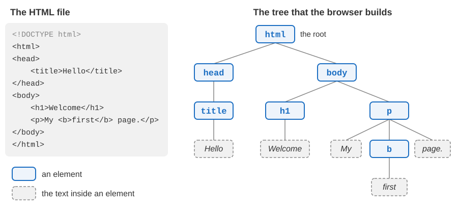
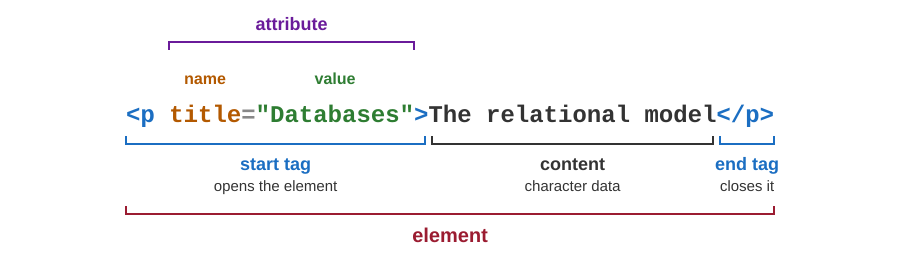
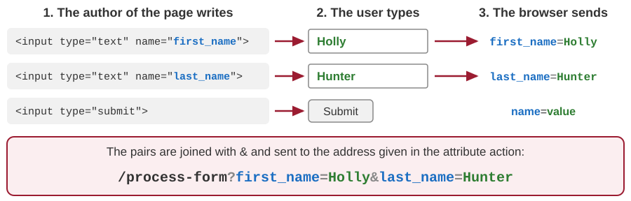

# Introduction to HTML

Developing Software Solutions

---

## What is HTML?

- HTML stands for **HyperText Markup Language**. It is the language in which web pages are written.
- **Hypertext** is text with links that lead to other texts.
- A **markup language** adds marks to a text. The marks say what each part of the text is: a heading, a paragraph, a list, a link ... In HTML the marks are called **tags**.
- An HTML page is a plain text file. The browser reads it and shows the content in the way the tags say. The tags themselves are not shown.
- HTML describes the content of a page and its structure. The look of the page is the job of CSS - the next lecture.

---

## Look at the HTML of any page

**View page source** - right click on the page, or `Ctrl+U`:

- the HTML exactly as the server has sent it.

**Developer tools** - right click on a part of the page and choose *Inspect*, or press `F12`:

- the panel *Elements* shows the HTML as the browser has understood it, element inside element;
- pointing at an element in that panel marks it on the page;
- the HTML can be changed on the spot, to try something out. The change exists only in our browser, until the page is reloaded.

Every page on the web can be examined in this way.

Note:
On a Mac: Cmd+Option+U (Chrome, Safari) or Cmd+U (Firefox) shows the source, Cmd+Option+I opens the developer tools. In Firefox the panel is called Inspector.

---

## How we work in this course

- We write HTML in a **text editor**, for example Visual Studio Code. A word processor such as Word is not suitable, because it does not save plain text.
- A page is a file with the extension **`.html`**.
- We open the pages through the local web server of the samples:

```text
cd teaching-samples/01-html-css-bootstrap
python main.py
```

- At `http://localhost:8000` the server lists the folders with the samples. A click on a file opens the page.
- After a change: save the file, then reload the page in the browser.
- Do not open the files by a double click: the forms of a page that is opened from the disk do not reach the server.

---

## The skeleton of a page

```html
<!DOCTYPE html>
<html>
<head>
    <title>Hello</title>
</head>
<body>
    <h1>Welcome</h1>
    <p>My <b>first</b> page.</p>
</body>
</html>
```

- `<!DOCTYPE html>` - "this document is written in HTML".
- `<html>` - the whole document. It always has two parts:
  - `<head>` - information about the page; it is not shown in the window;
  - `<body>` - the content that is shown in the window.

Sample: `01-html/01-basic-elements/01-skeleton.html`

---

## A document is a tree



`<body>` is the **parent** of `<h1>` and `<p>`, and they are its **children**.

---

## A very short history of HTML

| Year | Event |
|---|---|
| 1990 | Tim Berners-Lee, at CERN, writes the first web browser and web server - and the first HTML |
| 1997 | HTML 3.2 and HTML 4: standards of the W3C (World Wide Web Consortium) |
| 2004 | People from Apple, Mozilla and Opera start the WHATWG, a group that continues to develop HTML |
| 2014 | HTML5 becomes a W3C standard: audio, video, new kinds of form fields |
| 2019 | W3C and WHATWG agree on a single HTML: the **HTML Living Standard** |

- A *living standard* has no version numbers: it is corrected and extended all the time.
- So today the language is called simply HTML, and browsers follow one common standard.

Note:
HTML 4.01 followed in December 1999. HTML5 became a W3C Recommendation on 28 October 2014. The agreement between the W3C and the WHATWG was signed on 28 May 2019. The living standard is published at html.spec.whatwg.org.

---

## The doctype

```html
<!DOCTYPE html>
```

- The first line of every HTML document.
- It tells the browser that the page follows the current standard.
- Without it, browsers switch to *quirks mode*: they imitate the mistakes of browsers from the 1990s, and the page may look different from what we expect.
- It is a declaration, not an element: it has no end tag and no content.
- Before HTML5 the doctype was long and hard to remember:

```html
<!DOCTYPE HTML PUBLIC "-//W3C//DTD HTML 4.01//EN" "http://www.w3.org/TR/html4/strict.dtd">
```

---

## Elements and tags



- A **tag** is the name of an element between `<` and `>`. The end tag has a slash before the name.
- Start tag + content + end tag = one **element**. The content can be plain text (*character data*), other elements, or both.

---

## Nested and empty elements

An element can contain other elements - they are **nested** in it. The element that was opened last is closed first:

```html
<p>My <b>first page.</b></p>        <!-- correct -->
<p>My <b>first page.</p></b>        <!-- wrong: the two elements overlap -->
```

An **empty** element (the standard says *void* element) has no content, and therefore no end tag:

```html
<br>    <hr>        <meta charset="utf-8">
```

- Many pages, and some of our samples, write them with a slash: `<br />`. In HTML both forms are correct.

Sample: `01-html/02-text-shapes/01-bold-text.html` (the last paragraph is nested wrongly)

---

## Attributes

An **attribute** gives additional information about an element. Attributes are written in the start tag, as `name="value"`, separated by spaces.

```html
<a href="https://www.ekof.bg.ac.rs/">Faculty of Economics</a>

```

`href` and `src` exist only on particular elements. These four can be used on every element:

| Attribute | Meaning |
|---|---|
| `id` | a unique name of the element within the page |
| `class` | one or more class names; they connect the element with the rules of CSS |
| `style` | CSS rules for this one element |
| `title` | an additional description, shown when the pointer rests on the element |

Sample: `01-html/01-basic-elements/06-title-of-paragraph.html`

---

## Good habits

The browser does not report mistakes in HTML. It guesses what we meant and shows what it can - so a mistake easily stays unnoticed.

- Close every element that has an end tag: `<p>...</p>`, `<li>...</li>`.
- Write the names of tags and attributes in **lower case**. `<P>` means the same as `<p>`, but lower case is the custom.
- Put the values of attributes in double quotes: `class="intro"`.
- Indent nested elements, so that the structure is visible. In Visual Studio Code the command *Format Document* does it for us.
- Check the page with a validator, for example `validator.w3.org`.

---

## The head of the document

```html
<head>
    <meta charset="utf-8">
    <meta name="viewport" content="width=device-width, initial-scale=1">
    <title>Meta data and title</title>
</head>
```

- `<title>` - the title of the page. It is shown on the tab of the browser, in bookmarks and in the results of search engines.
- `<meta charset="utf-8">` - tells the browser that the file is stored in the UTF-8 encoding. Then the letters of all alphabets are shown correctly: š, ђ, ü ...
- `<meta name="viewport" ...>` - a phone shows the page in the real width of its screen, and not as a reduced picture of a wide page. Bootstrap needs it.

Sample: `01-html/01-basic-elements/02-paragraph-metadata-title.html`

---

## Headings

```html
<h1>Developing Software Solutions</h1>
<h2>Web pages</h2>
<h3>HTML</h3>
<h3>CSS</h3>
<h2>Programming</h2>
```

- Six levels: `<h1>` is the most important heading, `<h6>` the least important.
- Headings show the structure of a document, like the titles of chapters and sections in a book.
- The browser shows them in bold letters of different sizes, with empty space above and below.
- Choose the level by the meaning, not by the size of the letters. The size can be changed with CSS.

Sample: `01-html/01-basic-elements/04-headers.html`

---

## Paragraphs and line breaks

In the HTML file, any number of spaces and new lines counts as **one space**. The browser breaks the lines by itself, at the edge of the window.

```html
<p>This paragraph is written in three
   lines of the file, but the browser
   shows it as one flowing text.</p>
<p>This paragraph<br>has exactly one line break.</p>
<hr>
```

- `<p>` - a paragraph; the browser leaves empty space above and below it.
- `<br>` - a line break inside a paragraph.
- `<hr>` - a horizontal rule: a line across the page that separates two topics.

Sample: `01-html/01-basic-elements/07-paragraph-break.html`

Sample: `01-html/01-basic-elements/05-horisontal-rules-char-entities.html`

---

## Preformatted text

```html
<pre>
Coffee       150
Tea          120
Milk          90
</pre>
```

- Inside `<pre>` the spaces and the new lines are kept exactly as they are written.
- All characters have the same width, so the columns stay aligned.
- It is used for program code and for the output of programs. Our Python pages will show the output of a program in a `<pre>` element.

Sample: `01-html/01-basic-elements/08-preformated-text.html`

---

## Comments

```html
<!-- This is a comment -->
<p>This is a paragraph.</p>
<!--
<p>This paragraph is switched off for now.</p>
-->
```

- A comment starts with `<!--` and ends with `-->`. It may take several lines.
- The browser does not show comments.
- They are notes for the people who read the HTML, or a way to switch off a part of the page for a while.
- A comment is not a secret: everybody can read it with *View page source*.

Sample: `01-html/01-basic-elements/03-comments.html`

---

## Character entities

The characters `<`, `>` and `&` have a special meaning in HTML. To show them as text, we write an **entity**: `&`, a name, and `;`.

| Entity | Shown as | Remark |
|---|---|---|
| `&lt;` | `<` | "less than" |
| `&gt;` | `>` | "greater than" |
| `&amp;` | `&` | ampersand |
| `&quot;` | `"` | double quote; needed inside the value of an attribute |
| `&nbsp;` | a space | non-breaking space: the line is never broken at it |
| `&copy;` | © | a character that is not on the keyboard |

```html
<p>Element &lt;hr&gt; represents a horizontal rule.</p>
```

Sample: `01-html/01-basic-elements/05-horisontal-rules-char-entities.html`

---

## Bold and italic text

```html
<p>The <b>keywords</b> of this text are bold.</p>
<p><strong>Warning:</strong> the changes cannot be undone.</p>
<p>The Latin name of the wolf is <i>Canis lupus</i>.</p>
<p>You <em>must</em> save the file before you reload the page.</p>
```

| Element | Shown | Meaning |
|---|---|---|
| `<b>` | bold | draws attention to a part of the text |
| `<strong>` | bold | the content is important, serious or urgent |
| `<i>` | italic | a different kind of text: a term, a foreign phrase, a name |
| `<em>` | italic | emphasis - the word that is stressed in speech |

`<b>` and `<strong>` look the same, and so do `<i>` and `<em>`. The difference is in what they say about the text.

Samples: `01-html/02-text-shapes/` - the files 01 to 04

---

## More elements for text

| Element | Meaning | Shown |
|---|---|---|
| `<mark>` | marked text | yellow background |
| `<del>` | deleted text | crossed out |
| `<ins>` | inserted text | underlined |
| `<sub>` | subscript (index) | lowered and smaller |
| `<sup>` | superscript (exponent) | raised and smaller |
| `<kbd>` | what the user types on the keyboard | fixed-width font |
| `<samp>` | sample output of a program | fixed-width font |
| `<code>` | a piece of program code | fixed-width font |

```html
<p>My favourite colour is <del>blue</del> <ins>red</ins>. Water is H<sub>2</sub>O.</p>
```

Samples: `01-html/02-text-shapes/` - the files 05 to 08

---

## Unordered and ordered lists

```html
<ul>
    <li>Coffee</li>
    <li>Tea</li>
</ul>
<ol type="A">
    <li>Coffee</li>
    <li>Tea</li>
</ol>
```

- `<ul>` - an unordered list: every item gets a bullet.
- `<ol>` - an ordered list: the browser numbers the items by itself.
- `<li>` - one item of a list.
- The attribute `type` of `<ol>` chooses the kind of numbers: `1` (the usual), `a`, `A`, `i`, `I`.

Samples: `01-html/01-basic-elements/` - the files 10 to 12

---

## Description lists and nested lists

```html
<dl>
    <dt>Coffee</dt>
    <dd>a drink made from roasted beans</dd>
</dl>
<ul>
    <li>Tea
        <ol>
            <li>Black tea</li>
            <li>Green tea</li>
        </ol>
    </li>
</ul>
```

- `<dl>` - a description list: a term (`<dt>`) is followed by its description (`<dd>`).
- A **nested** list is written inside an item (`<li>`) of the outer list.

Sample: `01-html/01-basic-elements/13-definition-list.html`

Sample: `01-html/01-basic-elements/14-nested-lists.html`

---

## Images

```html

```

- `` is an empty element: everything is said by its attributes.
- `src` - the address of the image file. The image is not a part of the HTML file: the browser asks for it with a separate request.
- `alt` - a text that replaces the image when it cannot be shown. It is also read aloud to people who cannot see the image. Always write it.
- `width`, `height` - the size on the screen, in pixels. Without them the image has its own size. If they do not keep the proportions of the original, the image is distorted.

Sample: `01-html/03-images/01-element-img/index.html`

Sample: `01-html/03-images/02-img-atributes-alt-width-height/index.html`

---

## Where is the image file?

`src` is an address. A **relative** address starts from the folder of the page itself:

```html
     <!-- in the same folder as the page -->
      <!-- in the sub-folder images -->
       <!-- one folder up -->
```

- Folders are separated by `/`; two dots mean "the parent folder".
- Write the names exactly: on most servers `Lake.jpg` and `lake.jpg` are two different files.
- If the file is not found, the browser shows the `alt` text, usually with a small icon of a broken image.

Sample: `01-html/03-images/03-img-out-of-current-dir/index.html`

Sample: `01-html/03-images/04-img-broken/index.html`

---

## Images from other sites

```html

```

The address in `src` can lead to another site. It works, but it is a bad idea:

- the image is not ours - its owner can remove it, move it or replace it at any time, and then our page is broken;
- every visit to our page makes work for the server of the other site;
- we usually have no right to use the image.

It is better to copy the image into the folder of our own site - if we are allowed to use it - and to use a relative address.

Sample: `01-html/03-images/05-img-from-outer-world/index.html`

Note:
The sample takes two images from the site of the faculty. If they are not shown any more, the sample demonstrates exactly this problem.

---

## Links

```html
<a href="https://www.ekof.bg.ac.rs/">Link to the Faculty of Economics</a>
<a href="index2.html">Faculty logo</a>
<a href="http://www.matf.bg.ac.rs/" target="_blank">Link to the Faculty of Mathematics</a>
```

- `<a>` (*anchor*) makes a link. `href` is the address to which the link leads.
- An **absolute** address starts with `http://` or `https://`. It is needed for other sites.
- A **relative** address starts from the folder of the current page, in the same way as for images. We use it within our own site.
- An address like `www.ekof.bg.ac.rs`, without `https://`, is taken as relative - as the name of a file.
- `target="_blank"` opens the page in a new tab.

Sample: `01-html/04-links/01-links-with-absolute-address/index.html`

Sample: `01-html/04-links/02-links-attribute-target/index.html`

---

## Links inside a page

```html
<a href="#page_middle">Go to middle of the page</a>
...

```

- The destination is an element with an `id`. The link ends with `#` and that id - the *fragment* of the address.
- From another page: `<a href="index1.html#page_middle">`.
- The id must be written in the link exactly as in the element.

An image can be a link too - it is placed inside the `<a>` element:

```html
<a href="http://www.math.rs"></a>
```

Sample: `01-html/04-links/03-links-with-relative-address/index1.html`

Sample: `01-html/04-links/04-img-as-link/index.html`

Note:
To demonstrate the third bullet, change the id page_end in index1.html to page-end: the link "Go to end of the page" then does nothing, and the browser reports no error.

---

## Tables

```html
<table border="1">
    <caption>Results of the test</caption>
    <tr> <th>First name</th> <th>Last name</th> <th>Points</th> </tr>
    <tr> <td>John</td> <td>Malkovich</td> <td>84</td> </tr>
    <tr> <td>Robert</td> <td>De Niro</td> <td>94</td> </tr>
</table>
```

- `<table>` - the table; `<tr>` - a row; `<td>` - a cell with data; `<th>` - a heading cell, shown bold and centred.
- `<caption>` - the title of the table.
- `border="1"` draws lines around the table and its cells. It is an old attribute: today borders are drawn with CSS.

Samples: `01-html/05-tables/01-simpe-table.html`, `02-table-headings.html`

---

## Merged cells

```html
<table border="1">
    <tr> <th>Name</th> <th colspan="2">Phone</th> </tr>
    <tr> <td>John Malkovich</td> <td>555 77 854</td> <td>555 77 855</td> </tr>
</table>
<table border="1">
    <tr> <th>Name:</th> <td>John Malkovich</td> </tr>
    <tr> <th rowspan="2">Phone:</th> <td>555 77 854</td> </tr>
    <tr> <td>555 77 855</td> </tr>
</table>
```

- `colspan="2"` - the cell spreads over two columns.
- `rowspan="2"` - the cell spreads over two rows; the next row has one cell less.
- A cell can hold anything: text, an image, a link, a form field. Later we use tables to line up the fields of a form.

Sample: `01-html/05-tables/03-table-merge-cells-h.html`

Sample: `01-html/05-tables/04-table-merge-cells-v.html`

---

## Block and inline elements

- A **block** element starts on a new line and takes the whole available width: `<h1>`, `<p>`, `<ul>`, `<pre>`, `<form>`, `<div>`.
- An **inline** element stays in the line of the text and is only as wide as its content: `<a>`, `<b>`, `<em>`, ``, `<span>`.

`<div>` (block) and `<span>` (inline) have no meaning of their own. They only group a part of the page, so that CSS can give it a look:

```html
<div style="background-color:black; color:white">
    <h2>Block-level elements</h2>
    <p>An inline element <span style="color:red">does not</span> start on a new line.</p>
</div>
```

Sample: `02-css/01-style-in-element/07-elem-style-block.html`

Sample: `02-css/01-style-in-element/08-elem-style-inline.html`

---

## Forms

A **form** collects values from the user and sends them to the server. Later in the course, all communication between the user and our Python programs goes through forms.

```html
<form action="/process-form" method="get">
    First name: <input type="text" name="first_name">
    Last name: <input type="text" name="last_name">
    <input type="submit">
</form>
```

- `<form>` is not visible by itself. It groups the fields that are sent together.
- `action` - the address to which the values are sent.
- `method` - the way in which they are sent: `get` or `post`.
- `<input type="text">` - a field for one line of text.
- `<input type="submit">` - the button that sends the form.

Sample: `01-html/06-forms/01-form-text-submit.html`

---

## Every field has a name



- The server receives pairs **name=value**. A field without the attribute `name` is not sent at all.
- The attribute `value` sets what a field contains when the page opens.

---

## The address /process-form

In the samples, every form is sent to `/process-form`. This is an address of our local Python server (`main.py`). It does nothing with the values - it only shows what it has received:

- the HTTP method (`GET` or `POST`) and the complete address of the request;
- a table of the names and values that came **in the address** (the query string);
- a table of the names and values that came **in the body** of the request.

```text
http://localhost:8000/process-form?first_name=Holly&last_name=Hunter
```

Spaces and special characters are encoded in the address: `Ana Marić` travels as `Ana+Mari%C4%87`. The server decodes them.

A real application uses the values: it searches, calculates, or saves them in a database. We will write such programs in Python.

Note:
Demonstration: submit the form of 01-form-text-submit.html and show the two tables. Then change method to post in the developer tools and submit again - the values move from the first table to the second.

---

## Radio buttons and check boxes

```html
<input type="radio" name="gender" value="male" checked> Man
<input type="radio" name="gender" value="female"> Woman

<input type="checkbox" name="havebike" value="true"> I have a bike
<input type="checkbox" name="havecar" value="yes"> I have a car
```

- **Radio buttons** with the same `name` form one group: only one of them can be chosen. The server receives the `value` of the chosen button: `gender=female`.
- **Check boxes** are independent. Only the ticked boxes are sent: `havebike=true`. For a box that is not ticked, the server receives nothing.
- `checked` - the button or the box is already chosen when the page opens.

Samples: `01-html/06-forms/02-form-radio.html`, `06-form-check.html`

---

## Drop-down lists and text areas

```html
<select name="cars">
    <option value="volvo">Volvo</option>
    <option value="fiat" selected>Fiat</option>
</select>
<textarea name="message" rows="10" cols="30">The cat was playing in the garden.</textarea>
```

- `<select>` - a drop-down list. The server receives the `value` of the chosen `<option>`: `cars=fiat`.
- `selected` - the option that is chosen when the page opens. Without it, that is the first option.
- `<textarea>` - a field for a text of several lines; `rows` and `cols` give its size. The initial text is written between the tags.

Samples: `01-html/06-forms/03-form-combo.html`, `04-form-text-area.html`

---

## Buttons

```html
<input type="submit" value="Send">
<button>Send</button>
<button type="button" onclick="alert('Hello World!')">Click me!</button>
```

- `<input type="submit">` sends the form. The attribute `value` is the text on the button.
- `<button>` inside a form does the same. The text on the button is written between the tags.
- `<button type="button">` sends nothing. It only runs a script - here, one that shows a message.
- Pressing Enter in a text field also sends the form.

Sample: `01-html/06-forms/05-form-button.html`

---

## get and post

`method="get"` - the values travel **in the address**, as a query string:

```http
GET /process-form?first_name=Holly&last_name=Hunter HTTP/1.1
Host: localhost:8000
```

`method="post"` - the values travel **in the body** of the request:

```http
POST /process-form HTTP/1.1
Host: localhost:8000
Content-Type: application/x-www-form-urlencoded

first_name=Holly&last_name=Hunter
```

- `get` is for **asking**: searching, calculating. The values are in the address, so the address can be bookmarked or sent to someone.
- `post` is for **changing** data on the server, and for long texts.
- A form without the attribute `method` uses `get`.

Note:
Of the sample forms, 04-form-text-area.html and 07-form-formaction-readonly.html use post. The forms 03-form-combo.html and 06-form-check.html have no method attribute, so they use get. After a post, reloading the result page makes the browser ask whether the form should be sent again.

---

## One form, several buttons

```html
<form method="post">
    <input type="text" name="x" value="3">
    <input type="text" name="y" value="8">
    <button formaction="/process-form?operation=minimum">Minimum</button>
    <button formaction="/process-form?operation=maximum">Maximum</button>
</form>
```

- `formaction` - the address to which **this button** sends the form. It replaces the `action` of the form.
- Both buttons send the same fields, but to different addresses.
- In our Python applications every button will have an address of its own, such as `/min-max/minimum` and `/min-max/maximum`, and every address will be handled by its own function.

Sample: `01-html/06-forms/07-form-formaction-readonly.html`

---

## Read-only fields

```html
Result: <input value="8" readonly>
```

- `readonly` - the user can see and copy the content of the field, but cannot change it.
- It is an attribute without a value: its presence is enough.
- The content of the field is given by the attribute `value`.
- A read-only field that has a `name` is still sent with the form.

Our Python pages will show their results in this way: the program writes the result into the `value` of a read-only field, and sends the finished page to the browser.

Sample: `01-html/06-forms/07-form-formaction-readonly.html`

---

## Summary

- An HTML page is a text file. **Elements** (start tag, content, end tag) and their **attributes** say what each part of the content is.
- Every page has the same skeleton: the doctype, `<html>`, `<head>` and `<body>`. The elements form a **tree**.
- Text is organised by headings, paragraphs, lists and tables. Images are separate files. Links connect the pages.
- An address is **absolute** or **relative**; `#` and an `id` lead to a place inside a page.
- A **form** sends pairs `name=value` to the address in `action`: with `get` in the address, with `post` in the body of the request.
- HTML says what the content is. How it looks is the topic of the next lecture: CSS.

---

# Thanks for your attention!
