# Introduction to CSS

Developing Software Solutions

---

## What is CSS?

- CSS stands for **Cascading Style Sheets**.
- HTML describes **what** is on a page: headings, paragraphs, lists, links, tables, forms.
- CSS describes **how** all that looks: colours, fonts, sizes, spacing, the position on the page.
- A *style sheet* is a list of rules. A rule selects some elements of the page and sets their look.
- CSS is a language of its own - its syntax is different from the syntax of HTML.

Without CSS, the browser shows a page in its own plain way: black text on a white background, blue underlined links.

<div class="columns"><div>

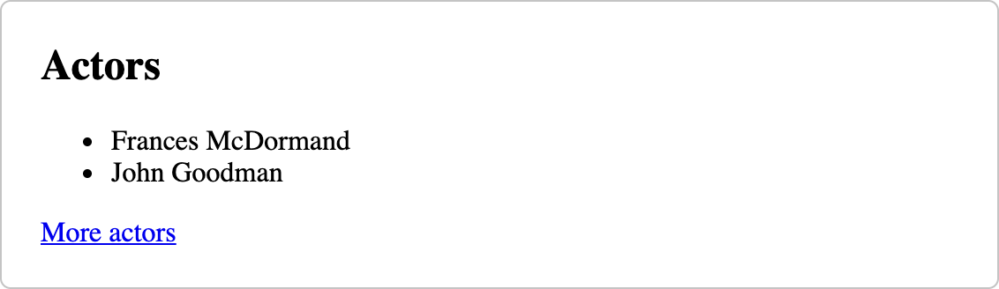

</div><div>

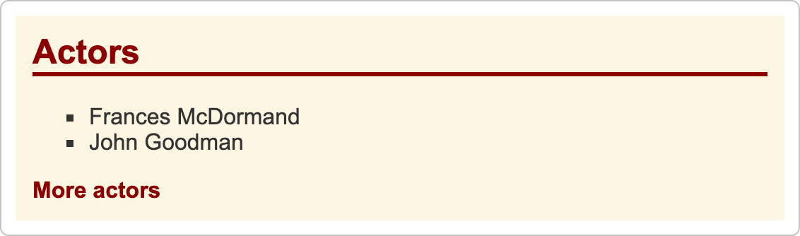

</div></div>

---

## Content and presentation are kept apart

Early HTML mixed the two. The look was written into every element:

```html
<h1><font color="darkred" face="Arial">Actors</font></h1>
<p><font color="darkgreen">The first paragraph.</font></p>
<p><font color="darkgreen">The second paragraph.</font></p>
```

Such elements and attributes are obsolete today. The look is described with CSS, because then:

- it is written in **one place** - one changed line changes all the pages of a site;
- the HTML stays short and readable: it contains only the content;
- the same content can be shown in different ways - on a wide screen, on a phone, on paper.

---

## The syntax of a rule

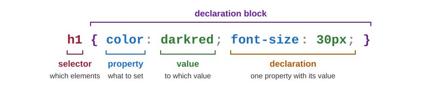

- The **selector** tells which elements the rule applies to - here, all `<h1>` elements.
- The **declaration block** is written in braces and contains any number of declarations.
- A **declaration** sets one **property** to a **value**. Its form is `property: value;`
- A rule may be written in one line or in several. Usually every declaration gets its own line.
- A comment is written between `/*` and `*/`. The browser skips it.

Note:
A declaration that the browser does not understand is ignored without any message. A typical mistake is a forgotten semicolon: then the next declaration is lost as well.

---

## Where to write styles 1: in the element

Styles can be written in three places. The first one is the `style` attribute of an element:

```html
<h2>I have no style attribute applied to me</h2>
<h2 style="color:red">I am red</h2>
<h2 style="color:#16C947">I am a kind of green, like grass</h2>
```

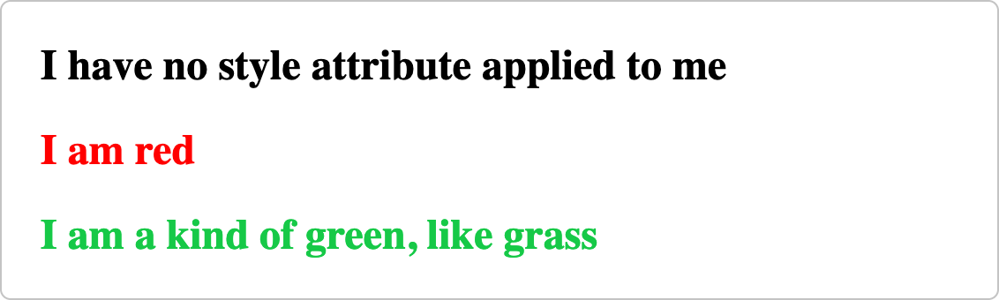

- There is no selector and there are no braces: the style applies to this one element only.
- Several declarations are separated by semicolons: `style="color:red; font-size:20px"`.
- This is called an **inline style**.

Sample: `02-css/01-style-in-element/01-elem-style-color.html`

All the samples: start the server (`python main.py`) and open `http://localhost:8000/02-css/`.

---

## Where to write styles 2: in the page

<div class="columns"><div>

```html
<head>
    <meta charset="utf-8" />
    <style>
        body {
            background-color: lightgrey;
            color: darkgreen;
        }

        h1 {
            color: darkred;
        }
    </style>
</head>
```

</div><div>

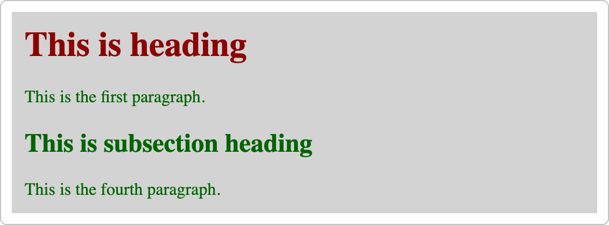

</div></div>

- The rules are written in a `<style>` element, inside the `<head>` of the page.
- A rule applies to the whole page: every `<h1>` of this page is dark red.
- Other pages do not see these rules. This is called an **internal style sheet**.

Sample: `02-css/02-style-in-document/01-style-priority.html` (its first two rules)

---

## Where to write styles 3: in a separate file

The file `my-custom-style.css` is an **external style sheet**. It contains only CSS rules, such as:

```css
h1 {
    color: #FF2200;
    font-size: 3em;
}
```

Every page that wants these rules refers to the file in its `<head>`:

```html
<link rel="stylesheet" type="text/css" href="my-custom-style.css" />
```

- `rel` says what the file is, and `href` where it is. The attribute `type` may be left out.
- `index1.html` and `index2.html` refer to the same file, so they have the same look.
- The browser fetches the file with a separate HTTP request - see the *Network* tab.

Sample: `02-css/03-external-style/01-css-file/index1.html`

---

## Which of the three?

| Place | Applies to | When to use it |
|---|---|---|
| **external** file and `<link>` | every page that refers to the file | the normal choice: the look of a whole site |
| **internal** `<style>` element | one page | something that only one page needs; small examples |
| **inline** `style` attribute | one element | rarely: a single exception, a quick experiment |

- An inline style cannot be reused, and it puts the look back into the HTML.
- Many of our samples use an internal style sheet, so that one file shows everything. On a real site, almost all the rules are in external files.
- The three can be mixed on one page. What happens when they disagree comes later in this lecture.

---

<!-- .slide: class="exercise" -->
## Exercise 1: three places for styles

Work in a folder of your own next to the samples, `wwwroot/my`, and open the pages at `http://localhost:8000/my/`.

1. Write `actors.html`: a heading `<h1>Actors</h1>` and two paragraphs with names of actors.
2. Make the first paragraph dark red with an **inline style**.
3. Add an **internal style sheet**: a light yellow background for `<body>`, and a dark green `<h1>`.
4. Move the rule for `<h1>` into a new file `actors.css`, and link that file to the page.

Check: after step 4 the heading is still dark green, and the *Network* tab shows a request for `actors.css`. *About 10 minutes.*

<details><summary>Solution</summary>

```html
<!DOCTYPE html>
<html>
<head>
    <title>Actors</title>
    <link rel="stylesheet" href="actors.css">
    <style>
        body { background-color: lightyellow; }
    </style>
</head>
<body>
    <h1>Actors</h1>
    <p style="color: darkred">Frances McDormand</p>
    <p>John Goodman</p>
</body>
</html>
```

The file `actors.css` contains one rule: `h1 { color: darkgreen; }`

- `href="actors.css"` is a relative address: the file is in the same folder as the page.

</details>

Note:
A typical mistake: the file is saved as actors.css.txt, or the link is written in the body. The Network tab then shows 404 for actors.css, or no request at all.

---

## Selectors: element, id, class

```css
p          { color: rgb(170, 84, 141); }                 /* all <p> elements                */
#dark-one  { color: black; }                             /* the element with id="dark-one"  */
.important { color: black; background-color: yellow; }   /* elements with class="important" */
```

<div class="columns"><div>

```html
<p>This is the second paragraph.</p>
<p id="dark-one">This is the third paragraph.</p>
<p class="important">This is the fourth paragraph.</p>
```

</div><div>

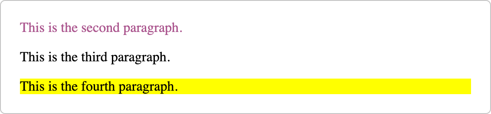

</div></div>

- **Element selector**: the name of the tag. It selects all the elements of that kind.
- **Id selector**: `#` and the `id` of an element. An id must be unique in a page.
- **Class selector**: `.` and the name of a class. Many elements may have the same class, and one element may have several classes: `class="important info"`.

Sample: `02-css/02-style-in-document/02-style-id.html`

Sample: `02-css/02-style-in-document/03-style-class.html`

---

## Combining selectors

### An element with a class

```css
.info  { color: aqua; }
p.info { color: darkcyan; }
```

- `p.info` selects only the `<p>` elements that have the class `info`.
- On the second page of the sample, the heading and the `<span>` with the class `info` are aqua. The paragraph with that class is dark cyan.

### A group of selectors

```css
table, th, td { border: 1px solid black; }
```

- The comma means "and": one block of declarations for all `<table>`, `<th>` and `<td>` elements. This rule draws the lines of a table, like the old attribute `border="1"`.

Sample: `02-css/03-external-style/01-css-file/index2.html`

Note:
`p.info` must be written without a space. `p .info` is a different selector: an element with the class info that is inside a paragraph. The rule for the table is not in the samples; try it in a table of the previous lecture. With border-collapse: collapse for the table, the double lines become single ones.

---

## The pseudo-class :hover

<div class="columns"><div>

```css
a {
    border: 1px double red;
    text-decoration: none;
    margin: 10px;
    padding: 10px;
    display: inline-block;
}

a:hover {
    text-decoration: underline
}
```

</div><div>

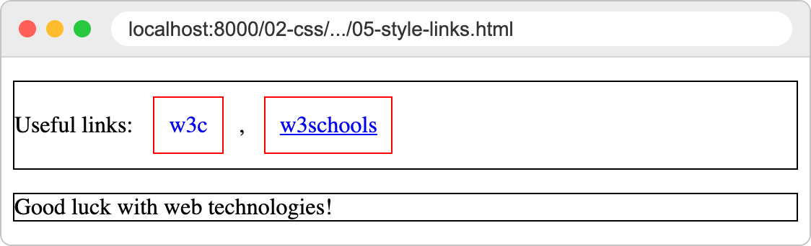

</div></div>

- A **pseudo-class** is written with a colon. Most often it selects an element by its state.
- `a:hover` selects a link only while the mouse pointer is over it. In the sample the links are not underlined; the line appears when the pointer comes over a link.
- `:hover` works with every element, not only with links.

Sample: `02-css/02-style-in-document/05-style-links.html`

Note:
The last declaration of a block may be written without a semicolon, as in the rule a:hover of the sample. It is safer to write the semicolon always.

---

## Colours and backgrounds

| Notation | Example | Meaning |
|---|---|---|
| name | `darkred` | more than 140 colours have a name |
| hexadecimal | `#FF2200` | two hexadecimal digits (`00` to `FF`) each for red, green and blue |
| `rgb()` | `rgb(170, 42, 141)` | the same three amounts as decimal numbers from 0 to 255 |

- `red`, `#FF0000` and `rgb(255, 0, 0)` are three ways to write the same colour.
- `color` sets the colour of the text, and `background-color` the colour behind it.
- A background colour of `<body>` covers the whole page.
- By default the background of an element is transparent: its parent shows through.

Sample: `02-css/01-style-in-element/01-elem-style-color.html`

Sample: `02-css/01-style-in-element/02-elem-style-background.html`

Note:
The last paragraph of 02-elem-style-background.html has the declaration "font-family: ;Helvetica". It is not valid, so the browser ignores it and the paragraph keeps the font of the body. A good moment to show that CSS reports no errors.

---

<!-- .slide: class="exercise" -->
## Exercise 2: selectors and colours

<div class="columns"><div>

Copy this into the `<body>` of a new page `films.html` in your folder `my`:

```html
<h1>Films</h1>
<p class="note">Films by the Coen brothers.</p>
<ul>
    <li id="best">Fargo</li>
    <li class="note">The Big Lebowski</li>
    <li>Raising Arizona</li>
</ul>
<p>More at <a href="https://www.imdb.com">IMDb</a>.</p>
```

*About 10 minutes.*

</div><div>

Write an internal style sheet, so that:

1. the heading is dark red - write the colour with `rgb()`;
2. everything with the class `note` is grey, `#808080`;
3. only the *list item* with the class `note` has a light grey background;
4. the item `best` has a yellow background;
5. the link is underlined only while the mouse is over it.

</div></div>

<details><summary>Solution</summary>

```css
h1      { color: rgb(139, 0, 0); }      /* darkred */
.note   { color: #808080; }
li.note { background-color: lightgrey; }
#best   { background-color: yellow; }
a       { text-decoration: none; }
a:hover { text-decoration: underline; }
```

- `li.note` - an element and a class, without a space: the paragraph with the class `note` stays without a background.
- `#best` selects by the `id`, `.note` by the class.

</details>

---

## Fonts

<div class="columns"><div>

```css
body {
    font-family: Arial, sans-serif;
    color: rgb(17, 14, 14);
}
```

</div><div>


</div></div>

- `font-family` is a list of fonts in the order of preference. The browser uses the first one that it finds on the computer of the visitor.
- We do not know which fonts a visitor has. Therefore the list ends with a **generic family**: `serif`, `sans-serif` or `monospace`. The browser always has a font for these.
- A name that contains spaces is written in quotes: `'Times New Roman'`.
- `font-weight: bold` and `font-style: italic` make the text bold or italic.

Sample: `02-css/01-style-in-element/03-elem-style-font.html`

Sample: `02-css/02-style-in-document/07-styles-text-tag.html`

---

## The size of the text

```css
div { font-size: 20px; }      /* the parent of the four elements below           */

.a  { font-size: 24px; }      /* 24px - a fixed size                             */
.b  { font-size: 1.5em; }     /* 30px - 1.5 times the font size of the parent    */
.c  { font-size: 150%; }      /* 30px - 150% of the font size of the parent      */
.d  { font-size: 1.5rem; }    /* 24px - 1.5 times the font size of <html>: 16px  */
```

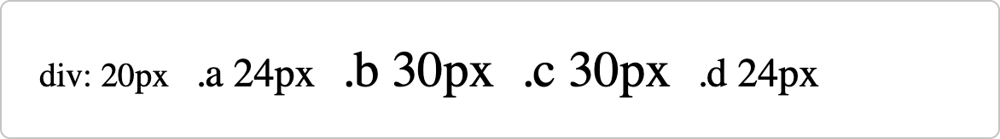

- `px` is an absolute unit. `em`, `%` and `rem` are **relative** units.
- If nothing sets it, the font size of a page is 16px - or what the user has chosen in the settings of the browser. Relative units respect that choice.
- In other properties, such as `padding: 2em`, one `em` is the font size of the element itself.

Sample: `02-css/02-style-in-document/06-style-text-rel.html` - `300%` gives 48px

Sample: `02-css/02-style-in-document/07-styles-text-tag.html` - `2em` gives 32px

---

## Styling text

| Property | Some values | Effect |
|---|---|---|
| `text-align` | `left`, `right`, `center`, `justify` | how the lines are aligned inside a block element |
| `text-decoration` | `underline`, `line-through`, `none` | a line under or through the text; `none` removes it |
| `text-transform` | `uppercase`, `lowercase`, `capitalize` | changes the letters on the screen, not in the HTML |

- With `text-transform: capitalize`, the heading "Text styling" is shown as "Text Styling".
- The same sample styles `<mickey>`, an element that HTML does not know. The browser treats it as an inline element, and CSS can select it by its name. In real pages, use a `<span>` with a class.

Sample: `02-css/01-style-in-element/04-elem-style-allign.html`

Sample: `02-css/02-style-in-document/07-styles-text-tag.html`

---

## Styling lists

<div class="columns"><div>

```html
<ul style="list-style-type:square">
    <li>Coffee</li>
    <li>Tea</li>
    <li>Milk</li>
</ul>
```

</div><div>

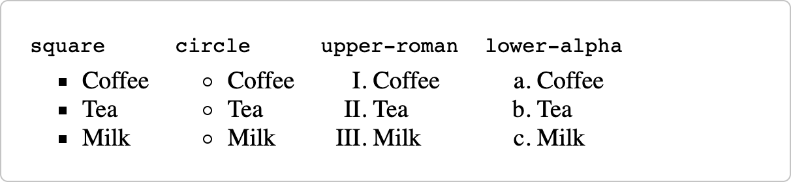

</div></div>

| List | Values of `list-style-type` |
|---|---|
| `<ul>` | `disc` (the default), `circle`, `square`, `none` |
| `<ol>` | `decimal` (the default), `decimal-leading-zero`, `upper-roman`, `lower-alpha` ... |

- The property is set for the list, and it applies to all its items.
- `none` removes the markers. The menus of web sites are often lists without markers.

Sample: `02-css/01-style-in-element/05-elem-style-ul.html`

Sample: `02-css/01-style-in-element/06-elem-style-ol.html`

---

## Block and inline elements

- A **block** element starts on a new line and takes all the available width: `<div>`, `<p>`.
- An **inline** element stays in the line and is only as wide as its content: `<span>`, `<a>`.

The property `display` changes this behaviour:

| Value of `display` | The element ... |
|---|---|
| `block` | behaves as a block element |
| `inline` | behaves as an inline element |
| `inline-block` | stays in the line, but has its own width, height, padding and margin |
| `none` | is not shown at all, and takes no space |

Sample: `02-css/01-style-in-element/07-elem-style-block.html`

Sample: `02-css/01-style-in-element/08-elem-style-inline.html`

Note:
The links of 05-style-links.html have display: inline-block. Change it to inline in the developer tools: the line no longer makes room for the padding and the border of the links, so they are drawn over the border of the paragraph.

---

## The box model

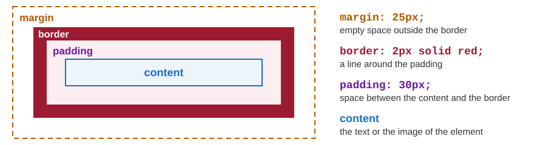

- The browser draws every element as a rectangular **box**: content, padding, border, margin.
- The background fills the content and the padding. The margin is always transparent.
- Each side can be set on its own: `margin-top`, `padding-left`, `border-bottom` ...

Sample: `02-css/02-style-in-document/08-style-block-elem.html`

Note:
The paragraphs of the sample are 25px apart, not 50px: the vertical margins of neighbouring blocks overlap ("collapse"). The properties width and height set the size of the content only, unless box-sizing: border-box is used - Bootstrap does that for all elements.

---

<!-- .slide: class="exercise" -->
## Exercise 3: a menu of boxes

<div class="columns"><div>

A page `menu.html` in your folder `my`:

```html
<h1>Vanity Fair</h1>
<ul>
    <li><a href="#">Actors</a></li>
    <li><a href="#">Films</a></li>
    <li><a href="#">Directors</a></li>
</ul>
```

Check: three boxes in one line; each one turns dark red under the mouse. Then give the links `display: block` - what happens? *About 15 minutes.*

</div><div>

1. The whole page in Arial, or else in any sans-serif font.
2. The heading centred, and in capital letters - but not in the HTML.
3. The list without markers, its items `inline`.
4. The links `inline-block`, bold, without the underline, with a padding of 10px, a margin of 4px and a 2px solid dark red border.
5. Under the mouse, a link gets a dark red background and white text.

</div></div>

<details><summary>Solution</summary>

```css
body    { font-family: Arial, sans-serif; }
h1      { text-align: center; text-transform: uppercase; }
ul      { list-style-type: none; }
li      { display: inline; }
a {
    display: inline-block;
    font-weight: bold;
    text-decoration: none;
    padding: 10px;
    margin: 4px;
    border: 2px solid darkred;
}
a:hover { background-color: darkred; color: white; }
```

- With `display: block` every link takes a line of its own and the full width - a vertical menu.

</details>

Note:
Without display: inline-block the padding of the links overlaps the lines above and below, as the note of the slide Block and inline elements shows.

---

## Several rules for one element

```html
<style>
    body { color: darkgreen; }
    p    { color: rgb(170, 42, 141); }
</style>
...
<p style="color:black">This is the third paragraph.</p>      <!-- which colour? -->
```

The browser decides by fixed rules, called the **cascade** - for every property separately:

1. **Specificity** - the declaration with the more specific selector wins.
2. **Order** - among equally specific declarations, the one that is written later wins.
3. **Inheritance** - if no rule sets a property of the text, its value comes from the parent element.

The paragraph is black: nothing is more specific than an inline style.

Sample: `02-css/02-style-in-document/01-style-priority.html`

---

## The cascade at work

Three declarations want to set the `color` of the third paragraph:


---

## Specificity

| Strength | Where the declaration is written | Example |
|---|---|---|
| 1 (strongest) | in the `style` attribute of the element | `<p style="color:black">` |
| 2 | in a rule with an id selector | `#dark-one` |
| 3 | in a rule with a class selector or a pseudo-class | `.important`, `a:hover` |
| 4 (weakest) | in a rule with an element selector | `p` |

- In combined selectors, first the ids are compared, then the classes, then the elements. So `h2.important` wins over `.important`: the heading of the sample is orange, not red.
- Every property has its own winner: the heading still gets `color: black` from `.important`.
- The built-in rules of the browser - big headings, blue links - are weaker than any rule of ours.

Sample: `02-css/02-style-in-document/04-style-class-priority.html`

Note:
A declaration that ends with !important wins over all normal declarations. The utility classes of Bootstrap use it, for example .text-center { text-align: center !important; }. In our own style sheets it should stay an exception.

---

## Order: the later rule wins

```html
<link rel="stylesheet" type="text/css" href="my-style.css" />

<style>
    p {
        background-color: yellow;
    }
</style>
```

The linked file says: `p { background-color: darkgrey; color: darkgreen; }`

- Both rules have the selector `p`, so they are equally specific. The `<style>` element comes after the `<link>` element, so its rule wins: the paragraphs are yellow.
- An internal style sheet is not stronger than an external one. Only the order counts.
- The text stays dark green, because no other rule sets `color`.

Sample: `02-css/03-external-style/02-style-priority/index.html`

Note:
Demonstration: move the style element above the link element and reload. The first and the third paragraph turn dark grey. The second paragraph keeps its colour (lightsalmon) in both cases, because it has an inline style. Practical consequence: our own style sheet is linked after the style sheet of a framework such as Bootstrap, so that our rules win.

---

## Inheritance

The sample sets the colour of the text once, in the rule for `<body>`: `color: darkgreen;`

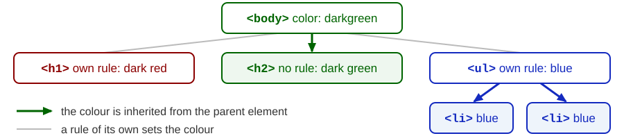

- Most properties of text are inherited: `color`, `font-family`, `font-size`, `text-align`.
- Properties of the box are not: `margin`, `padding`, `border`, `background-color`, `width`.
- A rule that selects the element itself always wins over an inherited value.
- Therefore the font and the colour of the text are set only once, for `<body>`.

Sample: `02-css/02-style-in-document/01-style-priority.html`

---

<!-- .slide: class="exercise" -->
## Exercise 4: which colour?

<div class="columns"><div>

```html
<style>
    body     { color: navy; }
    p        { color: green; }
    .warning { color: red; }
    #first   { color: orange; }
    p        { color: purple; }
</style>
...
<p id="first" class="warning">One</p>
<p class="warning">Two</p>
<p>Three <b>and four</b></p>
<h2>Five</h2>
<p class="warning" style="color: black">Six</p>
```

</div><div>

1. Without a browser: write down the colour of *One*, *Two*, *Three*, *and four*, *Five* and *Six*, and the reason for each.
2. Then make the page `colours.html` and check your answers.

*About 10 minutes.*

</div></div>

<details><summary>Solution</summary>

| Text | Colour | Why |
|---|---|---|
| One | orange | the id is more specific than the class and the element |
| Two | red | the class is more specific than the element `p` |
| Three | purple | two rules for `p` are equally specific: the later one wins |
| and four | purple | `<b>` has no rule of its own: it inherits the colour of its `<p>` |
| Five | navy | no rule selects `<h2>`: it inherits the colour of `<body>` |
| Six | black | nothing is more specific than an inline style |

</details>

Note:
The most frequent wrong answer is green for Three: the order of the two p rules decides. Five is a good question too: many expect the built-in black of the browser.

---

## Developer tools: looking at styles

1. Right-click an element of the page and choose *Inspect*. The panel *Elements* opens, and the element is selected in the tree of the page.
2. When the mouse is over an element of the tree, its box is painted on the page: content, padding and margin in different colours.
3. The pane *Styles* lists all the rules that apply to the selected element:
   - the strongest rule is at the top, and every rule shows its file and line;
   - a declaration that lost against a stronger one is crossed out;
   - a declaration that the browser does not understand has a warning sign;
   - rules marked `user agent stylesheet` are the built-in rules of the browser.
4. The pane *Computed* shows the final value of every property, and a drawing of the box.

Try it: the second paragraph of `02-css/03-external-style/02-style-priority/index.html`

Note:
The names are those of Chrome and Edge. Firefox has the same tools under slightly different names: the panel is called Inspector, and the pane with the rules is called Rules. The second paragraph of the sample shows three declarations of background-color, two of them crossed out. The warning sign is the only hint that a declaration is wrong: the last paragraph of 02-elem-style-background.html shows one.

---

## Developer tools: the pane *Styles*

The second paragraph of `02-css/03-external-style/02-style-priority/index.html` (simplified):


---

## Developer tools: trying out styles

In the pane *Styles* the page can be changed while we look at it:

- click a value and type a new one - the page changes at once;
- remove the tick in front of a declaration to switch it off;
- click into the block `element.style` to add a declaration for the selected element;
- the button `:hov` can force a state such as `:hover` on the element.

Nothing is saved: after a reload the page is as it was. Copy what works into your file.

### Try it

Open `02-css/02-style-in-document/08-style-block-elem.html` and inspect a paragraph. Change its `padding` to `5px`, switch its `border` off, and look at its box in the pane *Computed*.

---

<!-- .slide: class="exercise" -->
## Exercise 5: find the mistakes

Copy this into a page `mistakes.html` in your folder `my`:

```html
<style>
    h1      { colour: darkred; }
    .intro  { color: grey font-size: 20px; }
    #menu   { background-color: lightyellow; }
    p .info { color: green; }
</style>
...
<h1>Actors</h1>
<p class="intro">Our favourite actors.</p>
<ul class="menu"><li>Fargo</li><li>Raising Arizona</li></ul>
<p class="info">Updated today.</p>
```

None of the four rules works. Inspect the elements: what does the pane *Styles* show, or not show? Correct the four rules. *About 10 minutes.*

<details><summary>Solution</summary>

```css
h1     { color: darkred; }                  /* the property is color, not colour */
.intro { color: grey; font-size: 20px; }    /* a semicolon was missing           */
.menu  { background-color: lightyellow; }   /* the list has a class, not an id   */
p.info { color: green; }                    /* without the space                 */
```

- *Styles* shows `colour` and the colour of `.intro` with a warning sign: the browser does not understand them. Without the semicolon, `grey font-size: 20px` is one wrong value, so both declarations are lost.
- `#menu` and `p .info` are not listed at all: they select no element of the page. `p .info` means "an element with the class `info` inside a paragraph".

</details>

---

## Summary

- CSS describes the **look** of a page, HTML its content. One style sheet can serve a whole site.
- A rule is a **selector** and a block of declarations of the form `property: value;`
- Styles are written in the element (`style`), in the page (`<style>`) or - best - in a separate file.
- Selectors: element `p`, id `#dark-one`, class `.important`, combined `p.info`, state `a:hover`.
- Every element is a **box**: content, padding, border, margin.
- When rules disagree, the **cascade** decides: first specificity, then order. Properties of the text that no rule sets are inherited from the parent element.

A framework such as **Bootstrap** gives us a large ready-made style sheet: a collection of CSS classes that we only add to our elements. That is the topic of the next lecture.

---

<!-- .slide: class="exercise" -->
## Assignment: a page about a film

A page about a film you like: `film.html` and its style sheet `film.css`, in your folder `my`.

**The content** - HTML only, no `style` attributes:

- a menu of three links at the top: to Wikipedia, to IMDb, and to the facts lower on the page;
- the title of the film, and a paragraph with the year and the director;
- a table of three actors and their roles, with a header row;
- a list of three facts about the film, one of them marked with the class `highlight`;
- a footer with your name.

**The look** - all of it in `film.css`, see the next slide.

*About 40 minutes.* A solution: [exercises/01-03-css](https://github.com/kartelj/ekof_dss/tree/main/exercises/01-03-css)

---

<!-- .slide: class="exercise" -->
## Assignment: the look

1. The font and the colour of the text are set once, for `<body>`. The headings have a colour of their own.
2. The menu: links as boxes in one line, with another background under the mouse.
3. The table: single lines around the cells (`border-collapse: collapse` on the table), a grey header row, and a row that lights up under the mouse (`tr:hover`).
4. The facts: square markers; the fact with the class `highlight` on a yellow background.
5. The main part of the page in a `<div id="content">` with a light background, a border and some padding.
6. Sizes of the text in `em` or `rem`. The footer smaller, grey and centred.

Check in the developer tools: no declaration has a warning sign, and nothing is crossed out that should win.

---

# Thanks for your attention!
