# Introduction to Bootstrap

Developing Software Solutions

---

## One page, many screens

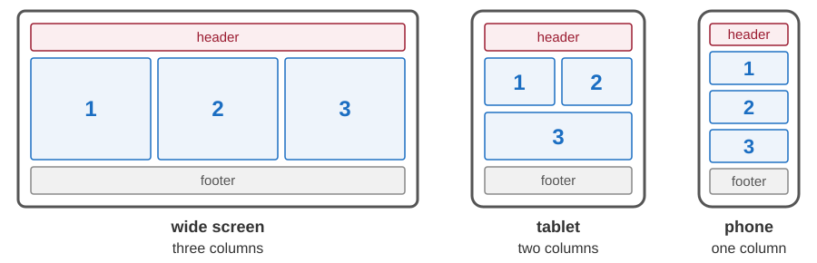

- A phone is about 400 pixels wide, a desktop monitor 1920 pixels or more.
- A **responsive** page is one HTML document whose layout adapts to the width of the screen.
- Try it: make the window narrow, or use the *device toolbar* of the developer tools (F12).

Note:
The widths are CSS pixels. A phone has many more physical pixels (for example 1080 across), but it reports a width of about 400 to the page.
In Chrome and Edge the device toolbar is the second icon in the top left corner of the developer tools; Firefox calls it Responsive Design Mode.

---

## Responsive web design

A responsive page needs three ingredients (Ethan Marcotte, 2010):

1. A **flexible grid** - the widths of the columns are given in percent, not in pixels.
2. **Flexible images** - an image is never wider than the element that contains it.
3. **Media queries** - CSS rules that apply only on some screens, for example only when the window is at least 768 pixels wide.

All three are ordinary CSS - and somebody has already written them for us.

Note:
Ethan Marcotte, a web designer, introduced the name in the article "Responsive Web Design" (A List Apart, May 2010) and described the method in a book with the same title (2011).

---

## What is a CSS framework?

A **CSS framework** is a large style sheet written by somebody else. We write very little CSS ourselves: we put its ready-made classes into our HTML.

**Bootstrap** is one of the most widely used CSS frameworks. It gives us:

- a responsive **grid** for the layout of a page,
- a ready-made look for text, images, tables and forms,
- **utility classes** for spacing, colours, borders and alignment,
- **components**: buttons, alerts, cards, navigation bars ...

Bootstrap was created at Twitter and has been free and open source since 2011. In this course we use **version 4.5.2**, in the samples and in all the applications.

Note:
Bootstrap 4.5.2 defines more than 1500 class names. Nobody knows them by heart: we look them up in the documentation and in the samples.

---

## Adding Bootstrap to a page

```html
<meta name="viewport" content="width=device-width, initial-scale=1">
<link rel="stylesheet" href="https://maxcdn.bootstrapcdn.com/bootstrap/4.5.2/css/bootstrap.min.css">
<script src="https://ajax.googleapis.com/ajax/libs/jquery/3.5.1/jquery.min.js"></script>
<script src="https://cdnjs.cloudflare.com/ajax/libs/popper.js/1.16.0/umd/popper.min.js"></script>
<script src="https://maxcdn.bootstrapcdn.com/bootstrap/4.5.2/js/bootstrap.min.js"></script>
```

- These lines go into the `<head>`. The `<link>` loads the style sheet of Bootstrap.
- The `<script>` lines load JavaScript for the components that react to clicks. Bootstrap 4 needs the libraries jQuery and Popper, and they must come before it.
- The files come from a **CDN** (*content delivery network*): servers around the world that hold copies of popular files.
- We install nothing - but the browser needs an internet connection to fetch the files.

The samples of this lecture: `http://localhost:8000/03-bootstrap/`

Sample: `03-bootstrap/02-containers/01-container.html`

Note:
The server for the samples is started with "python main.py" in the folder 01-html-css-bootstrap (the archive 01-html-css-bootstrap.zip from the course page).
The word "min" in a file name means minified: the same file without spaces and line breaks, so that it is smaller.
The alternative to a CDN is to download the files and to keep them next to our own pages.
Popper is used by the dropdown menus and the tooltips: it calculates where they appear on the page.

---

## The viewport meta element

```html
<meta name="viewport" content="width=device-width, initial-scale=1">
```

- The **viewport** is the area of the browser window in which the page is shown.
- Without this line a phone behaves as if its screen were about 980 pixels wide. It lays the page out as on a desktop and then shrinks it, so the text becomes tiny.
- `width=device-width` - use the real width of the device.
- `initial-scale=1` - show the page without zooming.
- Responsive design does not work without this line: the style sheet cannot find out that the screen is narrow.

Sample without this line: `03-bootstrap/01-basic-template/01-page-basic.html`

Sample with it: `03-bootstrap/01-basic-template/02-page-bootstrap.html`

Note:
Open both samples with the device toolbar switched on and a phone chosen. In an ordinary desktop window the two pages look the same.

---

## Containers

A **container** is the outermost box of a page. It keeps the content away from the edges.

```html
<div class="container">
    <h1>Actors</h1>
    <p>All the content of the page goes here.</p>
</div>
```

| Class | Width |
|---|---|
| `container` | changes in steps with the window: 540, 720, 960 or 1140 pixels, centred |
| `container-fluid` | always the full width of the window |

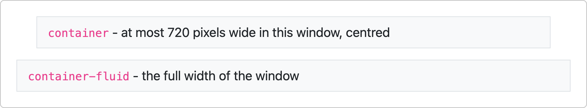

In a window narrower than 576 pixels both take the full width.

Samples: `03-bootstrap/02-containers/01-container.html`, `02-container-fluid.html`

Note:
The sample 06-container-size.html shows container-sm, container-md, container-lg and container-xl: full width below that breakpoint, and like container above it. Come back to it after the slide about breakpoints.

---

## Borders and spacing

**Utility classes** are small classes that do one thing. `border` draws a thin grey line around an element. A spacing class has three parts, for example `pt-5`:

| Part | Values |
|---|---|
| property | `p` - padding (inside the border), `m` - margin (outside the border) |
| sides | `t` top, `b` bottom, `l` left, `r` right, `x` left and right, `y` top and bottom, nothing - all four |
| size | `0` to `5` - normally 0, 4, 8, 16, 24 and 48 pixels |

```html
<div class="container border p-5 my-3">Padding on all four sides, margin above and below.</div>
<div class="container border pt-5 pl-5">Large padding at the top and on the left.</div>
```

Sample: `03-bootstrap/02-containers/03-container-border-pad.html`

Sample: `03-bootstrap/02-containers/04-container-margin.html`

---

<!-- .slide: class="exercise" -->
## Exercise 1: a page with Bootstrap

In your folder `wwwroot/my`, make the page `bootstrap.html`:

1. In the `<head>`: the viewport meta element and the `<link>` to Bootstrap - copy them from the slide *Adding Bootstrap to a page*.
2. In the `<body>`: a `container` with a heading `<h1>` and two paragraphs.
3. Give the container a border, a padding of size 3, and a margin of size 4 above it - with classes only, no CSS of your own.
4. Make the window narrower and wider: the container changes its width in steps. Then change it to `container-fluid`.

Check: in a window 800 pixels wide the container is 720 pixels wide - see the pane *Computed* of the developer tools. *About 10 minutes.*

<details><summary>Solution</summary>

```html
<!DOCTYPE html>
<html>
<head>
    <meta charset="utf-8">
    <meta name="viewport" content="width=device-width, initial-scale=1">
    <link rel="stylesheet" href="https://maxcdn.bootstrapcdn.com/bootstrap/4.5.2/css/bootstrap.min.css">
    <title>Vanity Fair</title>
</head>
<body>
    <div class="container border p-3 mt-4">
        <h1>Vanity Fair</h1>
        <p>A list of actors.</p>
        <p>Made with Bootstrap.</p>
    </div>
</body>
</html>
```

- The three `<script>` lines are not needed yet: nothing on this page reacts to clicks.
- `container-fluid` always takes the full width of the window.

</details>

---

## The grid: 12 columns

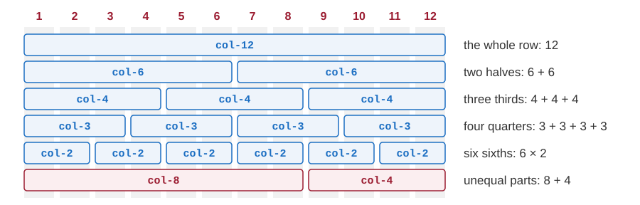

- A row is divided into **12 equal parts**. A column takes one or more of them.
- 12 can be divided by 2, 3, 4 and 6: halves, thirds, quarters and sixths are all possible.

---

## Rows and columns

<div class="columns"><div>

```html
<div class="container">
    <div class="row">
        <div class="col">one half</div>
        <div class="col">one half</div>
    </div>
    <div class="row">
        <div class="col-4">one third</div>
        <div class="col-8">two thirds</div>
    </div>
</div>
```

</div><div>

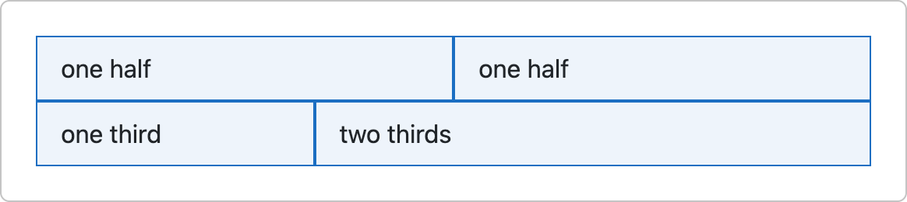

</div></div>

- A `row` goes into a container, columns go into a row, and the content goes into the columns.
- `col` - an **automatic** column: the columns of a row share its width equally.
- `col-4` - a column with a **width**: 4 of the 12 parts, one third of the row.
- If the widths add up to more than 12, the last columns move to a new line.

Samples: `03-bootstrap/03-grids/01-grid-col-auto.html`, `02-grid-col-manual.html`

Note:
In the last row of 02-grid-col-manual.html the widths add up to 11, so a part of the row stays empty.
An automatic column can be mixed with the others: next to a col-3, a col takes the remaining nine parts.
Every column has 15 pixels of padding on the left and on the right, so the contents of neighbouring columns do not touch.
Show 01-grid-col-auto.html in a wide window. An automatic column never becomes narrower than its longest word, so in a narrow window the last columns of that sample move to a new line.

---

## Breakpoints

A **breakpoint** is a width of the window at which the layout changes. Bootstrap 4 has four:

| Class | Works when the window is | Typical device |
|---|---|---|
| `col-4` | of any width | all devices, phones included |
| `col-sm-4` | 576px or wider | phones held sideways |
| `col-md-4` | 768px or wider | tablets |
| `col-lg-4` | 992px or wider | laptops and desktops |
| `col-xl-4` | 1200px or wider | large desktops |

- A class with a breakpoint works **from that width upwards**.
- Classes can be combined: `class="col-12 col-md-6 col-lg-4"` gives one, two or three columns in a line.

---

## Below the breakpoint, columns stack

```html
<div class="row">
    <div class="col-sm-4">A</div>
    <div class="col-sm-4">B</div>
    <div class="col-sm-4">C</div>
</div>
```

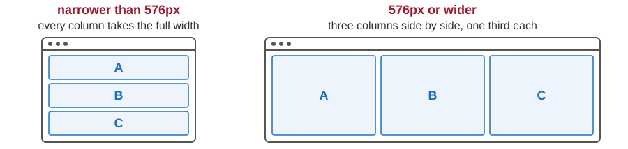

Sample: `03-bootstrap/03-grids/03-grid-col-sm-manual.html` - make the window narrow.

---

<!-- .slide: class="exercise" -->
## Exercise 2: one, two or four in a line

In the container of your page `bootstrap.html`, add a row with four columns: *Actors*, *Films*, *Directors* and *Awards*. Give every column the classes `border p-3`, so that you can see it.

1. In a window narrower than 576 pixels: one column in a line.
2. From 576 pixels: two columns in a line.
3. From 992 pixels: all four in one line.

Before you check: how many columns are in a line when the window is 800 pixels wide? And at 500 pixels?

Check with the device toolbar of the developer tools, or by making the window narrower. *About 10 minutes.*

<details><summary>Solution</summary>

```html
<div class="row">
    <div class="col-sm-6 col-lg-3 border p-3">Actors</div>
    <div class="col-sm-6 col-lg-3 border p-3">Films</div>
    <div class="col-sm-6 col-lg-3 border p-3">Directors</div>
    <div class="col-sm-6 col-lg-3 border p-3">Awards</div>
</div>
```

- At 800 pixels: two in a line - `col-sm-6` holds, `col-lg-3` not yet. At 500 pixels: one in a line.
- Below its smallest breakpoint a column takes the full width, so `col-12` is not needed - but `class="col-12 col-sm-6 col-lg-3"` is correct too.

</details>

---

## Headings and text

```html
<div class="jumbotron">
    <h1 class="display-4">Movies</h1>
    <p>Films, actors and directors.</p>
</div>
<h2>Actors <small class="text-muted">in alphabetical order</small></h2>
<p>Bootstrap can <mark>highlight</mark> a part of the text.</p>
```

- Headings `<h1>` ... `<h6>` go from 40 down to 16 pixels.
- `display-1` ... `display-4` - much larger and lighter headings, for the main titles.
- `<small>` - smaller, secondary text. `<mark>` - text on a light yellow background.
- `jumbotron` - a large grey box for the main message of a page.

Samples: `03-bootstrap/04-basic-elements/` - the files 01 to 04

Sample: `03-bootstrap/08-advanced-elements/01-jumbotrones.html`

---

## Contextual colours

| Name | Colour | Meaning |
|---|---|---|
| `primary` | blue | the most important element or action |
| `secondary` | grey | a less important one |
| `success` | green | something went well |
| `danger` | red | an error, or a dangerous action |
| `warning` | yellow | be careful |
| `info` | blue-green | neutral information |

- Text: `text-danger`. Background: `bg-danger`. There are also `light`, `dark` and `white`.
- **Contextual**: the name tells what an element *means*, not how it looks.
- The same names return in the components: `btn-danger`, `alert-danger` ...

Sample: `03-bootstrap/04-basic-elements/05-element-color.html`

Note:
Bootstrap does not choose the colour of the text for a background: a readable pair, such as bg-dark with text-white, is our job.
Colour alone must never carry the message - say it in words as well.
More samples: 02-containers/05-container-background-text.html and 06-links/01-link-color.html.

---

## Text and colours in the browser

<div class="columns"><div>

The code of the slide *Headings and text*:

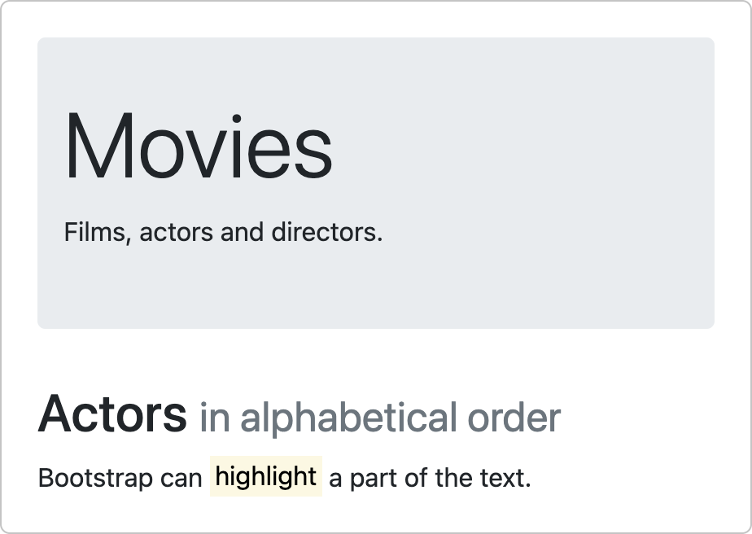

</div><div>

The contextual colours, `text-` and `bg-`:

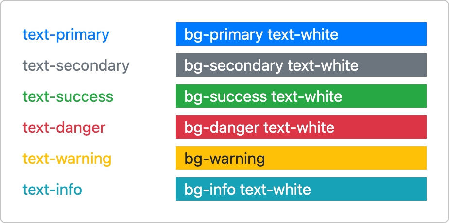

</div></div>

---

## Images

| Class | Effect |
|---|---|
| `rounded` | slightly rounded corners |
| `rounded-circle` | the image is cut to a circle (to an ellipse, if it is not a square) |
| `img-thumbnail` | a thin border with a little space around the image |
| `float-left`, `float-right` | the image goes to the left or right edge, the text flows around it |
| `mx-auto d-block` | the image is centred |
| `img-fluid` | the image shrinks when its container is narrower than the image |

```html

```

`img-fluid` is the **flexible image** of responsive design: `max-width: 100%; height: auto;`

Samples: `03-bootstrap/05-images/01-img-corner.html` ... `05-img-responsive.html`

---

## Tables

```html
<div class="table-responsive">
    <table class="table table-striped table-hover">
        <thead class="thead-dark">
            <tr><th>Actor</th><th>Film</th></tr>
        </thead>
        <tbody>
            <tr><td>Frances McDormand</td><td>Fargo</td></tr>
            <tr class="table-success"><td>Holly Hunter</td><td>Raising Arizona</td></tr>
        </tbody>
    </table>
</div>
```

- `table` - the basic look; `table-striped`, `table-bordered`, `table-hover` add to it.
- `thead-dark` - a dark header row. `table-success`, `table-danger` ... - a coloured row.
- `table-responsive` on a `<div>` around a table: a wide table gets its own scrollbar.

Samples: `03-bootstrap/07-tables/01-table.html` ... `04-table-responsive.html`

---

## Images and tables in the browser

<div class="columns"><div>

`rounded`, `rounded-circle` and `img-thumbnail`:

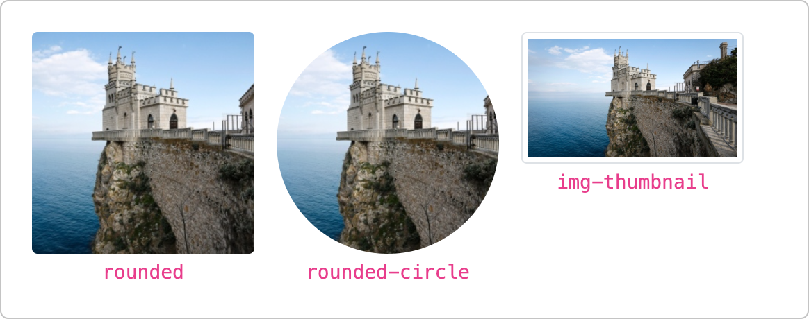

</div><div>

The table of the previous slide:

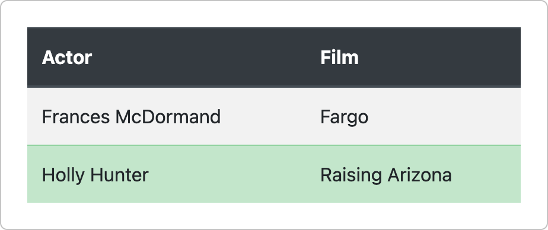

</div></div>

---

<!-- .slide: class="exercise" -->
## Exercise 3: a page for a film

A new page `film.html` in your folder `my`, with Bootstrap and a `container`:

1. A `jumbotron` with the title *Fargo* as a `display-4` heading, and the text *A film by Joel and Ethan Coen, 1996.*
2. A picture with rounded corners that becomes smaller in a narrow window. Copy `castle.jpg` from `03-bootstrap/05-images` into your folder, or use a picture of your own.
3. A striped table with a dark header row: three actors and their roles. The row of the main role is green.
4. Under the table, in red: *Not for children.*

Check: make the window narrow - the picture shrinks with it. *About 15 minutes.*

<details><summary>Solution</summary>

```html
<div class="container">
    <div class="jumbotron">
        <h1 class="display-4">Fargo</h1>
        <p>A film by Joel and Ethan Coen, 1996.</p>
    </div>
    
    <table class="table table-striped">
        <thead class="thead-dark">
            <tr><th>Actor</th><th>Role</th></tr>
        </thead>
        <tbody>
            <tr class="table-success"><td>Frances McDormand</td><td>Marge Gunderson</td></tr>
            <tr><td>William H. Macy</td><td>Jerry Lundegaard</td></tr>
            <tr><td>Steve Buscemi</td><td>Carl Showalter</td></tr>
        </tbody>
    </table>
    <p class="text-danger">Not for children.</p>
</div>
```

- `img-fluid` - never wider than the container; `rounded` - the corners.

</details>

---

## Alerts and badges

```html
<div class="alert alert-success">
    <strong>Saved.</strong> The actor has been added to the list.
</div>
<div class="alert alert-danger">
    The name is missing. <a href="#" class="alert-link">Go back to the form.</a>
</div>

<h2>Messages <span class="badge badge-primary">4</span></h2>
```

- `alert` with `alert-success`, `alert-danger` ... - a message in a coloured box.
- `alert-link` - a link in a colour that matches its alert.
- `badge` with `badge-primary`, `badge-danger` ... - a small label, often a number. `badge-pill` makes it rounder.

Samples: `03-bootstrap/08-advanced-elements/02-alerts.html`, `05-badges.html`

---

## Buttons and button groups

```html
<button type="button" class="btn btn-primary">Save</button>
<button type="button" class="btn btn-outline-danger btn-sm">Delete</button>
<a href="index.html" class="btn btn-secondary">Back to the list</a>

<div class="btn-group">
    <button type="button" class="btn btn-info">Day</button>
    <button type="button" class="btn btn-info">Week</button>
    <button type="button" class="btn btn-info">Month</button>
</div>
```

- `btn` with a colour, `btn-primary`, or with an outline only, `btn-outline-primary`.
- Sizes: `btn-lg` and `btn-sm`. `btn-block` - as wide as the container.
- The classes also work on `<a>` and `<input>`: a link can look like a button.
- `btn-group` joins buttons into one block.

Samples: `03-bootstrap/08-advanced-elements/03-buttons.html`, `04-button-groups.html`

---

## Alerts, badges and buttons in the browser

<div class="columns"><div>

The code of the slide *Alerts and badges*:

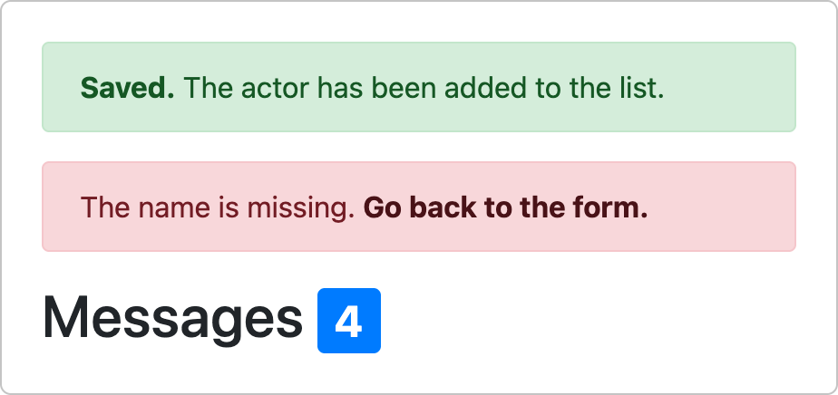

</div><div>

The code of the slide *Buttons and button groups*:

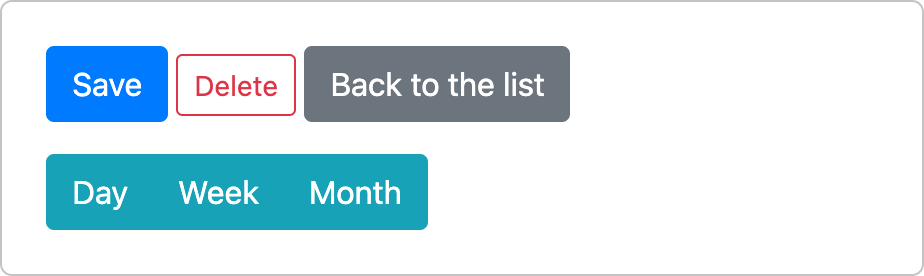

</div></div>

---

## Cards and list groups

```html
<div class="card" style="width: 300px">
    <div class="card-body">
        <h4 class="card-title">John Goodman</h4>
        <p class="card-text">Known for his roles in the films of the Coen brothers.</p>
        <a href="#" class="btn btn-primary">See profile</a>
    </div>
</div>

<ul class="list-group">
    <li class="list-group-item active">Raising Arizona</li>
    <li class="list-group-item">The Big Lebowski</li>
</ul>
```

- `card` - a box with a border. Its parts: `card-header`, `card-body`, `card-footer`.
- `card-img-top` - a picture at the top of a card.
- `list-group` - a list shown as a column of boxes; `active` marks the chosen item.

Samples: `03-bootstrap/08-advanced-elements/08-cards.html`, `07-list-groups.html`

Note:
09-cards-layout.html shows how several cards are laid out side by side (card-deck, card-group, card-columns).

---

## Navs, tabs and pagination

```html
<ul class="nav nav-tabs">
    <li class="nav-item"><a class="nav-link active" href="#">Actors</a></li>
    <li class="nav-item"><a class="nav-link" href="#">Directors</a></li>
</ul>

<ul class="pagination">
    <li class="page-item disabled"><a class="page-link" href="#">Previous</a></li>
    <li class="page-item active"><a class="page-link" href="#">1</a></li>
    <li class="page-item"><a class="page-link" href="#">2</a></li>
    <li class="page-item"><a class="page-link" href="#">Next</a></li>
</ul>
```

- `nav` - a row of links. `nav-tabs` shows them as tabs, `nav-pills` colours the active one.
- `pagination` - links to the pages of a long list.
- In both, `active` marks the current item, and `disabled` an item that cannot be chosen.

Samples: `03-bootstrap/08-advanced-elements/14-nav-tabs.html`, `06-paginations.html`

Note:
Also 13-navs.html (plain navs, alignment, vertical nav) and 15-nav-pils.html.

---

## Cards, tabs and pagination in the browser

<div class="columns"><div>

The code of the slide *Cards and list groups*:

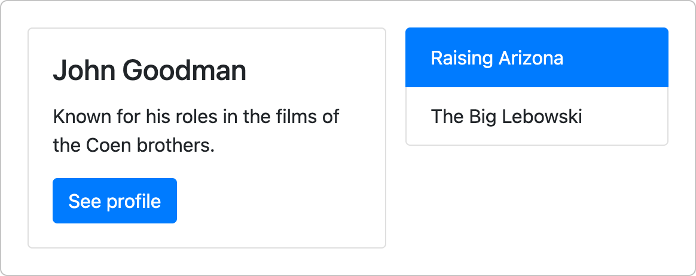

</div><div>

The code of the slide *Navs, tabs and pagination*:

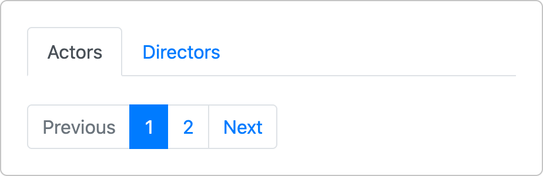

</div></div>

---

<!-- .slide: class="exercise" -->
## Exercise 4: cards in a grid

A new page `actors.html` in your folder `my`, with Bootstrap and a `container`:

1. At the top, tabs: *Actors* (the active one) and *Directors*.
2. Under them, three cards, side by side from 768 pixels, one under the other in a narrower window.
3. In every card: the name of an actor as the title, with a badge that shows the number of his or her films; a sentence about the actor; a small button *Profile*, with an outline only.
4. Under the cards, the pages 1, 2 and 3 of the list; the page 1 is the current one.

*About 15 minutes.*

<details><summary>Solution</summary>

```html
<ul class="nav nav-tabs mb-3">
    <li class="nav-item"><a class="nav-link active" href="#">Actors</a></li>
    <li class="nav-item"><a class="nav-link" href="#">Directors</a></li>
</ul>
<div class="row">
    <div class="col-md-4 mb-3">                <!-- the column decides how wide the card is -->
        <div class="card">
            <div class="card-body">
                <h4 class="card-title">John Goodman <span class="badge badge-secondary">5</span></h4>
                <p class="card-text">Known for the films of the Coen brothers.</p>
                <a href="#" class="btn btn-outline-primary btn-sm">Profile</a>
            </div>
        </div>
    </div>
    <!-- two more columns, each with a card -->
</div>
<ul class="pagination">
    <li class="page-item active"><a class="page-link" href="#">1</a></li>
    <li class="page-item"><a class="page-link" href="#">2</a></li>
    <li class="page-item"><a class="page-link" href="#">3</a></li>
</ul>
```

</details>

---

## Navbars

```html
<nav class="navbar navbar-expand-md bg-dark navbar-dark">
    <a class="navbar-brand" href="#">Movies</a>
    <button class="navbar-toggler" type="button" data-toggle="collapse" data-target="#menu">
        <span class="navbar-toggler-icon"></span>
    </button>
    <div class="collapse navbar-collapse" id="menu">
        <ul class="navbar-nav">
            <li class="nav-item active"><a class="nav-link" href="#">Actors</a></li>
            <li class="nav-item"><a class="nav-link" href="#">Directors</a></li>
        </ul>
    </div>
</nav>
```

- `navbar` - the bar at the top of a page; `navbar-brand` - the name of the site.
- `bg-dark navbar-dark` - a dark bar with light text.
- `navbar-expand-md` - from 768px up the links are in one line.
- Below 768px the links are hidden; the `navbar-toggler` button shows them.

Sample: `03-bootstrap/08-advanced-elements/16-navbars.html`

---

## A navbar on a wide and on a narrow screen

The navbar of the previous slide in a window 800 pixels wide:


<div class="columns"><div>

380 pixels wide: only the `navbar-toggler` button is shown.


</div><div>

After a click on the button, the links appear one under the other.

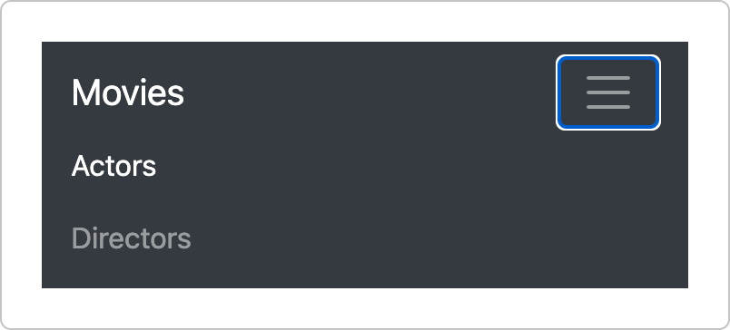

</div></div>

---

## Components that react to clicks

```html
<button type="button" class="btn btn-primary" data-toggle="collapse" data-target="#more">
    More about the film
</button>
<div id="more" class="collapse">This text is hidden until the button is clicked.</div>

<div class="alert alert-warning alert-dismissible fade show">
    <button type="button" class="close" data-dismiss="alert">&times;</button>
    The list has been changed.
</div>
```

- **Collapse**: the button shows and hides the element whose `id` is given in `data-target`.
- A click on the `close` button removes the alert.
- We write no JavaScript. The `data-` attributes tell the script of Bootstrap what to do - so these components need the three `<script>` lines.

Sample: `03-bootstrap/08-advanced-elements/12-collapse-accordion.html`

Note:
Other components of this kind: dropdown menus (10-dropdowns.html, 11-dropdown-layouts.html), tabs that switch their content (the last example in 14-nav-tabs.html) and the accordion (the last example in 12-collapse-accordion.html).
The dismissible alerts are in 02-alerts.html.

---

<!-- .slide: class="exercise" -->
## Exercise 5: why does the button do nothing?

The `<head>` of the page `navbar.html` has the viewport meta element and the `<link>` to Bootstrap. Its `<body>`:

```html
<nav class="navbar navbar-expand-md bg-dark navbar-dark">
    <a class="navbar-brand" href="#">Movies</a>
    <button class="navbar-toggler" type="button" data-toggle="collapse" data-target="menu">
        <span class="navbar-toggler-icon"></span>
    </button>
    <div class="collapse navbar-collapse" id="main-menu">
        <ul class="navbar-nav">
            <li class="nav-item"><a class="nav-link" href="#">Actors</a></li>
            <li class="nav-item"><a class="nav-link" href="#">Films</a></li>
        </ul>
    </div>
</nav>
```

Below 768 pixels a click on the button with three lines does nothing. Find the three mistakes, correct them, and check: the links appear under *Movies*. *About 10 minutes.*

<details><summary>Solution</summary>

1. The three `<script>` lines are missing - jQuery, Popper and Bootstrap. Without them nothing reacts to clicks.
2. `data-target` needs the sign `#`, as a selector: `data-target="#menu"`.
3. The `id` of the hidden part must be the one in `data-target`: `id="menu"`.

```html
<button class="navbar-toggler" type="button" data-toggle="collapse" data-target="#menu">
...
<div class="collapse navbar-collapse" id="menu">
...
<script src="https://ajax.googleapis.com/ajax/libs/jquery/3.5.1/jquery.min.js"></script>
<script src="https://cdnjs.cloudflare.com/ajax/libs/popper.js/1.16.0/umd/popper.min.js"></script>
<script src="https://maxcdn.bootstrapcdn.com/bootstrap/4.5.2/js/bootstrap.min.js"></script>
```

- The `<script>` lines can go into the `<head>`, as in the samples, or at the end of the `<body>`.

</details>

Note:
The Console of the developer tools does not help here: in all these cases it shows no error, nothing happens at all. With the scripts added but the wrong data-target, the button still does nothing. Comparing the code with the sample 16-navbars.html, or with the slide Navbars, is the quickest way.

---

## Forms

```html
<form action="/process-form">
    <div class="form-group">
        <label for="email">Email:</label>
        <input type="email" class="form-control" id="email" name="email">
    </div>
    <div class="form-group">
        <label for="password">Password:</label>
        <input type="password" class="form-control" id="password" name="password">
    </div>
    <button type="submit" class="btn btn-primary">Send</button>
</form>
```

- A `<label>` belongs to the control whose `id` is in its `for` attribute.
- `form-group` - a label and its control, with some space below them.
- `form-control` - the look of `<input>`, `<select>` and `<textarea>`. The control takes the full width, so the form is **stacked**: every label is above its control.

Samples: `03-bootstrap/08-advanced-elements/17-form-stacked.html`, `24-inputs.html`

Note:
A click on a label puts the cursor into its control.
A checkbox or a radio button gets the class form-check-input instead of form-control; its div gets form-check and its label form-check-label. 17-form-stacked.html has an example.
24-inputs.html shows the other controls: textarea, checkboxes, radio buttons, select, range, file, and the sizes of controls.
25-input-groups.html shows input groups: a text or a button attached to the left or to the right side of a control.

---

## Inline forms and forms in a grid

```html
<form class="form-inline" action="/process-form">
    <label for="city" class="mr-sm-2">City:</label>
    <input type="text" class="form-control mr-sm-2" id="city" name="city">
    <button type="submit" class="btn btn-primary">Search</button>
</form>

<form action="/process-form">
    <div class="form-row">
        <div class="col"><input type="text" class="form-control" name="first"></div>
        <div class="col"><input type="text" class="form-control" name="last"></div>
    </div>
</form>
```

- `form-inline` - label, control and button in one line, in windows of 576px or wider.
- `mr-sm-2` - a spacing class with a breakpoint: a margin on the right, from 576px up.
- The grid works in a form too. `form-row` is a `row` with smaller gaps.

Samples: `03-bootstrap/08-advanced-elements/18-form-inline.html`, `20-form-grid.html`

Note:
19-form-inline-fine.html adds spacing classes to the inline form; 21-form-grid-fine.html compares row and form-row.

---

## Validation

```html
<form action="/process-form" class="was-validated">
    <div class="form-group">
        <label for="uname">Username:</label>
        <input type="text" class="form-control" id="uname" name="uname" required>
        <div class="valid-feedback">Looks good.</div>
        <div class="invalid-feedback">Please fill out this field.</div>
    </div>
    <button type="submit" class="btn btn-primary">Send</button>
</form>
```

- The rules are plain HTML, for example `required`. The browser checks them.
- `was-validated` on the form: valid controls turn green, invalid ones red.
- `valid-feedback` and `invalid-feedback` - only the message that fits is shown.
- When our own program checks the data: `is-valid` or `is-invalid` on the control.

Sample: `03-bootstrap/08-advanced-elements/22-form-validation-before.html`

Sample: `03-bootstrap/08-advanced-elements/23-form-validation-after.html`

Note:
In the second sample the colours appear only after the first attempt to send the form: the form has the attribute novalidate, and a short script adds was-validated at that moment.

---

## Forms in the browser

<div class="columns"><div>

A stacked form - the slide *Forms*:

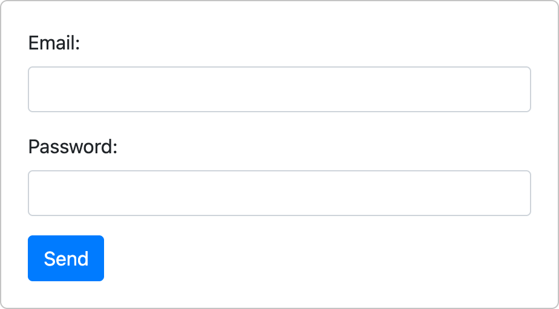

</div><div>

An inline form and a form in a grid:

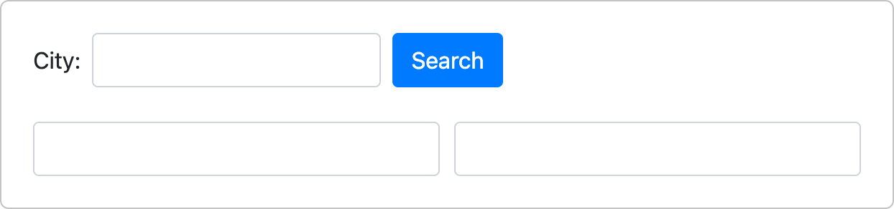

Validation - empty, and filled in:

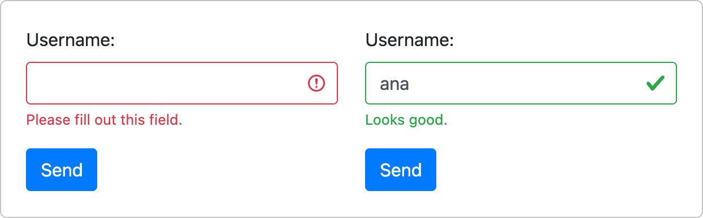

</div></div>

---

<!-- .slide: class="exercise" -->
## Exercise 6: a form for a new actor

A page `actor-form.html` in your folder `my`, with Bootstrap and a `container`:

1. A heading *New actor*, and a form that is sent to `/process-form`.
2. *First name* and *Last name* side by side, in a `form-row`. Both are required.
3. Under them, a drop-down list *Country* with three countries, as wide as the form.
4. A green button *Save*.
5. The form shows its checks at once: `was-validated`, and the message *Please fill out this field.* under both required fields.

Check: an empty form cannot be sent, and the empty fields are red. A filled form arrives at `/process-form`, which shows the three pairs: `first_name`, `last_name` and `country`. *About 15 minutes.*

<details><summary>Solution</summary>

```html
<form action="/process-form" class="was-validated">
    <div class="form-row">
        <div class="col form-group">
            <label for="first">First name:</label>
            <input type="text" class="form-control" id="first" name="first_name" required>
            <div class="invalid-feedback">Please fill out this field.</div>
        </div>
        <!-- the same for the last name: id="last", name="last_name" -->
    </div>
    <div class="form-group">
        <label for="country">Country:</label>
        <select class="form-control" id="country" name="country">
            <option>Serbia</option> <option>USA</option> <option>France</option>
        </select>
    </div>
    <button type="submit" class="btn btn-success">Save</button>
</form>
```

- The `name` of a field is the name in the pair that the browser sends; the `id` connects it with its `<label>`.

</details>

---

## Media queries

A **media query** is a condition in front of a group of CSS rules. The rules are used only while the condition is true.

```css
@media (min-width: 768px) {
    /* rules for windows that are 768px wide or wider */
}

@media (max-width: 575.98px) {
    /* rules for windows that are narrower than 576px */
}
```

Every breakpoint of Bootstrap is a media query. From its style sheet (shortened):

```css
@media (min-width: 576px)  { .container { max-width: 540px; } }
@media (min-width: 768px)  { .container { max-width: 720px; } }
@media (min-width: 992px)  { .container { max-width: 960px; } }
@media (min-width: 1200px) { .container { max-width: 1140px; } }
```

Note:
Bootstrap writes 575.98px and not 575px, because the width of a window is not always a whole number.
These four rules are the reason why a container changes its width in steps.

---

## A media query written by hand

```css
a { display: block; }               /* always: one link per line */

@media (min-width: 768px) {
    a { display: inline; }          /* 768px or wider: links in one line */
}
```

```html
<a href="#">Actors</a>
<a href="#">Directors</a>
<a href="#">Films</a>
```

- The first rule always holds. In a window of 768px or more the second rule holds as well, and it wins because it comes later.
- First the narrow screen, then the additions for wider ones: this order is called **mobile first**.
- A navbar with `navbar-expand-md` does the same thing with its links.
- On a phone it works only if the page has the viewport meta element.

Note:
This example does not use Bootstrap. The rules go into a style element in the head of a page (or into a .css file), the links into the body.

---

## Icons

- Bootstrap 4 has no icons of its own.
- Icons come from separate **icon libraries**, for example Bootstrap Icons or Font Awesome.
- A library is added to a page like Bootstrap: with one more `<link>` in the `<head>`.
- An icon is then an ordinary element with the classes of that library. It takes the size and the colour of the text around it.

---

## A newer version: Bootstrap 5

Bootstrap 5 (2021) keeps the ideas of this lecture, but its JavaScript **no longer needs jQuery**, and some classes have new names:

| Bootstrap 4 - this course | Bootstrap 5 |
|---|---|
| `pl-3`, `pr-3`, `ml-3`, `mr-3` | `ps-3`, `pe-3`, `ms-3`, `me-3` |
| `float-left`, `float-right` | `float-start`, `float-end` |
| `badge-primary` | `bg-primary` |
| `data-toggle`, `data-target` | `data-bs-toggle`, `data-bs-target` |
| `jumbotron`, `form-group`, `thead-dark` | removed |

When you look for help on the web, check which version the answer is written for. The documentation of our version: `https://getbootstrap.com/docs/4.5/`

---

## Summary

- **Responsive web design**: a flexible grid, flexible images and media queries.
- **Bootstrap** is a CSS framework. We load it from a CDN and use its classes; the viewport meta element must not be forgotten.
- Layout: `container`, `row`, `col-md-4` ... - 12 columns and four breakpoints.
- **Utility classes** for spacing, borders and colours; the colours are **contextual**.
- A ready-made look for text, images, tables and forms.
- **Components** - alerts, buttons, cards, navbars - are a few elements with the right classes.
- All the web applications that we write later in the course use Bootstrap 4.5.2.

---

<!-- .slide: class="exercise" -->
## Assignment: the home page of Vanity Fair

The page `vanity-fair.html` in your folder `my`: Bootstrap 4.5.2 with its scripts, and a style sheet of your own, `vanity-fair.css`, linked **after** Bootstrap.

1. A dark navbar with the name *Vanity Fair* and the links *Actors*, *Films* and *About*. Below 768 pixels the links hide behind the button.
2. Under it, an alert *Welcome to Vanity Fair!* that the user can close.
3. A `jumbotron` with a large heading and one sentence.
4. Six cards of actors: one in a line on a phone, two from 576 pixels, three from 992 pixels. Every card has a name, a sentence, a badge with the number of films and a button.

The rest of the page is on the next slide.

---

<!-- .slide: class="exercise" -->
## Assignment: the rest of the page

5. A table of films with a dark header row, and one row in yellow.
6. A form *Add an actor*: the name and the country side by side, both required and checked at once, sent to `/process-form`.
7. A footer. In `vanity-fair.css`: its text is centred, and from 768 pixels on it is on the right - with a media query of your own.

Check the page 380, 800 and 1200 pixels wide: the cards, the navbar and the footer change. Send the form once empty and once filled in. *About 45 minutes for the whole assignment.*

A solution: [exercises/01-04-bootstrap](https://github.com/kartelj/ekof_dss/tree/main/exercises/01-04-bootstrap)

---

# Thanks for your attention!
