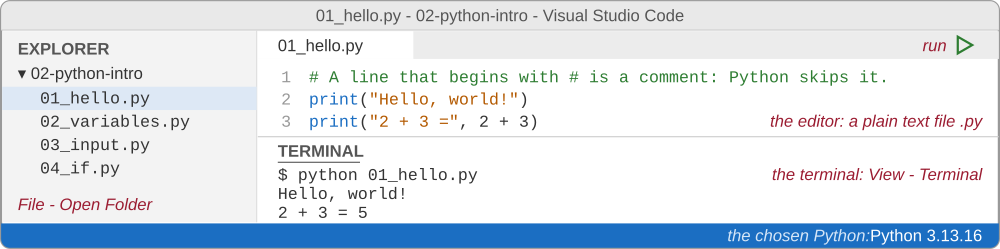
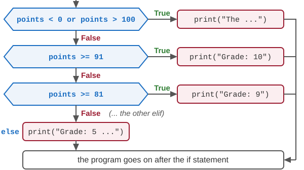
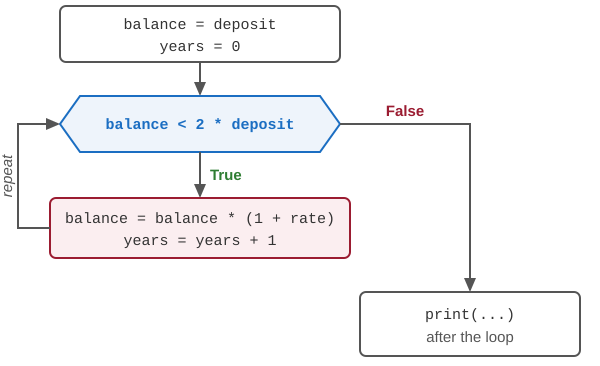
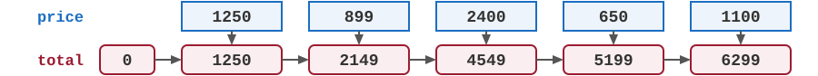
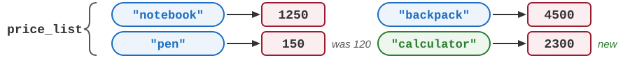
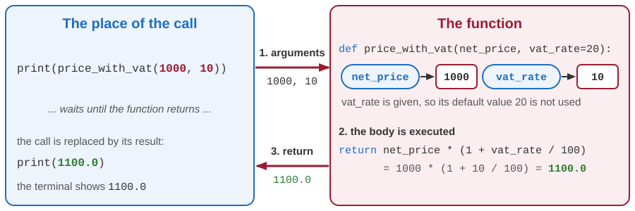
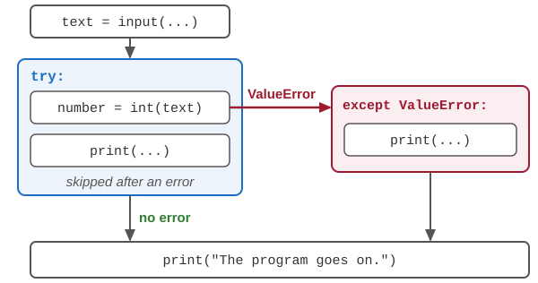
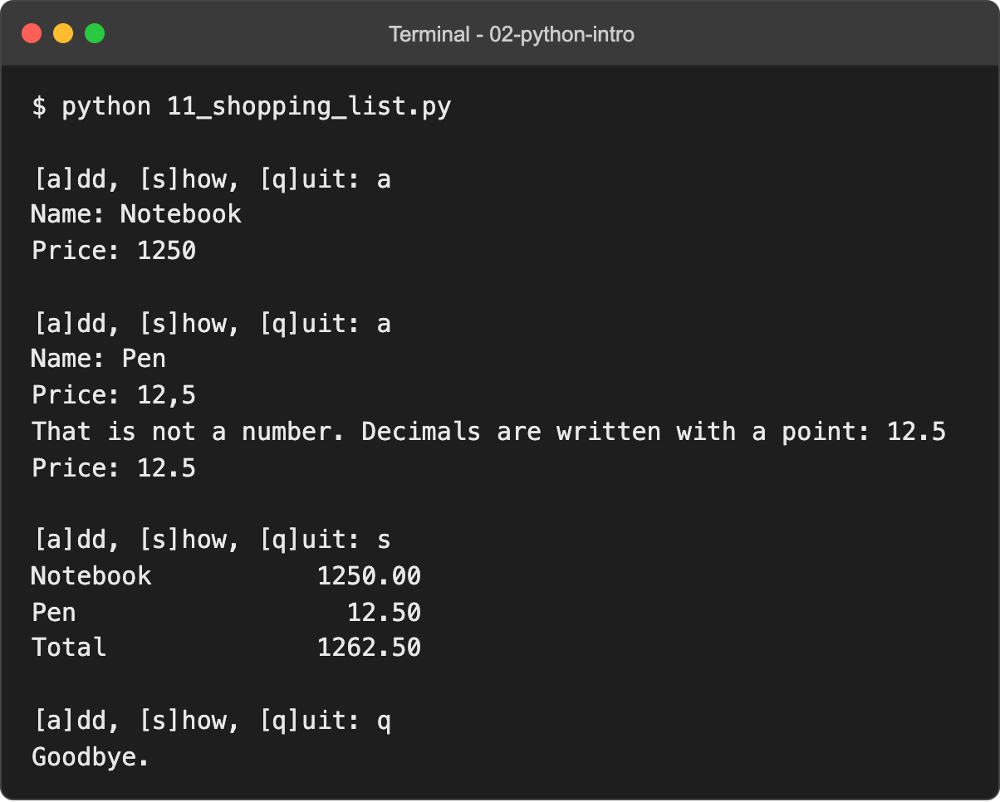
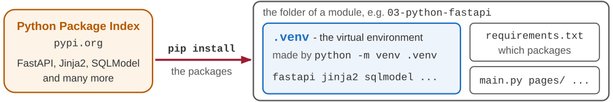

# Introduction to Python

Developing Software Solutions

---

## Why Python?

- A **program** is a list of instructions, written in a text file. The computer carries them out one after another.
- **Python** is one of the most widely used programming languages: data analysis, finance, automation, machine learning, web applications.
- Its programs are short and easy to read. It is free and runs on Windows, macOS and Linux.
- In this course Python builds the web applications, the services and the databases of the next modules.
- This lecture: the basics of the language, with small programs that run in the terminal.

Sample: `teaching-samples/02-python-intro` - one small program for every topic

Note:
The samples of this lecture need only Python itself: no packages, no web server.
Every "Sample:" line on the following slides names a file of the folder 02-python-intro. Start it during the lecture, and let the students change it.

---

## Installing Python

- Download Python from `python.org` (the page *Downloads*). The course needs **Python 3.12 or newer**.
- **Windows**: in the first window of the installer, tick *Add python.exe to PATH*.
- **macOS**: use the installer from `python.org`. The `python3` that comes with the developer tools of macOS may be older.
- Check the installation in a terminal:

```text
python --version
Python 3.13.16
```

- On macOS the command is `python3`. On Windows `py` works as well.

Note:
The terminal: on Windows PowerShell or the app Terminal, on macOS the app Terminal. It is also built into the editor - next slide.
PATH is the list of folders in which the system looks for programs. Without the tick, the command python is not found on Windows.
Any version from 3.12 on is fine; the number after the second dot changes with every bug-fix release.

---

## The editor: Visual Studio Code

- A program is a plain text file with the extension `.py`. Any text editor will do; we use **Visual Studio Code**, which is free.
- Install its extension **Python** (by Microsoft): colours for the code, completion, and warnings while we type.
- *File - Open Folder*: open the folder of the course.
- *View - Terminal*: a terminal inside the editor, already in the folder that is open.



Note:
A word processor such as Word is not suitable: it saves formatting, not plain text.
VS Code shows the chosen Python in the status bar at the bottom. If it is the wrong one: Ctrl+Shift+P, then "Python: Select Interpreter".
The keyboard shortcut for the terminal is Ctrl and the backtick key (on a US keyboard left of the key 1).

---

## The interactive prompt

The command `python` without a file name starts the **interactive prompt**. Every line is executed as soon as we press Enter:

```text
>>> 2 + 3
5
>>> 1250 * 1.2
1500.0
>>> "Hello" + " " + "world"
'Hello world'
>>> exit()
```

- `>>>` is the prompt: Python waits for the next line.
- The value of an expression is shown at once, without `print()`.
- A good place for short experiments. Nothing is saved: programs are written in files.

---

## The first program

The file `01_hello.py`:

```python
# A line that begins with # is a comment: Python skips it.
print("Hello, world!")
print("2 + 3 =", 2 + 3)
```

In the terminal, in the folder of the file, we type the first line; the program answers with the other two:

```text
python 01_hello.py
Hello, world!
2 + 3 = 5
```

- The interpreter reads the file and executes its statements from the top down, one per line.
- `print()` writes its values in the terminal, separated by spaces, and starts a new line.

Sample: `02-python-intro/01_hello.py`

Note:
First go to the folder: cd teaching-samples/02-python-intro
"No such file or directory" means that the terminal is in another folder, or that the name is misspelled.
In VS Code a program can also be started with the triangle in the top right corner of the editor.

---

## Variables

```python
price = 1250
vat = price * 0.2
total = price + vat
print(total)                # 1500.0

price = 900                 # a new value - total does not change by itself
print(price, total)         # 900 1500.0
```

- A **variable** is a name for a value. The first assignment creates it.
- `=` means: calculate the right side, then give the result this name. It is not the "equals" of mathematics.
- A name consists of letters, digits and `_`, and does not begin with a digit. Upper and lower case differ: `Price` is another name.

Sample: `02-python-intro/02_variables.py`

Note:
The convention for names is lower_case_with_underscores: vat_rate, total_price.
The statements are executed in order: total was calculated with the old price, and keeps its value.

---

## Types of values

| Type | Values | Examples |
|---|---|---|
| `int` | whole numbers | `1250`, `-7`, `0` |
| `float` | numbers with a decimal point | `0.2`, `1500.0` |
| `str` | text - a *string* of characters | `"notebook"`, `'pen'` |
| `bool` | logical values | `True`, `False` |

- `type(x)` tells the type of a value: `type(1250)` is `<class 'int'>`.
- The type belongs to the value, not to the name.
- Decimal numbers are written with a **point**: `12.5`, never `12,5`.

Sample: `02-python-intro/02_variables.py`

---

## Arithmetic

| Operator | Meaning | Example | Result |
|---|---|---|---|
| `+` `-` `*` | addition, subtraction, multiplication | `17 * 5` | `85` |
| `/` | division - the result is always a `float` | `17 / 5` | `3.4` |
| `//` | integer division: the whole part | `17 // 5` | `3` |
| `%` | the remainder of the integer division | `17 % 5` | `2` |
| `**` | power | `2 ** 10` | `1024` |

- `*` and `/` are calculated before `+` and `-`. Parentheses change the order: `(17 - 5) * 2` is `24`.
- `round(3.14159, 2)` gives `3.14`.

Sample: `02-python-intro/02_variables.py`

---

## Texts and f-strings

```python
product = "notebook"
price = 1250
print("The " + product + " costs " + str(price) + " RSD")
print(f"The {product} costs {price} RSD")
print(f"With VAT: {price * 1.2:.2f} RSD")
print(len(product))
```

```text
The notebook costs 1250 RSD
The notebook costs 1250 RSD
With VAT: 1500.00 RSD
8
```

- A text is written between quotes, single or double. `+` joins two texts; `str()` makes a text out of a number.
- An **f-string** has `f` before the quote. Every `{expression}` in it is replaced by its value; `:.2f` shows two decimals.

Sample: `02-python-intro/02_variables.py`

---

## Asking the user: input()

```python
name = input("Your name: ")
quantity = int(input("How many notebooks? "))
price = float(input("Price of one notebook: "))

total = quantity * price
print(f"{name}, you pay {total:.2f} RSD.")
```

```text
Your name: Ana
How many notebooks? 3
Price of one notebook: 1250
Ana, you pay 3750.00 RSD.
```

- `input()` shows its text, waits until the user presses Enter, and gives back what was typed - **always as a text**.
- `int()` and `float()` turn a text into a number. `"3" + "3"` is `"33"`, but `3 + 3` is `6`.

Sample: `02-python-intro/03_input.py`

Note:
The comments of the sample file are left out on the slide.
Typing three instead of 3 stops the program with an error - a slide later in this lecture shows how to read the message.

---

## Comparisons and logical values

```python
points = 77
print(points >= 51)                     # True
print(points == 100)                    # False   == compares, = assigns
print(points != 100)                    # True    != means "is not equal to"
print(points >= 51 and points <= 60)    # False   and: both must be true
print(points < 0 or points > 100)       # False   or: at least one must be true
print(not points >= 51)                 # False   not: the opposite
```

- The comparison operators are `==`, `!=`, `<`, `<=`, `>` and `>=`. The result is `True` or `False`.
- `and`, `or` and `not` combine conditions.

---

## Decisions: if, elif, else

<div class="columns"><div>

```python
points = int(input("Points (0-100): "))

if points < 0 or points > 100:
    print("The points must be between 0 and 100.")
elif points >= 91:
    print("Grade: 10")
elif points >= 81:
    print("Grade: 9")
    ...
else:
    print("Grade: 5 - the exam is not passed.")
```

</div><div>



</div></div>

- The conditions are checked from the top. Only the block of the **first** true condition is executed.
- A line that ends with a colon opens a **block**: the lines below it, indented by 4 spaces. The indentation is a part of the language, not decoration.

Sample: `02-python-intro/04_if.py`

Note:
The sample has all the grades, from 10 down to 6, and the scale of the faculty: 51 points for a 6, 61 for a 7, and so on.
elif and else are optional. A forgotten colon or a wrong indentation is reported as an error before the program starts.

---

## Loops: while

```python
deposit = 1000.0    # euros
rate = 0.05         # 5 % interest a year

balance = deposit
years = 0
while balance < 2 * deposit:
    balance = balance * (1 + rate)
    years = years + 1
print(f"The deposit is doubled after {years} years: {balance:.2f} EUR")
```

```text
The deposit is doubled after 15 years: 2078.93 EUR
```

- `while` repeats its block as long as the condition is true. The condition is checked before every repetition.
- Something in the block must change the condition. Otherwise the loop never ends, and only Ctrl+C stops the program.

Sample: `02-python-intro/05_loops.py`

---

## A while loop, step by step

<div class="columns"><div>



</div><div>

| `years` | `balance` | `balance < 2 * deposit` |
|---|---|---|
| 0 | 1000.00 | `True` |
| 1 | 1050.00 | `True` |
| 2 | 1102.50 | `True` |
| ... | ... | ... |
| 14 | 1979.93 | `True` |
| 15 | 2078.93 | `False` |

</div></div>

- The condition is checked 16 times. 15 times it is `True`, and the block is executed; the 16th time it is `False`, and the program goes on after the loop.

---

## Loops: for and range

```python
balance = deposit
for year in range(1, 6):        # year takes the values 1, 2, 3, 4, 5
    balance = balance * (1 + rate)
    print(f"Year {year}: {balance:.2f} EUR")
```

```text
Year 1: 1050.00 EUR
Year 2: 1102.50 EUR
Year 3: 1157.62 EUR
Year 4: 1215.51 EUR
Year 5: 1276.28 EUR
```

- `for` gives the variable the values of a sequence, one after another, and executes the block for each of them.
- `range(1, 6)` counts from 1 up to 6 - the end is not included. `range(5)` gives 0, 1, 2, 3, 4.

Sample: `02-python-intro/05_loops.py`

Note:
Year 3: the value is exactly 1157.625. When a number is exactly halfway, Python rounds to the even digit: 1157.62. In the same way round(2.5) is 2.

---

## Lists

```python
prices = [1250, 899, 2400, 650]

print(prices[0])        # 1250   the positions (indexes) start at 0
print(prices[-1])       # 650    the last element
print(len(prices))      # 4      the number of elements

prices.append(1100)     # a new element at the end
print(prices)           # [1250, 899, 2400, 650, 1100]
```

- A **list** keeps several values under one name, in a fixed order. It is written in square brackets.
- An element is reached by its index. An index that does not exist stops the program: `IndexError`.

Sample: `02-python-intro/06_lists.py`

---

## Going through a list

```python
total = 0
for price in prices:                            # one element after another
    total = total + price
print("Total:", total)                          # Total: 6299
print("Average:", total / len(prices))          # Average: 1259.8

print(sum(prices), min(prices), max(prices))    # 6299 650 2400
print(sorted(prices))                           # [650, 899, 1100, 1250, 2400]
print(899 in prices)                            # True
```



- `for` goes through the elements of a list. A variable collects the result - here the total.
- Python already has functions for the usual calculations: `sum`, `min`, `max`, `sorted`.
- `in` asks whether a value is in the list.

Sample: `02-python-intro/06_lists.py`

---

## Dictionaries

```python
price_list = {"notebook": 1250, "pen": 120, "backpack": 4500}

print(price_list["pen"])                # 120
price_list["calculator"] = 2300         # a new pair
price_list["pen"] = 150                 # a new value for an existing key
print("pen" in price_list)              # True

for name, price in price_list.items():
    print(name, price)                  # notebook 1250, then pen 150 ...
```



- A **dictionary** holds pairs *key: value*, in braces. A value is found by its key, not by its position.
- A key that does not exist stops the program: `KeyError`. Check it first with `in`.
- Data from the web (JSON) usually arrives as dictionaries and lists.

Sample: `02-python-intro/07_dictionaries.py`

---

## Functions

```python
def price_with_vat(net_price, vat_rate=20):
    """Returns the price with the value added tax; the rate is given in percent."""
    return net_price * (1 + vat_rate / 100)


print(price_with_vat(1000))         # 1200.0 - vat_rate is left out, so it is 20
print(price_with_vat(1000, 10))     # 1100.0
```

- `def` defines a **function**: its name, its **parameters** in parentheses, and the indented body.
- The body is executed only when the function is **called**. The values in the call (the *arguments*) become the values of the parameters.
- `return` gives the result back to the place of the call. A parameter with a default value may be left out.

Sample: `02-python-intro/08_functions.py`

Note:
The text in triple quotes is a docstring: it says what the function does.
A function without return gives back the value None.

---

## A function call, step by step



- The program waits at the call until the function returns. Then it goes on with the result, as if the call had been replaced by it.

---

## Why functions?

```python
def grade(points):
    """Returns the grade (5 to 10) for the points of an exam (0 to 100)."""
    if points >= 91:
        return 10       # return ends the function and gives the result back
    if points >= 81:
        return 9
    ...
    return 5


for points in [45, 58, 77, 93]:
    print(points, "points - grade", grade(points))
```

- A function is written once and called many times: here, four times in a loop.
- Its name says **what** it does. The caller does not need to know **how**.
- A long program becomes a set of small functions that can be read and tested one by one.

Sample: `02-python-intro/08_functions.py`

Note:
The output: 45 points - grade 5, 58 points - grade 6, 77 points - grade 8, 93 points - grade 10.
Compare with 04_if.py: the same scale, but now as a function that returns the grade instead of printing it.

---

## Modules

```python
import math
import random
from datetime import date

import shop                         # the file shop.py in the same folder

print(math.sqrt(2))                 # 1.4142135623730951
print(random.randint(1, 6))         # a random whole number from 1 to 6
print(date.today())                 # 2026-10-03 - the date of today
print(shop.price_with_vat(1000))    # 1200.0
```

- A **module** is a file with Python code. `import` makes its functions available: `module.function`.
- The **standard library** comes with Python: `math`, `random`, `datetime`, `json` and many more.
- Our own file is a module too: `shop.py` holds the functions of a small shop.

Sample: `02-python-intro/09_modules.py`, `shop.py`

Note:
from datetime import date takes one name out of the module, so it is written without the name of the module: date.today().
Do not name your own file like a module of the standard library (random.py, math.py): import would find your file instead.

---

## When something goes wrong

Typing `three` instead of `3` in `03_input.py`:


- The program stops. Read the message **from the bottom up**.
- The last line names the error (`ValueError`) and its cause. The lines above it tell where it happened: the file and the line.
- Errors are normal while a program is written. The message says what to look at.

Note:
The real message also shows the comment of line 8. Python 3.12 adds a line of ^ characters under the part of the line that failed.

---

## Frequent errors

| Error | Typical cause | Example |
|---|---|---|
| `SyntaxError` | a missing colon, quote or parenthesis | `if points > 50` |
| `IndentationError` | a block that is not indented | `print()` below `if`, at the same level |
| `NameError` | a misspelled name, or a variable used before it exists | `prnt("Hi")` |
| `TypeError` | a value of the wrong type | `"Total: " + 15` |
| `ValueError` | a value that cannot be converted | `int("12,5")` |
| `IndexError`, `KeyError` | an index or a key that does not exist | `prices[10]`, `price_list["pencil"]` |

- A `SyntaxError` and an `IndentationError` are found before the program starts: nothing is executed.
- The others appear only when the faulty line is reached.

Note:
The messages, as Python writes them: SyntaxError: expected ':' / IndentationError: expected an indented block after 'if' statement on line 2 / NameError: name 'prnt' is not defined. Did you mean: 'print'? / TypeError: can only concatenate str (not "int") to str / ValueError: invalid literal for int() with base 10: '12,5' / IndexError: list index out of range / KeyError: 'pencil'

---

## Catching errors: try and except

<div class="columns"><div>

```python
text = input("A whole number: ")

try:
    number = int(text)
    print("Its square is", number * number)
except ValueError:
    print(f"'{text}' is not a whole number.")

print("The program goes on.")
```

```text
A whole number: abc
'abc' is not a whole number.
The program goes on.
```

</div><div>



</div></div>

- The block `try` is executed. If a statement in it raises a `ValueError`, the rest of the block is skipped, and the block `except` is executed instead.
- Without `try` - `except`, the error would stop the program.

Sample: `02-python-intro/10_errors.py`

---

## A complete program

```python
items = []      # every item is a dictionary: {"name": ..., "price": ...}

while True:
    command = input("\n[a]dd, [s]how, [q]uit: ").strip().lower()
    if command == "a":
        name = input("Name: ")
        price = read_price("Price: ")
        items.append({"name": name, "price": price})
    elif command == "s":
        show(items)
    elif command == "q":
        print("Goodbye.")
        break
    else:
        print("Unknown command.")
```

- A shopping list: everything from this lecture in one program.
- `while True` repeats forever; `break` leaves the loop. `read_price` and `show` are functions written above, in the same file.

Sample: `02-python-intro/11_shopping_list.py`

Note:
read_price asks again until the user types a number (try - except inside a loop). show prints the items and the total.
strip() removes the spaces at both ends of a text, lower() makes its letters small - methods of a text, called with a dot.
Demonstration: add two items, type 12,5 as a price, show the list, type an unknown command, quit.

---

## The shopping list at work

<div class="columns"><div>



</div><div>

- `a` adds an item: a name and a price.
- `12,5` is not a number: `read_price` says so and asks again - `try` - `except` inside a loop.
- `s` shows the items and the total, in columns: the formats `:15` and `:10.2f` of the f-strings.
- `q` ends the loop with `break`, and the program with it.

</div></div>

---

## Packages and virtual environments

```text
python -m venv .venv
source .venv/bin/activate          (Windows:  .venv\Scripts\activate)
pip install -r requirements.txt
```

- A **package** is a library that does not come with Python: FastAPI, Jinja2, SQLModel ... `pip` installs packages from the Python Package Index.
- A **virtual environment** - the folder `.venv` - keeps the packages of one project apart from the rest of the computer.
- `requirements.txt` lists the packages of the course, with their exact versions. The environment is created once, and activated in every new terminal.



Note:
The commands are typed in the root folder of the course, where requirements.txt is. The samples of this module need no packages; from module 03 on they do.
An active environment is shown at the beginning of the prompt: (.venv).
If Windows PowerShell refuses to run the activation script, the command Set-ExecutionPolicy -Scope CurrentUser RemoteSigned allows it.
The README of the course repeats these steps.

---

## Python in the rest of the course

- **Module 03**: web applications with **FastAPI**. A Python function answers a request from the browser, and a dictionary carries the values into an HTML template.
- The lectures on **procedural** and **object-oriented** programming go deeper into the language, with the pages of the sample application.
- **Module 04** builds one application step by step. **Modules 05 to 07** add a database and a RESTful service.

Everything in those modules is built from the pieces of this lecture: variables, decisions, loops, lists, dictionaries, functions and modules.

---

## Summary

- A Python program is a text file with the extension `.py`, started with `python file.py`. The interactive prompt is for short experiments.
- A **variable** is a name for a value. The basic types: `int`, `float`, `str`, `bool`.
- `input()` reads a text; `int()` and `float()` turn it into a number.
- `if` - `elif` - `else` decides, `while` and `for` repeat. A block is marked by its **indentation**.
- **Lists** keep values in order, **dictionaries** find a value by its key.
- **Functions** give a piece of a program a name; **modules** keep functions in files.
- An error message is read from the bottom up; `try` - `except` catches an error.

Next: web applications with FastAPI.

---

# Thanks for your attention!
