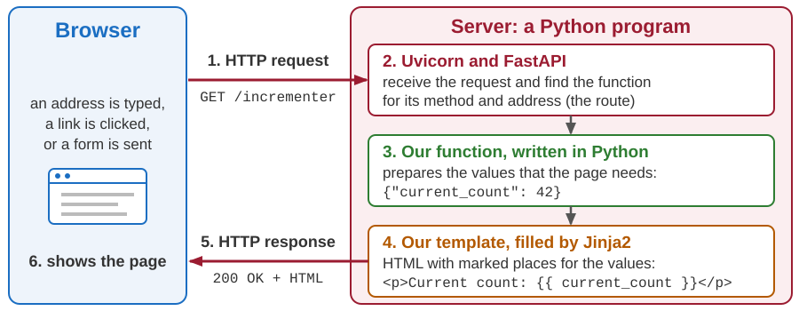
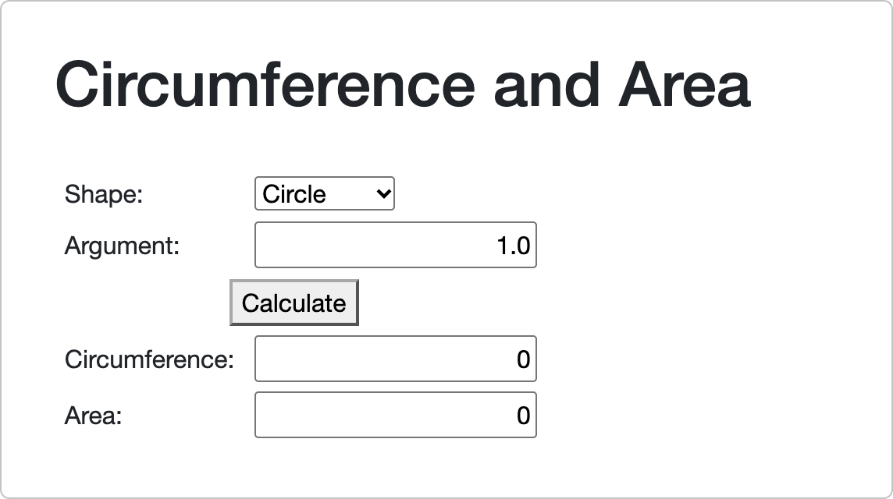
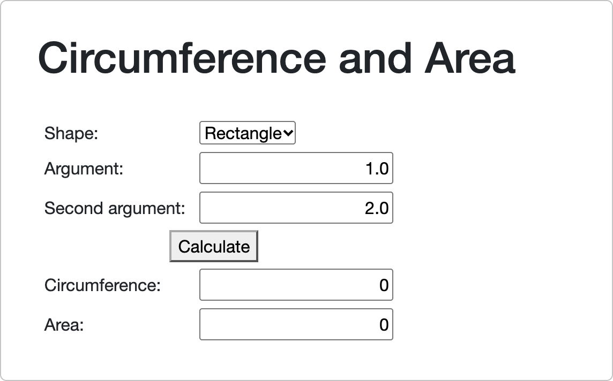
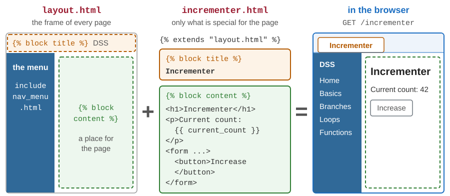
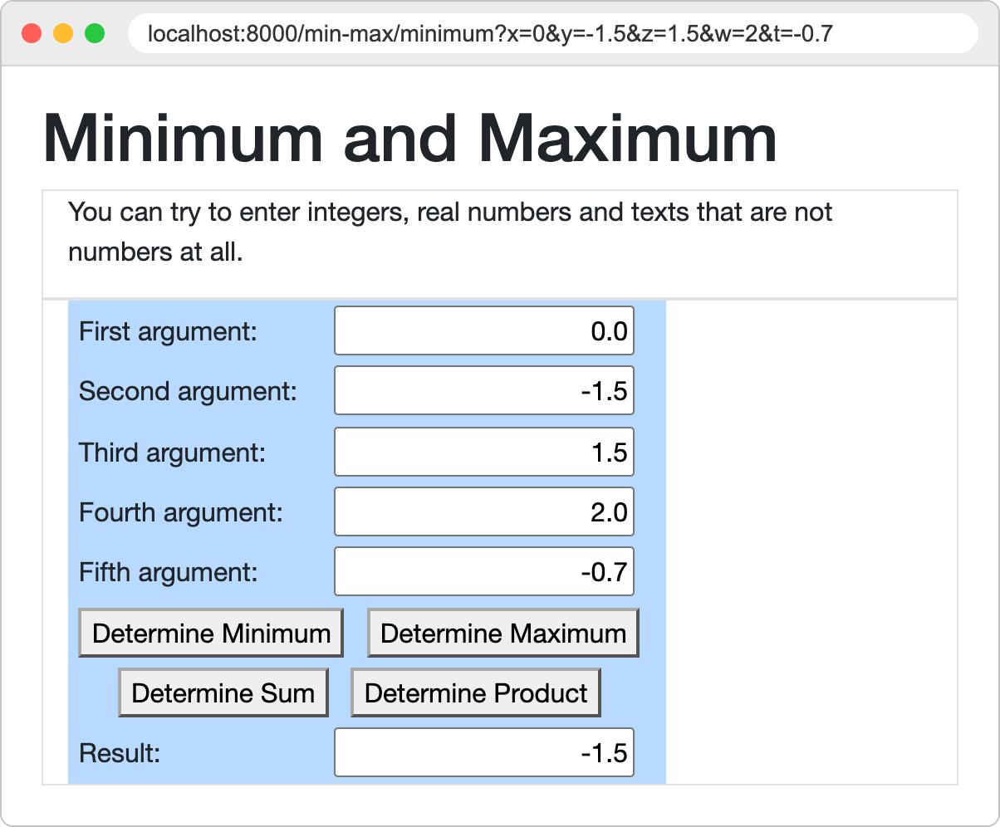
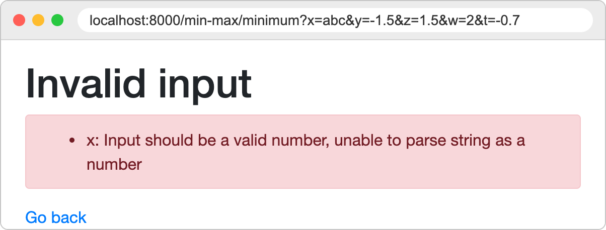
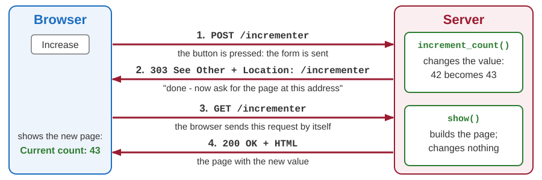

# Introduction to FastAPI and Jinja2

Developing Software Solutions

---

## From static to dynamic pages

- Until now our pages were **static**: HTML files that the server sends exactly as they are stored on the disk.
- With HTML and CSS alone, a page cannot calculate anything, and it cannot show data that changes: a counter, a result, a list of actors.
- A **dynamic** page is created by a **program on the server**, at the moment of the request. From now on we write such programs - in Python.
- The program runs **on the server**. The browser receives only the finished HTML. Look at *View page source*: there is no Python in it.
- So a page cannot run our code by itself. For every job of the program, the browser has to send a **new request** - through a link or a form.

Note:
Static and dynamic content were introduced in the first lecture.
Demonstration: start the sample application 03-python-fastapi, open the page Incrementer (section Basics of the menu), press the button a few times and then look at the source of the page. The number is simply written in the HTML.

---

## One request, step by step



Sample: `03-python-fastapi/pages/incrementer.py` with `templates/incrementer.html`

Note:
A function is a named piece of a program. FastAPI runs it ("calls" it) when a request for its address arrives.
Step 2 is the work of the tools. Steps 3 and 4 are what we write: a function in Python and a template in HTML.
The same steps are repeated every time a page is shown. A button of a POST form causes two requests: first the POST, whose function changes a value and answers with a redirect (no template is filled), and then a GET that goes through all six steps - see the slide Post/Redirect/Get.

---

## The tools

| Tool | What it does for us |
|---|---|
| **Python** | the programming language in which we write our programs |
| **FastAPI** | a web framework: it finds the function for each request, and gives it the values |
| **Uvicorn** | the web server program: it receives the requests and passes them to FastAPI |
| **Jinja2** | a template engine: it fills HTML templates with values |

Python is installed from `python.org`. The other three are Python *packages*, installed with `pip`:

```bash
python -m venv .venv
source .venv/bin/activate        # Windows: .venv\Scripts\activate
pip install -r requirements.txt
```

- A **virtual environment** (the folder `.venv`) keeps the packages of one project apart from the rest of the computer. It is created once, and activated in every new terminal.

Note:
The commands are typed in the folder of the course, where the file requirements.txt is. It lists the packages with their exact versions, so everybody gets the same ones. Python 3.12 or newer is needed.
The file also installs python-multipart, which FastAPI needs for reading the data of forms, and the packages for the later parts of the course.
On macOS and Linux the first command is often python3. After the activation, python works everywhere.
A framework is a library that does the common work of one kind of programs. We do not call it: it calls our functions at the right moment.

---

## Starting an application

```bash
cd teaching-samples/03-python-fastapi
python main.py
```

```text
INFO:     Uvicorn running on http://127.0.0.1:8000 (Press CTRL+C to quit)
...
Text is appended to message. Text: Hello
INFO:     127.0.0.1:50098 - "POST /append-clear/write HTTP/1.1" 303 See Other
```

- Open `http://localhost:8000` in the browser: `localhost` and `127.0.0.1` both mean *this computer*. Ctrl+C stops the server.
- The terminal shows one line for every request, and everything that our code writes with `print()`. That text appears **here**, not in the browser.
- `main.py` ends with `uvicorn.run("main:app", port=8000, reload=True)`. This line starts the server.
- `reload=True`: when we save a changed `.py` file, the application restarts by itself. A changed template is simply used at the next request.

Note:
"main:app" means: the variable app in the file main.py.
The lines of the terminal on the slide: the address of the server, the text written by print() in the function write of the page Append-clear, and the line of the request that called it. The other lines are left out.
Demonstration: the page Append-clear calls print() in the functions of both of its buttons. Press the buttons and watch the terminal.
Every step of the actors application is a separate application, started in its own folder. Two applications cannot share the port 8000: always stop the running one with Ctrl+C before the next one is started. If one is still running, the new one usually stops with the message "address already in use"; if there is no message, the browser keeps showing the old application.

---

## The smallest application

```python
from pathlib import Path

from fastapi import FastAPI, Request
from fastapi.templating import Jinja2Templates

BASE_DIR = Path(__file__).parent                                # the folder of this file

app = FastAPI(title="Vanity Fair")                              # the application
templates = Jinja2Templates(directory=BASE_DIR / "templates")   # the template engine

title = "Vanity Fair"
actor = "Robert De Niro"


@app.get("/")
def index(request: Request):
    return templates.TemplateResponse(request, "index.html", {"title": title, "actor": actor})
```

The first lines are nearly the same in every application. The last three lines answer the browser.

Sample: `04-python-fastapi-actors/02-actors-display/main.py` (shortened)

Note:
Left out: the import of uvicorn, the line that mounts the static files, and the two lines at the end that start the server.
The students do not have to understand every line now. The basics of the language were shown in the introduction to Python; the next two lectures go into the details.

---

## A route and its function

```python
@app.get("/")
def index(request: Request):
    return templates.TemplateResponse(request, "index.html", {"title": title, "actor": actor})
```

- `@app.get("/")` is a **route**: when a `GET` request for the address `/` arrives, FastAPI calls the function written below it.
- `def index(...)` defines a **function**: a named piece of the program, which runs when it is called.
- `request` is the request that has arrived. FastAPI gives it to the function, and the function passes it on to the template.
- `TemplateResponse(...)` is the answer: the template `index.html`, filled with the values of a **dictionary** - pairs `"name": value`.
- An address that has no route is answered with `404 Not Found`.

Note:
The name of the function (index) is our choice. FastAPI looks only at the route.
The template is looked for in the folder templates, and it finds the values under the names written in the dictionary.
A route is the pair method + address. A request with the right address and the wrong method gets 405 Method Not Allowed.
The template can use the request too: our menu reads the current address from it (request.url.path in nav_menu.html).

---

## A template: HTML with places for values

<div class="columns"><div>

In the template:

```html
<h1>{{ title }}</h1>
<p>{{ actor }}</p>
```

What the browser receives:

```html
<h1>Vanity Fair</h1>
<p>Robert De Niro</p>
```

</div><div>


</div></div>

- `{{ name }}` is replaced by the value that the function has sent under that name. Everything else is sent as it is written.
- The values flow in **one direction**: from the Python code into the page.
- A name that the function did not send is replaced by **nothing**, and no error is reported. Check the spelling of the names.

Note:
In the sample 02-actors-display these two lines are in two files: the heading is in templates/index.html, the paragraph in the component templates/components/actors.html. Layouts and components come later in this lecture.

---

<!-- .slide: class="exercise" -->
## Exercise 1: your first application

1. Make a new folder `my-site`, and in it the folder `templates`.
2. In `my-site/main.py` write the smallest application, with `title = "My site"` and `film` - your favourite film - instead of `actor`. The template `index.html` shows the title as a heading, and the sentence *My favourite film: ...*
3. Add the route `/about` with the template `about.html`: *This site was made by ...* and your name.
4. Add `import uvicorn` to the imports, and these two lines at the end. Start it with `python main.py`.

```python
if __name__ == "__main__":
    uvicorn.run("main:app", port=8000, reload=True)
```

Check: `localhost:8000` and `localhost:8000/about` show your texts, `localhost:8000/contact` shows `{"detail":"Not Found"}`. *About 15 minutes.*

<details><summary>Solution</summary>

```python
title = "My site"
film = "Fargo"

@app.get("/")
def index(request: Request):
    return templates.TemplateResponse(request, "index.html", {"title": title, "film": film})

@app.get("/about")
def about(request: Request):
    return templates.TemplateResponse(request, "about.html", {"name": "Ana"})
```

```html
<!-- templates/index.html -->
<h1>{{ title }}</h1>
<p>My favourite film: {{ film }}</p>

<!-- templates/about.html -->
<p>This site was made by {{ name }}.</p>
```

- The beginning of `main.py` - the imports, `app` and `templates` - is the same as on the slide *The smallest application*.

</details>

Note:
Typical mistakes: the folder templates is not next to main.py (the page answers "Internal Server Error", the terminal says TemplateNotFound); the virtual environment is not activated (ModuleNotFoundError: No module named 'fastapi'); another application still runs on the port 8000 ("address already in use").

---

## Attributes and filters

```html
<h2>Details for {{ actor.first_name }} {{ actor.last_name | upper }}</h2>
<div><span>id: </span>{{ actor.id }}</div>
<div><span>country: </span>{{ actor.country_code }}</div>
```

```html
<h2>Details for Robert DE NIRO</h2>
<div><span>id: </span>3</div>
<div><span>country: </span>US</div>
```

- Here `actor` is an **object**: one value made of several named parts, its *attributes*. An attribute is reached with a dot: `actor.first_name`.
- `| upper` is a **filter**: it changes the value on its left - here into capital letters. Other filters: `lower`, `length`, `round`.
- Simple expressions are allowed too: `{{ current_count + 1 }}`.

Sample: `04-python-fastapi-actors/03-actors-model`

Note:
Objects and classes are the subject of the lecture on object-oriented programming. For now: an object is a value with named parts.
The template of the sample is templates/components/actors.html; the class Actor is in models/actor.py.
Not every wrong name is silently empty. A wrong attribute after the dot shows nothing. A wrong name before a dot or inside an expression, a wrong filter and a wrong name of a component stop the page with the error 500: the terminal says UndefinedError, or "No filter named ...".

---

## Decisions in a template: if

```html

<tr>
    <td>Second argument:</td>
    <td>
        <input style="text-align:right" name="y" value="{{ y }}" />
    </td>
</tr>

```

- `` is a **statement** of the template language. It shows nothing by itself: it controls the HTML around it.
- The HTML between `` and `` is sent only when the condition holds. Here: the second field exists only for the shapes that need two numbers.
- Conditions are written as in Python: `==`, `!=`, `<`, `>`, `and`, `or`, `not`. There are also `` and ``.

Sample: `03-python-fastapi/templates/geometry.html`

Note:
The decision is made on the server. The browser never sees the if: it receives the row of the table, or nothing.
The same template uses an if inside a tag, to mark the selected option of the list.

---

## One template, two pages

The page *Geometry if* of `03-python-fastapi`, shown for two shapes:

<div class="columns"><div>



`shape` is `"circle"`: the condition is false, and the row with the second field is not sent.

</div><div>



`shape` is `"rectangle"`: the row with the field *Second argument* is in the page.

</div></div>

Note:
Demonstration: select another shape in the list. The form is sent at once (onchange), and the page comes back from the server with or without the second field.

---

## Repetition in a template: for

```html
<ul class="actors">
    
    <li><span class="badge">{{ a.id }}</span> {{ a.first_name }} {{ a.last_name }}</li>
    
    <li><em>There are no actors.</em></li>
    
</ul>
```

- The HTML between `` and `` is repeated for every element of the list `actors`. In each pass, `a` is the current element.
- The part after `` is used when the list is empty.
- Inside the loop, `loop.index0` is the number of the pass, counted from 0.

Sample: `04-python-fastapi-actors/05-actors-list`

Sample with `loop.index0`: `03-python-fastapi/templates/list_min_max_5.html`

Note:
The list item of the sample is longer: it also shows the date of birth and the country.
loop.index counts from 1. loop.last is true in the last pass - the home page of 03-python-fastapi uses it to put commas between the links.

---

## Comments and automatic escaping

- `{# a note for those who read the template #}` is a **comment**. It is not sent to the browser.

```html
<pre>{{ message }}</pre>
```

If `message` is the text `<b>Hello</b>`, typed by a user into a form, the browser receives:

```html
<pre>&lt;b&gt;Hello&lt;/b&gt;</pre>
```

- Every value is **escaped**: the characters that have a meaning in HTML are replaced (`<` by `&lt;`, `>` by `&gt;`, `&` by `&amp;`, and the quotation marks). The browser shows the text exactly as it was typed.
- Why it matters: without escaping, anybody could type HTML - or a script - into a form, and it would become a part of our page.

Sample: `03-python-fastapi/templates/append_clear.html`

Note:
Demonstration: on the page Append-clear type some HTML into the field and press Write. The text is shown with its tags; View page source shows the entities.
An HTML comment in a template is sent to the browser like any other text, and everybody can read it in the source of the page.
Escaping is switched on by Jinja2Templates of FastAPI for the templates whose names end with .html.

---

<!-- .slide: class="exercise" -->
## Exercise 2: a list of films

In `my-site`:

1. In `main.py`, send this list of dictionaries to `index.html` under the name `films`:

```python
films = [{"title": "Fargo", "year": 1996}, {"title": "Amélie", "year": 2001}, {"title": "Heat", "year": 1995}]
```

2. In `index.html`: the sentence *3 films* (the filter `length`), then a list: every title in capital letters, with its year; after a film made before 2000 the words *- a classic*; for an empty list *No films yet.*
3. Add the film `<i>Up</i>` from 2009. What does the page show?

Expected: `FARGO (1996) - a classic`, `AMÉLIE (2001)`, `HEAT (1995) - a classic`. *About 10 minutes.*

<details><summary>Solution</summary>

```python
    return templates.TemplateResponse(request, "index.html", {"title": title, "film": film, "films": films})
```

```html
<p>{{ films | length }} films</p>
<ul>
    
    <li>{{ f.title | upper }} ({{ f.year }}) - a classic</li>
    
    <li>No films yet.</li>
    
</ul>
```

- `f.title` works for a dictionary too: Jinja2 looks for the key `title`.
- The new film is shown as the text `<I>UP</I> (2009)`: the tags are escaped, and `upper` has changed them too.

</details>

Note:
To see the text "No films yet.", the students can write films = [] for a moment.

---

## The layout: what all the pages share

```html
<head>
    <title>DSS</title>
    <link rel="stylesheet" href="/static/css/app.css">
</head>
<body>
    <div class="sidebar">
        
    </div>
    <article class="content px-4">
        
    </article>
</body>
```

- The menu, the links to the style sheets, the frame of the page: what is the same on every page is written **once**.
- `` marks a place that a page can fill with its own content.
- `` inserts another template at that place - here, the menu.

Sample: `03-python-fastapi/templates/layout.html` (shortened)

Note:
The real layout also links Bootstrap from a CDN, and it has a row with a link at the top of the page.
The address /static/css/app.css leads to a static file of the application - see the slide about the folders.
nav_menu.html builds the menu from the list MENU of templating.py: a for loop over the sections, and inside it a for loop over the pages of a section.

---

## A page fills the blocks

```html


Incrementer


<h1>Incrementer</h1>

<p role="status">Current count: {{ current_count }}</p>

<form action="/incrementer" method="post">
    <button class="btn btn-outline-secondary">Increase</button>
</form>

```

- ``: this page is the layout, with its blocks replaced.
- The file contains only what is special for this page.
- A block that the page does not fill keeps the content written in the layout (the title `DSS`).

Sample: `03-python-fastapi/templates/incrementer.html`

Note:
Demonstration: change the heading in incrementer.html, save the file and refresh the page in the browser. Then change something in layout.html: all the pages change.

---

## The layout and the page together



For every request, Jinja2 puts the two together again: the browser always receives one complete HTML page.

---

## Components

```html
{# templates/components/actors.html #}

<h2>Details for {{ actor.first_name }} {{ actor.last_name | upper }}</h2>
<div><span>id: </span>{{ actor.id }}</div>


{# templates/index.html #}

...
{{ Actors(actor) }}
```

- A **component** is a piece of a page, written once and used wherever it is needed.
- We write a component as a Jinja2 **macro**: it has a name and parameters, like a function, and it produces a piece of HTML.
- In this course every word in the name of a component starts with a capital letter: `Actors`, `ActorDetail`, `AppMessages`.

Sample: `04-python-fastapi-actors/03-actors-model`

Note:
The first component appears in step 02 (02-actors-display). The macro of the sample has a few more lines.
A macro sees its parameters, but not the other values of the page. An included template (the menu) sees all of them.
The values inside a macro are escaped as everywhere else. The HTML that the macro produces is not escaped again when it is put into the page.
A component can use another component: in step 07 Actors uses ActorDetail. A layout can use a component too: from step 10 on, the layout shows AppMessages.

---

<!-- .slide: class="exercise" -->
## Exercise 3: a layout and a component

In `my-site`:

1. `templates/layout.html`: a whole HTML page with the block `title` (by default *My site*) inside `<title>`, a menu with the links *Home* (`/`) and *About* (`/about`), the block `content`, and the footer *Made in the DSS course*.
2. `index.html` and `about.html` extend the layout. `about.html` sets the title *About*.
3. The component `FilmItem(film)` in `templates/components/film.html` makes one `<li>` of the list. The loop of `index.html` uses it.

Check: both pages have the menu and the footer; on the page About the tab of the browser says *About*; the list looks as before. *About 15 minutes.*

<details><summary>Solution</summary>

<div class="columns"><div>

```html
<!DOCTYPE html>
<html>
<head>
<title>My site</title>
</head>
<body>
    <nav>
        <a href="/">Home</a> |
        <a href="/about">About</a>
    </nav>
    
    <footer>Made in the DSS course</footer>
</body>
</html>
```

```html

About

<p>This site was made by {{ name }}.</p>

```

</div><div>

```html

<li>
    {{ film.title | upper }} ({{ film.year }})
     - a classic
</li>

```

```html




<h1>{{ title }}</h1>
...
    
    {{ FilmItem(f) }}
    
...

```

</div></div>

</details>

---

## Getting values from the user

- A template only **shows** values. When the user types into a field, nothing happens on the server: the page has no connection with our variables.
- The values come back in the **next request** - when the user clicks a link or sends a form.

| The value travels in | Example of a request | The function receives it as |
|---|---|---|
| the query (a `GET` form, a link) | `GET /min-max/minimum?x=0&y=-1.5&...` | `x: float` |
| the body (a `POST` form) | `POST /append-clear/write` with `text=Hello` | `text: Annotated[str, Form()]` |
| the path | `GET /actordetail/3` | `actor_id: int` |

- In all three cases the values arrive as **parameters** of our function: the names listed between its parentheses.
- In most of the samples the routes are written `@router.get(...)` and `@router.post(...)`. They work like `@app.get(...)`; the difference is explained near the end of this lecture.

Note:
The names in a form (the attribute name of every field) and the pairs name=value were explained in the lecture on HTML.
There is no automatic connection between a field of the page and a variable of the program. Every value makes a round trip: variable, template, page, request, parameter.
A link can carry values in its query too: in 06-actors-click every actor of the list is a link to the address /?selected=3, with its own id.

---

## A GET form: values in the address

```html
<form method="get">
    First argument: <input name="x" value="{{ x }}" />
    ...
    <button formaction="/min-max/minimum">Determine Minimum</button>
</form>
```

```python
@router.get("/min-max/minimum")
def minimum(request: Request, x: float, y: float, z: float, w: float, t: float):
    smallest = x
    ...
    return render(request, x, y, z, w, t, result=smallest)
```

- The browser asks for `/min-max/minimum?x=0&y=-1.5&z=1.5&w=2&t=-0.7`.
- Every value goes to the parameter that has the **same name** as the field. `x: float` gives its type, a decimal number: FastAPI turns the text `0` into the number `0.0`.
- The function sends the numbers back to the template, so the form shows them again.

Sample: `03-python-fastapi/pages/min_max.py`

Note:
render is a small function of the same module. It fills the template min_max.html with the five numbers and the result.
The fields of the sample are in the cells of a table; the form has five fields and four buttons.

---

## The answer to a GET form

<div class="columns"><div>



</div><div>

- The address bar shows the request: after the `?` comes every field of the form, as `name=value`, separated by `&`.
- The page is new, made by the function `minimum`. It shows the five numbers again - now as `0.0` and `2.0`, because they have been turned into numbers - and the result.
- This address can be saved, or sent to somebody: it gives the same page again.

</div></div>

---

## A POST form: values in the body

```html
<form method="post">
    Input: <input name="text" value="{{ user_input }}" />
    <button formaction="/append-clear/write">Write</button>
    <button formaction="/append-clear/clear">Clear</button>
</form>
```

```python
@router.post("/append-clear/write")
def write(text: Annotated[str, Form()] = ""):
    """Executed when the button "Write" is pressed; `text` is the content of the input field."""
    ...
```

- The value travels in the **body** of the request (`text=Hello`), not in the address.
- `Annotated[str, Form()]`: a text (`str`) that FastAPI takes from the form. Without `Form()` it would look for the value in the address.
- `= ""` is the value that is used when the field is left empty.

Sample: `03-python-fastapi/pages/append_clear.py`

Note:
The function appends the text to the output, writes a line with print(), and sends the browser back to the page (Post/Redirect/Get, later in this lecture).

---

## Values in the path

```html

<li><a href="/actordetail/{{ a.id }}">{{ a.first_name }} {{ a.last_name }}</a></li>

```

```python
@router.get("/actordetail/{actor_id}")
def show(
    request: Request,
    actor_id: int,
    # ... and the services - explained later
):
    selected_actor = find_actor(actor_service.get_actors(), actor_id)
```

- `{actor_id}` in the route is a place for a value: `/actordetail/1`, `/actordetail/2` ...
- The value goes to the parameter with the same name, as a whole number (`int`).
- Typical use: an address for **every item** of a list.
- If there is no actor with that number, the function answers `404 Not Found`.

Sample: `04-python-fastapi-actors/10-actors-navigation`

Note:
The files: pages/actor_detail.py and templates/actors.html. The link of the sample contains more: the badge with the id, the date of birth and the country.
The 404 is produced in find_actor: raise HTTPException(status_code=404, detail="Actor not found").

---

## Conversion and validation

What happens when the user types `abc` where a number is expected?

```text
http://localhost:8000/min-max/minimum?x=abc&y=-1.5&z=1.5&w=2&t=-0.7
```

<div class="columns"><div>

- FastAPI converts every value to the type of its parameter. The text `abc` cannot become a `float`.
- Our function **is not called at all**. The answer is `422 Unprocessable Content`.
- The application `03-python-fastapi` answers with the page *Invalid input*.

</div><div>



</div></div>

- The same happens for a required value that is missing or empty, and for `2,5` (write `2.5`).
- So inside the function we can rely on the types: `x` is always a number.

Note:
The page is made in main.py by the function invalid_input, registered with @app.exception_handler(RequestValidationError), and the template error.html.
Without such a function FastAPI sends the same information as JSON. The actors application does that: try /actordetail/abc.
The messages: an empty field of a GET form arrives as an empty text and is reported like abc. "Field required" is reported when the name is not in the address at all, and for an empty field of a POST form. A parameter with a default value (= "") is not required.
With Python 3.12 the status line says 422 Unprocessable Entity - the older name of the same code.

---

<!-- .slide: class="exercise" -->
## Exercise 4: the square of a number

In `my-site`, with the layout of Exercise 3:

1. The route `GET /square` with the parameter `n: int = 0`. Its page `square.html` has a GET form with the field `n` and a button, and the sentence *The square of 7 is 49.*
2. The route `GET /square/{n}`: the same page, for the number in the path.
3. Try `/square?n=7`, `/square/12`, `/square?n=abc` and `/square/abc`.

Expected: *The square of 7 is 49.* and *The square of 12 is 144.* For `abc` the answer is `422`, with the JSON message *Input should be a valid integer* - once for the `"query"`, once for the `"path"`. *About 10 minutes.*

<details><summary>Solution</summary>

```python
@app.get("/square")
def square(request: Request, n: int = 0):
    return templates.TemplateResponse(request, "square.html", {"n": n, "result": n * n})

@app.get("/square/{n}")
def square_in_path(request: Request, n: int):
    return templates.TemplateResponse(request, "square.html", {"n": n, "result": n * n})
```

```html



<form method="get" action="/square">
    Number: <input name="n" value="{{ n }}" />
    <button>Square</button>
</form>
<p>The square of {{ n }} is {{ result }}.</p>

```

- Without `= 0`, the address `/square` alone would get 422. `my-site` has no page *Invalid input*: FastAPI answers with JSON.

</details>

---

## Buttons: every button has its function

```html
<form method="post">
    <button class="btn btn-outline-primary" formaction="/inc-dec/increment">Increase</button>
    <button class="btn btn-outline-secondary" formaction="/inc-dec/decrement">Decrease</button>
</form>
```

| The user | The request | The function |
|---|---|---|
| opens the page | `GET /inc-dec` | `show` |
| presses *Increase* | `POST /inc-dec/increment` | `increment_count` |
| presses *Decrease* | `POST /inc-dec/decrement` | `decrement_count` |

- A button cannot call a function directly. It **sends its form** to an address, and the route of that address leads to the function.
- `formaction` gives the address for one button. So several buttons can share one form - and its fields.

Sample: `03-python-fastapi/pages/inc_dec.py`

Note:
A form with one button does not need formaction: the address is in the attribute action of the form (see incrementer.html).
The whole application is a list of such rows: method + address, and the function that answers.

---

## GET or POST?

| | `GET` | `POST` |
|---|---|---|
| The values travel | in the address: `?x=0&y=-1.5` | in the body of the request |
| We use it for | **asking**: a calculation, a search | **changing**: saving, adding, deleting |
| Sending the same request again | is harmless | repeats the change |
| The address of the result | can be saved, or sent to somebody | cannot |
| In the samples | `min_max.py`, `geometry.py` | `incrementer.py`, `append_clear.py` |

- A link, and an address typed by hand, always send a `GET`.
- The rule: a `GET` request must not change the data of the application.
- The pages that only calculate keep nothing on the server: the numbers travel in the address, and come back in the page.

Note:
An HTML form knows only GET and POST. That is why deleting an actor is a POST to an address that ends with /delete (step 12).
The messages of the actors application are written at GET requests too. Like the lines of the terminal, they are a record of what happened - not a change that the user asked for.

---

## Where do the values live between requests?

- HTTP is **stateless**, and the variables inside a function disappear when the function ends.
- What an application has to remember is called its **state**. Here it is kept in a **global variable**: written in the module (the `.py` file), outside of the functions:

```python
current_count = 42  # an integer (type int)


@router.post("/incrementer")
def increment_count():
    global current_count  # the function changes the variable defined outside of it

    current_count = current_count + 1
    ...
```

- It is simple - but the variable is **shared by all users**, and it is **lost when the program restarts**.
- Later the data moves into *services*, and in the end into a database.

Sample: `03-python-fastapi/pages/incrementer.py`

Note:
Demonstration: open the page in two different browsers - both show and change the same number.
With reload=True every saved change of a .py file restarts the program, and the counter is 42 again.
Variables and the word global are explained in the next lecture.

---

## Post/Redirect/Get



```python
    return RedirectResponse("/incrementer", status_code=status.HTTP_303_SEE_OTHER)
```

- In the samples of this part of the course, every function for a `POST` ends with such a line. Refreshing the page (F5) then repeats only the harmless `GET`, never the change.

Note:
status.HTTP_303_SEE_OTHER is the number 303, written with a name.
The status code has to be given: without it RedirectResponse answers 307, and then the browser repeats the POST at the new address.
If the POST function returned the page itself, a refresh would send the form again (the browser asks first), and the counter would be increased once more.
A second advantage: every page is built in one place only, in its function show.
Demonstration of the problem: the address /process-form of the first part of the course answers a POST with the page itself. Send the form of 01-html/06-forms/04-form-text-area.html and refresh the result: the browser asks whether the form should be sent again.

---

<!-- .slide: class="exercise" -->
## Exercise 5: a poll

In `my-site`:

1. The page `GET /poll`: the question *Do you like Python?* and the line `Yes: 0 No: 0`. The two numbers are global variables.
2. One POST form with two buttons: *Yes* sends it to `/poll/yes`, *No* to `/poll/no`. Each function adds 1 to its number, and redirects to `/poll` with the status 303.
3. Press *Yes*, *Yes*, *No*. Then press F5. Open the page in a second browser. Then add an empty line to `main.py` and save it.

Expected: `Yes: 2 No: 1`; F5 changes nothing; the second browser shows the same numbers; after the save both are 0 again. *About 15 minutes.*

<details><summary>Solution</summary>

```python
yes_votes = 0
no_votes = 0

@app.get("/poll")
def poll(request: Request):
    return templates.TemplateResponse(request, "poll.html", {"yes": yes_votes, "no": no_votes})

@app.post("/poll/yes")
def vote_yes():
    global yes_votes
    yes_votes = yes_votes + 1
    return RedirectResponse("/poll", status_code=status.HTTP_303_SEE_OTHER)
```

```html
<h1>Do you like Python?</h1>
<p>Yes: {{ yes }} No: {{ no }}</p>
<form method="post">
    <button formaction="/poll/yes">Yes</button>
    <button formaction="/poll/no">No</button>
</form>
```

- `vote_no` is the same, with `no_votes`.

</details>

Note:
A frequent mistake: the function changes the number without global. Python then reports UnboundLocalError (the answer is 500 Internal Server Error), because the name yes_votes is local in the whole function.

---

## The folders of an application

```text
03-python-fastapi/
    main.py          creates the application and adds all the pages to it
    templating.py    the template engine, shared by all the pages
    pages/           one Python module per page             incrementer.py
    templates/       one template per page, the layout      incrementer.html
    static/          files that are sent unchanged          css/app.css
    models/          classes that describe the data         actor.py
    helpers/         functions used by several pages        mathematics.py
```

- A page is made of two files with the same name: `pages/incrementer.py` and `templates/incrementer.html`.
- **Static files** (style sheets, images) are not templates. One line of `main.py` says that an address like `/static/css/app.css` is answered with the file itself:

```python
app.mount("/static", StaticFiles(directory=BASE_DIR / "static"), name="static")
```

Note:
Static files are sent as they are, like the pages of the first part of the course. Bootstrap is linked from a CDN in the layout.
The actors application has the same structure, with the folder services in the place of helpers, and the file dependencies.py.

---

## One module per page

```python
# pages/incrementer.py
router = APIRouter()


@router.get("/incrementer")
def show(request: Request):
    ...
```

```python
# main.py
from pages import hello_world, incrementer, index
...
app.include_router(incrementer.router)
```

- In the module of a page the routes are written with `@router.get(...)`: an `APIRouter` collects the routes of one module.
- `app.include_router(...)` adds them to the application.
- A new page: a module in `pages`, a template in `templates`, and two additions in `main.py` - the import and `include_router`.

Note:
The import in main.py of the sample lists all the modules of the folder pages.
In 03-python-fastapi a new page also needs a line in the list MENU (templating.py), so that it appears in the menu.
In the actors application the pages are split into modules in step 10.

---

## Services and dependency injection

```python
def get_actor_service() -> ActorService:      # dependencies.py
    return _actor_service                     # one object for the whole application


@router.get("/actors")                        # pages/actors.py
def show(
    request: Request,
    actor_service: Annotated[ActorService, Depends(get_actor_service)],
):
    actors = actor_service.get_actors()
```

- A **service** is an object that does a job for the pages. This one obtains the actors.
- **Dependency injection**: the page does not create the service. FastAPI calls `get_actor_service()` and passes the result to `show`.
- If every page created its own service, every page would have its own copy of the actors - and would have to know where they come from.

Samples: `04-python-fastapi-actors/08-actors-service-data`, `10-actors-navigation`

Note:
The service and Depends first appear in step 08; there the function is index, in main.py. The code of the slide is from step 10: dependencies.py and pages/actors.py.
With separate copies, an actor added on one page would not exist on another.
In this module the actors come from a file. At the end of the course they come from a RESTful service with a database behind it: a new service class is written and one line of dependencies.py is changed. A page that only reads the actors, such as the dashboard, stays exactly as it is.
Step 09 adds a second service (messages), which is used by the pages and by the actor service.
Classes and objects are explained in the lecture on object-oriented programming.

---

## One service for all the pages


Every page gets the **same object**: an actor changed on one page is changed on all of them.

Sample: `04-python-fastapi-actors/10-actors-navigation/dependencies.py`

---

## When something goes wrong

| The browser shows | Status | The usual cause |
|---|---|---|
| `{"detail":"Not Found"}` | `404` | a mistake in the address: there is no such route |
| the page *Invalid input* | `422` | a value cannot be converted, or it is missing |
| the page *An error has occurred* | `500` | an error in our program |

For an error in the program, the details are in the **terminal**. Read the *traceback* from the bottom:

```text
  File ".../03-python-fastapi/pages/function_guessing.py", line 91, in start_game
    envisioned_number = random.randint(lower_limit, upper_limit)  # both limits are included
  ...
ValueError: empty range in randrange(10, 2)
```

- The last line names the error. Above it, look for the last line that mentions one of **our** files.
- If no page opens at all, a mistake in the code has stopped the restart. The terminal shows the file and the line. Correct it and save.

Note:
Demonstration: in the guessing game (Functions - Guessing) enter a lower limit that is greater than the upper limit, and press Start Game. The slide shows the limits 10 and 1: randint(10, 1) calls randrange(10, 2).
The two pages are made in main.py of 03-python-fastapi (the functions invalid_input and program_error). An application without them answers 422 with JSON, and 500 with the text Internal Server Error.
A wrong name of a template also ends as 500: the terminal says TemplateNotFound.
The mistake that stops the restart is usually a SyntaxError, for example a missing colon. After the correction is saved, the application starts again by itself.

---

<!-- .slide: class="exercise" -->
## Exercise 6: a new page in a copy of `03-python-fastapi`

1. `pages/greeting.py`: the route `GET /greeting` with the parameter `name: str = "stranger"`.
2. `templates/greeting.html` extends `layout.html`: a GET form with the field `name`, and *Hello, Ana!*
3. Register the page: the import and `include_router` in `main.py`, the line `("Greeting", "/greeting")` in the section *Basics* of `MENU` (`templating.py`).
4. A mistake on purpose: `"greetings.html"` in `greeting.py`. Read the page and the terminal, then correct it.

Expected: *Greeting* in the menu; `/greeting?name=Ana` shows *Hello, Ana!*, `/greeting` *Hello, stranger!*; the mistake gives the page *An error has occurred* with `TemplateNotFound`. *About 15 minutes.*

<details><summary>Solution</summary>

<div class="columns"><div>

```python
# pages/greeting.py
from fastapi import APIRouter, Request

from templating import templates

router = APIRouter()


@router.get("/greeting")
def show(request: Request, name: str = "stranger"):
    return templates.TemplateResponse(
        request, "greeting.html", {"name": name}
    )
```

```python
# main.py
from pages import (
    ...
    greeting,
    ...
)
app.include_router(greeting.router)
```

</div><div>

```html


Greeting


<h1>Greeting</h1>
<form method="get" action="/greeting">
    Your name:
    <input name="name" value="{{ name }}" />
    <button>Greet me</button>
</form>
<p>Hello, {{ name }}!</p>

```

- The terminal shows the same error at its last line: `jinja2.exceptions.TemplateNotFound`.

</div></div>

</details>

---

## Going further: htmx

- In this lecture every click loads a whole new page.
- **htmx** is a small JavaScript library. With it an element of the page can ask the server for a **piece of HTML**, and put it into the page that is already shown. We write no JavaScript, only attributes:

```html
<input id="search-box" name="search" value="{{ search }}" autocomplete="off"
    hx-get="/search" hx-trigger="input changed delay:300ms" hx-target="#search-result" />
```

- `hx-get`: the address to ask for. `hx-trigger`: when - the text has changed, and the user has paused for 0.3 seconds. `hx-target`: where the answer is put.
- On the server nothing is new: `/search` is a route whose template is not a whole page, only the items of a list.

Sample: `04-python-fastapi-actors/14-actors-htmx-search` (an optional step)

Note:
Demonstration: type "tom" into the search box of the dashboard and watch the Network tab of the browser: every pause sends a request to /search?search=..., and the address of the page does not change.
Without JavaScript the form still works as in step 13: the button Search loads the whole page again.

---

## htmx at work

<div class="columns"><div>


</div><div>

- The user types `tom`, and pauses.
- htmx asks for `GET /search?search=tom`.
- The answer is only the items of the list:

```html
<li>
    <a href="/actordetail/5">
        Tom CRUISE (US)
    </a>
</li>
...
```

- htmx puts them into `#search-result`. The rest of the page stays - and the address is still `/dashboard`.

</div></div>

---

## Summary

- A dynamic page is built **on the server**, for every request: a route leads to a function, and the function fills a template.
- **Jinja2**: `{{ value }}`, ``, ``; layouts and components keep every piece of HTML in one place.
- Values come from the user only **in a request** - in the query, in the body of a form, or in the path - and arrive as typed parameters of the function.
- `GET` asks, `POST` changes - and then redirects to a `GET`.
- The server does not remember by itself: the state lives in variables of the program, later in services and in a database.

Next lecture: the Python language in more detail.

Note:
Things to try, with the application 03-python-fastapi running:
1. Open the page Incrementer, press the button, and look at the source of the page.
2. Change the heading in templates/incrementer.html, save the file, and refresh the page.
3. Change 42 into 100 in pages/incrementer.py, save the file, and watch the terminal. The application restarts, and the counter starts from 100.
4. Type abc into a field of the page Min Max 5 (section Branches) and press a button.
5. Add the line print("increased") to the function increment_count: before the line with return, and with the same indentation as that line. Press the button and watch the terminal.

---

<!-- .slide: class="exercise" -->
## Assignment: a small film site

A new application, started with `python main.py`, that uses the whole lecture:

1. A **layout**: the name of the site, a menu *Home - Films - Add a film*, a footer, and the style sheet `static/css/site.css`. Every page extends it, and sets its title.
2. `/`: how many films there are (`| length`).
3. `/films`: the films of a global list of dictionaries (title, year, director). The **component** `FilmItem` shows each one as a link to `/films/0`, `/films/1` ... (`loop.index0`).
4. `/films/{film_id}`: one film. For a number that does not exist: `raise HTTPException(status_code=404, detail="Film not found")`.
5. `/films/add`: a **POST** form (title, year, director). The film is added to the list, then **Post/Redirect/Get** to `/films`.

*About 45 minutes.*

Note:
The route GET /films/add has to be written before /films/{film_id}: otherwise FastAPI tries to turn "add" into a number and answers 422.
HTTPException is imported from fastapi, like Form.

---

<!-- .slide: class="exercise" -->
## Assignment: how to check it

- The home page says that there are 3 films, the page *Films* lists them, and every title leads to its own page.
- Add *Heat*, 1995, Michael Mann: it is the last film of the list, and its address is `/films/3`.
- Press F5 on the list after adding: the film is **not** added a second time.
- `/films/99` answers `{"detail":"Film not found"}` with the status 404.
- The year `abc` is refused with the status 422.
- Restart the program: the list has the three films of the beginning again.

A solution, with a short description: [exercises/03-01-fastapi-jinja2](https://github.com/kartelj/ekof_dss/tree/main/exercises/03-01-fastapi-jinja2)

---

# Thanks for your attention!
