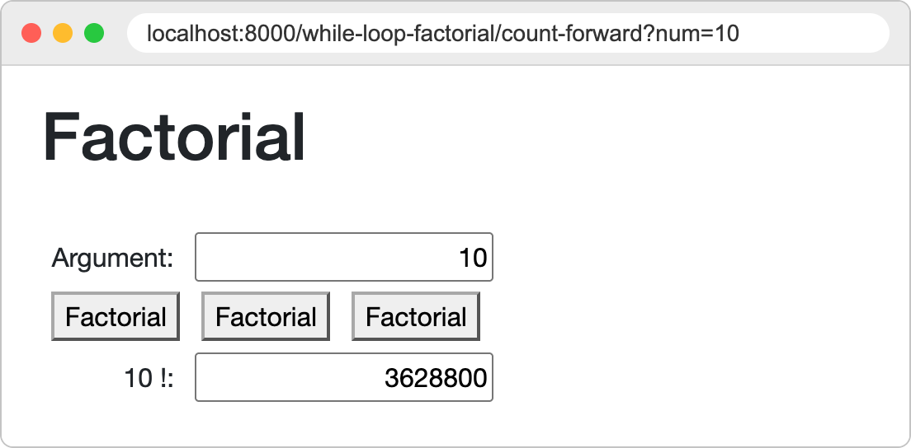
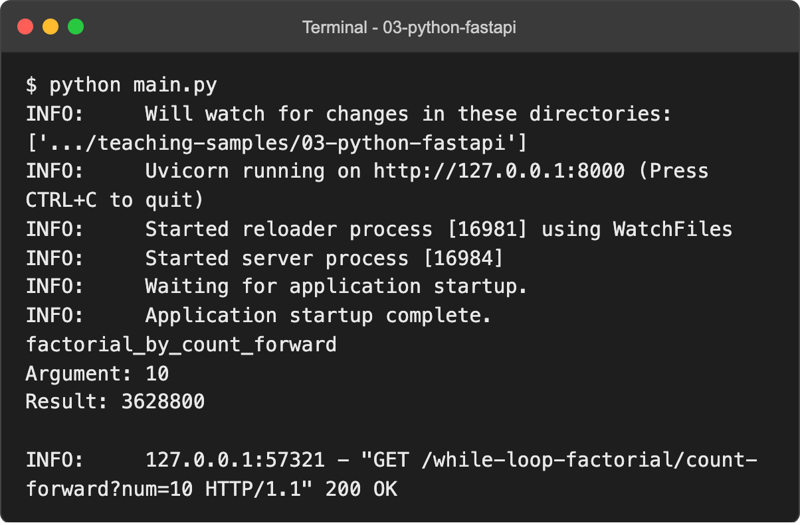
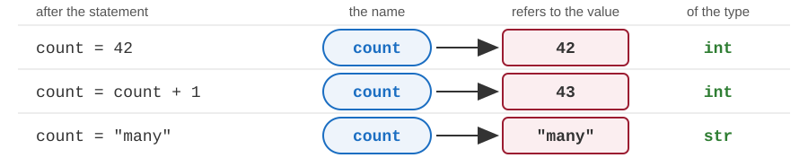
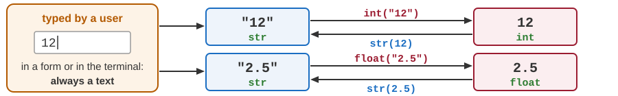
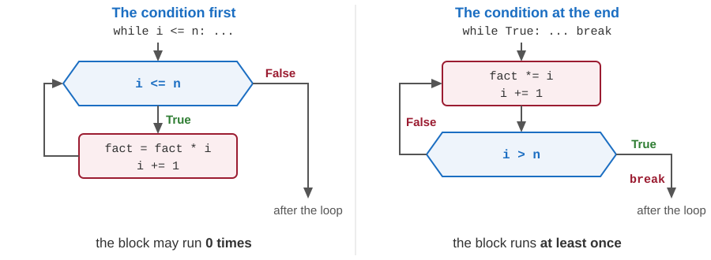
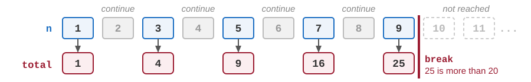
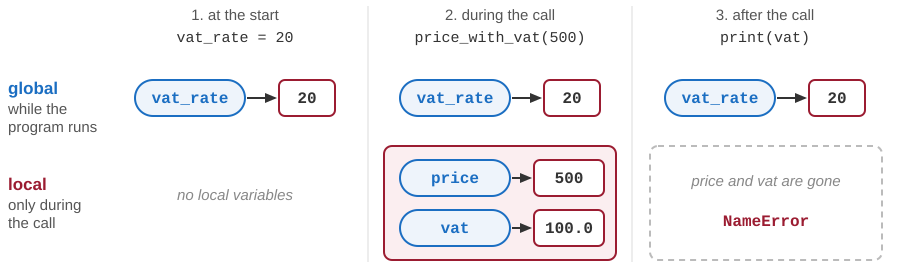
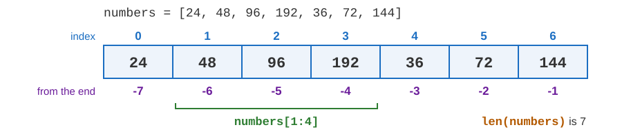

# Python: procedural programming

Developing Software Solutions

---

## From the introduction to the details

- The introduction to Python (lecture 02-01) ran small programs in the terminal. This lecture goes through the procedural part of the language in more detail.
- **Procedural programming**: a program is a sequence of statements, organised into functions. Classes and objects come in the next lecture.
- The examples come from the sample application of this module. It is started with `python main.py` in the folder `03-python-fastapi` (the archive of the module), and opened at `http://localhost:8000`.
- What its pages write with `print()` appears in that terminal. Sample: `pages/append_clear.py`

Note:
With an activated virtual environment the command is python on every system. Without one it may be python3 (macOS, Linux) or py (Windows).
The samples: start the application, open http://localhost:8000 and keep the terminal visible. Every "Sample:" line on the following slides names the Python file of one page. Today we read only the plain Python in those files; the routes, the forms and the templates belong to the lecture about FastAPI and Jinja2.
The topics that the introduction already showed - variables, if, loops, lists, dictionaries, functions - come back here with more detail and with the pages of the application. They can be taken faster.

---

## The sample application at work

<div class="columns"><div>



</div><div>



</div></div>

- The page *Factorial W* after the argument 10 and the first button. The browser shows the page; the terminal shows what the function wrote with `print()`, and a line for every request.

Sample: `pages/while_loop_factorial.py`

---

## Statements and blocks

```python
amount = 12500

if amount > 10000:
    print("A large order.")          # these two lines are a block: they are
    print("The discount is 5 %.")    # executed only if the condition is true
print("Done.")                       # not indented, so not a part of the block
```

- One **statement** per line; no semicolon is needed at the end. The statements are executed in the order in which they are written.
- A line that ends with a colon opens a **block**: the indented lines below it.
- There are no braces around a block, as there are in CSS. The indentation alone shows where the block begins and ends.
- The convention is 4 spaces for each level. Wrong indentation is an error - or a different program.

Sample: `pages/hello_world.py`

Note:
A long statement may continue on the following lines if it is written inside parentheses - see the function multiply_2 in pages/operations.py.

---

## Comments, docstrings and names

```python
"""Calculates the price of an order."""

# a comment: Python ignores everything from the sign # to the end of the line
unit_price = 250.0
quantity = 3
total_price = unit_price * quantity    # a comment may follow a statement
print(Total_Price)                     # NameError: name 'Total_Price' is not defined.
                                       # Did you mean: 'total_price'?
```

- A **comment** begins with `#`. It is meant for the people who read the program.
- A **docstring** is a text between triple quotes at the beginning of a file or of a function: it tells what that file or function is for.
- Names consist of letters, digits and `_`, and do not begin with a digit. The convention is `lower_case_with_underscores`.
- Python is **case sensitive**: `total_price` and `Total_Price` are two different names.

Note:
On the following slides a comment after print() shows what that statement writes. Every sample file begins with a docstring that says what the page demonstrates.

---

## Variables and assignment



- A **variable** is a name for a value. The first assignment creates it - there are no declarations.
- `=` is not the "equals" of mathematics: the right side is calculated first, and then the name on the left is attached to the result.
- **Dynamic typing**: the type belongs to the value, not to the name. `type(count)` shows the type of the current value: `<class 'str'>`.

Sample: `pages/incrementer.py`

Note:
Giving a name a value of another type is allowed, but it makes a program hard to read. In practice one variable keeps one kind of value.

---

## The built-in types

| Type | Values | Examples |
|---|---|---|
| `int` | whole numbers | `42`, `-7`, `0` |
| `float` | numbers with a decimal point | `3.14`, `-0.5`, `2.0` |
| `bool` | logical values | `True`, `False` |
| `str` | text - a *string* of characters | `"Hello"`, `'Belgrade'` |
| `NoneType` | a single value that means "nothing" | `None` |

- `True`, `False` and `None` begin with a capital letter.
- `None` stands where a value is missing - for example, a result that could not be calculated. Sample: `pages/while_loop_factorial.py`
- Other types come from modules (`Decimal`) or hold many values (lists, tuples, dictionaries). We meet them later in this lecture.

---

## Type hints

```python
quantity: int = 3                 # a hint: "quantity is meant to be a whole number"
unit_price: float = 250.0


def total_price(unit_price: float, quantity: int) -> float:
    return unit_price * quantity


print(total_price(250.0, 3))      # 750.0
quantity = "three"                # no error: the hints are not checked
```

- A **type hint** tells which type we expect: `name: type` for a variable or for a parameter of a function, `-> type` for the result of a function.
- Python does not check the hints when the program runs. They are documentation for the reader, and editors use them to warn about mistakes.
- The samples use hints in the first lines of their functions. Sample: `helpers/mathematics.py`

Note:
Two hints from the samples that need a word of explanation: `list[float]` is a list of numbers, and `int | None` is a whole number or None.

---

## Numbers: int, float and Decimal

```python
import math                                 # two modules that come with Python;
from decimal import Decimal                 # import is explained later in this lecture

print(math.factorial(30))                   # 265252859812191058636308480000000
print(0.1 + 0.2)                            # 0.30000000000000004
print(0.1 + 0.2 == 0.3)                     # False
print(Decimal("0.1") + Decimal("0.2"))      # 0.3

price = Decimal("19.99")
print(price * 3)                            # 59.97
```

- An `int` has **no upper limit**: a number takes as much memory as it needs. Sample: `pages/while_loop_factorial.py` - try 30, then 100.
- A `float` keeps about 15-16 significant digits, in binary form. Most decimal fractions, such as 0.1, have no exact binary form, so small errors appear. Do not compare `float` values with `==`.
- A `Decimal` calculates with decimal digits, as we do on paper. It is the right type for money. Create it from a text, not from a `float`. Sample: `pages/decrementer.py`

Note:
In many languages whole numbers have a fixed size, usually 64 bits; 20! is the largest factorial that fits into 64 bits. Python has no such limit. On the factorial page 1000 still works (2568 digits). For 2000 the page shows an error: the number is calculated, but by default Python refuses to turn an int with more than 4300 digits into text.
Decimal(0.1) would take over the error of the float - that is why the sample writes Decimal("0.5"). Decimal and float cannot be mixed in one expression (TypeError); Decimal and int can. For display, a float is rounded: round(x, 2), or the format :.2f of an f-string.

---

## Arithmetic operators

| Operator | Meaning | Example | Result |
|---|---|---|---|
| `+` `-` `*` | addition, subtraction, multiplication | `17 - 5 * 2` | `7` |
| `/` | division - the result is always a `float` | `17 / 5` | `3.4` |
| `//` | integer division - the quotient is rounded down | `17 // 5` | `3` |
| `%` | the remainder of the integer division | `17 % 5` | `2` |
| `**` | power | `2 ** 10` | `1024` |

- Multiplication and division come before addition and subtraction. Parentheses change the order: `(17 - 5) * 2` is `24`.
- `x += 2` is a shorter way to write `x = x + 2`. The same works with `-=`, `*=`, `/=` and the other operators.
- There are no operators `++` and `--`: we write `x += 1` and `x -= 1`.

Sample: `pages/incrementer.py`, `pages/inc_dec.py`, `pages/operations.py`

---

## Comparison and logical operators

```python
age = 25
income = 40000

print(age >= 18)                         # True
print(age == 30)                         # False    == compares, = assigns
print(age != 30)                         # True     != means "is not equal to"
print(age >= 18 and income > 50000)      # False    and: both conditions must be true
print(age >= 18 or income > 50000)       # True     or: at least one must be true
print(not age >= 18)                     # False    not: the opposite
print(18 <= age < 65)                    # True     the same as: 18 <= age and age < 65
```

- The comparison operators are `==`, `!=`, `<`, `<=`, `>` and `>=`. The result of a comparison is a `bool`.
- The logical operators are words: `and`, `or`, `not`.

Sample: `pages/function_guessing.py` - `return game_started and not user_lost`

Note:
A bool can be kept in a variable like any other value: pages/while_loop_power.py remembers whether the exponent is negative (exponent_is_negative = True) and tests it later with "if not exponent_is_negative:".

---

<!-- .slide: class="exercise" -->
## Exercise 1: predict, then check

Write down on paper what each line gives. Then start the interactive prompt (`python`), type `from decimal import Decimal`, and check your answers line by line.

```python
17 // 5
-17 // 5
17 % 5
10 / 5
0.1 * 3 == 0.3
Decimal("0.1") * 3
18 <= 20 < 65
not (5 > 3 and 2 > 4)
type(10 / 5)
```

*About 5 minutes.*

<details><summary>Solution</summary>

```python
17 // 5                  # 3
-17 // 5                 # -4               rounded down: -3.4 becomes -4, not -3
17 % 5                   # 2
10 / 5                   # 2.0              / always gives a float
0.1 * 3 == 0.3           # False            0.1 * 3 is 0.30000000000000004
Decimal("0.1") * 3       # Decimal('0.3')   exact
18 <= 20 < 65            # True             18 <= 20 and 20 < 65
not (5 > 3 and 2 > 4)    # True             the parentheses are False
type(10 / 5)             # <class 'float'>
```

</details>

Note:
The two surprises are -17 // 5 and 0.1 * 3 == 0.3. Ask the students who got them right to explain them to the others.

---

## Strings

```python
first_name = "Ana"
last_name = 'Petrović'                       # single or double quotes - no difference
full_name = first_name + " " + last_name     # + joins texts: concatenation

print(full_name)                             # Ana Petrović
print(len(full_name))                        # 12 - the number of characters
print("It's late.")                          # a quote of the other kind may be inside
print("Hello world!!!\nGoodbye.")            # \n starts a new line: two lines are written
```

- A string (`str`) is a text between quotes. It may contain the letters of any alphabet: `"Београд"`.
- The backslash begins an **escape sequence**: `\n` is a new line, `\t` a tab, `\"` a quote, `\\` the backslash itself.

Sample: `pages/hello_world.py` - every line of the message ends with `"\n"`

---

## f-strings

```python
name = "notebook"
price = 1249.5
quantity = 3

print(f"{quantity} x {name}")                    # 3 x notebook
print(f"Total: {price * quantity}")              # Total: 3748.5
print(f"Total: {price * quantity:.2f} RSD")      # Total: 3748.50 RSD
print(f"Total: {price * quantity:,.2f}")         # Total: 3,748.50
print("Total: " + str(price * quantity))         # Total: 3748.5 - without an f-string
```

- An **f-string** has the letter `f` in front of the first quote. Every `{expression}` in it is replaced by the value of the expression.
- A format may follow after a colon: `:.2f` shows two decimals, `:,.2f` also separates the thousands.

Sample: `pages/operations.py` - the same message is built with `+` in `plus_2` and with an f-string in `minus_2`

---

## String methods

```python
city = "Belgrade"
print(city.upper())                      # BELGRADE
print(city.lower())                      # belgrade
print(city)                              # Belgrade - the original text is not changed

answer = "  yes \n"
print(answer.strip())                    # yes - spaces and new lines at both ends are removed
print("2026-10-02".split("-"))           # ['2026', '10', '02'] - a list of the parts
```

- A **method** is a function that belongs to a value. It is called with a dot: `value.method()`.
- Strings are **immutable**: no method changes the text - each one gives back a new text. To keep the result, assign it: `city = city.upper()`.
- A character can be read by its position (`city[0]` is `"B"`), but not replaced.

---

## From text to numbers and back

```python
print("12" + "3")               # 123          + joins two texts ...
print(int("12") + 3)            # 15           ... and adds two numbers
print(float("2.5") * 2)         # 5.0
print("Total: " + str(15))      # Total: 15
print("Total: " + 15)           # TypeError: can only concatenate str (not "int") to str
```

- `int()` makes a whole number out of a text, `float()` a number with decimals. `str()` makes a text out of any value.
- Python does not guess what we meant: a text and a number cannot be added.
- Everything that a user types - in the terminal or into a form on a web page - reaches the program as **text**. It has to be converted before we calculate with it.



Note:
In a program that runs in the terminal, input() reads one line typed by the user - as a text. In this course the input comes from the forms of web pages.

---

## When the text is not a number

```python
text = "abc"
n = int(text)
print(n + 1)
```

```text
Traceback (most recent call last):
  File ".../convert.py", line 2, in <module>
    n = int(text)
ValueError: invalid literal for int() with base 10: 'abc'
```

- The program stops in line 2. The last line of the message names the error (`ValueError`) and its cause; the lines above it tell where it happened.
- `int("12.5")` and `float("12,5")` fail in the same way: a whole number has no decimals, and the decimal sign is a point, not a comma.
- In the sample application FastAPI does the conversion, guided by the type hints (`num: int`). When it fails, the page **Invalid input** is shown. Sample: `pages/while_loop_factorial.py`

Note:
Demo: type abc, and then 2.5, as the argument of the factorial. The page says "num: Input should be a valid integer, unable to parse string as an integer". On the page Min Max 5 try 1,5 instead of 1.5. The message on the slide is the one written by Python 3.13 and 3.14; Python 3.12 adds a line of ^ characters that marks the place of the error. How a program catches such an error itself (try - except) is a topic of the next lecture.

---

<!-- .slide: class="exercise" -->
## Exercise 2: names and dates

Write `texts.py`, which begins with two texts:

```python
full_name = "  ana petrović  "
date = "2026-10-02"
```

1. Remove the spaces at both ends, and write the name in capital letters.
2. Write the initials. `split(" ")` gives the two words, and `[0]` is the first character of a word.
3. From the date, write the day and the month without the leading zero (hint: `int()`), and the year in 10 years.

```text
ANA PETROVIĆ
A.P.
2.10.2026.
In 10 years: 2036
```

*About 10 minutes.*

<details><summary>Solution</summary>

```python
full_name = "  ana petrović  "
date = "2026-10-02"

name = full_name.strip()
print(name.upper())

parts = name.split(" ")
print(f"{parts[0][0].upper()}.{parts[1][0].upper()}.")

d = date.split("-")
print(f"{int(d[2])}.{int(d[1])}.{d[0]}.")
print(f"In 10 years: {int(d[0]) + 10}")
```

- Every method gives back a new text: `name = full_name.strip()` keeps the result.
- `int("02")` is 2: the zero disappears when the text becomes a number. `d[0] + 10` would be a `TypeError`.

</details>

---

## Branching: if / elif / else

```python
if number < 100:
    comparison_result = f"{number} less than 100!"
elif number == 100:
    comparison_result = f"{number} equal to 100!"
else:
    comparison_result = f"{number} greater than 100!"
```

- The conditions are checked from the top. The block of the first true condition is executed, and the rest is skipped.
- `elif` and `else` are optional. Without them, the block is simply skipped when the condition is false.
- A **conditional expression** chooses between two values in one line:

```python
relation = "less than" if number < 100 else "not less than"
```

Sample: `pages/operations.py`, `pages/min_max.py`

Note:
operations.py shows four forms: three separate if statements (all three conditions are always checked), if - elif - else, the same with f-strings, and a conditional expression. min_max.py finds the smallest of five numbers with a series of if statements.

---

## Branching: match

```python
match shape:
    case "circle":
        area = math.pi * x * x
    case "square":
        area = x * x
    case "rectangle":
        area = x * y
    case _:
        area = -math.inf        # the shape is not known
```

- `match` compares one value with several cases. The block of the first case that fits is executed.
- `case _:` fits every value. It is the "in all other cases" branch, and it is written last.
- One case can list several values: `case "square" | "rectangle":`
- `match` is available from Python 3.10 on.

Sample: `pages/geometry.py` (with `if` - `elif` - `else`), `pages/geometry_2.py` (with `match`)

---

<!-- .slide: class="exercise" -->
## Exercise 3: the seasons

Write `season.py`. It asks for the number of a month, and writes the season and the half of the year:

1. Find the season with `match`: `case 12 | 1 | 2:` is winter, then come spring, summer and autumn. `case _:` takes everything else - that is not a month.
2. Choose the half with a conditional expression: `"first" if ... else "second"`.

```text
Month (1-12): 4
4: spring, the first half of the year

Month (1-12): 13
13 is not a month.
```

*About 10 minutes.*

<details><summary>Solution</summary>

```python
month = int(input("Month (1-12): "))

match month:
    case 12 | 1 | 2:
        season = "winter"
    case 3 | 4 | 5:
        season = "spring"
    case 6 | 7 | 8:
        season = "summer"
    case 9 | 10 | 11:
        season = "autumn"
    case _:
        season = "not a month"

half = "first" if month <= 6 else "second"
if season == "not a month":
    print(f"{month} is not a month.")
else:
    print(f"{month}: {season}, the {half} half of the year")
```

</details>

Note:
The same with if - elif needs conditions such as month == 12 or month == 1 or month == 2 - a good moment to compare the two forms.

---

## Loops: while

```python
n = 5
i = 1
fact = 1
while i <= n:
    fact = fact * i
    i += 1              # without this line the loop would never end
print(fact)             # 120, which is 1 * 2 * 3 * 4 * 5
```

- `while` repeats its block as long as the condition is true.
- The condition is checked **before** every repetition. If it is false at the very beginning, the block is not executed at all: for `n = 0` the result is 1.
- Something in the block has to change the condition. Otherwise the loop is endless, and only Ctrl+C stops the program.

Sample: `pages/while_loop_factorial.py`, `pages/while_loop_power.py`

---

## A loop with the condition at the end

```python
n = 5
i = 1
fact = 1
while True:
    fact *= i
    i += 1
    if i > n:           # the loop continues while i <= n
        break
print(fact)             # 120
```

- `while True` is an endless loop. The statement `break` leaves it.
- The condition is checked at the **end** of the block, so the block is always executed at least once.
- Many languages have a special statement for such a loop (*do - while*). Python does not - this is how it is written.

Sample: `pages/do_while_loop_factorial.py`, `pages/do_while_loop_power.py`

Note:
"At least once" has a price: in the sample, the version that counts backward needs a separate if for n = 0, because its block would multiply by 0.

---

## Where is the condition checked?



- For `n = 0` the block on the left is not executed at all; the block on the right is executed once.

---

## Loops: for and range()

```python
n = 5
fact = 1
for i in range(1, n + 1):       # i takes the values 1, 2, 3, 4, 5
    fact *= i
print(fact)                     # 120
```

| Call | Values | Meaning |
|---|---|---|
| `range(5)` | 0, 1, 2, 3, 4 | from 0 up to 5 - the end is not included |
| `range(1, 6)` | 1, 2, 3, 4, 5 | forward, from 1 |
| `range(5, 0, -1)` | 5, 4, 3, 2, 1 | backward: the third argument is the step |
| `range(0, 10, 2)` | 0, 2, 4, 6, 8 | every second number |

- `for` gives the variable the values of a sequence, one after another, and executes the block for each of them.

Sample: `pages/for_loop_factorial.py`, `pages/for_loop_power.py`

---

## break and continue

```python
total = 0
for n in range(1, 100):
    if n % 2 == 0:
        continue          # an even number: skip it and go on with the next n
    total += n
    if total > 20:
        break             # the sum is large enough: leave the loop
print(n, total)           # 9 25    (25 is 1 + 3 + 5 + 7 + 9)
```



- `break` leaves the loop at once. The program goes on with the first statement after the loop.
- `continue` ends only the current repetition: the loop goes on with the next one.
- Both work in `while` and in `for` loops, and they are almost always inside an `if`.

---

<!-- .slide: class="exercise" -->
## Exercise 4: find the bugs

<div class="columns"><div>

```python
# should write 55, the sum of 1 to 10,
# but writes 45
total = 0
for i in range(1, 10):
    total += i
print(total)
```

</div><div>

```python
# should write 3, 2, 1 and Start!,
# but it never stops
n = 3
while n > 0:
    print(n)
print("Start!")
```

</div></div>

1. Find and correct both mistakes. Ctrl+C stops the second program.
2. Then write a `for` loop with `range` and `continue` that writes the numbers from 1 to 20 that are divisible by 3 but not by 2: 3, 9 and 15, one per line.

*About 10 minutes.*

<details><summary>Solution</summary>

```python
for i in range(1, 11):      # the end is not included: 11, not 10
```

```python
while n > 0:
    print(n)
    n -= 1                  # without it, n stays 3 and the condition is always true
```

```python
for n in range(1, 21):
    if n % 2 == 0:
        continue            # an even number: go on with the next n
    if n % 3 == 0:
        print(n)
```

</details>

---

## Functions

```python
def fact(n: int) -> int:
    """Calculates the factorial of n."""
    result = 1
    for i in range(1, n + 1):
        result *= i
    return result


print(fact(5))                # 120
print(fact(3) + fact(4))      # 30
```

- `def` defines a **function**. Its body is executed only when the function is **called**.
- In the call `fact(5)` the **argument** 5 becomes the value of the **parameter** `n`.
- `return` ends the function and gives the result back to the place of the call.
- A function without `return` gives back `None`. The docstring tells what the function does.

Sample: `pages/function_factorial.py`, `pages/function_guessing.py`

---

## Default values and keyword arguments

```python
def power(the_base: float, exp: int = 2) -> float:
    """Raises the_base to the power exp."""
    res = 1.0
    for i in range(exp):
        res *= the_base
    return res


print(power(3, 4))                 # 81.0   positional: in the order of the parameters
print(power(3))                    # 9.0    exp is left out and gets its default value 2
print(power(exp=3, the_base=2))    # 8.0    keyword arguments: by name, in any order
```

- A parameter with a **default value** may be left out in the call. Such parameters are written after the others.
- A **keyword argument** names its parameter: `render(request, num=0, result=1)`. Such a call is easier to read.

Sample: `pages/function_power.py`, `pages/function_factorial.py` (the function `render`)

---

## Local and global variables

```python
vat_rate = 20                         # global: assigned outside of all functions


def price_with_vat(price):
    vat = price * vat_rate / 100      # price and vat are local; vat_rate is only read
    return price + vat


print(price_with_vat(500))            # 600.0
print(vat_rate)                       # 20
print(vat)                            # NameError: name 'vat' is not defined
```

- A variable that is assigned inside a function is **local**, and so are the parameters. It is created when the function is called and disappears when the function returns.
- A variable that is assigned outside of all functions is **global**. It exists as long as the program runs, and every function of the file can read it.
- Two functions can use the same local name: each of them has its own variable.

---

## Local variables live only during the call



- Every call creates its local variables anew, and the return removes them. The global `vat_rate` stays as long as the program runs.

---

## The statement global

```python
current_count = 42                    # a global variable keeps the state of the page


def increment_count():
    global current_count              # the assignment below changes the global variable
    current_count = current_count + 1


increment_count()
increment_count()
print(current_count)                  # 44
```

- An assignment inside a function creates a local variable - unless the name is declared with `global`. Without that line, this function stops with an `UnboundLocalError`.
- A page of the sample application is made of functions: one shows the page, another is executed when a button is pressed. What has to survive between two clicks is kept in a global variable.

Sample: `pages/incrementer.py`, `pages/hello_world.py`, `pages/function_guessing.py`

Note:
In incrementer.py the function show() only reads current_count, so it needs no global statement; increment_count() assigns to it, so it does. The state is kept in the memory of the running application: it is shared by all visitors, and it is lost when the application is restarted. Later in the course the data moves to a database.

---

<!-- .slide: class="exercise" -->
## Exercise 5: a Reset button

Work in a copy of the folder `03-python-fastapi` - e.g. unzip `03-python-fastapi.zip` once more, into another folder.

1. In `pages/incrementer.py`, add a function for `POST /incrementer/reset`. It sets `current_count` back to 0 and redirects to `/incrementer` - like `increment_count`.
2. In `templates/incrementer.html`, add a second form, with a button *Reset* that sends a POST to that address.
3. Start the application, press *Increase* three times, then *Reset*: the page shows `Current count: 0`.
4. Remove the line `global current_count` from your function, and try again. What happens now - and why?

*About 15 minutes.*

<details><summary>Solution</summary>

```python
@router.post("/incrementer/reset")
def reset_count():
    global current_count

    current_count = 0

    return RedirectResponse("/incrementer", status_code=status.HTTP_303_SEE_OTHER)
```

```html
<form action="/incrementer/reset" method="post">
    <button class="btn btn-outline-secondary">Reset</button>
</form>
```

- Without `global` there is no error, but the count is not reset: `current_count = 0` creates a local variable, which disappears when the function returns.

</details>

Note:
Step 4 is the point of the exercise: a quiet mistake, without any message. Compare with increment_count, where the missing global gives an UnboundLocalError, because the old value is read first.

---

## Modules and packages

- A **module** is a file with Python code: `helpers/mathematics.py`. A **package** is a folder that contains modules: `helpers`, `pages`.
- A module **imports** what it needs from another module - in one of three forms:

```python
import helpers.list_helper                           # 1. the module, with its full name
print(helpers.list_helper.minimum([7, 5, 9]))        # 5     package.module.function

from helpers import list_helper                      # 2. the module, taken from its package
print(list_helper.minimum([7, 5, 9]))                # 5     module.function

from helpers.list_helper import minimum, maximum     # 3. the functions themselves
print(minimum([7, 5, 9]))                            # 5     function
```

- With the name of the module in front (`mathematics.power`) we see where a function comes from, and two modules can use the same name without a conflict.

Sample: `pages/list_iteration_module.py`, `pages/module_namespace_power.py`

Note:
Python looks for a module in the folder of the program that was started (main.py), then in the standard library and among the installed packages. That is why helpers and pages are found. A file named `__init__.py` marks a folder as a package; in the samples it holds only a docstring.

---

## The standard library

| Module | What it offers | Example |
|---|---|---|
| `math` | mathematical functions and constants | `math.sqrt(16)`, `math.pi` |
| `random` | random numbers | `random.randint(1, 100)` |
| `decimal` | exact decimal numbers | `Decimal("0.1")` |
| `datetime` | dates and times | `datetime.date.today()` |
| `json` | reading and writing data in the JSON format | `json.loads(text)` |

- The **standard library** is a large collection of modules that is installed together with Python. An `import` is all it takes.
- Samples: `pages/geometry.py` (`math`), `pages/function_guessing.py` (`random`), `pages/decrementer.py` (`decimal`).
- Other packages, such as FastAPI and Jinja2, are not a part of Python. They are installed with `pip`.

Note:
Do not give your own file the name of a standard module (random.py, json.py): import would then find your file instead of the module.

---

## Lists



- A **list** keeps several values under one name, in a fixed order. It is written in square brackets.
- The elements are numbered from 0. The first one is `numbers[0]`, the last one is `numbers[len(numbers) - 1]` - or shorter, `numbers[-1]`.
- An index that does not exist stops the program with an `IndexError`: `numbers[7]`.

Sample: `pages/list_indexing.py`

---

## Slices and changes

```python
numbers = [24, 48, 96, 192, 36, 72, 144]

print(numbers[1:4])       # [48, 96, 192]   a slice: from index 1 up to 4 - 4 is not included
print(numbers[:2])        # [24, 48]        the first two elements
print(numbers[-2:])       # [72, 144]       the last two elements

numbers[0] = 25           # an element gets a new value
numbers.append(288)       # a new element is added at the end
print(numbers)            # [25, 48, 96, 192, 36, 72, 144, 288]

empty = []                # a list without elements: len(empty) is 0
zeros = [0.0] * 5         # [0.0, 0.0, 0.0, 0.0, 0.0]
```

- A slice is a new list. The original list stays as it was.
- Unlike a string, a list is **mutable**: its elements can be replaced, added and removed.

Sample: `pages/list_indexing.py`

---

## Going through a list

```python
seasons = ["spring", "summer", "autumn", "winter"]

for s in seasons:                    # s is the element itself: spring, summer ...
    print(s)

for i in range(len(seasons)):        # i is the index: 0, 1, 2, 3
    print(i, seasons[i])

for i, s in enumerate(seasons):      # the index and the element together
    print(f"{i}: {s}")               # 0: spring, 1: summer ...
```

- The first form is the simplest. Use it whenever the index is not needed.
- `enumerate()` gives the index and the element at the same time.
- A typical task: a variable collects the result while the loop goes through the list - a sum, the smallest element, a text.

Sample: `pages/list_iteration.py`

---

## Lists as arguments of functions

```python
def average(arr: list[float]) -> float:
    r = 0
    for x in arr:
        r += x
    return r / len(arr)


marks = [9.7, 9.4, 9.6, 9.9]
print(average(marks))                    # 9.65
print(average([120, 80, 200, 150]))      # 137.5
```

- A list is passed to a function like any other value; its hint is `list[float]`.
- The function gets the list itself, not a copy: if it changes an element, the caller sees the change.
- Python already has `len()`, `min()`, `max()`, `sum()` and `sorted()`. The module `helpers/list_helper.py` writes such functions by hand, to practise loops.

Sample: `pages/list_iteration_function.py`, `pages/list_min_max_5.py`

---

## A list of lists: a table

```python
sales = [
    [120, 135, 150],        # row 0: the first shop in January, February and March
    [80, 95, 70],           # row 1: the second shop
    [200, 210, 190],        # row 2: the third shop
]

print(sales[1])             # [80, 95, 70]   a whole row
print(sales[1][2])          # 70             row 1, column 2
print(len(sales))           # 3              the number of rows

total = 0
for row in sales:           # a loop inside a loop goes through all the cells
    for value in row:
        total += value
print(total)                # 1250
```

<div class="columns"><div>

- The elements of a list can be lists themselves. A list of rows is a **table**.
- Two indexes lead to one cell: first the row, then the column.

</div><div>

![The list sales as a table of 3 rows and 3 columns: sales[1] is the whole row 80, 95, 70, and sales[1][2] is the cell in row 1, column 2 - the value 70](images/python-list-of-lists.svg)

</div></div>

---

<!-- .slide: class="exercise" -->
## Exercise 6: the totals of a table

Write `totals.py`, which begins with the list `sales` of the previous slide:

1. A function `row_totals(table)` returns a list with the sum of every row: the total of every shop.
2. A function `column_totals(table)` returns a list with the sum of every column: the total of every month.
3. Write the number of the best shop, and its total. The shops are numbered from 1.

```text
[405, 245, 600]
[400, 440, 410]
The best shop: 3 (600)
```

*About 15 minutes.*

<details><summary>Solution</summary>

```python
def row_totals(table):
    result = []
    for row in table:
        result.append(sum(row))
    return result

def column_totals(table):
    result = [0] * len(table[0])        # one total for every column
    for row in table:
        for i in range(len(row)):
            result[i] += row[i]
    return result

totals = row_totals(sales)
print(totals)
print(column_totals(sales))

best = 0                                # the index of the best shop so far
for i in range(len(totals)):
    if totals[i] > totals[best]:
        best = i
print(f"The best shop: {best + 1} ({totals[best]})")
```

</details>

---

## Tuples

```python
page = ("Hello world", "/hello-world")     # a tuple: values in parentheses, with commas
print(page[0])                             # Hello world
title, address = page                      # unpacking: one name for every element


def min_max(arr):
    return min(arr), max(arr)              # two results, given back as one tuple


lowest, highest = min_max([24, 48, 96])
print(lowest, highest)                     # 24 96
```

- A **tuple** is a sequence like a list, but it is immutable: its elements cannot be replaced, added or removed.
- It is used for a few values that belong together, and for functions with more than one result.
- `enumerate()` gives tuples of the form (index, element).

Sample: `templating.py` - the menu of the application is a list of tuples

---

## Dictionaries

```python
forecast = {"date": "2026-10-05", "temperature_c": 1, "summary": "Freezing"}

print(forecast["summary"])          # Freezing     a value is found by its key
forecast["temperature_c"] = 3       # the value of an existing key is replaced
forecast["wind"] = "strong"         # a new key is added
print(len(forecast))                # 4
print("rain" in forecast)           # False        is there such a key?

for key, value in forecast.items():
    print(key, "=", value)          # date = 2026-10-05, then temperature_c = 3 ...
```

- A **dictionary** (`dict`) holds pairs *key: value*, written in braces. A value is reached by its key, not by its position.
- A key that is not in the dictionary gives a `KeyError`.
- Data in the JSON format becomes dictionaries and lists (`sample-data/weather.json`). A page hands its values to the template as a dictionary: `{"message": message}`.

---

<!-- .slide: class="exercise" -->
## Exercise 7: the stock

Write `stock.py`, which begins with a dictionary and a list of tuples (product, quantity):

```python
stock = {"notebook": 12, "pen": 0, "backpack": 3}
orders = [("pen", 2), ("notebook", 5), ("ruler", 1), ("backpack", 4)]
```

Go through the orders and write one line for each. Change the stock only when the order can be fulfilled. At the end, write the dictionary.

```text
pen: not in stock
notebook: 5 sold, 7 left
ruler: unknown product
backpack: only 3 left
{'notebook': 7, 'pen': 0, 'backpack': 3}
```

*About 10 minutes.*

<details><summary>Solution</summary>

```python
for product, quantity in orders:
    if product not in stock:
        print(f"{product}: unknown product")
    elif stock[product] == 0:
        print(f"{product}: not in stock")
    elif quantity > stock[product]:
        print(f"{product}: only {stock[product]} left")
    else:
        stock[product] -= quantity
        print(f"{product}: {quantity} sold, {stock[product]} left")
print(stock)
```

- `for product, quantity in orders` unpacks every tuple. `not in` checks first, so `stock["ruler"]` never gives a `KeyError`.

</details>

---

## Summary

- A Python program is a text file. The interpreter executes its statements one by one, and the indentation marks the blocks.
- A variable is a name for a value. The type belongs to the value: `int`, `float`, `bool`, `str`, `None` - and `Decimal` for money.
- Text and numbers are different things: `int()`, `float()` and `str()` convert between them.
- `if` and `match` choose what is executed; `while` and `for` repeat it.
- A function is a named piece of a program, with parameters and a result. Modules and packages keep the functions in order.
- Lists, tuples and dictionaries hold many values under one name.

Next lecture: classes and objects.

---

<!-- .slide: class="exercise" -->
## Assignment: a report of the sales

A shop writes every sale into a journal: `2026-10-01;notebook;3;1250.00` - the date, the product, the quantity and the price of one piece. In the program, the journal is a list of such texts (next slide).

1. A module `sales.py` with three functions, with type hints and docstrings:
    - `parse(line)` returns a tuple (date, product, quantity as an `int`, price as a `Decimal`), or `None` if the line does not have four parts, or its quantity is not a whole number;
    - `quantities(sales)` and `amounts(sales)` return dictionaries: the pieces sold, and the quantity times the price, added up for every product.
2. A program `report.py` imports the module and writes the lines that are not valid, with their numbers. Then it writes a table of the products in alphabetical order, the total, and the product with the most pieces sold.

*About 45 minutes.* The solution: [exercises/03-02-python-procedural](https://github.com/kartelj/ekof_dss/tree/main/exercises/03-02-python-procedural)

---

<!-- .slide: class="exercise" -->
## Assignment: the journal and the report

<div class="columns"><div>

```python
journal = [
    "2026-10-01;notebook;3;1250.00",
    "2026-10-01;pen;10;120.50",
    "2026-10-02;backpack;1;4500.00",
    "2026-10-02;notebook;two;1250.00",
    "2026-10-02;pen;4",
    "2026-10-03;notebook;2;1250.00",
]
```

</div><div>

```text
Skipped line 4: 2026-10-02;notebook;two;1250.00
Skipped line 5: 2026-10-02;pen;4

backpack         1     4,500.00
notebook         5     6,250.00
pen             10     1,205.00
Total:                11,955.00
Most sold: pen (10 pieces)
```

</div></div>

- `"2026-10-02;pen;4".split(";")` has only three parts. `int("two")` gives a `ValueError`: catch it with `try` - `except`, as in the introduction to Python.
- The columns come from the formats `:12`, `:5` and `:12,.2f`. `sorted()` of a dictionary gives its keys in alphabetical order.
- `enumerate(journal, start=1)` numbers the lines from 1.

Note:
A possible extension: the amount of every day (a third dictionary, with the date as the key), or the journal read from a text file - files are not a topic of this lecture, so give the students open() and readlines() as a hint.

---

# Thanks for your attention!
