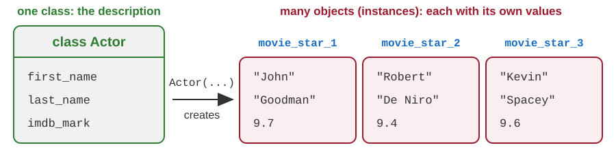
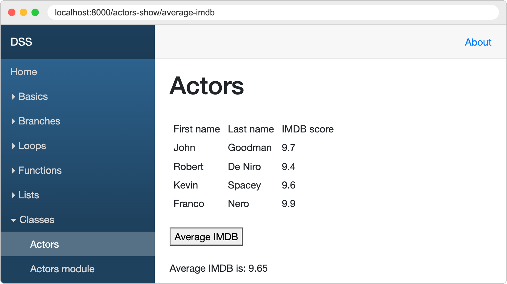
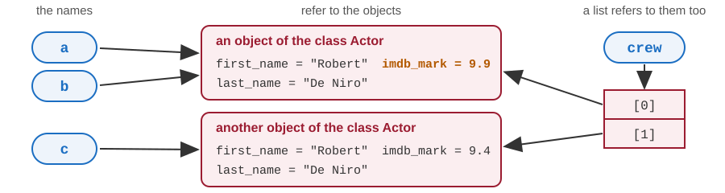
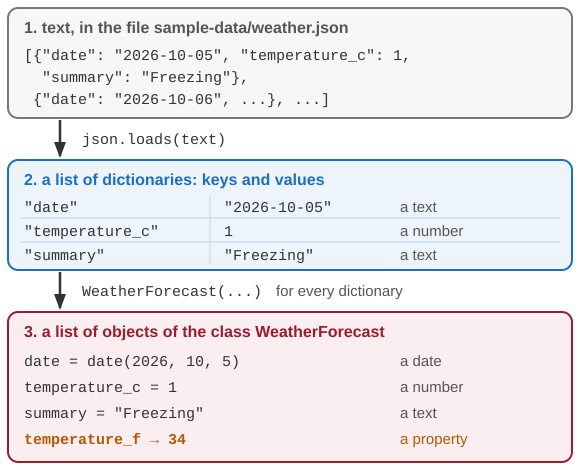
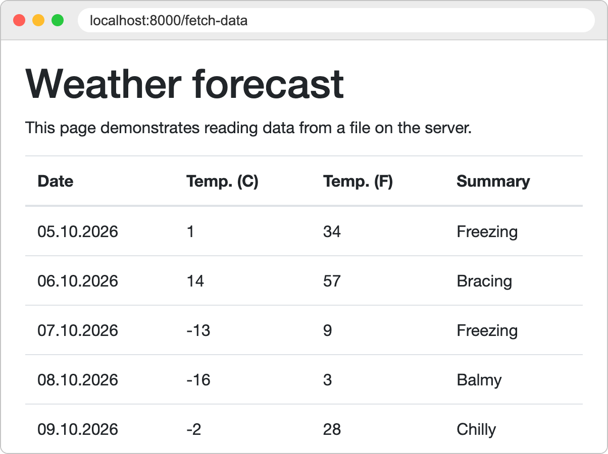
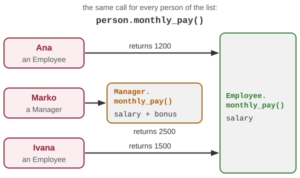
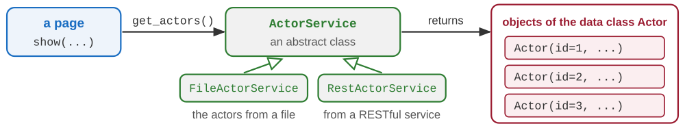

# Python: object-oriented programming

Developing Software Solutions

---

## Why objects?

So far the data has been kept in variables, lists and dictionaries, and the code in functions.

```python
actor = {"first_name": "Robert", "last_name": "De Niro", "imdb_mark": 9.4}

def full_name(a):
    return a["first_name"] + " " + a["last_name"]

print(full_name(actor))        # Robert De Niro
```

- Nothing says which keys an actor must have. A dictionary with a mistyped key is accepted - the error shows up later, in another part of the program.
- Nothing says that `full_name` belongs to actors: it accepts any dictionary.

**Object-oriented programming** joins the data and the functions that work with it into one **object**.

---

## Class and object



- A **class** is a description: what data every object of that kind holds, and what it can do.
- An **object** - also called an **instance** of the class - is one concrete thing made from that description, with its own values.
- You have used objects already: a text is an object of the class `str`, a list of the class `list`. `city.upper()` and `numbers.append(288)` call their methods.

---

## Defining a class

```python
class Actor:
    def __init__(self, first_name: str = "", last_name: str = "", imdb_mark: float = 0):
        self.first_name = first_name
        self.last_name = last_name
        self.imdb_mark = imdb_mark
```

- `class Actor:` starts the description. By convention the name begins with a capital letter.
- `__init__` - two underscores on each side - is called automatically for every new object. It gives the object its first values.
- `self` is the object that is being created.
- `self.first_name = first_name` creates an **attribute**: a variable that belongs to the object.

Sample: `models/actor.py`

Note:
`__init__` is often called the constructor. The type hints (`: str`) and the default values (`= ""`) are optional, exactly as in ordinary functions. With one underscore on each side (`_init_`) Python does not recognise the method, and `Actor("John")` fails: `TypeError: Actor() takes no arguments`.

---

## Creating objects

```python
# positional arguments: matched by their order
movie_star_1 = Actor("John", "Goodman", 9.7)

# keyword arguments: matched by their names, so the order is free
movie_star_2 = Actor(last_name="De Niro", imdb_mark=9.4, first_name="Robert")

# no arguments: the default values from __init__ are used
movie_star_3 = Actor()
movie_star_3.first_name = "Kevin"          # an attribute is reached with a dot
movie_star_3.last_name = "Spacey"
movie_star_3.imdb_mark = 9.6

print(movie_star_3.first_name, movie_star_3.last_name)        # Kevin Spacey
```

- A class is called like a function. Python makes a new object and runs `__init__` on it.
- Every object has its own attributes: changing `movie_star_3` does not affect the others.
- A page imports the class from its module: `from models.actor import Actor`.

Sample: `pages/actors_show.py`, `pages/actors_show_module.py`

Note:
In the two sample files every actor is created with keyword arguments.

---

## A list of objects

```python
movie_star_4 = Actor(last_name="Nero", imdb_mark=9.9, first_name="Franco")
film_crew = [movie_star_1, movie_star_2, movie_star_3, movie_star_4]

total = 0
for a in film_crew:
    total += a.imdb_mark             # a is one actor after another
avg_imdb = total / len(film_crew)
print(avg_imdb)                      # 9.65
```

The template goes through the same list - one row of the table for every actor:

```html

<tr>
    <td>{{ act.first_name }}</td>
    <td>{{ act.last_name }}</td>
    <td>{{ act.imdb_mark }}</td>
</tr>

```

Sample: `pages/actors_show.py`, `templates/actors_show.html`

Note:
Demo: the page Classes - Actors of the sample application; the button Average IMDB shows 9.65. The page Actors module (`pages/actors_show_module.py`) does the same with three actors, but the average is calculated by the function `average` from the module `helpers/list_helper.py`.

---

## The list on the page



Every object of the list `film_crew` is one row of the table. The button *Average IMDB* runs the loop of the previous slide.

---

## Methods

```python
class Actor:
    def __init__(self, first_name: str = "", last_name: str = "", imdb_mark: float = 0):
        self.first_name = first_name
        self.last_name = last_name
        self.imdb_mark = imdb_mark

    def full_name(self) -> str:
        return self.first_name + " " + self.last_name

    def is_better_than(self, limit: float) -> bool:
        return self.imdb_mark > limit

star = Actor("Robert", "De Niro", 9.4)
print(star.full_name())              # Robert De Niro
print(star.is_better_than(9.0))      # True
```

- A **method** is a function written inside a class. It works with the data of its object.
- Its first parameter is `self`: the object in front of the dot. Python passes it for us.
- Through `self` the method reaches the attributes and the other methods of that object.

Note:
A frequent mistake is to forget `self` in the definition of a method. The call then fails: `TypeError: Actor.full_name() takes 0 positional arguments but 1 was given`.

---

## Showing an object as text

```python
class Actor:
    def __init__(self, first_name: str = "", last_name: str = "", imdb_mark: float = 0):
        self.first_name = first_name
        self.last_name = last_name
        self.imdb_mark = imdb_mark

    def __str__(self) -> str:          # for the user: print(), str(), f-strings
        return f"{self.first_name} {self.last_name} ({self.imdb_mark})"

    def __repr__(self) -> str:         # for the programmer: the debugger, a list of objects
        return f"Actor('{self.first_name}', '{self.last_name}', {self.imdb_mark})"

star = Actor("Robert", "De Niro", 9.4)
print(star)                            # Robert De Niro (9.4)
print([star])                          # [Actor('Robert', 'De Niro', 9.4)]
```

- Without them, `print(star)` shows `<__main__.Actor object at 0x101773230>`.
- These are **special methods**: we write them, and Python calls them when it needs a text.
- A class that has only `__repr__` is printed with it as well.

Note:
The number in the default text is the address of the object in memory; it is different in every run.

---

<!-- .slide: class="exercise" -->
## Exercise 1: the class Film

1. In a new file `films.py`, the class `Film` with the attributes `title`, `year` and `rating`.
2. The method `age(self, this_year: int) -> int`, and `__str__` that gives the text `Fargo (1996) 8.1`.
3. A list of three films. Print every film with its age in 2026, then the average rating, rounded to two decimals.

Expected output:

```text
Fargo (1996) 8.1 - 30 years old
Heat (1995) 8.3 - 31 years old
Amélie (2001) 8.3 - 25 years old
Average: 8.23
```

*About 10 minutes.*

<details><summary>Solution</summary>

```python
class Film:
    def __init__(self, title: str, year: int, rating: float):
        self.title = title
        self.year = year
        self.rating = rating

    def age(self, this_year: int) -> int:
        return this_year - self.year

    def __str__(self) -> str:
        return f"{self.title} ({self.year}) {self.rating}"

films = [Film("Fargo", 1996, 8.1), Film("Heat", 1995, 8.3), Film("Amélie", 2001, 8.3)]
total = 0
for f in films:
    print(f, "-", f.age(2026), "years old")
    total += f.rating
print("Average:", round(total / len(films), 2))
```

- `print(f, ...)` uses `__str__`. Without it, each line would begin with `<__main__.Film object at ...>`.

</details>

---

## Variables hold references to objects

```python
a = Actor("Robert", "De Niro", 9.4)
b = a                                    # not a copy: a second name for the same object
c = Actor("Robert", "De Niro", 9.4)      # another object, with equal values
crew = [a, c]                            # a list holds references as well

b.imdb_mark = 9.9
print(a.imdb_mark, crew[0].imdb_mark, c.imdb_mark)        # 9.9 9.9 9.4
```



Note:
The same happens when an object is passed to a function: the function receives a reference to the same object, not a copy.

---

## Identity and equality: is and ==

```python
c.imdb_mark = 9.9          # now a and c have equal values

print(a is b)              # True  - one object, two names
print(a is c)              # False - two objects
print(a == c)              # False - the values are equal, but Actor has no __eq__ yet

x = [1, 2]
y = [1, 2]
print(x is y)              # False - two lists
print(x == y)              # True  - the class list knows when two lists are equal
```

- `is` asks: is it the **same object**? `==` asks: are the two objects **equal**?
- What "equal" means is decided by the class of the objects, in its special method `__eq__`. A class without that method compares like `is`.

---

## None: no object

```python
def find(crew: list[Actor], last_name: str) -> Actor | None:    # gives an actor, or None
    for actor in crew:
        if actor.last_name == last_name:
            return actor
    return None                    # nobody was found

found = find(crew, "Pacino")
print(found)                       # None

if found is not None:              # the test comes before the result is used
    print(found.first_name)
```

- `None` is the object that means "nothing". Test for it with `is None` or `is not None`.
- Without the test, `found.first_name` stops the program: `AttributeError: 'NoneType' object has no attribute 'first_name'`.

---

## Properties: calculated attributes

```python
import datetime

class WeatherForecast:
    def __init__(self, date: datetime.date, temperature_c: int, summary: str):
        self.date = date
        self.temperature_c = temperature_c
        self.summary = summary

    @property                              # a decorator: it changes the method below it
    def temperature_f(self) -> int:
        return 32 + round(self.temperature_c * 9 / 5)

forecast = WeatherForecast(datetime.date(2026, 10, 6), 14, "Bracing")    # year, month, day
print(forecast.temperature_f)          # 57
forecast.temperature_c = 24
print(forecast.temperature_f)          # 75
```

- `@property` turns a method into a **calculated attribute**: it is read without parentheses.
- The value is not stored. It is calculated again every time it is read.

Sample: `pages/fetch_data.py`

Note:
A line that begins with `@`, written above a function or a class, is a decorator. `@router.get(...)` in the pages of the application is a decorator too.
`forecast.temperature_f()` - with parentheses - is a mistake: `TypeError: 'int' object is not callable`.

---

## From JSON data to objects

```python
import json

text = """[{"date": "2026-10-05", "temperature_c": 1, "summary": "Freezing"},
           {"date": "2026-10-06", "temperature_c": 14, "summary": "Bracing"}]"""

forecasts = []
for item in json.loads(text):            # item is a dictionary
    forecast = WeatherForecast(
        date=datetime.date.fromisoformat(item["date"]),      # the text becomes a date object
        temperature_c=item["temperature_c"],
        summary=item["summary"],
    )
    forecasts.append(forecast)

print(forecasts[1].date.year, forecasts[1].temperature_f)       # 2026 57
```

- `json.loads` turns a text in the **JSON** format into lists and dictionaries. Then we make an object out of every dictionary.

Sample: `pages/fetch_data.py` - the text is read from the file `sample-data/weather.json`

Note:
Demo: the page Classes - Fetch data of the sample application. Its template reads the property (`forecast.temperature_f`) and calls a method of the date object (`forecast.date.strftime("%d.%m.%Y")`).

---

## From the file to the page

<div class="columns"><div>



</div><div>



</div></div>

One row of the table for every object; the column *Temp. (F)* is the property `temperature_f`.

---

<!-- .slide: class="exercise" -->
## Exercise 2: products from JSON

```python
text = """[{"name": "Tea", "net_price": 100}, {"name": "Coffee", "net_price": 250},
           {"name": "Cocoa", "net_price": 180}]"""
```

1. The class `Product` with `name`, `net_price`, and the property `gross_price`: the price with 20 % VAT, `net_price * 120 / 100`.
2. With `json.loads`, make a list of `Product` objects out of the text.
3. The function `find(products, name) -> Product | None`. Print the gross price of *Coffee*, and *No such product* for *Milk*.
4. Guess before you run it: what does the last line print?

```python
p = find(products, "Tea")
p.net_price = 120
print(products[0].gross_price)
```

Expected: `Coffee: 300.0`, `No such product: Milk` and `144.0`. *About 15 minutes.*

<details><summary>Solution</summary>

<div class="columns"><div>

```python
class Product:
    def __init__(self, name: str, net_price: int):
        self.name = name
        self.net_price = net_price

    @property
    def gross_price(self) -> float:
        return self.net_price * 120 / 100


def find(products, name) -> Product | None:
    for p in products:
        if p.name == name:
            return p
    return None
```

</div><div>

```python
products = []
for item in json.loads(text):
    product = Product(item["name"], item["net_price"])
    products.append(product)

for name in ["Coffee", "Milk"]:
    found = find(products, name)
    if found is not None:
        print(f"{name}: {found.gross_price}")
    else:
        print("No such product:", name)
```

- `144.0`: `p` and `products[0]` are two names for **one** object, and the property is calculated again from the new net price.

</div></div>

</details>

---

## "Private" attributes

```python
class Account:
    def __init__(self, owner: str):
        self.owner = owner
        self._balance = 0                  # the underscore says: for internal use

    @property
    def balance(self) -> int:              # reading is allowed
        return self._balance

    def deposit(self, amount: int):        # changes go through a method that checks them
        if amount > 0:
            self._balance += amount

account = Account("Ana")
account.deposit(100)
account.deposit(-500)                      # ignored
print(account.balance)                     # 100
```

- Python has no keyword that hides an attribute. There is a convention instead: a name that starts with an underscore is **internal**, and the code outside the class should not use it.
- `account.balance = 5` is an error: a property without a setter can only be read.

Note:
`account._balance = 1000000` still works - the underscore is an agreement between programmers, not a lock. A property can get a setter (`@balance.setter`) that checks the new value. Later in this lecture a wrong amount is refused by raising an exception.

---

## Class attributes and instance attributes

```python
class Product:
    vat_rate = 20                          # class attribute: one value for all the objects

    def __init__(self, name: str, net_price: float):
        self.name = name                   # instance attributes: every object has its own
        self.net_price = net_price

    def gross_price(self) -> float:
        return self.net_price * (100 + self.vat_rate) / 100

tea = Product("Tea", 100)
coffee = Product("Coffee", 250)
print(tea.gross_price(), coffee.gross_price())        # 120.0 300.0
Product.vat_rate = 25                                 # changed once, for all the products
print(tea.gross_price(), coffee.gross_price())        # 125.0 312.5
```

- `self.vat_rate` is found in the class, because the object has no such attribute. The assignment `tea.vat_rate = 10` would create one - in the object `tea` only.
- A method can belong to the class too. It is called on the class, not on an object: `datetime.date.fromisoformat("2026-10-05")`.

Note:
Methods of the class are marked with `@classmethod` or `@staticmethod`; `fromisoformat` and `today` of the class `date` are class methods.

---

## A class that only holds data

```python
class Actor:
    def __init__(self, first_name: str = "", last_name: str = "", imdb_mark: float = 0):
        self.first_name = first_name
        self.last_name = last_name
        self.imdb_mark = imdb_mark

    def __repr__(self) -> str:
        return (f"Actor(first_name='{self.first_name}', last_name='{self.last_name}', "
                + f"imdb_mark={self.imdb_mark})")

    def __eq__(self, other) -> bool:
        if not isinstance(other, Actor):   # is the other object an actor at all?
            return NotImplemented          # no: "I do not know how to compare with that"
        return (self.first_name == other.first_name
                and self.last_name == other.last_name
                and self.imdb_mark == other.imdb_mark)
```

- `__eq__` gives a meaning to `==`: two actors are equal when all their attributes are equal.
- The name of every attribute is written seven times. The code is routine - and easy to get wrong.

---

## Data classes

```python
from dataclasses import dataclass

@dataclass
class Actor:
    first_name: str = ""
    last_name: str = ""
    imdb_mark: float = 0

a = Actor("Robert", "De Niro", 9.4)
b = Actor(last_name="De Niro", imdb_mark=9.4, first_name="Robert")
print(a)              # Actor(first_name='Robert', last_name='De Niro', imdb_mark=9.4)
print(a == b)         # True
print(a is b)         # False
```

- `@dataclass` reads the attributes - the **fields** - and writes `__init__`, `__repr__` and `__eq__`.
- Every field needs a type: `name: type = default value`. Python does not check the types when the program runs.
- Our own methods and properties can be added, as in any other class.

Note:
A field without a default value must be given when an object is created. Such fields are written before the fields that have a default value.

---

<!-- .slide: class="exercise" -->
## Exercise 3: a shelf of books

1. The data class `Book` with the fields `title: str`, `author: str` and `year: int`.
2. The class `Shelf`: the class attribute `capacity = 3`, the internal list `_books`, and the property `count`.
3. The method `add(book)`: a book that is already on the shelf (an equal one) is refused with *Already on the shelf: ...*, a book that does not fit with *The shelf is full: ...*; any other book is added.

```python
shelf = Shelf()
shelf.add(Book("Dune", "Frank Herbert", 1965))
shelf.add(Book("Dune", "Frank Herbert", 1965))
shelf.add(Book("Emma", "Jane Austen", 1815))
shelf.add(Book("Ulysses", "James Joyce", 1922))
shelf.add(Book("Hamlet", "William Shakespeare", 1603))
print(shelf.count)
```

Expected: `Already on the shelf: Dune`, `The shelf is full: Hamlet` and `3`. *About 10 minutes.*

<details><summary>Solution</summary>

<div class="columns"><div>

```python
@dataclass
class Book:
    title: str
    author: str
    year: int

class Shelf:
    capacity = 3            # the same for all shelves

    def __init__(self):
        self._books = []    # for internal use

    @property
    def count(self) -> int:
        return len(self._books)
```

</div><div>

```python
    def add(self, book: Book):
        if book in self._books:     # compares with ==
            print("Already on the shelf:", book.title)
        elif self.count == self.capacity:
            print("The shelf is full:", book.title)
        else:
            self._books.append(book)
```

- The two *Dune* objects are equal because `@dataclass` has written `__eq__`. With an ordinary class, `in` would not find the second one.

</div></div>

</details>

---

## Inheritance

```python
class Employee:
    def __init__(self, name: str, salary: int):
        self.name = name
        self.salary = salary

    def monthly_pay(self) -> int:
        return self.salary

    def describe(self) -> str:
        return f"{self.name} earns {self.monthly_pay()}"

class Manager(Employee):                       # Manager is derived from Employee
    def __init__(self, name: str, salary: int, bonus: int):
        super().__init__(name, salary)         # the base class sets name and salary
        self.bonus = bonus                     # the derived class adds what is new

    def monthly_pay(self) -> int:              # replaces the method of the base class
        return self.salary + self.bonus
```

- `Employee` is the **base class** (or *superclass*), `Manager` the **derived class** (or *subclass*).
- A manager **is an** employee. `super()` is the way to reach the base class - here its `__init__`.

---

## Base class and derived class


`Manager` is written with only what is new: `bonus` and its own `monthly_pay()`. Everything else comes from `Employee`.

---

## Inherited, added, overridden

```python
worker = Employee("Ana", 1200)
boss = Manager("Marko", 2000, 500)

print(boss.name, boss.bonus)             # Marko 500
print(boss.monthly_pay())                # 2500
print(boss.describe())                   # Marko earns 2500
print(isinstance(boss, Manager))         # True
print(isinstance(boss, Employee))        # True
print(isinstance(worker, Manager))       # False
```

- **Inherited**: `name`, `salary` and `describe()` are written only in `Employee`.
- **Added**: only a manager has a `bonus`.
- **Overridden**: for a manager, even the inherited `describe()` calls the new `monthly_pay()`.
- `isinstance(x, C)` is true if `x` is an object of the class `C` or of a class derived from `C`.

Sample: `helpers/list_helper.py` - `isinstance(x, str)` finds the elements that are texts

---

## Polymorphism

```python
staff = [Employee("Ana", 1200), Manager("Marko", 2000, 500), Employee("Ivana", 1500)]
total = 0
for person in staff:
    print(person.describe())
    total += person.monthly_pay()        # every object uses the method of its own class
print("Total:", total)
```

<div class="columns"><div>

```text
Ana earns 1200
Marko earns 2500
Ivana earns 1500
Total: 5200
```

- **Polymorphism**: one loop, one call - but every object behaves as its own class defines.
- The loop never asks "is this a manager?". A new kind of employee is a new derived class; the loop stays as it is.

</div><div>



</div></div>

---

## Abstract base classes

```python
from abc import ABC, abstractmethod

class Shape(ABC):                          # an abstract base class
    @abstractmethod
    def area(self) -> float:               # every shape must have this method,
        ...                                # but there is no formula for "a shape in general"

class Rectangle(Shape):
    def __init__(self, width: float, height: float):
        self.width = width
        self.height = height

    def area(self) -> float:               # here is the required method
        return self.width * self.height

print(Rectangle(2, 3).area())              # 6
```

- An abstract class says **what** its derived classes must be able to do. They say **how**.
- Compare with the sample `pages/geometry.py`, where `if` - `elif` chooses the formulas.

Note:
The three dots are a valid statement that does nothing; `pass` or a docstring can be used instead. An abstract class may also contain ordinary methods, and its derived classes inherit them.

---

## What an abstract class requires

```python
class Circle(Shape):
    def __init__(self, radius: float):
        self.radius = radius

    # the method area() is forgotten

shape = Shape()            # TypeError: Can't instantiate abstract class Shape ...
circle = Circle(1)         # TypeError: Can't instantiate abstract class Circle ...
```

> TypeError: Can't instantiate abstract class Circle without an implementation for abstract method 'area'

- An abstract class cannot be instantiated. It exists only to be a base class.
- A derived class must define **every** abstract method - otherwise it is abstract as well.
- The mistake is reported when the object is created, not later, when somebody calls `area()`.

---

<!-- .slide: class="exercise" -->
## Exercise 4: cinema tickets

1. The abstract class `Ticket` with the attributes `film` and `price`, the abstract method `final_price()`, and the ordinary method `describe()`, which returns `Fargo: 600` - the film and the final price.
2. Derived classes: `RegularTicket` (the price), `StudentTicket` (half of it, with `//`), and `VipTicket`, which gets one more value in `__init__`, `extra`, and adds it to the price.
3. Print every ticket of this list with `describe()`, and the total. Then try `Ticket("Heat", 600)`.

```python
tickets = [RegularTicket("Fargo", 600), StudentTicket("Fargo", 600), VipTicket("Heat", 600, 400)]
```

Expected: `Fargo: 600`, `Fargo: 300`, `Heat: 1000`, `Total: 1900`, and then `TypeError: Can't instantiate abstract class Ticket ...` *About 15 minutes.*

<details><summary>Solution</summary>

<div class="columns"><div>

```python
class Ticket(ABC):
    def __init__(self, film: str, price: int):
        self.film = film
        self.price = price

    @abstractmethod
    def final_price(self) -> int:
        ...

    def describe(self) -> str:
        return f"{self.film}: {self.final_price()}"

class RegularTicket(Ticket):
    def final_price(self) -> int:
        return self.price

class StudentTicket(Ticket):
    def final_price(self) -> int:
        return self.price // 2
```

</div><div>

```python
class VipTicket(Ticket):
    def __init__(self, film, price, extra):
        super().__init__(film, price)
        self.extra = extra

    def final_price(self) -> int:
        return self.price + self.extra

total = 0
for t in tickets:
    print(t.describe())
    total += t.final_price()
print("Total:", total)
```

- `describe()` is written once, in `Ticket`. It calls `final_price()` of the class of each object.

</div></div>

</details>

---

## Interfaces in Python: duck typing

```python
class Square:                                  # not derived from Shape
    def __init__(self, side: float):
        self.side = side

    def area(self) -> float:
        return self.side ** 2

def material_cost(thing, price_per_m2: float) -> float:
    return thing.area() * price_per_m2         # the only requirement: a method area()

print(material_cost(Rectangle(2, 3), 15))      # 90
print(material_cost(Square(3), 15))            # 135
material_cost("abc", 15)           # AttributeError: 'str' object has no attribute 'area'
```

- An **interface** is the list of methods that an object must have in order to be used somewhere.
- Python asks for no declaration: if the object has the method, it can be used. This is **duck typing**.
- A missing method is noticed only when the call is executed.

Note:
The name comes from the saying "if it walks like a duck and quacks like a duck, then it is a duck": what an object can do matters, not what its class is called.

---

## Writing the interface down: Protocol

```python
from typing import Protocol

class HasArea(Protocol):                       # the interface: what the object must have
    def area(self) -> float:
        ...

def material_cost(thing: HasArea, price_per_m2: float) -> float:
    return thing.area() * price_per_m2

print(material_cost(Square(3), 15))            # 135
```

- A **protocol** lists the required methods, without their bodies: an interface, written in Python.
- `Square` and `Rectangle` do not mention `HasArea`. Having a suitable `area()` is enough.
- A **type checker** (a tool such as mypy or Pyright; an editor can run one while we type) reports `material_cost("abc", 15)` before the program runs. Python itself does not check type hints.

Note:
An abstract base class is named by its derived classes (`class Rectangle(Shape)`), and Python checks the required methods when an object is created. A protocol is not named by anybody: a tool compares the methods, before the program runs. In an editor this check may have to be switched on in the settings.

---

## Three ways to an interface

The same kind of mistake - an object without the method `area()` - is noticed at different moments:


Note:
The earlier a mistake is noticed, the cheaper it is to correct: a type checker finds it while the program is being written, duck typing only when that line is executed - perhaps by a user.

---

## Functions are objects too

```python
def with_vat(price):
    return price * 1.2

def change_prices(prices, rule):               # rule is a function
    result = []
    for price in prices:
        result.append(rule(price))             # the function that was passed in is called here
    return result

print(change_prices([100, 250], with_vat))                      # [120.0, 300.0]
print(change_prices([100, 250], lambda price: price - 10))      # [90, 240]
```

- A function name **without parentheses** is the function itself - an object. Parentheses call it.
- So a function can be stored in a variable or in a list, and passed to another function.
- `lambda price: price - 10` makes a small function without a name: the parameters, a colon, and one expression - the result.

---

## Events and listeners

```python
class Newsletter:
    def __init__(self):
        self.listeners = []                    # the functions to call at every new edition

    def subscribe(self, listener):
        self.listeners.append(listener)        # the function is stored, not called

    def publish(self, title: str):
        for listener in self.listeners:
            listener(title)                    # the event: every stored function is called

def show(title: str):
    print("New edition:", title)

news = Newsletter()
news.subscribe(show)                                       # will print: New edition: October
news.subscribe(lambda title: print("Archived:", title))    # will print: Archived: October
news.publish("October")
```

- An **event**: something happens. A **listener** (or **callback**): a function to be called then.
- The newsletter does not know what its listeners do. It only calls them.

Note:
FastAPI uses the same idea: the decorator `@router.get("/actors-show")` registers our function, and FastAPI calls it when such a request arrives.

---

## The listeners in a picture


The list holds the functions themselves, not their results: they are called only when `publish` runs.

---

## Operator overloading

```python
class Money:
    def __init__(self, amount: int):
        self.amount = amount

    def __repr__(self) -> str:
        return f"Money({self.amount})"

    def __eq__(self, other) -> bool:           # a == b
        return self.amount == other.amount

    def __lt__(self, other) -> bool:           # a < b
        return self.amount < other.amount

    def __add__(self, other):                  # a + b
        return Money(self.amount + other.amount)
```

- **Operator overloading**: a class defines what the operators mean for its objects.
- `a + b` is executed as `a.__add__(b)`: `self` is the left operand, `other` is the right one.
- The result of `+` is a new object. The two operands are not changed.

Note:
The methods assume that `other` is a `Money` too. A complete class checks it with `isinstance` and returns `NotImplemented` otherwise, as in the hand-written `__eq__` of `Actor`. `!=` works as soon as `__eq__` is defined.

---

## Using the operators

```python
prices = [Money(1250), Money(775), Money(999)]

print(prices[0] + prices[1])           # Money(2025)
print(prices[0] == Money(1250))        # True
print(prices[0] < prices[1])           # False
print(sorted(prices))                  # [Money(775), Money(999), Money(1250)]

class Basket:
    def __init__(self, prices: list[Money]):
        self.prices = prices

    def __len__(self) -> int:          # len(basket)
        return len(self.prices)

print(len(Basket(prices)))             # 3
```

- `sorted` compares the objects with `<`, so it calls our `__lt__`.
- Without `__lt__`, sort by a key: `sorted(film_crew, key=lambda a: a.imdb_mark)`.
- Built-in functions use special methods too: `len(basket)` calls `basket.__len__()`.

---

<!-- .slide: class="exercise" -->
## Exercise 5: the length of a film

1. The class `Duration` with the attribute `minutes`. `__repr__` gives `1h 38min`, `+` adds two durations, `<` compares them.
2. With the dictionary below: add up all the durations; sort the durations; sort the titles by their durations - `sorted` with `key=lambda ...`.

```python
films = {"Fargo": Duration(98), "Heat": Duration(170), "Amélie": Duration(122)}
```

Expected output:

```text
6h 30min
[1h 38min, 2h 2min, 2h 50min]
['Fargo', 'Amélie', 'Heat']
```

*About 10 minutes.*

<details><summary>Solution</summary>

<div class="columns"><div>

```python
class Duration:
    def __init__(self, minutes: int):
        self.minutes = minutes

    def __repr__(self) -> str:
        h, m = self.minutes // 60, self.minutes % 60
        return f"{h}h {m}min"

    def __add__(self, other):
        return Duration(self.minutes + other.minutes)

    def __lt__(self, other) -> bool:
        return self.minutes < other.minutes
```

</div><div>

```python
total = Duration(0)
for d in films.values():
    total = total + d
print(total)
print(sorted(films.values()))
print(sorted(films, key=lambda title: films[title]))
```

- `sorted(films)` goes through the keys - the titles. The lambda gives the duration of a title, and the durations are compared with `__lt__`.

</div></div>

</details>

---

## Exceptions: errors are objects too

```python
text = "12a"
try:                                   # this block is tried
    number = int(text)                 # int() cannot do its job: it raises an exception
except ValueError as error:            # a ValueError was raised: the program continues here
    print("Not a number:", error)      # error is the exception object
else:
    print("The number is", number)     # only when no exception was raised
finally:
    print("Done")                      # always
```

```text
Not a number: invalid literal for int() with base 10: '12a'
Done
```

- An **exception** is an object that describes an error. Its class says what kind of error it is: `ValueError`, `KeyError`, `ZeroDivisionError`, `AttributeError` ...
- When a statement in the `try` block raises an exception, the rest of that block is skipped.
- An exception that nobody catches stops the program.

Note:
The previous lecture showed the message of a `ValueError` that nobody caught. With `text = "12"` the program prints "The number is 12" and "Done". A `try` may have several `except` parts, one for each class of exceptions.

---

## Raising an exception

```python
def deposit(balance: int, amount: int) -> int:
    if amount <= 0:
        raise ValueError("The amount must be positive")
    return balance + amount

try:
    balance = deposit(100, -50)
    print("The new balance is", balance)
except ValueError as error:
    print("Refused:", error)           # Refused: The amount must be positive
```

- `ValueError("...")` creates the exception object - it is an ordinary call of a class.
- `raise` ends the function at once and hands the exception to the caller - and from there further up, until an `except` catches it.
- Raise an exception when a function cannot do its job. The caller cannot overlook it.

Note:
Demo: on the page Functions - Guessing start a game with a lower limit that is greater than the upper limit. The terminal shows the line `raise ValueError(...)` of the module `random`, and the page "An error has occurred" shows the class of the exception and its message.

---

## Your own exception class

```python
class InsufficientFundsError(Exception):       # our own kind of error
    pass                                       # an empty block: nothing has to be added

def withdraw(balance: int, amount: int) -> int:
    if amount > balance:
        raise InsufficientFundsError(f"The balance is only {balance}")
    return balance - amount

try:
    withdraw(100, 500)
except InsufficientFundsError as error:
    print("Refused:", error)                   # Refused: The balance is only 100
```

- The class is derived from `Exception`. Often it is empty: its name says what went wrong.
- The caller can catch exactly this kind of error, and let all the others pass.
- `except Exception` would catch it too - an `InsufficientFundsError` **is an** `Exception`.

Sample: `main.py` - the function `program_error` handles an exception that no page has caught

Note:
By convention the name of an exception class ends with `Error`. The function `program_error` shows the class of the exception object and its message on the page "An error has occurred"; the details are written in the terminal.

---

## The family tree of exceptions


An `except` catches the exceptions of its class **and of every class derived from it**.

Note:
KeyboardInterrupt is raised when the user presses Ctrl+C in the terminal. It is not derived from Exception, so a program with `except Exception` can still be stopped. The whole tree is in the Python documentation: "Built-in Exceptions", section "Exception hierarchy".

---

<!-- .slide: class="exercise" -->
## Exercise 6: a hall that refuses

1. The exception class `SoldOutError`; the class `Hall` with the attribute `free` (free seats).
2. The method `book(count)`: for `count <= 0` it raises a `ValueError`, for more than `free` seats a `SoldOutError`; otherwise it takes the seats.
3. A hall with 5 seats: book 2, 0, 4 and 3 tickets in a loop, and catch the two kinds of errors separately. The expected output:

```text
Booked 2
Refused: The number of tickets must be positive
Sold out: Only 3 seats are free
Booked 3
Free seats: 0
```

And with one `except Exception as error` instead of the two? *About 10 minutes.*

<details><summary>Solution</summary>

<div class="columns"><div style="flex: 1.35">

```python
class SoldOutError(Exception):
    pass

class Hall:
    def __init__(self, seats: int):
        self.free = seats

    def book(self, count: int):
        if count <= 0:
            raise ValueError(
                "The number of tickets must be positive")
        if count > self.free:
            raise SoldOutError(
                f"Only {self.free} seats are free")
        self.free -= count
```

</div><div>

```python
hall = Hall(5)
for wanted in [2, 0, 4, 3]:
    try:
        hall.book(wanted)
        print("Booked", wanted)
    except SoldOutError as error:
        print("Sold out:", error)
    except ValueError as error:
        print("Refused:", error)
print("Free seats:", hall.free)
```

- With one `except Exception`, both errors are caught - both classes are derived from `Exception` - but the program can no longer tell a wrong number from a full hall.

</div></div>

</details>

---

## Objects in the rest of the course

The applications that we are going to build use objects in these ways:

- **Models** - data classes that describe the things an application works with. For example an actor: id, first name, last name, country, date of birth.
- **Services** - classes that hide where the data comes from. A page asks the actor service for the actors and does not need to know where they are stored.
- **Events** - a messaging service keeps a list of listeners and calls them when a message arrives.
- **Database** - model classes are mapped to tables: a class describes a table, an object is one row.



Note:
The pages will know only an abstract class of the actor service; the derived classes obtain the actors from a file, and later from another server. A page that cannot find an actor raises an exception.

---

## Summary

- A **class** describes the data (attributes) and the behaviour (methods) of its **objects**. Variables hold references to objects.
- **Special methods** connect our classes with the language: `__init__`, `__str__`, `__eq__`, `__lt__`, `__add__` ...
- `@property` makes a calculated attribute. `@dataclass` writes the routine methods for us.
- **Inheritance**: a derived class gets everything its base class has, and adds to it or changes it. **Polymorphism**: one call, different behaviour.
- An **interface** can be declared by inheritance (an abstract base class), left unwritten (duck typing) or written down as a `Protocol`.
- **Functions** are objects that can be stored and passed on - the basis of events and listeners.
- **Exceptions** are objects as well: `raise` reports a problem, `try` - `except` handles it.

---

<!-- .slide: class="exercise" -->
## Assignment: the cinema

A program `cinema.py` that uses the whole lecture:

1. The **data class** `Film` (title, year, minutes) with the **property** `duration` (`1h 38min`). The films are read from a **JSON** file. `find_film(films, title)` returns a film or `None`.
2. The **abstract class** `Ticket` with the class attribute `base_price = 500`, the abstract method `price()`, and `__str__` (`Fargo (500)`). **Derived classes**: `RegularTicket`, `StudentTicket` (half) and `PremiereTicket` (double). Tickets are compared with `<` by their price.
3. The class `Cinema`: a "private" list of sold tickets, `capacity = 4`, `sell(ticket)`, the property `income`, `len(cinema)`, **listeners** called at every sale, and **its own exception** `SoldOutError` when the hall is full.

Then: sell six tickets - one of them for a film that does not exist, one of them too many - and print the prices sorted, and the income. *About 45 minutes.*

A solution, with the expected output: [exercises/03-03-python-oop](https://github.com/kartelj/ekof_dss/tree/main/exercises/03-03-python-oop)

Note:
The orders of the solution are pairs (class, title): a class is called like a function, so (StudentTicket, "Fargo") becomes StudentTicket(film) once the film has been found.

---

# Thanks for your attention!
