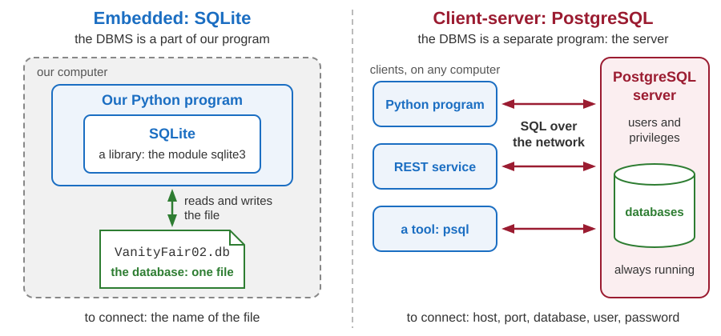
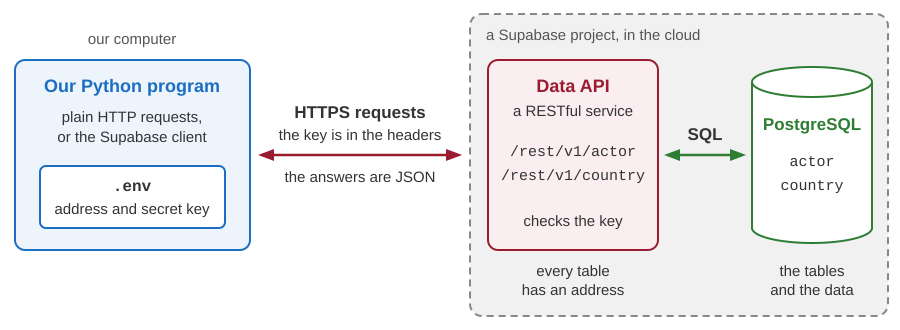

# SQLite and PostgreSQL

Developing Software Solutions

---

## Two ways a DBMS can work



The relational model and SQL are the same in both. The difference is **where the DBMS runs**.

---

## Which one, and when?

### SQLite - embedded

- The DBMS is a library inside our program. Python has it built in: nothing to install, nothing to start.
- A database is **one file**. To copy the file is to copy the database.
- No users and no passwords: whoever may read the file may read the data.
- The right choice for learning and development, for a program with one user, for an application on a phone.

### PostgreSQL - client-server

- The DBMS is a separate program, the **server**: free, open source, always running. Clients connect to it over the network.
- It has users and privileges, and many clients read and write at the same time.
- The right choice when many users and several programs share the same data.

Note:
In this course: SQLite on our own computer, and PostgreSQL in the form of the cloud service Supabase. We do not install a PostgreSQL server.
SQLite: many programs may read the same file at the same time, but only one of them may write. For a small web site that is enough.
PostgreSQL: the server usually listens on port 5432. Its command-line tool is called psql - it is for PostgreSQL what the shell sqlite3 is for SQLite.

---

## The shell sqlite3

```bash
cd teaching-samples/04-python-db-sqlite/database/VanityFair02
sqlite3 VanityFair02.db
```

```text
SQLite version 3.54.0 2026-04-09 12:25:13
Enter ".help" for usage hints.
SQLite-3.54 VanityFair02.db-> .tables
genre     movie     state     vw_movie_profit
SQLite-3.54 VanityFair02.db-> .schema state
CREATE TABLE state (
    state_id    INTEGER PRIMARY KEY,
    name        TEXT    NOT NULL,
    code        TEXT    NOT NULL
);
SQLite-3.54 VanityFair02.db-> .quit
```

- `sqlite3` is a small program for the terminal. To "connect" means to open the file.
- A line that begins with a dot is a command for the shell, not SQL: `.tables` lists the tables and views, `.schema` shows the `CREATE` statements, `.quit` ends the work.
- A mistyped file name is not an error: the shell opens a new, empty database.

Note:
The shell is not a part of Python. macOS has it already; for Windows it is downloaded from sqlite.org (the command-line tools), and unpacked into a folder.
The prompt depends on the version of the shell: older versions write only `sqlite>` in front of every line.
.help lists all the dot-commands. .schema without a name shows the whole database.
Without the shell: python -m sqlite3 VanityFair02.db gives a very simple one. It accepts SQL statements, but not the dot-commands of this lecture (it knows only .help, .quit and .version).
If the file VanityFair02.db is not there, build it first - see the slide "Building the course databases".

---

## Queries in the shell

```text
SQLite-3.54 VanityFair02.db-> .headers on
SQLite-3.54 VanityFair02.db-> .mode column
SQLite-3.54 VanityFair02.db-> SELECT title, year FROM movie
                          ;-> WHERE state_id = 2 ORDER BY year;
          title            year
-------------------------  ----
Delicatessen               1991
The City of Lost Children  1995
Amélie                     2001
```

- A statement may be typed in several lines. The shell executes it when it reaches the `;`.
- `.headers on` shows the names of the columns, and `.mode column` puts the values into columns.
- Without the two commands the look of a result depends on the version of the shell: the newest versions draw a frame around the table, the older ones print `Delicatessen|1991`.
- The prompt depends on the version too. Older versions write `sqlite>` and `...>`.

Note:
The second prompt, with the semicolon in it, says: the statement is not finished yet.
A forgotten semicolon is the most frequent problem of beginners: the shell waits, and nothing happens. Type ; and press Enter.
The two settings hold until the shell is closed.

---

## Scripts and the command line

```text
SQLite-3.54 VanityFair02.db-> .read queries.sql
```

- A **script** is a text file with SQL statements. `.read` executes all of them, one after another, and shows every result.
- One statement can also be given in the command line. It is executed, and the shell ends:

```bash
sqlite3 -header -column VanityFair02.db "SELECT name, code FROM state;"
```

```text
          name            code
------------------------  ----
United States of America  USA
France                    FRA
Yugoslavia                YUG
Italy                     ITA
```

- There are graphical tools too, for example *DB Browser for SQLite*, or an extension for SQLite in the code editor.

Note:
Sample: 04-python-db-sqlite/database/VanityFair02/queries.sql. The script ends with a transaction that is rolled back, so it leaves the data as it was.
.read looks for the script in the folder in which the shell was started. That is why we started it in the folder VanityFair02.
The options -header and -column do the work of .headers on and .mode column.
A dot-command can be given in the same way: sqlite3 VanityFair02.db ".tables"

---

## Building the course databases

```bash
cd teaching-samples/04-python-db-sqlite/database
python create_databases.py
```

```text
VanityFair01: executed create-tables.sql
VanityFair01: executed insert-table-data.sql
VanityFair01: created .../database/VanityFair01/VanityFair01.db
VanityFair02: executed create-tables.sql
VanityFair02: executed create-views.sql
VanityFair02: executed insert-table-data.sql
VanityFair02: created .../database/VanityFair02/VanityFair02.db
```

- The order matters: `create-tables.sql` makes the empty tables, `create-views.sql` the view that reads them, and `insert-table-data.sql` fills the tables with rows.
- The file of a database appears in the folder of its scripts.
- **To start again from scratch, run the program again.** It deletes the old file first - and with it all our experiments.

Sample: `04-python-db-sqlite/database/create_databases.py`

Note:
The program prints the whole path of each new file. On the slide the beginning of the path is replaced by three dots.
04-python-db-sqlite/README.md describes the two databases and the samples of the module.
The program is short. For every database it deletes the old file, opens a new one with sqlite3.connect(), and hands each script to connection.executescript(), which executes all the statements of the script. It is the first Python program of the course that talks to a DBMS.
create-tables.sql of VanityFair02 also creates the two indexes. In insert-table-data.sql the genres and the states come before the films that refer to them.
The fourth script of each folder, queries.sql, is not executed by the program. It is there for us.
The .db files are not kept in git (the line `*.db` in .gitignore): the scripts are the source, and the database is made from them.
Before building the databases again, leave the shell and close the other tools that have a database open.

---

## SQLite is different: flexible types

```sql
UPDATE movie SET lasting = 'two hours' WHERE title = 'Fargo';

SELECT title, lasting, typeof(lasting) AS stored_as
FROM movie
WHERE movie_id IN (3, 4, 5);
```

```text
     title         lasting   stored_as
----------------  ---------  ---------
Amélie                  122  integer
Fargo             two hours  text
The Big Lebowski        117  integer
```

- The column `lasting` is declared as `INTEGER`, and SQLite still stores the text. The declared type is a wish, not a rule.
- The mistake shows itself later: `SELECT MAX(lasting) FROM movie` now answers `two hours`.
- PostgreSQL refuses such a value. So does SQLite, if the table is declared `STRICT`.

Note:
typeof() tells how one value is really stored: integer, real, text, blob or null.
The text '117' would be accepted and stored as the integer 117: SQLite converts a value when it can.
A strict table: CREATE TABLE movie ( ... ) STRICT; - the word comes after the closing parenthesis. The same UPDATE is then refused: cannot store TEXT value in INTEGER column movie.lasting
The experiments of these four slides spoil the database. Afterwards: python create_databases.py

---

## SQLite is different: dates are texts

```sql
SELECT CURRENT_TIMESTAMP AS now, typeof(CURRENT_TIMESTAMP) AS stored_as,
       date('1943-08-17', '+1 day') AS iso_text, date('17.8.1943', '+1 day') AS other_text;
```

```text
        now          stored_as   iso_text   other_text
-------------------  ---------  ----------  ----------
2026-10-02 17:16:05  text       1943-08-18
```

- There is no type for dates. A date is a text in the ISO format, `YYYY-MM-DD`: the functions for dates understand it.
- Nothing checks the format. `'17.8.1943'` can be stored too - but the functions answer NULL.
- `CURRENT_TIMESTAMP` is the moment in **UTC**. In Belgrade the clock showed 19:16.
- PostgreSQL has the types `date` and `timestamp with time zone`.

Sample: `04-python-db-sqlite/01-sqlite-with-sql/sqlite_service.py` - the table `actor`

Note:
The table actor of the sample has two columns for dates, date_of_birth and created_at. Both are declared as TEXT, and created_at has DEFAULT CURRENT_TIMESTAMP.
UTC is the reference time of the world. Belgrade is one hour ahead of it in winter, and two hours in summer.
datetime(created_at, 'localtime') shows a stored moment in the time of our computer.
SQLite stores '2026-02-31' without any complaint - for SQLite it is a text like any other. PostgreSQL refuses that date.

---

## SQLite is different: foreign keys

```sql
PRAGMA foreign_keys;                                  -- answers 0: the check is switched off

INSERT INTO movie (title, genre_id, state_id)
VALUES ('A film of an unknown genre', 99, 1);         -- accepted - and there is no genre 99

PRAGMA foreign_keys = ON;

INSERT INTO movie (title, genre_id, state_id)
VALUES ('Another film of an unknown genre', 99, 1);   -- FOREIGN KEY constraint failed
```

- A `PRAGMA` is a statement of SQLite for the settings of the DBMS itself.
- The setting belongs to the **connection**, not to the file. Every program, and every new session of the shell, has to switch the check on again.
- That is why `create-tables.sql` of VanityFair02 begins with this line. A Python program sends it right after connecting: `connection.execute("PRAGMA foreign_keys = ON")`
- PostgreSQL always checks foreign keys.

Note:
insert-table-data.sql and queries.sql of VanityFair02 begin with the same line. The first film stays in the table: switching the check on does not look at the rows that are already there. PRAGMA foreign_key_check; lists the rows that break a foreign key.
The RESTful service of the next module switches the check on for every connection that SQLModel opens (database.py of 05-python-rest-sqlite/02-rest-service-actors-db).

---

## SQLite is different: ALTER TABLE

```sql
ALTER TABLE state ADD COLUMN continent TEXT;                    -- works
ALTER TABLE state RENAME COLUMN continent TO part_of_world;     -- works
ALTER TABLE state DROP COLUMN part_of_world;                    -- works

ALTER TABLE state ALTER COLUMN code TYPE VARCHAR(3);            -- syntax error
ALTER TABLE state ADD CONSTRAINT uq_state_code UNIQUE (code);   -- syntax error
```

- SQLite cannot change the type of a column. It cannot make an existing column a key - primary, foreign or `UNIQUE`.
- The way round: create a new table as it should be, copy the rows with `INSERT ... SELECT`, drop the old table, rename the new one.
- While we develop, there is a simpler way: correct `create-tables.sql`, and build the database again.
- PostgreSQL executes all five statements.

Note:
The last two statements are correct PostgreSQL.
The copying must be done carefully when other tables refer to the table: the foreign key check is switched off during the work, and everything is done in one transaction.

---

## SQL from Python: the module sqlite3

```python
import sqlite3

connection = sqlite3.connect("actors.db")     # opens the file - or creates it
connection.row_factory = sqlite3.Row          # the columns of a row get their names
cursor = connection.execute("SELECT * FROM actor")
for row in cursor.fetchall():                 # fetchall(): a list of all the rows
    print(row["actor_id"], row["first_name"], row["last_name"], row["created_at"])
connection.close()
```

```text
1 Franco Nero 2026-10-02 17:15:34
2 Franco Nero 2026-10-02 17:15:57
```

- `connect` gives a **connection**. `execute` sends one statement to the DBMS and gives a **cursor**: the result, from which the rows are fetched. `fetchone()` gives the next row, or `None`.
- Without `row_factory` a row is a plain tuple, and a value is reached by its position: `row[2]`.

Sample: `04-python-db-sqlite/01-sqlite-with-sql` - the same calls, in the class `SqliteService`

Note:
Run main.py of the sample two times first: every run adds one Franco Nero. The file actors.db appears in the folder of the sample.
The first row as a tuple: (1, 'Nero', 'Franco', None, None, '2026-10-02 17:15:34'). NULL arrives as None.
The sample builds the path of the file from the folder of the program: `Path(__file__).parent / "actors.db"`. A bare name, as on the slide, means a file in the folder in which the terminal is.
main.py prints every row as a dictionary: print(dict(row)).
close() ends the work with the database. After it the connection cannot be used.

---

## Parameters and commit

```python
    def insert_data(self, first_name: str, last_name: str) -> int:
        cursor = self._connection.execute(
            "INSERT INTO actor (first_name, last_name) VALUES (?, ?)",
            (first_name, last_name),
        )
        self._connection.commit()  # without commit the change would be lost
        return cursor.lastrowid
```

- Each `?` is a **parameter**: a place for one value. The values are sent apart from the text, as a tuple, in the order of the question marks.
- A tuple with one value needs a comma: `("Nero",)`.
- `commit()` makes the change permanent. If the connection is closed without it, the change is gone.
- `lastrowid` is the key that the DBMS assigned to the new row. The third run of `main.py` prints: `actor_id of the new row: 3`

Sample: `04-python-db-sqlite/01-sqlite-with-sql/sqlite_service.py`

Note:
Without the comma, ("Nero") is only a text in parentheses, and the module complains: Incorrect number of bindings supplied. The current statement uses 1, and there are 4 supplied. It took every letter for one value.
The module starts a transaction by itself before an INSERT, UPDATE or DELETE. commit() ends it and keeps the changes; rollback() ends it and cancels them.
Parameters can have names as well: "... WHERE year = :year" with the dictionary {"year": 1996}.

---

## Never paste a value into the SQL text

```python
title = "nothing' OR 'a' = 'a"                 # typed into a search field by a "user"

# 1. the value is pasted into the text of the statement
sql = f"SELECT title FROM movie WHERE title = '{title}'"
print(sql)
print(len(connection.execute(sql).fetchall()))            # 10 - every film of the table

# 2. the value is sent as a parameter
sql = "SELECT title FROM movie WHERE title = ?"
print(len(connection.execute(sql, (title,)).fetchall()))  # 0 - no film has such a title
```

```text
SELECT title FROM movie WHERE title = 'nothing' OR 'a' = 'a'
10
0
```

- A pasted value becomes a part of the statement, and it can change the meaning of the statement. This attack is called **SQL injection**.
- An innocent value breaks it too: `Miller's Crossing` ends with `near "s": syntax error`.
- A parameter is always only a value - whatever it contains.

Note:
The connection of this example is sqlite3.connect("VanityFair02.db").
With the same trick an attacker reads the data of other users, or logs in without a password. It is one of the oldest and best known weaknesses of web applications.
execute() accepts only one statement, so a second statement smuggled in after a semicolon is refused: You can only execute one statement at a time. That is a help, not a protection - the example above needs no second statement.

---

## Object-relational mapping

With `sqlite3` we write SQL and get rows. An **object-relational mapper (ORM)** lets us work with objects of our own classes, and writes the SQL for us. Our ORM is the library **SQLModel**.

```python
class Actor(SQLModel, table=True):
    actor_id: int | None = Field(default=None, primary_key=True)  # assigned by the DBMS
    last_name: str
    first_name: str
    country_code: str | None = None
    date_of_birth: datetime.date | None = None
    created_at: datetime.datetime | None = None
```

| In the program | In the database |
|---|---|
| the class `Actor` | the table `actor` |
| an attribute with its type: `last_name: str` | a column: `last_name VARCHAR NOT NULL` |
| a type that allows `None`: `str \| None` | a column that allows NULL |
| an object of the class | a row of the table |

Sample: `04-python-db-sqlite/02-sqlite-with-model/actor.py`

Note:
A class like this is called a model class, or simply a model.
actor_id allows None although the column is a primary key: a new object has no key until the DBMS assigns one.
SQLModel is built on two other libraries: SQLAlchemy, which talks to the database, and Pydantic, which describes data with type hints. The messages on the next slides mention SQLAlchemy for that reason.

---

## The engine creates the table

```python
engine = create_engine(f"sqlite:///{DATABASE_FILE}", echo=True)
SQLModel.metadata.create_all(engine)  # creates the table actor if it does not exist
```

With `echo=True` the engine prints every SQL statement that it sends to the database:

```sql
CREATE TABLE actor (
        actor_id INTEGER NOT NULL,
        last_name VARCHAR NOT NULL,
        first_name VARCHAR NOT NULL,
        country_code VARCHAR,
        date_of_birth DATE,
        created_at DATETIME,
        PRIMARY KEY (actor_id)
)
```

- The **engine** knows where the database is: `sqlite:///...` names the DBMS and the file.
- `create_all` writes the `CREATE TABLE` from the class. A table that already exists is left as it is.

Sample: `04-python-db-sqlite/02-sqlite-with-model/main.py`

Note:
In the terminal every line of this log begins with the time and with INFO sqlalchemy.engine.Engine.
After a change of the class - for example a new attribute imdb_mark - the old table stays as it was, and the program stops with: no such column: actor.imdb_mark. During development the cure is simple: delete the file actors.db.
SQLite accepts VARCHAR, DATE and DATETIME as names of types; the values are stored as texts.
echo=True is for learning and for looking for mistakes. A finished program does not print its statements.

---

## The session: reading and adding rows

```python
with Session(engine) as session:
    actors = session.exec(select(Actor)).all()     # a list of Actor objects
    print(len(actors))

    model = Actor(first_name="Robert", last_name="De Niro", country_code="US",
                  date_of_birth=datetime.date(1943, 8, 17),
                  created_at=datetime.datetime.now(datetime.timezone.utc))
    session.add(model)
    session.commit()
    session.refresh(model)  # reads the row back, with the actor_id that the DBMS assigned
    print(model)
```

- A **session** is a conversation with the database. `with` closes it at the end of the block.
- `session.exec(select(Actor)).all()` sends a query, and gives the rows as objects.
- `add` only announces the new object. `commit` sends the `INSERT` - with parameters - and makes the change permanent.

Sample: `04-python-db-sqlite/02-sqlite-with-model/main.py`

Note:
The first run prints 0, the second 1: every run adds one Robert De Niro.
The echo shows the statements: SELECT actor.actor_id, actor.last_name ... FROM actor, then the INSERT with its values ('De Niro', 'Robert', 'US', '1943-08-17', '2026-10-02 17:00:34.273466'), and after it a SELECT ... WHERE actor.actor_id = ? - that is the refresh.
print(model) shows all the attributes; after the refresh actor_id is no longer None.
The with statement is new: it opens something for the block below it, and closes it when the block ends - also when the block ends with an exception.
In the sample the arguments of Actor(...) are written one per line.

---

## A moment in time needs a time zone

```python
created_at=datetime.datetime.now(),            # the time of our clock, without a time zone
```

```text
sqlalchemy.exc.StatementError: (builtins.ValueError) Datetime values must have timezone
information. Use datetime.now(timezone.utc), or annotate the field with NaiveDatetime
for naive storage.
```

- "19:16" does not say **when**. In which country? In summer time or in winter time? A program in the cloud runs on a computer in another time zone.
- `datetime.datetime.now(datetime.timezone.utc)` is a moment together with its time zone: **UTC**, the reference time of the world.
- SQLModel refuses a moment without a time zone. It stores every moment in UTC, and returns it with the time zone.
- The rule: keep moments in UTC, and convert them to local time only when they are shown to a user.

Note:
The message is one long line in the terminal. It is followed by the INSERT statement that was not executed.
The error appears at session.commit(), not when the object is made: a table class does not check its values, and the INSERT is sent only at the commit.
After the refresh the sample prints: created_at=datetime.datetime(2026, 10, 2, 17, 0, 34, 273466, tzinfo=datetime.timezone.utc) - two hours less than the clock in Belgrade showed.
A date of birth is not a moment: datetime.date has no time zone.

---

## PostgreSQL in the cloud: Supabase



- **Supabase** is a cloud service built around PostgreSQL: the server runs in a data centre.
- Our programs do not send SQL. They send HTTP requests to the **Data API** of our project.

Note:
A project is our own database at Supabase, with its address and its keys. The steps for preparing one are in 04-python-db-supabase/README.md: create the project, run the script in the SQL Editor, write the address and the key into the file .env.
The Data API is a RESTful service - the subject of the next lectures. Here we only use it.
Everything else in the course works without Supabase: the SQLite samples do the same tasks on our own computer.

---

## An address and a key instead of a file

```text
SUPABASE_URL=https://your-project.supabase.co
SUPABASE_SECRET_KEY=sb_secret_...
```

```python
load_dotenv()  # reads the settings from the file .env into os.environ
supabase_url = os.environ.get("SUPABASE_URL")
supabase_key = os.environ.get("SUPABASE_SECRET_KEY")
```

- A SQLite program needs the name of a file. A Supabase program needs the **address** of the project and a **key**.
- Both are in the file `.env`, in the root folder of the course: a copy of `.env.example`, with the values of our own project.
- The secret key opens all the data of the project. It is never written into source code: source code is shared, shown to others and stored in git.
- The file `.env` is never put into git: `.gitignore` names it.

Sample: `.env.example`, `04-python-db-supabase/01-supabase-with-request/main.py`

Note:
The address and the keys of a project are shown in its dashboard; the comments in .env.example say where.
os.environ holds the environment variables: settings that a program receives from outside, as pairs name = value.
If the two values are missing, the samples stop with the message: SUPABASE_URL and SUPABASE_SECRET_KEY are not set - see the file .env.example
load_dotenv() finds the file .env also when it is in a folder above the program.

---

## The tables: PostgreSQL's dialect

```sql
create table public.actor (
    actor_id       bigint generated by default as identity primary key,
    created_at     timestamp with time zone not null default now(),
    last_name      text not null,
    first_name     text null,
    date_of_birth  date null,
    country_id     bigint null,
    constraint actor_country_id_fkey foreign key (country_id)
        references public.country (country_id)
);
```

- We run the script once, in the **SQL Editor** of the project's dashboard.
- `generated by default as identity`: the DBMS assigns 1, 2, 3 ... to the new rows.
- `timestamp with time zone` and `date` are real types. `now()` is the current moment.
- `public.actor` is the table `actor` in the schema `public`.
- `create function`, further down, stores a query in the database under a name.

Sample: `04-python-db-supabase/database/create-tables.sql`

Note:
The SQL Editor is a part of the project's dashboard: we paste the script and run it.
In SQLite, INTEGER PRIMARY KEY does the work of the identity column.
The keywords are written in lower case here. For SQL that makes no difference.
The function get_actors_with_country() is written in SQL and returns a table: every actor with the name and the code of the country. The Data API offers it at the address /rest/v1/rpc/get_actors_with_country.
The script ends with the first data: five countries and six actors.

---

## Who may read and change the data?

Every Supabase project has two kinds of keys:

| Key | It is meant for | In our project it can |
|---|---|---|
| **publishable** | programs that anybody can look into: web pages, mobile applications | read and change nothing |
| **secret** | programs on a server that we control - like our Python programs | read and change everything |

```sql
alter table public.actor enable row level security;

grant select, insert, update, delete on table public.actor to service_role;
```

- **Row level security**: rules called *policies* say which rows a role may see and change. Our script defines no policy - so nothing gets through with the publishable key.
- A request with the secret key works as the role `service_role`. Row level security does not stop it, and `grant` gives it the four privileges.

Sample: `04-python-db-supabase/database/create-tables.sql`

Note:
The script contains the same two statements for the table country.
The function is protected too: revoke execute ... from public, anon, authenticated; and grant execute ... to service_role.
A page in the browser could use only the publishable key - everybody can read the source of a page. Then policies would say, for example: everybody may read the actors, nobody may change them.

---

## Sample 1: plain HTTP requests

```python
self._client = httpx2.Client(
    base_url=supabase_url,
    headers={"apikey": supabase_key, "Authorization": f"Bearer {supabase_key}"},
)

response = self._client.get(f"/rest/v1/{table_name}", params={"select": "*"})
response.raise_for_status()  # an answer such as 401 or 404 becomes an exception
return response.text
```

```http
GET /rest/v1/actor?select=%2A HTTP/1.1
Host: your-project.supabase.co
apikey: sb_secret_...
Authorization: Bearer sb_secret_...
```

- **httpx2** is a library that sends HTTP requests. The address of the table: `/rest/v1/actor`.
- The key travels in two headers of every request. The answer is JSON: one object for every row.
- `insert_data` sends a `POST` to the same address, with the new row as JSON in the body.

Sample: `04-python-db-supabase/01-supabase-with-request/supabase_service.py`

Note:
The first statement is from `__init__`, the other three from `get_data`. The request on the slide is the one that get_data("actor") sends; the less important headers are left out.
`select=*` asks for all the columns; `%2A` is the star, encoded for an address.
The POST has one more header, Prefer: return=representation. It asks the service to send the new row back. Its body: {"first_name":"Franco","last_name":"Nero"}
No SQL anywhere in this program: the Data API writes the SELECT and the INSERT.
Every run adds one row, as in the SQLite sample.

---

## Sample 2: the client and a model class

```python
supabase = create_client(supabase_url, supabase_key)

result = supabase.table("actor").select("*").execute()
actors = [Actor.model_validate(row) for row in result.data]   # a list of dictionaries

model = Actor(first_name="Robert", last_name="De Niro",
              date_of_birth=datetime.date(1943, 8, 17))

# the model is sent as JSON, without the values that the DBMS assigns by itself
row = model.model_dump(mode="json", exclude={"actor_id", "created_at"})
result = supabase.table("actor").insert(row).execute()
```

- The library **supabase** hides the HTTP requests: `select("*")` sends the same `GET` as the first sample, and `insert(row)` the same kind of `POST`.
- Here `Actor` is a plain model, not a table class. `model_validate` makes an object from a dictionary: the text `"1943-08-17"` becomes a date. `model_dump` goes the other way.
- `actor_id` and `created_at` are left out: PostgreSQL assigns them.

Sample: `04-python-db-supabase/02-supabase-with-model`

Note:
The line with the brackets makes a list: one Actor object for every dictionary of result.data.
The class is based on BaseModel of the library Pydantic. Nothing creates a table from it - the table was created by the script.
The dictionary that is sent: {'last_name': 'De Niro', 'first_name': 'Robert', 'country_id': None, 'date_of_birth': '1943-08-17'}
The moment created_at comes back from PostgreSQL with its time zone, and model_validate makes a datetime with a time zone from it.

---

## SQLite and PostgreSQL in this course

| | SQLite | PostgreSQL (Supabase) |
|---|---|---|
| The database is | a file on our computer | on a server in the cloud |
| To connect we need | the name of the file | the address of the project and a key |
| The tables are created by | `create_databases.py`, or `create_all` | a script in the SQL Editor |
| Our program uses | SQL (`sqlite3`), or model classes (SQLModel) | HTTP requests to the Data API |
| A key assigned by the DBMS | `INTEGER PRIMARY KEY` | `generated by default as identity` |
| Types | flexible; dates are texts | strict; `date`, `timestamp with time zone` |
| Foreign keys | only after `PRAGMA foreign_keys = ON` | always checked |
| Who may use the data | whoever may read the file | decided by keys, privileges and policies |
| Samples | `04-python-db-sqlite` | `04-python-db-supabase` |

---

## Summary

- A DBMS is **embedded** in a program (SQLite: one file, no server, no users) or works as a **server** (PostgreSQL: many clients, users and privileges).
- The shell `sqlite3`: `.tables`, `.schema`, `.headers on`, `.mode column`, `.read`, `.quit`.
- `python create_databases.py` builds the course databases from their scripts.
- SQLite: flexible types, dates as texts, a `PRAGMA` for foreign keys, a modest `ALTER TABLE`.
- The module `sqlite3`: `connect`, `execute`, fetch, `commit`. Values go into a statement only as **parameters**.
- **SQLModel** maps a class to a table and objects to rows. `echo=True` shows the SQL that it writes.
- **Supabase** is PostgreSQL in the cloud: an address, a key, HTTP requests. The secret key stays in `.env`.

Next: we write a RESTful service - and put a database behind it.

---

# Thanks for your attention!
