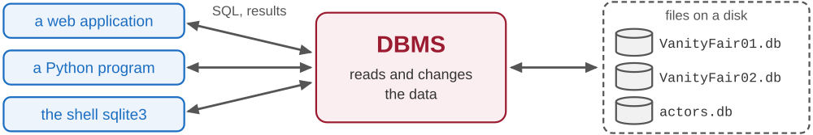
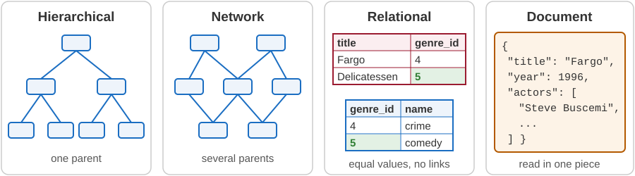
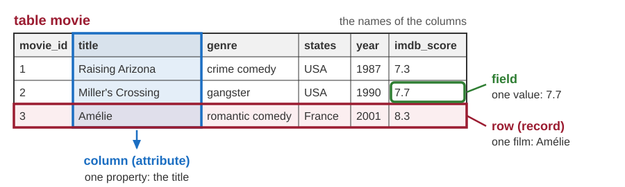
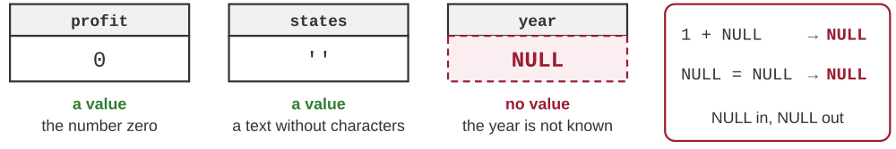
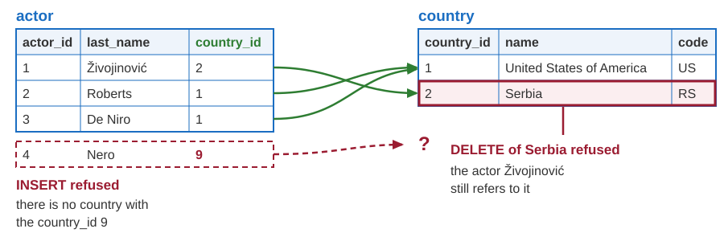
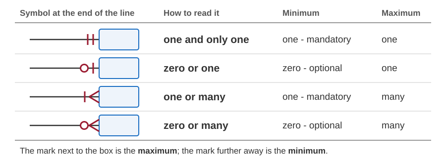
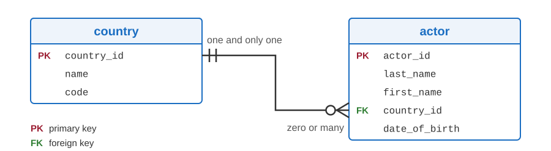
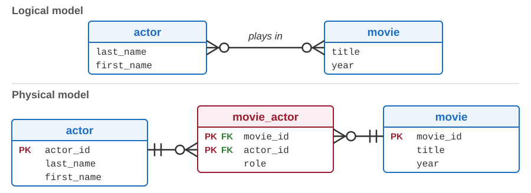
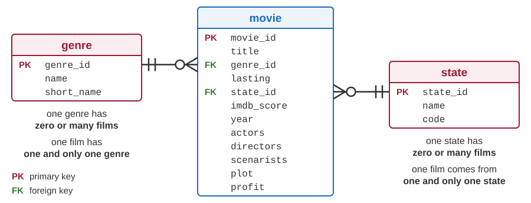

# Introduction to databases and the relational model

Developing Software Solutions

---

## Where does an application keep its data?

The actors application (module `04-python-fastapi-actors`) loaded the actors from a file and kept them in a Python list. A new actor was added only to the list in memory - after a restart it was gone.

Sample: `13-actors-service-search/services/file_actor_service.py`

A real application needs more:

- **permanence** - the data survive the end of the program,
- **sharing** - many users read and change the same data at the same time,
- **searching** - one item is found quickly among millions,
- **correctness** - data that make no sense are refused.

A **database** provides all four.

---

## Database and DBMS

- A **database** is an organized collection of data about one part of the real world - films, customers, orders - that is stored permanently.
- A **database management system (DBMS)** is the program that creates and manages databases: PostgreSQL, SQLite, MySQL, Microsoft SQL Server, Oracle Database.
- The data are stored in files on a disk, but an application does not read those files directly. It sends a request to the DBMS, and the DBMS reads or changes the data.
- One DBMS can manage many databases.
- In everyday speech the word "database" is used for both.



---

## What a DBMS takes care of

- **The data and their description** - besides the data, the DBMS stores the *metadata*: which tables exist, and what their columns, types and rules are.
- **Integrity** - a change that breaks a declared rule is refused.
- **Security** - it is defined who may read the data, and who may change them.
- **Concurrent access** - many users work at the same time without damaging each other's work. Changes that belong together form a *transaction*: either all of them are carried out, or none.
- **Access for programs** - every client program talks to the DBMS in the same way. For a relational DBMS, the language is SQL.

Note:
SQLite is an exception in one respect: it has no users and no passwords. Whoever can read the file of the database can read the data.

---

## Data models

A data model is the way in which a DBMS organizes the data.

| Model | The idea |
|---|---|
| **Hierarchical** | records form a tree, like folders on a disk: every record has one parent |
| **Network** | records form a web: a record can have several parents |
| **Relational** | the data are in tables; rows are connected by values, not by links |
| **Document, object** | a whole document (JSON) or object is stored and read in one piece |

---

## Data models in pictures



- In the first two models (1960s) a program *navigates*: it follows links from record to record.
- In the relational model (E. F. Codd, 1970) a program only says **what** it wants; the DBMS decides how to find it.
- Document databases, such as MongoDB, are used for data without a fixed structure.

---

## The DBMSs of this course

Both are relational, and both understand the language SQL.

### SQLite

- The whole database is **one file**. There is no server, and nothing to install.
- It is built into Python: the module `sqlite3`.
- Sample: `05-python-db-sqlite/database/create_databases.py` creates the databases of this lecture.

### PostgreSQL

- A database **server**: a separate program, which many clients reach over the network.
- It has users, passwords and permissions.
- **Supabase** offers PostgreSQL as a cloud service: the database runs on their computers, and we use it over the internet.

---

## The relational model: data in tables

- A relational database is a set of **tables**. The model calls a table a *relation* - hence its name.
- A table describes things of one kind (films). A **row** (record) is one of them: one film.
- A **column** (attribute) is one property: the title, the year, the country (`states`).
- A **field** is the place where a row and a column meet. It holds one value.

The table `movie` of the database VanityFair01 (the first three rows, six of the twelve columns):

| movie_id | title | genre | states | year | imdb_score |
|---|---|---|---|---|---|
| 1 | Raising Arizona | crime comedy | USA | 1987 | 7.3 |
| 2 | Miller's Crossing | gangster | USA | 1990 | 7.7 |
| 3 | Amélie | romantic comedy | France | 2001 | 8.3 |

Sample: `05-python-db-sqlite/database/VanityFair01/create-tables.sql`

---

## Row, column, field



The names of the columns are not a row of the table: they belong to its description.

---

## The rules of a table

- Every column has a **name** and a **type**: whole number, decimal number, text, date ... All the values of a column are of that type.
- Every field holds **one value** - an *atomic* value, not a list.
- The **order of the rows** carries no meaning. If we want the films sorted, we say so when we ask for them.
- The **order of the columns** carries no meaning: a column is found by its name, not by its position.
- **No two rows are the same**: a row is recognized by its values, not by its place in the table.

In `movie`: `movie_id` and `year` are whole numbers, `title` is a text, `imdb_score` is a decimal number.

Note:
SQL is more tolerant than the model: a table without a primary key may contain equal rows. SQLite goes one step further: unless a table is declared STRICT, it accepts a text in a column of the type INTEGER. PostgreSQL refuses such a value. The lecture about SQLite and PostgreSQL returns to this.

---

## NULL: the missing value

- Sometimes a value is not known, or it does not exist. The field then holds **NULL**.
- NULL is not a value. It is not the number 0, and it is not an empty text.
- The designer decides for every column whether NULL is allowed. In `movie`:
  - `title` is required - the column is declared `NOT NULL`,
  - `year` may be missing - a film can be stored before we find out when it was made.
- NULL behaves in its own way:
  - a calculation with NULL gives NULL,
  - a comparison with NULL gives NULL too - it is neither true nor false, even for two NULLs.



---

## Primary key

- The **primary key** of a table is a column - or a group of columns - whose value identifies exactly one row.
- Its values are **unique** and **never NULL**. The DBMS guards this: a second film with `movie_id` 3 is refused.
- A good key **never changes**, because other tables will remember its values.
- Every table should have a primary key.

Why is `title` not the key of `movie`? Two films can have the same title: *True Grit* (1969) and *True Grit* (2010). That is why the table has the column `movie_id`.

A key that consists of several columns is called a **composite key**.

Note:
SQLite has an old exception: in an ordinary table, a primary key that is not of the type INTEGER accepts NULL, unless the column is also declared NOT NULL. PostgreSQL never allows NULL in a primary key.

---

## Natural and surrogate keys

| | Natural key | Surrogate key |
|---|---|---|
| **Made of** | data that have a meaning in the real world | an artificial number without any meaning |
| **Examples** | the code of a country (`RS`), the ISBN of a book, the IBAN of a bank account | `movie_id`, `actor_id` |
| **Good** | no additional column, readable | short, always available, never changes |
| **Bad** | can change, can be long, is sometimes not known | says nothing to the user, does not stop the same thing from being entered twice |

- A surrogate key is generated by the DBMS: every new row gets a new number.
- Every table of the course databases has a surrogate key.

Note:
Natural keys do change. The ISO code YU (Yugoslavia) was replaced by CS (Serbia and Montenegro) in 2003, and Serbia has had the code RS since 2006.

---

## Foreign key

A **foreign key** is a column whose values are primary key values of another table.

`country` - the name of a country is written only once: in this table

| country_id | name | code |
|---|---|---|
| 1 | United States of America | US |
| 2 | Serbia | RS |

`actor` - the column `country_id` is a foreign key: it refers to `country`

| actor_id | last_name | first_name | country_id | date_of_birth |
|---|---|---|---|---|
| 1 | Živojinović | Bata | 2 | 1933-06-05 |
| 2 | Roberts | Julia | 1 | 1967-10-28 |
| 3 | De Niro | Robert | 1 | 1943-08-17 |

Note:
These are the first rows of the actors database, which the RESTful services use later in the course (06-python-rest-sqlite/02-rest-service-actors-db creates it). Almost the same tables, for PostgreSQL, are in 05-python-db-supabase/database/create-tables.sql; there the country of an actor is optional - country_id allows NULL.

---

## Referential integrity

**The rule:** every value of a foreign key must exist as a primary key value in the table it refers to. The only exception is NULL, in a foreign key that allows it.

The DBMS checks the rule at every change. It refuses:

- a new actor with `country_id` 9 - there is no such country,
- deleting the country Serbia while an actor still refers to it.

The designer may choose another reaction to deleting: delete the actors too (*cascade*), or set their `country_id` to NULL - if the column allows NULL.

Types, `NOT NULL`, primary keys and foreign keys are **integrity constraints**: rules that are declared once, and then checked by the DBMS for every program that changes the data.

Note:
SQLite checks foreign keys only if the check is switched on for the connection: PRAGMA foreign_keys = ON (see the first lines of VanityFair02/create-tables.sql). PostgreSQL always checks them.

---

## Referential integrity at work



The green arrows are the foreign keys of the three actors. Both changes in red are refused.

---

## What people do with a database

| Activity | What is done |
|---|---|
| **Design** | modelling the data; defining the tables with their columns, keys and rules |
| **Use** | *queries* - reading the data; *changes* - adding, changing and deleting rows |
| **Administration** | users and permissions, backup copies, speed, new versions of the DBMS |

- Tables are defined, read and changed in the language SQL - the topic of the next lecture.
- In the folder `05-python-db-sqlite/database/VanityFair01`: the file `create-tables.sql` is design; `insert-table-data.sql` and `queries.sql` are use.
- Most users never see the database: they use it through an application, such as the ones that we build in this course.
- In a small team one person does all three jobs.

---

## Data modelling: entities and relationships

Before the tables are created, the designer draws a **model** of the data. The best known kind is the **entity-relationship (E-R) model**.

- An **entity** is a kind of thing about which we keep data: film, actor, country.
- An **attribute** is a property of an entity: the title of a film, the date of birth of an actor.
- A **relationship** connects entities: an actor *comes from* a country, an actor *plays in* a film.

Later the model is turned into tables:

| In the model | In the database |
|---|---|
| entity | table |
| one instance of an entity (one actor) | row |
| attribute | column |
| relationship | foreign key, or a table of its own |

---

## Cardinality of a relationship

How many instances of one entity can be connected with one instance of the other?

The **maximum** - one or many - gives three kinds of relationships:

| Kind | Example | In the database |
|---|---|---|
| **one-to-one** (1:1) | a country and its capital city | one table, or a unique foreign key |
| **one-to-many** (1:N) | a country has many actors; an actor has one country | a foreign key on the "many" side |
| **many-to-many** (N:M) | a film has many actors; an actor plays in many films | a third table |

The **minimum** - zero or one - tells whether the connection must exist:

- 0, **optional**: a country may have no actors,
- 1, **mandatory**: an actor must have a country - its foreign key is `NOT NULL`.

---

## The three kinds, with examples


John Goodman plays in two of these films, and *The Big Lebowski* has two of these actors: neither side is "one".

---

## Crow's foot notation



The symbol is drawn at the end of the line, next to the entity that it counts.

---

## Example: countries and actors



- One country has **zero or many** actors - the symbol next to `actor`.
- One actor comes from **one and only one** country - the symbol next to `country`.
- A table is a box: its name, and its columns with the keys marked.

---

## Logical and physical model

### Logical model - what the data are

- entities with their attributes and keys, and the relationships between them
- independent of the DBMS that will be used
- a many-to-many relationship is simply a line between two entities

### Physical model - how the data are stored

- exactly the tables that will be created in the chosen DBMS
- columns with the types of that DBMS, and foreign keys
- every many-to-many relationship has become a table

The designer first improves the logical model (normalization, in a moment), and then derives the physical one.

Note:
Many books distinguish three levels: conceptual, logical and physical. There the foreign keys and the junction tables already belong to the logical model, and the physical model adds what depends on the DBMS, such as the types of the columns.

---

## Many-to-many: the junction table



A foreign key holds one value, so this relationship needs a table of its own. One row of `movie_actor` is one actor in one film; `role` is a fact about that pair.

Note:
The primary key of the junction table is the pair of its two foreign keys: the same actor cannot be entered twice for the same film.

---

## One big table: what can go wrong?

| movie_id | title | genre | states |
|---|---|---|---|
| 1 | Raising Arizona | crime comedy | USA |
| 2 | Miller's Crossing | gangster | USA |
| 5 | The Big Lebowski | crime comedy | USA |

- **Redundancy** - in `movie` of VanityFair01 the same words are typed again and again.
- **Update anomaly** - to rename a genre, many rows must be changed; one is easily forgotten.
- **Insertion anomaly** - a genre cannot be stored before its first film.
- **Deletion anomaly** - delete *Miller's Crossing*, and the genre `gangster` is gone as well.

The cause: genres and states are things of their own, but they have no table of their own.

**Normalization** divides the data into tables in which every fact is stored once. Its steps are called *normal forms*.

---

## First normal form (1NF)

**Every field holds exactly one value.**

VanityFair01 breaks the rule - the column `actors` holds a list:

| movie_id | title | year | actors |
|---|---|---|---|
| 1 | Raising Arizona | 1987 | Nicolas Cage, Holly Hunter, William Forsythe, John Goodman |
| 3 | Amélie | 2001 | Audrey Tautou, Mathieu Kassovitz |

- "In which films does John Goodman play?" The DBMS has to search inside every text.
- The name of an actor is typed again for every film - each time it can be typed differently.
- Columns `actor_1`, `actor_2`, `actor_3` are the same mistake: how many are enough?

Sample: `05-python-db-sqlite/database/VanityFair01/queries.sql`

---

## 1NF: one row for every film and actor

| movie_id | title | year | actor |
|---|---|---|---|
| 1 | Raising Arizona | 1987 | Nicolas Cage |
| 1 | Raising Arizona | 1987 | Holly Hunter |
| 1 | Raising Arizona | 1987 | William Forsythe |
| 1 | Raising Arizona | 1987 | John Goodman |
| 3 | Amélie | 2001 | Audrey Tautou |
| 3 | Amélie | 2001 | Mathieu Kassovitz |

- Every field holds one value: the table is in 1NF.
- `movie_id` alone no longer identifies a row. The key is the pair (`movie_id`, `actor`).
- A new problem: the title and the year are repeated for every actor of the film.

---

## Second normal form (2NF)

**1NF, and every non-key column describes the whole key - not only a part of it.**

Three rows of the previous table; its key is the pair (`movie_id`, `actor`):

| movie_id | actor | title | year |
|---|---|---|---|
| 1 | Nicolas Cage | Raising Arizona | 1987 |
| 1 | Holly Hunter | Raising Arizona | 1987 |
| 3 | Audrey Tautou | Amélie | 2001 |

- `title` and `year` are facts about the film only: they depend on `movie_id`, a **part** of the key.
- That is why they are stored again for every actor - with all the anomalies.
- Only a table with a composite key can break 2NF.

Note:
"Key" means here every group of columns that identifies a row, not only the declared primary key. Adding a column id to this table would repair nothing: the pair (movie_id, actor) would still identify a row, and the title would still depend on a part of it.

---

## 2NF: the facts about a film move to the film

`movie` - the key is `movie_id`

| movie_id | title | year |
|---|---|---|
| 1 | Raising Arizona | 1987 |
| 3 | Amélie | 2001 |

`movie_actor` - the key is the pair (`movie_id`, `actor`)

| movie_id | actor |
|---|---|
| 1 | Nicolas Cage |
| 1 | Holly Hunter |
| 3 | Audrey Tautou |

- The title and the year are stored once; `movie_actor.movie_id` is a foreign key.
- A column `role` would belong to `movie_actor`: a role is a fact about the film **and** the actor.

---

## Third normal form (3NF)

**2NF, and no non-key column describes another non-key column.**

We want to store the name and the code of the state of every film. Two columns in `movie`?

| movie_id | title | state | code |
|---|---|---|---|
| 1 | Raising Arizona | United States of America | USA |
| 2 | Miller's Crossing | United States of America | USA |
| 3 | Amélie | France | FRA |

- `code` describes the state, not the film.
- The film determines its state, and the state determines its code.
- The same name and code are written again for every film from that state.
- A state without films cannot be stored at all.

---

## 3NF: the state gets a table of its own

`state` - every state is written once, even a state without films (Italy)

| state_id | name | code |
|---|---|---|
| 1 | United States of America | USA |
| 2 | France | FRA |
| 3 | Yugoslavia | YUG |
| 4 | Italy | ITA |

`movie` - the column `state_id` is a foreign key

| movie_id | title | state_id |
|---|---|---|
| 1 | Raising Arizona | 1 |
| 2 | Miller's Crossing | 1 |
| 3 | Amélie | 2 |

Note:
A possible question: in the table state, does code not describe name? Both are facts about the state itself. The name and the code are unique, so each of them could be the key of the table - 3NF is not broken.

---

## From VanityFair01 to VanityFair02



The columns `genre` and `states` became foreign keys: `genre_id` and `state_id`.

---

## The keys, written in SQL

```sql
CREATE TABLE movie (
    movie_id    INTEGER PRIMARY KEY,
    title       TEXT    NOT NULL,
    genre_id    INTEGER NOT NULL,
    lasting     INTEGER NOT NULL DEFAULT 90,   -- in minutes
    state_id    INTEGER NOT NULL,
    -- ... seven more columns ...

    CONSTRAINT fk_movie_genre FOREIGN KEY (genre_id) REFERENCES genre (genre_id),
    CONSTRAINT fk_movie_state FOREIGN KEY (state_id) REFERENCES state (state_id)
);
```

- `INTEGER PRIMARY KEY` - the values are unique; SQLite assigns 1, 2, 3 ... by itself.
- `NOT NULL` - a film must have a genre and a state: the relationships are mandatory.
- `FOREIGN KEY ... REFERENCES` - a `genre_id` that does not exist in `genre` is refused.

Sample: `05-python-db-sqlite/database/VanityFair02/create-tables.sql`; two changes that are refused are near the end of `queries.sql`.

---

## A view puts the pieces together

A **view** is a query that is stored in the database under a name. In a query it is used like a table, but it holds no data: its rows are read from the tables every time.

The view `vw_movie_profit` of VanityFair02 (the first three rows):

| movie_id | title | short_name | code | year | profit |
|---|---|---|---|---|---|
| 1 | Raising Arizona | CRCOM | USA | 1987 | 0 |
| 2 | Miller's Crossing | GANG | USA | 1990 | 0 |
| 3 | Amélie | ROMCOM | FRA | 2001 | 0 |

The user sees one table again - but every genre and every state is stored only once.

Sample: `05-python-db-sqlite/database/VanityFair02/create-views.sql`

---

## Indexes and schemas

- An **index** makes searching by a column fast - like the index at the end of a book.
  - VanityFair02 has two: `ix_movie_genre_id` and `ix_movie_state_id`. The films of one genre are found without reading the whole table.
  - The DBMS keeps an index up to date by itself. The price: some space, and slightly slower changes.
  - Searching by the primary key is always fast - the DBMS takes care of that.
- The **schema** of a database is the description of its structure: tables, columns, keys, views, indexes.
  - In PostgreSQL the word has a second meaning: a named group of objects inside a database. The default one is called `public`, so the full name of a table is, for example, `public.country`.

Sample: `05-python-db-supabase/database/create-tables.sql`

---

## What is still wrong in VanityFair02?

The columns `actors`, `directors` and `scenarists` are still lists - the table `movie` is not even in 1NF.

The next version of the database would have:

- a table `actor` - every actor is one row, and the name is written once,
- a junction table `movie_actor` - which actor plays in which film (many-to-many),
- directors and scenarists in the same way - or, better, one table `person` for all of them: Joel Coen is a director and a scenarist.

Three independent lists need three junction tables. One table for all of them would have to combine every actor of a film with every director: this is what the *fourth normal form* forbids.

A designer may also keep such a column on purpose, for simplicity or for speed. Breaking a normal form knowingly is called *denormalization*.

---

## Summary

- A **DBMS** stores the data permanently, guards their integrity and serves many users at once. We use SQLite and PostgreSQL.
- In the **relational model** the data are in tables: rows, columns with types, atomic values, NULL for a missing value.
- A **primary key** identifies a row. A **foreign key** refers to a row of another table, and the DBMS guards **referential integrity**.
- The **E-R model** describes entities and relationships: one-to-one, one-to-many, many-to-many; optional or mandatory.
- **Normalization** stores every fact once: one value in every field (1NF); every non-key column describes the whole key (2NF) and nothing but the key (3NF).
- From VanityFair01 to VanityFair02: genres and states became tables, connected to `movie` by foreign keys.

---

# Thanks for your attention!
