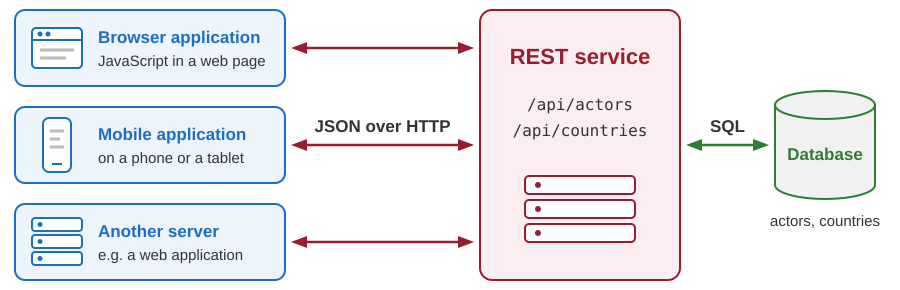

# Introduction to REST APIs

Developing Software Solutions

---

## What is an API?

- **API** stands for *Application Programming Interface*: the operations that a program offers to **other programs**, and the rules for using them.
- A **web API** offers its operations over HTTP: a program sends a request to an address and gets data in the response.

| | A web page | A web API |
|---|---|---|
| The response is read by | a person | a program |
| The body contains | HTML: the data, arranged for reading | only the data, usually as JSON |
| Example | `http://localhost:8000/actors-show` | `http://localhost:8001/api/actors` |

Sample: `02-python-fastapi/pages/actors_show.py` - a page for people.

Note:
An API does not have to be on the web. The functions of the file helpers/mathematics.py (sample 02) are its API: to call mathematics.power(2, 10) we only have to know what goes in and what comes out, not how the result is calculated.

The address of the API in the table belongs to the service that we build in the next lecture.

---

## One service, many clients



- A program that offers a web API is a **web service** - in this lecture simply *the service*. The programs that call it are its **clients**.
- The clients need the data in a strict format, not a page designed for reading.
- All clients use the same API. Only the service talks to the database.

Note:
Do not confuse a web service with the service objects of the actors application (ActorService). Those are objects inside one program; a web service is a separate program. A REST service is a web service built in the REST style, which the next slides explain.

Browser application: JavaScript code in a page asks for data and shows it without loading a new page.

Mobile application: the same data, shown on a phone.

Another server: a program on a server can be a client too. At the end of the course (module 06) our own web application gets its data from such a service.

None of the clients has to know which database is used, or how its tables look.

---

## JSON: the format of the data

```json
{
  "actor_id": 3,
  "last_name": "De Niro",
  "first_name": "Robert",
  "country_id": 1,
  "date_of_birth": "1943-08-17"
}
```

- **JSON** (*JavaScript Object Notation*) is plain text that describes data. Practically every programming language can read and write it.
- An **object** is written in braces: pairs `"name": value`, separated by commas. The order of the pairs has no meaning.
- A value is a **string** in double quotes, a **number**, `true`, `false`, `null` (no value), another object, or an **array**: `[1, 2, 3]`.
- There is no type for dates. A date travels as a string: `"1943-08-17"`.

---

## JSON and Python

| JSON | Python |
|---|---|
| object `{"code": "US"}` | dictionary `{"code": "US"}` |
| array `[1, 2, 3]` | list `[1, 2, 3]` |
| string `"US"` | string `"US"` or `'US'` |
| number `3` or `8.5` | `int` or `float` |
| `true`, `false`, `null` | `True`, `False`, `None` |

- JSON looks like Python, but it is only **text**. `json.loads(text)` turns the text into dictionaries and lists; `json.dumps(value)` does the opposite.
- JSON is stricter: only double quotes, no comma after the last item, no comments.

Sample: `02-python-fastapi/pages/fetch_data.py` reads the file `sample-data/weather.json`.

---

## What is REST?

- **REST** stands for *Representational State Transfer*.
- It is an **architectural style**: a set of rules (*constraints*) for building systems like the web. It is not a protocol, not a standard and not a library.
- The aim: systems that stay simple, serve many users, and have parts that can be changed independently.
- Roy Fielding described it in 2000, in his doctoral dissertation. He is also one of the authors of the HTTP specification.
- The style does not depend on HTTP, but in practice REST APIs use HTTP: it already has addresses, methods, status codes and headers.
- An API that follows the constraints is called **RESTful**.

Note:
The dissertation: Roy T. Fielding, "Architectural Styles and the Design of Network-based Software Architectures", University of California, Irvine, 2000. REST is described in chapter 5.

---

## Six constraints: 1 and 2

### 1. Client-server

- The service keeps and processes the data. The client decides what to do with it.
- They know each other only through the interface: addresses, methods, JSON.
- In practice: each side can be changed or replaced without changing the other.

### 2. Statelessness

- The service keeps the data, but it does not remember the conversation: who asked, and what was asked before.
- Every request carries everything that is needed to answer it. It cannot say "the actor that I read a moment ago" - it says `DELETE /api/actors/14`.
- In practice: any copy of the service can answer any request, so a busy service can run on many computers.

Note:
Statelessness is already known from the first lecture: HTTP itself is stateless. REST asks the application to keep it that way.

What the user is doing at the moment (which actor is being edited, what is typed into a form) is remembered by the client.

What a client does with the data is its own business: a browser application shows it to a person, another server may use it in a calculation.

---

## Six constraints: 3 and 4

### 3. Cacheability

- A response says whether it may be kept and used again (*cached*), and for how long. In HTTP this is written in a header: `Cache-Control: max-age=3600` allows 3600 seconds, one hour.
- In practice: the list of countries changes rarely, so a client does not have to ask for it every time. Fewer requests mean a faster application.

### 4. Layered system

- Between the client and the service there can be other programs: one that encrypts the traffic (HTTPS), one that divides the requests among several copies of the service.
- In practice: the client talks to one address and does not see what is behind it. Such layers are added and removed without changing the clients.

Note:
The service of this course does not send the header Cache-Control.

---

## Six constraints: 5 and 6

### 5. Code on demand (optional)

- The server may send program code that the client runs. A web page with JavaScript does that. An API that sends JSON does not need it.

### 6. Uniform interface

- Every resource - an actor, a country, the list of all actors - has its own **address**.
- A resource is read and changed through its **representation**: a JSON text that describes it.
- Every message **describes itself**: method, status code and `Content-Type` show how to read it.
- Responses contain **links** to what the client can do next (rare in practice).

In practice: all RESTful APIs look alike. The next slides show how.

Note:
The numbers of the constraints are ours: Fielding lists the uniform interface fourth.

A representation describes the current or the wanted state of a resource. The client and the service transfer representations.

The fourth point of the uniform interface is known as HATEOAS: hypermedia as the engine of application state. We come back to it on the slide "Reality check".

---

## Resources and their addresses

- A **resource** is anything that the API works with: an actor, a country, the list of all actors.
- Every resource has an address. The addresses are **nouns**, usually in the plural.

| Address | Resource |
|---|---|
| `/api/actors` | the **collection**: all actors |
| `/api/actors/3` | one **item**: the actor with id 3 |
| `/api/countries` | all countries |
| `/api/countries/1` | the country with id 1 |

- The HTTP method, not the address, says what to do with a resource. There is no `/api/getActors` and no `/api/deleteActor?id=3`.

Note:
The prefix /api is a common convention. It shows that the address belongs to an API and not to a page.

---

## Methods are the operations

Almost everything that is done with data is one of four operations: **c**reate, **r**ead, **u**pdate, **d**elete - in short, **CRUD**.

| Operation | HTTP method | Address | In SQL |
|---|---|---|---|
| Create | `POST` | `/api/actors` | `INSERT` |
| Read | `GET` | `/api/actors` or `/api/actors/3` | `SELECT` |
| Update | `PUT` | `/api/actors/3` | `UPDATE` |
| Delete | `DELETE` | `/api/actors/3` | `DELETE` |

- The address says **which** resource. The method says **what to do** with it.
- `POST` goes to the collection: the new actor has no id yet - the service chooses it.
- `PUT` replaces the whole item: the client sends all the values, not only the changed ones.

Note:
HTTP also has the method PATCH, which changes only a part of a resource. The service of this course does not use it.

---

## Safe and idempotent methods

- A **safe** method only reads: it does not change the data.
- An **idempotent** method may be repeated: several identical requests have the same effect on the data as one request.

| Method | Safe | Idempotent | If the same request is sent twice |
|---|---|---|---|
| `GET` | yes | yes | the data is read twice; nothing changes |
| `PUT` | no | yes | the actor gets the same values again |
| `DELETE` | no | yes | the actor stays deleted (the second response is `404`) |
| `POST` | no | no | **two** new actors are created |

- In practice: if the response does not arrive, a client may simply repeat a `GET`, a `PUT` or a `DELETE` - but not a `POST`.

---

## Status codes of an API

| Code | What it tells the client |
|---|---|
| `200 OK` | Success. The body contains the data that was asked for. |
| `201 Created` | Success. A new resource was created; the header `Location` holds its address. |
| `204 No Content` | Success. There is nothing to send back - the body is empty. |
| `400 Bad Request` | The request is wrong, e.g. the id in the address and the id in the body differ. |
| `404 Not Found` | There is no resource at this address. |
| `422 Unprocessable Content` | The data in the request is not valid, e.g. `"USA"` where a number is expected. |
| `500 Internal Server Error` | The service itself failed. The client did nothing wrong and cannot repair it. |

After `4xx` the client has to change the request. After `5xx` it can only try again later.

Note:
400 or 422? The border is not sharp. Our service sends 422 automatically when the body cannot be read as an actor (a value is missing or has a wrong type). It sends 400 from its own check, when a correct actor does not fit the address.

Our service also sends 409 Conflict when the database refuses a change, for example an actor with a country that does not exist.

422 is also known under its older name, Unprocessable Entity. With Python versions before 3.13 the server writes the older name in the status line.

---

## Example: read all actors

```http
GET /api/actors HTTP/1.1
Host: localhost:8001
```

```http
HTTP/1.1 200 OK
Content-Type: application/json

[
  {"actor_id": 1, "last_name": "Živojinović", "first_name": "Bata",
   "country_id": 2, "date_of_birth": "1933-06-05"},
  {"actor_id": 2, "last_name": "Roberts", "first_name": "Julia",
   "country_id": 1, "date_of_birth": "1967-10-28"},
  ...
]
```

- A request to the collection returns a JSON **array**: one object per actor.
- The slides show only the important headers. Long bodies are shortened and split into lines.
- The names of headers are not case-sensitive: our service writes `content-type`.

Note:
The service runs at http://localhost:8001. A real client also sends headers such as User-Agent and Accept, and Content-Length when the request has a body. The real response also has the headers date, server and content-length.

The service sends every body as one line, without spaces.

---

## Example: read one actor

```http
GET /api/actors/3 HTTP/1.1
Host: localhost:8001
```

```http
HTTP/1.1 200 OK
Content-Type: application/json

{"actor_id": 3, "last_name": "De Niro", "first_name": "Robert",
 "country_id": 1, "date_of_birth": "1943-08-17"}
```

- A request to one item returns one JSON **object**.
- `Content-Type: application/json` tells the client how to read the body.
- The country is given only by its id. Its name is in another resource: `/api/countries/1`.

---

## Example: the actor does not exist

```http
GET /api/actors/99 HTTP/1.1
Host: localhost:8001
```

```http
HTTP/1.1 404 Not Found
Content-Type: application/json

{"detail": "Actor not found"}
```

- There is no actor with id 99. The conversation itself worked - this is a regular response.
- The **status code** is for the program: it has to check the code before it uses the body.
- The **body** is for the programmer: it describes the problem in words.

---

## Example: create an actor

```http
POST /api/actors HTTP/1.1
Host: localhost:8001
Content-Type: application/json

{"last_name": "Streep", "first_name": "Meril",
 "country_id": 1, "date_of_birth": "1949-06-22"}
```

```http
HTTP/1.1 201 Created
Content-Type: application/json
Location: /api/actors/14

{"actor_id": 14, "last_name": "Streep", "first_name": "Meril",
 "country_id": 1, "date_of_birth": "1949-06-22"}
```

- The client sends the new actor **without** `actor_id`: the service chooses it.
- `Location` holds the address of the new resource. The body is the actor as it was saved.

Note:
The first name is misspelled on purpose (Meril instead of Meryl). The mistake is corrected with PUT two slides later.

---

## Example: invalid data

```http
POST /api/actors HTTP/1.1
Host: localhost:8001
Content-Type: application/json

{"last_name": "Streep", "first_name": "Meril",
 "country_id": "USA", "date_of_birth": "1949-06-22"}
```

```http
HTTP/1.1 422 Unprocessable Content
Content-Type: application/json

{"detail": [{
    "type": "int_parsing",
    "loc": ["body", "country_id"],
    "msg": "Input should be a valid integer, unable to parse string as an integer",
    "input": "USA"
}]}
```

- The same request, but `country_id` is `"USA"` - a text, not a number. Nothing was saved.
- The body says where the problem is (`loc`) and what it is (`msg`).

---

## Example: update an actor

```http
PUT /api/actors/14 HTTP/1.1
Host: localhost:8001
Content-Type: application/json

{"actor_id": 14, "last_name": "Streep", "first_name": "Meryl",
 "country_id": 1, "date_of_birth": "1949-06-22"}
```

```http
HTTP/1.1 204 No Content
```

- The first name was misspelled. The client sends the **whole** actor again, with the corrected value.
- `204 No Content`: success. There is no body - the client already has the data.
- Other responses: `400 Bad Request` if the id in the address differs from `actor_id` in the body, `404 Not Found` if there is no actor 14.

---

## Example: delete an actor

```http
DELETE /api/actors/14 HTTP/1.1
Host: localhost:8001
```

```http
HTTP/1.1 204 No Content
```

- The actor is removed. Again there is nothing to send back.
- If the client sends the same request once more, the response is different:

```http
HTTP/1.1 404 Not Found
Content-Type: application/json

{"detail": "Actor not found"}
```

- After one request and after two, the data is the same: there is no actor 14. That is why `DELETE` is idempotent.

---

## Reality check

REST describes an ideal. Real APIs often differ from it in three ways.

1. **`GET` that changes data** - for example `GET /api/deleteActor?id=3`. It works, but programs expect `GET` to be safe: browsers and search engines follow links on their own.
2. **Documentation** - ideally, the responses tell the client what it can do next. In reality a programmer reads the documentation. In the best case it is generated from the code, like our page `/docs`.
3. **Authentication and state** - most real APIs must know who is calling. A stateless API expects proof of identity (a key or a token) in **every** request. Some APIs remember the client on the server instead.

Note:
The service of this course does not ask who is calling. That is acceptable only because it runs on our own computer.

---

## How to try an API

Start the service first (see below). Then use one of three tools.

1. **The browser** - type `http://localhost:8001/api/actors` into the address bar. The browser shows the JSON. Only `GET` can be tried this way.
2. **`curl`** - a program for the terminal that can send every kind of request.
3. **The documentation page** - `http://localhost:8001/docs` lists all the operations. Open one, click *Try it out*, fill in the values and click *Execute*: the page sends the request and shows the response.

Sample: `05-python-rest-sqlite/02-rest-service-actors-db` - start it with `python main.py`.

Note:
The service keeps its terminal busy. Type the curl commands in a second terminal.

The page /docs loads its scripts from the internet, so it needs a connection.

---

## Requests with curl

**Read** - without options `curl` sends a `GET` and prints the body of the response:

```bash
curl http://localhost:8001/api/countries/1
```

```text
{"country_id":1,"name":"United States of America","code":"US"}
```

**Create** - the file `actor.json` in the current folder holds the JSON text of the new actor:

```bash
curl -i -X POST http://localhost:8001/api/actors \
     -H "Content-Type: application/json" \
     -d "@actor.json"
```

- `-X` sets the method, `-H` adds a header, `-d` sends the body. `-i` also shows the status line and the headers.
- On Windows, write the command in one line, without the `\` characters. In PowerShell, type `curl.exe`, not `curl`.

Note:
The header Content-Type is necessary: without it curl says that the body is the data of a form, and the service answers 422.

With -d, curl sends a POST by itself. -X POST is written only to make the method visible; with the option -v curl remarks that it is unnecessary. The option -v shows the request as well.

In Windows PowerShell the word curl alone starts another command (Invoke-WebRequest), so we type curl.exe. The backslash at the end of a line continues the command only in the terminals of macOS and Linux.

---

## Summary

- A **web API** is for programs: requests and responses over HTTP, with the data as **JSON**.
- **REST** is an architectural style with six constraints: client-server, statelessness, cacheability, layered system, code on demand (optional), uniform interface.
- A **resource** has an address (`/api/actors`, `/api/actors/3`). The HTTP **method** says what to do with it: `POST`, `GET`, `PUT`, `DELETE` - create, read, update, delete.
- The **status code** says how the request ended: `200`, `201`, `204` - `400`, `404`, `422` - `500`.
- An API can be tried without writing a program: the browser, `curl`, the page `/docs`.

Next lecture: we write such a service in Python, with FastAPI.

---

# Thanks for your attention!
