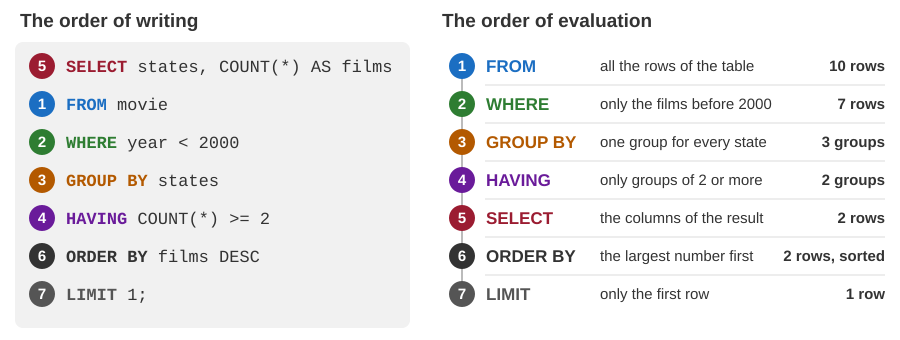
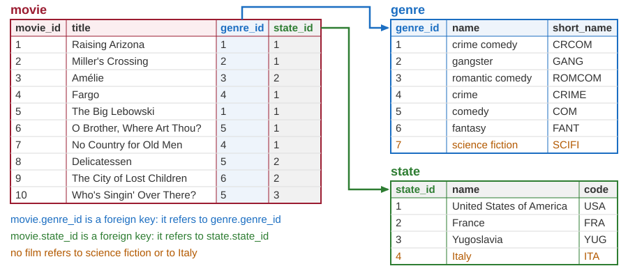
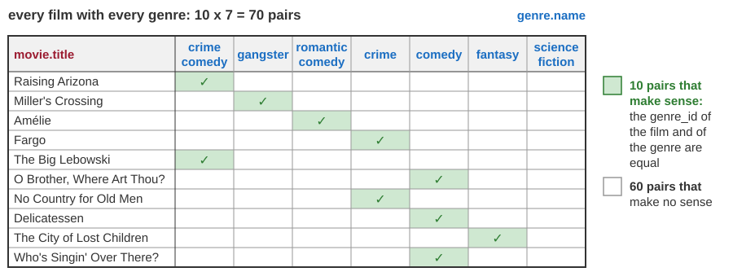
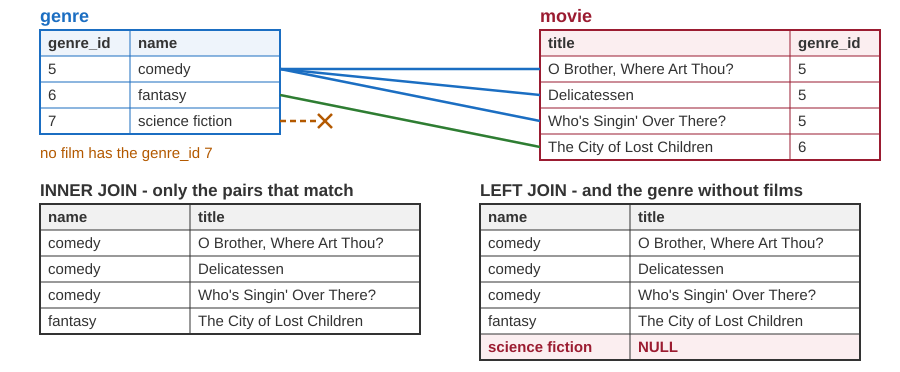
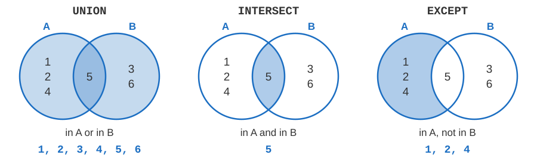
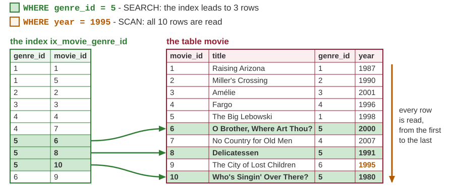
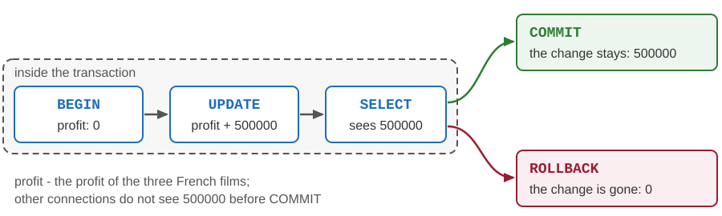

# Introduction to SQL

Developing Software Solutions

---

## What is SQL?

- **SQL** (*Structured Query Language*) is the language in which people and programs talk to a relational DBMS.
- With SQL we define tables, read the data, change the data, and decide who may use them.
- SQL is **declarative**: a statement describes *what* we want, not *how* to find it.

```sql
SELECT title, year
FROM movie
WHERE states = 'France';
```

- We did not say how to go through the rows, or whether to use an index. The DBMS chooses the way.

---

## A standard and its dialects

- SQL was created at IBM in the 1970s by Donald Chamberlin and Raymond Boyce. Its first name was SEQUEL, and many people still pronounce SQL that way.
- It became an ANSI standard in 1986 and an ISO standard in 1987.
- The standard has been revised many times since: SQL-92, SQL:1999, SQL:2003 ... SQL:2023.
- No DBMS implements all of it, and every DBMS adds something of its own. Each one speaks a **dialect** of SQL.
- Most statements of this lecture work, with small differences, in SQLite, PostgreSQL, MySQL, SQL Server and Oracle.

We use **SQLite**. Where it differs from the standard or from PostgreSQL, the slides say so.

---

## The parts of the language

| Part | Statements | Used for |
|---|---|---|
| **DDL** - Data Definition Language | `CREATE`, `ALTER`, `DROP` | tables, views, indexes |
| **DML** - Data Manipulation Language | `SELECT`, `INSERT`, `UPDATE`, `DELETE` | reading and changing data |
| **DCL** - Data Control Language | `GRANT`, `REVOKE` | who may do what |
| **Transaction control** | `BEGIN`, `COMMIT`, `ROLLBACK` | several changes as one |

- A `SELECT` statement is called a **query**. Queries are the most used part of SQL, and the largest part of this lecture.
- The plan: queries over one table, changing the data, queries over several tables, defining tables, access control, transactions.

---

## The database of this lecture

The table `movie` of the database VanityFair01, with its 10 films, was created by this statement:

```sql
CREATE TABLE movie (
    movie_id    INTEGER PRIMARY KEY,           -- the DBMS assigns 1, 2, 3 ... by itself
    title       TEXT    NOT NULL,
    genre       TEXT    NOT NULL,
    lasting     INTEGER NOT NULL DEFAULT 90,   -- in minutes
    states      TEXT    NOT NULL DEFAULT '',
    imdb_score  REAL    NOT NULL DEFAULT 0,
    year        INTEGER NULL,
    actors      TEXT    NULL,
    directors   TEXT    NULL,
    scenarists  TEXT    NULL,
    plot        TEXT    NULL,
    profit      NUMERIC NOT NULL DEFAULT 0
);
```

Every column has a name and a type. We return to the rest of the statement near the end of the lecture.

Sample: `05-python-db-sqlite/database/VanityFair01/create-tables.sql`

---

## Names

- Tables, columns, views and indexes have **names**: `movie`, `imdb_score`.
- A name starts with a letter. Letters, digits and the underscore `_` may follow.
- Upper and lower case do not matter in keywords and names: `select TITLE from MOVIE` is the same query as `SELECT title FROM movie`.
- A reserved word of the language - `select`, `order`, `table` - cannot be a name.
- In this course:
  - keywords are written in upper case, names in lower case with `_` between the words,
  - the name of a table is in the singular: `movie`, `genre`,
  - the primary key of the table `movie` is called `movie_id`.
- Values are a different matter: `'USA'` and `'usa'` are two different texts.

---

## Data types in the SQL standard

| Kind of data | Types |
|---|---|
| whole numbers | `SMALLINT`, `INTEGER`, `BIGINT` |
| exact decimal numbers | `NUMERIC(p, s)`, `DECIMAL(p, s)` |
| approximate numbers | `REAL`, `DOUBLE PRECISION` |
| text | `CHAR(n)`, `VARCHAR(n)` |
| date and time | `DATE`, `TIME`, `TIMESTAMP` |
| true or false | `BOOLEAN` |
| binary data: pictures, files | `BLOB` |

- `NUMERIC(10, 2)` has 10 digits, 2 of them after the decimal point - the type for money.
- `CHAR(3)` always holds 3 characters, `VARCHAR(100)` at most 100.
- PostgreSQL has these types (`BLOB` is called `BYTEA` there), and `TEXT` for a text of any length.

---

## Data types in SQLite

SQLite stores every value in one of five **storage classes**: `NULL`, `INTEGER`, `REAL`, `TEXT`, `BLOB`.

- The type of a column is only a preference, called *affinity*: `INTEGER`, `REAL`, `TEXT`, `BLOB` or `NUMERIC`.
- A `NUMERIC` column, such as `profit`, stores a whole number as INTEGER and any other number as REAL. There is no exact decimal type.
- A value of another kind is not refused: SQLite stores the text `'long'` in the INTEGER column `lasting`. PostgreSQL refuses it.
- There is no type for dates. A date is a text in the ISO format, `'2026-10-02'`; a moment in time is `'2026-10-02 18:30:00'`. Texts in this format sort in the order of time.
- There is no `BOOLEAN`: true and false are the numbers 1 and 0.

---

## Literals

| Kind of value | Written as |
|---|---|
| number | `122`, `-3`, `8.7`, `1.5e6` |
| text | `'Fargo'`, `'crime comedy'` |
| text that contains a quote | `'Miller''s Crossing'` |
| date - in SQLite, a text | `'2026-10-02'` |
| missing value | `NULL` |

- A text is written in **single** quotes. A quote inside the text is written twice.
- Double quotes are for names, not for texts. SQLite often accepts `"Fargo"` as a text; PostgreSQL does not.

```sql
SELECT title, year FROM movie WHERE title = 'Miller''s Crossing';
```

---

## SELECT ... FROM

```sql
SELECT * FROM movie;                          -- all the columns
SELECT title, year, imdb_score FROM movie;    -- only some columns
```

```text
          title             year  imdb_score
--------------------------  ----  ----------
Raising Arizona             1987         7.3
Miller's Crossing           1990         7.7
Amélie                      2001         8.3
Fargo                       1996         8.1
The Big Lebowski            1998         8.1
O Brother, Where Art Thou?  2000         7.7
No Country for Old Men      2007         8.2
Delicatessen                1991         7.5
The City of Lost Children   1995         7.5
Who's Singin' Over There?   1980         8.7
```

- `SELECT` lists the columns, `FROM` names the table. The result is again a table.
- A statement ends with `;`. The text after `--` is a comment.

Sample: `05-python-db-sqlite/database/VanityFair01/queries.sql`

---

## WHERE: choosing the rows

```sql
SELECT title, year FROM movie WHERE states = 'France';
```

| title | year |
|---|---|
| Amélie | 2001 |
| Delicatessen | 1991 |
| The City of Lost Children | 1995 |

- `WHERE` keeps only the rows for which the condition is true.
- The comparison operators are `=`, `<>` (not equal), `<`, `>`, `<=` and `>=`.
- Texts are compared exactly: `states = 'france'` finds nothing.

```sql
SELECT title, imdb_score FROM movie WHERE imdb_score >= 8;      -- 5 films
```

---

## SELECT chooses columns, WHERE chooses rows


The query of the previous slide: the result holds the chosen columns of the chosen rows.

---

## AND, OR, NOT

- `AND` - both conditions must be true. `OR` - at least one of them. `NOT` - the opposite.

```sql
SELECT title, genre, year FROM movie WHERE states = 'USA' AND year < 2000;
```

- `AND` is evaluated before `OR`. Parentheses change the order - and make a condition easier to read:

```sql
SELECT title, states, year FROM movie
WHERE (states = 'France' OR states = 'Yugoslavia') AND year < 1995;
```

| title | states | year |
|---|---|---|
| Delicatessen | France | 1991 |
| Who's Singin' Over There? | Yugoslavia | 1980 |

- Without the parentheses the result has 4 films: all the French ones, and the Yugoslav one.

---

## BETWEEN and IN

```sql
SELECT title, year FROM movie WHERE year BETWEEN 1990 AND 1999;
```

```text
          title            year
-------------------------  ----
Miller's Crossing          1990
Fargo                      1996
The Big Lebowski           1998
Delicatessen               1991
The City of Lost Children  1995
```

- `BETWEEN` includes both ends: it means `year >= 1990 AND year <= 1999`.

```sql
SELECT title, genre FROM movie WHERE genre IN ('comedy', 'crime comedy');
```

- `IN` is true when the value is equal to one of the values in the list. The script writes the same condition with `OR`.
- The opposite conditions are `NOT BETWEEN` and `NOT IN`.

---

## LIKE: searching by a pattern

```sql
SELECT title, genre FROM movie WHERE genre LIKE '%comedy%';
SELECT title, actors FROM movie WHERE actors LIKE '%John Goodman%';
```

In a pattern, `%` stands for any text - also for an empty one - and `_` for exactly one character.

| Condition | Finds the titles that ... | In our table |
|---|---|---|
| `title LIKE 'The %'` | begin with "The " | The Big Lebowski, The City of Lost Children |
| `title LIKE '%o'` | end with "o" | Fargo |
| `title LIKE '_a%'` | have "a" as the second character | Raising Arizona, Fargo |
| `title LIKE '_____'` | have exactly five characters | Fargo |

In SQLite, `LIKE` does not distinguish upper and lower case of the letters a-z. In PostgreSQL it does; the tolerant operator there is `ILIKE`.

---

## IS NULL

- A comparison with NULL is neither true nor false: its result is NULL again. So is the result of a calculation.

```sql
SELECT NULL = NULL AS a, NULL <> 1 AS b, 1 + NULL AS c, NULL IS NULL AS d;
```

| a | b | c | d |
|---|---|---|---|
| NULL | NULL | NULL | 1 |

- Only `IS NULL` gives an answer: 1, which is how SQLite shows *true*.
- `WHERE` keeps a row only when the condition is true, so `WHERE year = NULL` never finds anything. The tests for a missing value are `IS NULL` and `IS NOT NULL`:

```sql
SELECT title FROM movie WHERE plot IS NULL;      -- no rows: every film has a plot
```

---

## ORDER BY

```sql
SELECT title, imdb_score FROM movie ORDER BY imdb_score DESC;
SELECT title, states, year FROM movie ORDER BY states, year DESC;
```

```text
          title               states    year
--------------------------  ----------  ----
Amélie                      France      2001
The City of Lost Children   France      1995
Delicatessen                France      1991
No Country for Old Men      USA         2007
O Brother, Where Art Thou?  USA         2000
The Big Lebowski            USA         1998
Fargo                       USA         1996
Miller's Crossing           USA         1990
Raising Arizona             USA         1987
Who's Singin' Over There?   Yugoslavia  1980
```

- The order is ascending (`ASC`) unless we write `DESC`.
- The second query sorts by state; the films of one state are sorted by year, the newest first.
- Without `ORDER BY`, the order of the rows is not defined.

---

## LIMIT

```sql
SELECT title, imdb_score FROM movie ORDER BY imdb_score DESC LIMIT 3;
```

| title | imdb_score |
|---|---|
| Who's Singin' Over There? | 8.7 |
| Amélie | 8.3 |
| No Country for Old Men | 8.2 |

- `LIMIT 3` keeps only the first 3 rows of the result. With `ORDER BY` it answers questions such as "the three best films".
- `LIMIT 3 OFFSET 3` skips three rows and returns the next three - a long list can be shown page by page.
- `LIMIT` is not in the standard, but SQLite, PostgreSQL and MySQL have it. The standard form, `FETCH FIRST 3 ROWS ONLY`, works in PostgreSQL but not in SQLite.

Note:
Fargo and The Big Lebowski have the same score, 8.1. The order of rows with equal values is not defined, so a second column in ORDER BY is needed when the pages must not overlap.

---

## Expressions and aliases

```sql
SELECT title || ' (' || year || ')' AS film,
       lasting / 60 AS hours, lasting % 60 AS minutes
FROM movie
WHERE states = 'France';
```

| film | hours | minutes |
|---|---|---|
| Amélie (2001) | 2 | 2 |
| Delicatessen (1991) | 1 | 39 |
| The City of Lost Children (1995) | 1 | 52 |

- A column of the result can be computed: `+`, `-`, `*`, `/` and `%` (the remainder) work with numbers, and `||` joins texts.
- An integer divided by an integer gives an integer: `122 / 60` is 2. Write `122 / 60.0` for 2.03.
- `AS` gives the column of the result a name - an **alias**.

---

## DISTINCT

```sql
SELECT states FROM movie;               -- 10 rows: USA, USA, France, USA ...

SELECT DISTINCT states FROM movie;      -- every state only once
```

| states |
|---|
| USA |
| France |
| Yugoslavia |

- `DISTINCT` removes the repeated rows from the result.
- It compares whole rows: `SELECT DISTINCT states, genre FROM movie` returns 8 different pairs.

---

## Built-in functions

| Example | Result | The function gives |
|---|---|---|
| `upper('Fargo')` | `FARGO` | the text in upper case; `lower` is the opposite |
| `length('Fargo')` | `5` | the number of characters |
| `substr('Fargo', 1, 3)` | `Far` | 3 characters, from the 1st on |
| `trim('  Fargo  ')` | `Fargo` | the text without spaces at its ends |
| `round(108.8333, 1)` | `108.8` | the number rounded to 1 decimal |
| `abs(1980 - 2026)` | `46` | the absolute value |
| `date('now')` | `2026-10-02` | the date of today |
| `strftime('%d.%m.%Y', '2026-10-02')` | `02.10.2026` | a date in another format |

- A function can stand wherever a value can - also in `WHERE` and `ORDER BY`.
- SQLite: `upper` and `lower` change only the letters a-z. `upper('Amélie')` is `AMéLIE`.
- Functions for dates differ between DBMSs: PostgreSQL has `to_char`, not `strftime`.

Note:
date('now') is the date in UTC; date('now', 'localtime') uses the clock of the computer. Shortly after midnight the two differ.

---

## Aggregate functions

```sql
SELECT COUNT(*) AS films, ROUND(AVG(imdb_score), 2) AS average_score,
       MIN(year) AS oldest, MAX(year) AS newest, SUM(lasting) AS minutes
FROM movie;
```

| films | average_score | oldest | newest | minutes |
|---|---|---|---|---|
| 10 | 7.91 | 1980 | 2007 | 1072 |

- An aggregate function computes **one** value from many rows: `COUNT`, `SUM`, `AVG`, `MIN`, `MAX`.
- `COUNT(*)` counts rows. `COUNT(actors)` counts the rows in which `actors` is not NULL. `COUNT(DISTINCT states)` counts different values: 3.
- NULLs are skipped: `AVG` is the average of the known values. Over no values at all, `COUNT` gives 0 and the other functions give NULL.

Note:
The script calls AVG(imdb_score) without ROUND, and the tool then shows 7.909999999999999 or 7.9099999999999993. A good moment to say that REAL numbers are approximate.

---

## GROUP BY

```sql
SELECT states, COUNT(*) AS films, AVG(lasting) AS average_lasting
FROM movie
GROUP BY states;
```

| states | films | average_lasting |
|---|---|---|
| France | 3 | 111.0 |
| USA | 6 | 108.83333333333333 |
| Yugoslavia | 1 | 86.0 |

- `GROUP BY` puts the rows with the same value of `states` into one group. The functions are computed for every group, and the result has one row per group.
- The `SELECT` list may contain only the grouping columns and aggregate functions. PostgreSQL refuses anything else. SQLite accepts another column and takes its value from one row of the group - a mistake that is hard to notice.

---

## GROUP BY: from rows to groups


The query of the previous slide: ten rows, three groups, three rows in the result.

---

## HAVING

```sql
SELECT genre, COUNT(*) AS films
FROM movie
GROUP BY genre
HAVING COUNT(*) > 1
ORDER BY films DESC;
```

| genre | films |
|---|---|
| comedy | 3 |
| crime comedy | 2 |
| crime | 2 |

- `WHERE` is a condition for **rows**: it is applied before the grouping, and it cannot contain aggregate functions.
- `HAVING` is a condition for **groups**: it is applied after the grouping.

---

## The order of the clauses



An alias from the `SELECT` list can be used in `ORDER BY`. In `WHERE` and `HAVING` the standard does not allow it: they are evaluated earlier. PostgreSQL follows the rule; SQLite is tolerant.

---

## Subqueries

```sql
SELECT title, imdb_score
FROM movie
WHERE imdb_score = (SELECT MAX(imdb_score) FROM movie);
```

| title | imdb_score |
|---|---|
| Who's Singin' Over There? | 8.7 |

- A **subquery** is a query in parentheses inside another statement.
- Here the inner query gives one value, 8.7. The outer query compares every film with it.
- `WHERE imdb_score = MAX(imdb_score)` is not allowed: no aggregate functions in `WHERE`.

```sql
SELECT title, lasting FROM movie WHERE lasting > (SELECT AVG(lasting) FROM movie);
```

- The second query: the 5 films that last longer than the average, 107.2 minutes.

---

## INSERT

```sql
INSERT INTO movie (title, genre, states, year)
VALUES ('A film that will be deleted', 'test', 'Nowhere', 2026);
```

- The values are given in the order of the columns in the list.
- A column that is not in the list gets its `DEFAULT` value - or NULL, if it has none.

```sql
SELECT movie_id, lasting, imdb_score, year, actors, profit FROM movie WHERE genre = 'test';
```

| movie_id | lasting | imdb_score | year | actors | profit |
|---|---|---|---|---|---|
| 11 | 90 | 0.0 | 2026 | NULL | 0 |

- A `NOT NULL` column without a default must be in the list. Without `genre`, SQLite answers: `NOT NULL constraint failed: movie.genre`.
- `movie_id` got the next number. In SQLite an `INTEGER PRIMARY KEY` is enough for that; in PostgreSQL the column is declared `GENERATED BY DEFAULT AS IDENTITY`.

---

## INSERT: several rows, rows of a query

```sql
INSERT INTO movie (title, genre, states, year)
VALUES ('The first test film', 'test', 'Nowhere', 2026),
       ('The second test film', 'test', 'Nowhere', 2026);
```

- One statement can insert several rows.

```sql
CREATE TABLE old_movie (title TEXT NOT NULL, year INTEGER);

INSERT INTO old_movie (title, year)
SELECT title, year FROM movie WHERE year < 1990;
```

- `INSERT ... SELECT` inserts the rows that a query returns - here the two films made before 1990.
- The query must return as many columns as the list has.

---

## UPDATE

```sql
UPDATE movie SET profit = 1000000 WHERE title = 'Fargo';

UPDATE movie SET lasting = lasting + 1 WHERE states = 'France';
```

- `SET` gives a column its new value. The new value can be computed from the old one.
- `WHERE` chooses the rows: the first statement changes one film, the second changes three.
- Several columns are separated by commas:

```sql
UPDATE movie SET lasting = 100, imdb_score = 5.5 WHERE genre = 'test';
```

- A change that breaks a rule of the table is refused, as with `INSERT`.

Sample: `05-python-db-sqlite/database/VanityFair01/queries.sql` - the last statements

---

## DELETE

```sql
DELETE FROM movie WHERE genre = 'test';
```

- `DELETE` removes whole rows: all the rows that satisfy the condition - here the test films.

### Do not forget WHERE

```sql
UPDATE movie SET profit = 0;      -- changes ALL the films
DELETE FROM movie;                -- deletes ALL the films
```

- Both statements are correct SQL, so the DBMS executes them without asking.
- There is no "undo". Only a change made inside a transaction can still be cancelled - we come to that.
- A good habit: run a `SELECT` with the same `WHERE` first, and look at the rows.

Note:
After the experiments, 05-python-db-sqlite/database/create_databases.py creates both databases again from the scripts.

---

## VanityFair02: three tables



Sample: `05-python-db-sqlite/database/VanityFair02/queries.sql`

Note:
This is the second design from the previous lecture: the genres and the states have tables of their own. The picture shows all the rows of the three tables (and four of the twelve columns of movie); the following slides refer to them.

---

## The cartesian product

```sql
SELECT movie.title, genre.name FROM movie, genre;
SELECT movie.title, genre.name FROM movie, genre WHERE movie.movie_id = 1;
```

```text
     title            name
---------------  ---------------
Raising Arizona  crime comedy
Raising Arizona  gangster
Raising Arizona  romantic comedy
Raising Arizona  crime
Raising Arizona  comedy
Raising Arizona  fantasy
Raising Arizona  science fiction
```

- Two tables and no condition between them: every film is combined with every genre. The first query returns 10 x 7 = 70 rows - the **cartesian product**.
- Only 10 of the 70 rows make sense: those in which the two `genre_id` values are equal. With large tables, the product has millions of useless rows.
- `movie.title` is the column `title` of the table `movie`.

---

## The cartesian product as a grid



A join keeps only the green pairs. No film has the genre *science fiction*.

---

## INNER JOIN

```sql
SELECT movie.title, genre.name
FROM movie
     INNER JOIN genre ON genre.genre_id = movie.genre_id;
```

```text
          title                  name
--------------------------  ---------------
Raising Arizona             crime comedy
Miller's Crossing           gangster
Amélie                      romantic comedy
Fargo                       crime
The Big Lebowski            crime comedy
O Brother, Where Art Thou?  comedy
No Country for Old Men      crime
Delicatessen                comedy
The City of Lost Children   fantasy
Who's Singin' Over There?   comedy
```

- `ON` tells which rows belong together: the foreign key of the film is equal to the primary key of the genre.
- Older code writes the same join as `FROM movie, genre WHERE ...`, with the same condition.

---

## Three tables, and aliases

```sql
SELECT m.title, g.name AS genre, s.name AS state
FROM movie AS m
     INNER JOIN genre AS g ON g.genre_id = m.genre_id
     INNER JOIN state AS s ON s.state_id = m.state_id
WHERE s.code = 'FRA'
ORDER BY m.year;
```

| title | genre | state |
|---|---|---|
| Delicatessen | comedy | France |
| The City of Lost Children | fantasy | France |
| Amélie | romantic comedy | France |

- `movie AS m` gives the table a short name for this query - an alias.
- Every further `JOIN` adds one table. `WHERE` and `ORDER BY` follow as before.
- Both `genre` and `state` have a column `name`, so we must say which one we mean.

---

## LEFT JOIN

```sql
SELECT g.name, m.title
FROM genre AS g
     LEFT JOIN movie AS m ON m.genre_id = g.genre_id
WHERE g.genre_id >= 5;                              -- only to keep the result short
```

| name | title |
|---|---|
| comedy | O Brother, Where Art Thou? |
| comedy | Delicatessen |
| comedy | Who's Singin' Over There? |
| fantasy | The City of Lost Children |
| science fiction | NULL |

- `INNER JOIN` returns only the pairs that match: a genre without films is missing.
- `LEFT JOIN` keeps **all** the rows of the left table, `genre`. Where no film matches, the columns of `movie` are NULL.
- With the condition `m.movie_id IS NULL`, only the genres without films remain.

---

## INNER JOIN and LEFT JOIN



`RIGHT JOIN` keeps all the rows of the right table, and `FULL JOIN` all the rows of both.

---

## Aggregation over joined tables

```sql
SELECT s.name, COUNT(*) AS all_rows, COUNT(m.movie_id) AS films,
       ROUND(AVG(m.imdb_score), 2) AS average_score
FROM state AS s
     LEFT JOIN movie AS m ON m.state_id = s.state_id
GROUP BY s.name;
```

| name | all_rows | films | average_score |
|---|---|---|---|
| France | 3 | 3 | 7.77 |
| Italy | 1 | 0 | NULL |
| United States of America | 6 | 6 | 7.85 |
| Yugoslavia | 1 | 1 | 8.7 |

- The tables are joined first; the rows of the join are then grouped.
- Italy has one row, with NULLs in the columns of `movie`. `COUNT(*)` counts that row; `COUNT(m.movie_id)` skips the NULL and gives 0.
- With `INNER JOIN`, Italy would not be in the result at all.

Note:
The script VanityFair02/queries.sql counts the films of every genre in the same two ways: with INNER JOIN science fiction is missing, with LEFT JOIN and COUNT(m.movie_id) it gets 0. It also has the number of films and the average score per state, with HAVING.

---

## Subqueries: IN and NOT IN

```sql
SELECT name FROM state WHERE state_id NOT IN (SELECT state_id FROM movie);
```

| name |
|---|
| Italy |

- The subquery returns a list of values: the `state_id` of every film. The outer query keeps the states that are not in the list.
- With `IN` instead of `NOT IN`, the result is the three states that have films.
- A trap: if the list contains a NULL, `NOT IN` finds nothing. Here it cannot happen, because `movie.state_id` is `NOT NULL`.
- The same question can be answered with `LEFT JOIN` and `IS NULL`.

---

## Subqueries: EXISTS

```sql
SELECT name
FROM genre AS g
WHERE EXISTS (SELECT * FROM movie AS m WHERE m.genre_id = g.genre_id);
```

```text
     name
---------------
crime comedy
gangster
romantic comedy
crime
comedy
fantasy
```

- `EXISTS` is true when the subquery returns at least one row.
- The subquery uses `g.genre_id`, a column of the outer query. It is evaluated for every genre separately.
- `NOT EXISTS` gives the genre without films: science fiction.

---

## UNION, INTERSECT, EXCEPT

```sql
SELECT genre_id FROM movie WHERE state_id = 1      -- A: the genres of the American films
INTERSECT
SELECT genre_id FROM movie WHERE state_id = 2;     -- B: the genres of the French films
```

| Operator | The result contains | Here |
|---|---|---|
| `UNION` | the rows of A and of B, every row once | 1, 2, 3, 4, 5, 6 |
| `UNION ALL` | all the rows of A and of B, also the repeated ones | 1, 2, 4, 1, 5, 4, 3, 5, 6 |
| `INTERSECT` | the rows that are in A and in B | 5 |
| `EXCEPT` | the rows of A that are not in B | 1, 2, 4 |

- The two queries must return the same number of columns. One `ORDER BY`, at the end, sorts the whole result:

```sql
SELECT name, 'genre' AS kind FROM genre
UNION
SELECT name, 'state' AS kind FROM state
ORDER BY kind, name;
```

---

## UNION, INTERSECT, EXCEPT as sets



A: the genres of the American films. B: the genres of the French films.

---

## CREATE TABLE: constraints

A new table for VanityFair02 - the reviews of the films - with every kind of constraint:

```sql
CREATE TABLE review (
    review_id   INTEGER PRIMARY KEY,
    movie_id    INTEGER NOT NULL REFERENCES movie (movie_id),
    reviewer    TEXT    NOT NULL,
    stars       INTEGER NOT NULL CHECK (stars BETWEEN 1 AND 5),
    written_on  TEXT    NOT NULL DEFAULT CURRENT_DATE,
    UNIQUE (movie_id, reviewer)
);
```

| Constraint | The DBMS makes sure that ... |
|---|---|
| `PRIMARY KEY` | the value identifies the row: no two rows have the same one |
| `NOT NULL` | the column always has a value |
| `DEFAULT` | a row inserted without this column gets the given value |
| `UNIQUE` | no two rows have the same value - here, the same pair of values |
| `CHECK` | the condition is true in every row |
| `REFERENCES` | the value exists in another table: a foreign key |

---

## Constraints at work

```sql
INSERT INTO review (movie_id, reviewer, stars) VALUES (4, 'Ana', 5);
SELECT * FROM review;
```

| review_id | movie_id | reviewer | stars | written_on |
|---|---|---|---|---|
| 1 | 4 | Ana | 5 | 2026-10-02 |

The first review is accepted: it gets its key and the date of today. The next three are refused:

```sql
INSERT INTO review (movie_id, reviewer, stars) VALUES (4, 'Marko', 9);    -- 9 stars
INSERT INTO review (movie_id, stars) VALUES (4, 3);                       -- no reviewer
INSERT INTO review (movie_id, reviewer, stars) VALUES (4, 'Ana', 3);      -- Ana, once more
```

```text
CHECK constraint failed: stars BETWEEN 1 AND 5
NOT NULL constraint failed: review.reviewer
UNIQUE constraint failed: review.movie_id, review.reviewer
```

- A constraint is checked for every `INSERT` and every `UPDATE`, whichever program sends it.

---

## FOREIGN KEY ... REFERENCES

The foreign keys of `movie` are declared at the end of its `CREATE TABLE` statement, each with a name:

```sql
    CONSTRAINT fk_movie_genre FOREIGN KEY (genre_id) REFERENCES genre (genre_id),
    CONSTRAINT fk_movie_state FOREIGN KEY (state_id) REFERENCES state (state_id)
```

A film of a genre that does not exist, and the deletion of a genre that has films, are both refused:

```sql
INSERT INTO movie (title, genre_id, state_id) VALUES ('A film of an unknown genre', 99, 1);
DELETE FROM genre WHERE genre_id = 1;
```

```text
FOREIGN KEY constraint failed
FOREIGN KEY constraint failed
```

- SQLite checks foreign keys only after `PRAGMA foreign_keys = ON;` - in every new connection. PostgreSQL always checks them, and its message names the constraint: `fk_movie_genre`.

Sample: `05-python-db-sqlite/database/VanityFair02/create-tables.sql`

---

## ALTER TABLE and DROP TABLE

```sql
ALTER TABLE review ADD COLUMN comment TEXT;              -- the old rows get NULL in it
ALTER TABLE review RENAME COLUMN comment TO remark;
ALTER TABLE review RENAME TO movie_review;

DROP TABLE movie_review;                                 -- the table and its rows are gone
```

- `ALTER TABLE` changes the structure of a table that already holds data.
- SQLite can rename a table, and add, rename or drop a column. It cannot change the type of a column or add a key: a new table is created, and the rows are copied. PostgreSQL does both with `ALTER TABLE`.
- `DROP TABLE` asks no questions. Only a table to which rows of another table refer is protected: `DROP TABLE genre` is refused.
- Views and indexes are removed in the same way: `DROP VIEW`, `DROP INDEX`.

---

## CREATE VIEW

```sql
CREATE VIEW vw_movie_profit
AS
SELECT movie.movie_id, movie.title, genre.short_name, state.code, movie.year, movie.profit
FROM genre
     INNER JOIN movie ON genre.genre_id = movie.genre_id
     INNER JOIN state ON movie.state_id = state.state_id;
```

- The view stores the query, not its result. In a query it is used like a table:

```sql
SELECT code, COUNT(*) AS films FROM vw_movie_profit GROUP BY code;
```

| code | films |
|---|---|
| FRA | 3 |
| USA | 6 |
| YUG | 1 |

- In SQLite a view can only be read: `INSERT`, `UPDATE` and `DELETE` on it are refused.

Sample: `05-python-db-sqlite/database/VanityFair02/create-views.sql`

---

## CREATE INDEX

```sql
CREATE INDEX ix_movie_genre_id ON movie (genre_id);
CREATE INDEX ix_movie_state_id ON movie (state_id);
```

- Searching by a primary key or a `UNIQUE` column is fast without our help. For foreign keys the DBMS creates no index, so the script creates them.
- A query never mentions an index. The DBMS decides when to use one; in SQLite, `EXPLAIN QUERY PLAN` shows its decision:

```sql
EXPLAIN QUERY PLAN SELECT title FROM movie WHERE genre_id = 5;
EXPLAIN QUERY PLAN SELECT title FROM movie WHERE year = 1995;
```

```text
QUERY PLAN
`--SEARCH movie USING INDEX ix_movie_genre_id (genre_id=?)
QUERY PLAN
`--SCAN movie
```

- `SCAN` means that every row of the table is read: there is no index on `year`.

Sample: `05-python-db-sqlite/database/VanityFair02/create-tables.sql`

---

## SEARCH and SCAN



The index is sorted by `genre_id`: the three films of the genre 5 are found at once.

---

## Access control: GRANT and REVOKE

- A DBMS that works as a server - PostgreSQL, MySQL, SQL Server, Oracle - has **users**, each with a name and a password.
- A **privilege** is the right to execute one kind of statement on one object: `SELECT`, `INSERT`, `UPDATE` or `DELETE` on a table.
- The owner of a table gives privileges with `GRANT`, and takes them back with `REVOKE`:

```sql
CREATE ROLE ana LOGIN PASSWORD 'secret';     -- PostgreSQL: a user is a role that may log in

GRANT SELECT, INSERT ON movie TO ana;        -- ana may read the films and add new ones
REVOKE INSERT ON movie FROM ana;             -- ... and now she may only read them
```

- A statement without the privilege is refused: `permission denied for table movie`.
- **SQLite has none of this.** A database is a file: whoever may write to the file may do everything.

Sample: `05-python-db-supabase/database/create-tables.sql`

Note:
The sample is the script of the Supabase (PostgreSQL) database of the course. After the tables it has a part with GRANT and REVOKE statements for the roles that Supabase uses.

---

## Transactions

- A **transaction** is a group of statements that is carried out as a whole: all of its changes are accepted, or none.
- `BEGIN` starts a transaction, `COMMIT` accepts its changes, `ROLLBACK` cancels them.

```sql
BEGIN TRANSACTION;
UPDATE movie SET profit = profit + 500000 WHERE state_id = 2;
SELECT title, profit FROM movie WHERE state_id = 2;     -- 500000: the change is visible
ROLLBACK;
SELECT title, profit FROM movie WHERE state_id = 2;     -- 0: the change is gone
```

- Without `BEGIN`, every statement is a transaction of its own: its change is accepted at once.
- The classic example is a payment: money leaves one account and arrives at another. One change without the other must never remain.

Sample: `05-python-db-sqlite/database/VanityFair02/queries.sql`

Note:
The statements are at the end of the script. In the next lecture the Python module sqlite3 starts a transaction by itself before INSERT, UPDATE and DELETE - that is why the Python samples call commit().

---

## COMMIT or ROLLBACK



The example of the previous slide ends with `ROLLBACK`. With `COMMIT` the new profit would stay.

---

## ACID

The four properties of a transaction. SQLite and PostgreSQL guarantee all of them.

| | Property | Meaning |
|---|---|---|
| **A** | Atomicity | all the changes of a transaction are carried out, or none of them |
| **C** | Consistency | a transaction leaves the database in a valid state: all the constraints hold |
| **I** | Isolation | transactions that run at the same time do not disturb each other |
| **D** | Durability | after a successful `COMMIT` the changes are not lost, even if the computer fails |

For a payment this means:

- the money never leaves one account without arriving at the other (A),
- no account is left in a state that the rules of the bank forbid (C),
- nobody else sees the money "on its way" (I),
- a payment that was confirmed stays recorded (D).

---

## Transactions at the same time

A server DBMS works for many users at once. What may a transaction see of the others?

- **Dirty read** - it reads a change that another transaction has not committed, and may still roll back.
- **Non-repeatable read** - it reads the same row twice and gets different values: another transaction changed the row and committed in between.
- **Phantom read** - it repeats a query and gets new rows: another transaction inserted them and committed in between.

The standard defines four **isolation levels**: `READ UNCOMMITTED`, `READ COMMITTED`, `REPEATABLE READ`, `SERIALIZABLE`. The first allows all three problems; every next level excludes one more.

- PostgreSQL uses `READ COMMITTED` unless we ask for a stricter level.
- SQLite lets only one transaction write at a time; its transactions are serializable.

---

## Triggers

A **trigger** is SQL that the DBMS executes by itself when the rows of a table change.

```sql
CREATE TABLE profit_log (movie_id INTEGER, old_profit NUMERIC, new_profit NUMERIC);

CREATE TRIGGER trg_movie_profit AFTER UPDATE OF profit ON movie
BEGIN
    INSERT INTO profit_log VALUES (OLD.movie_id, OLD.profit, NEW.profit);
END;

UPDATE movie SET profit = 1000000 WHERE title = 'Fargo';
SELECT * FROM profit_log;
```

| movie_id | old_profit | new_profit |
|---|---|---|
| 4 | 0 | 1000000 |

- The trigger runs after every change of `profit`, once for each changed row. `OLD` and `NEW` are the row before and after the change.
- In PostgreSQL the action of a trigger is written as a separate function.

---

## Stored procedures

- A **stored procedure** is a named program that is kept in the database and executed by the DBMS. Its language is SQL with variables, conditions and loops: PL/pgSQL in PostgreSQL.

```sql
CREATE PROCEDURE add_profit(p_state_id INTEGER, p_amount NUMERIC)      -- PostgreSQL
LANGUAGE SQL                                                           -- here: plain SQL
AS $$
    UPDATE movie SET profit = profit + p_amount WHERE state_id = p_state_id;
$$;

CALL add_profit(2, 500000);
```

- For: one call instead of many statements sent over the network; the same rules for every program that uses the database.
- Against: the logic is divided between the program and the database, and tied to one DBMS.
- **SQLite has no stored procedures.** With SQLite, all the logic is in the program - for us, in Python.

Note:
The Supabase sample of the course has a stored function: get_actors_with_country in 05-python-db-supabase/database/create-tables.sql. A function returns a value or a table and is used inside a query; a procedure is executed with CALL.

---

## How programs use SQL

1. **Interactive tools.** A person types a statement and looks at the result - in a command line program such as `sqlite3` or `psql`, or in a graphical tool. This is how we worked today.
2. **A library of a programming language.** The program sends the text of a statement to the DBMS and receives the rows. Python has the module `sqlite3` for SQLite.
3. **Object-relational mapping (ORM).** We work with classes and objects of our language, and a library writes the SQL for us. In this course: **SQLModel**.

Whichever way we choose, the DBMS receives SQL statements.

The next lecture: SQLite and PostgreSQL - the tools, running scripts, and a database in a Python program.

Note:
The samples of the next lecture show the second and the third way: 05-python-db-sqlite/01-sqlite-with-sql and 05-python-db-sqlite/02-sqlite-with-model.

---

## Summary

- SQL is a declarative, standardised language. Every DBMS speaks its own dialect.
- **Queries**: `SELECT ... FROM ... WHERE ... GROUP BY ... HAVING ... ORDER BY ... LIMIT`.
- Tables are combined with `JOIN ... ON`; results of queries with `UNION`, `INTERSECT`, `EXCEPT`.
- **Changing the data**: `INSERT`, `UPDATE`, `DELETE` - and never without thinking about `WHERE`.
- **Defining**: `CREATE TABLE` with constraints, `ALTER`, `DROP`, views and indexes.
- A **transaction** is all or nothing: `BEGIN`, `COMMIT`, `ROLLBACK`.
- SQLite: flexible types, dates as texts, no users, no stored procedures; foreign keys only after `PRAGMA foreign_keys = ON`.

---

# Thanks for your attention!
