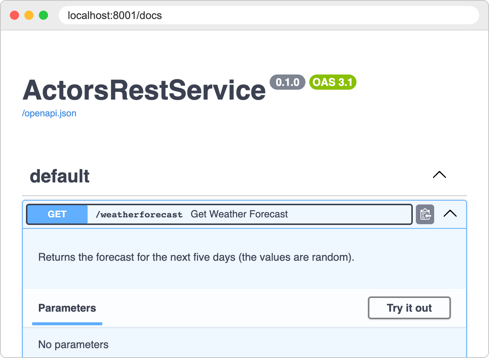
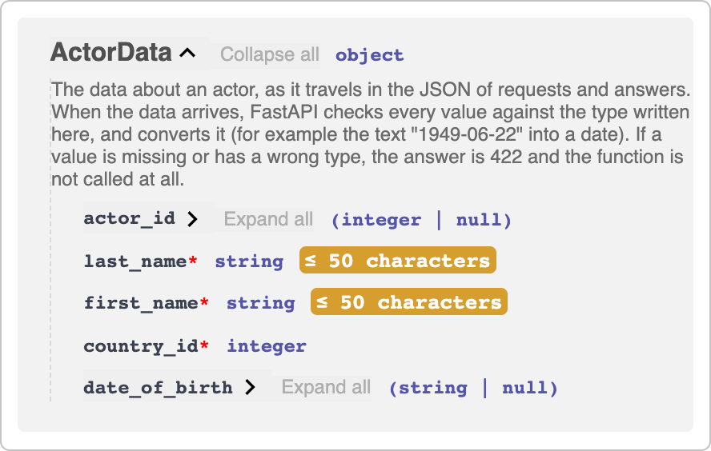
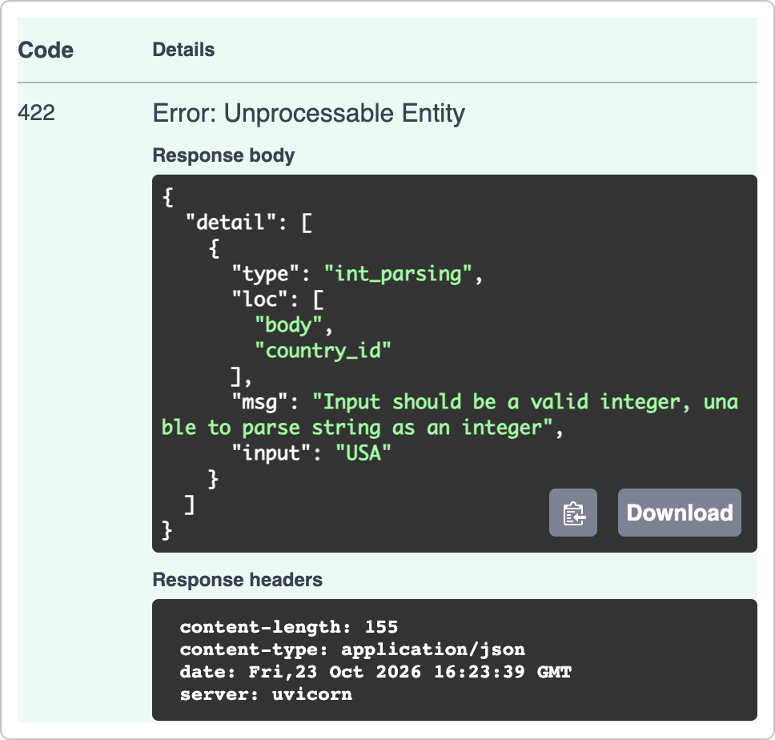
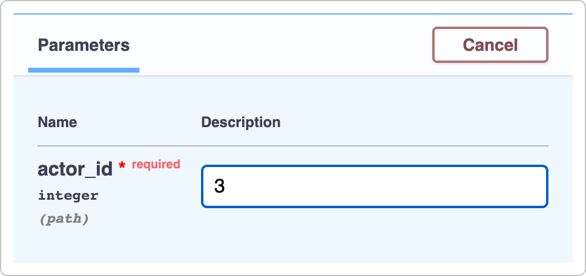
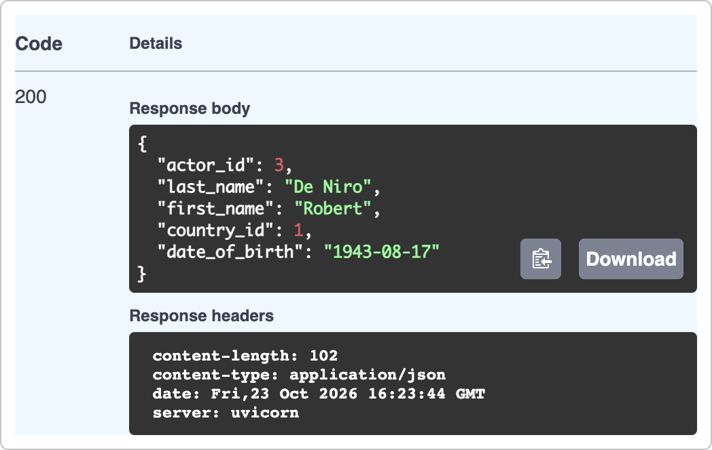
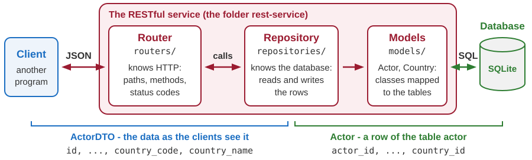
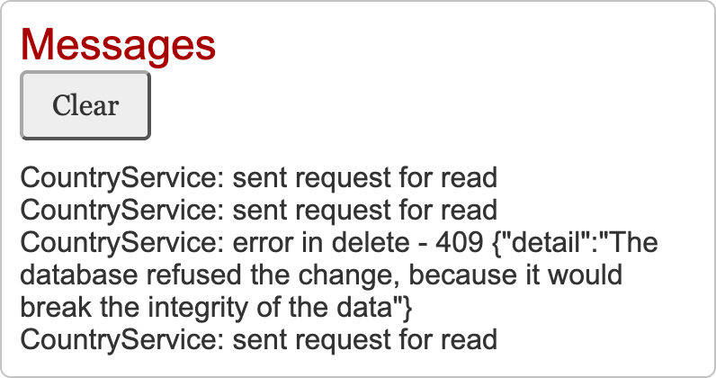
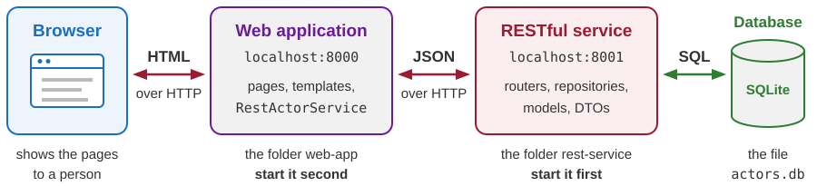

# RESTful services with FastAPI

Developing Software Solutions

---

## The same framework, another kind of answer

The previous lecture showed a REST API from the outside: addresses, methods, status codes, JSON. Now we write such a service - with the framework that we already use for pages.

| | A page of a web application | An operation of a service |
|---|---|---|
| The function returns | `templates.TemplateResponse(...)` | Python objects |
| FastAPI sends | HTML, made from a template | JSON, made from the objects |
| `Content-Type` of the answer | `text/html` | `application/json` |
| The answer is read by | a person, in a browser | another program |

- Everything else stays: routes, `APIRouter`, typed parameters, `Depends`, Uvicorn.
- In the second part of the lecture we write the *other program* as well: a client of the service.

Note:
A word about words: the answer of a service is its HTTP response - the term of the previous lecture, and the name of the objects in the code (Response, response).

---

## The smallest service

```python
app = FastAPI(title="ActorsRestService")

@app.get("/weatherforecast")
def get_weather_forecast() -> list[WeatherForecast]:
    forecasts = []
    for index in range(1, 6):
        forecast = WeatherForecast(
            date=datetime.date.today() + datetime.timedelta(days=index),
            temperature_c=random.randint(-20, 54),
            summary=random.choice(SUMMARIES),
        )
        forecasts.append(forecast)
    return forecasts
```

```json
[{"date":"2026-10-03","temperature_c":12,"summary":"Scorching","temperature_f":54},
 {"date":"2026-10-04","temperature_c":19,"summary":"Warm","temperature_f":66}, ...]
```

- The function returns a **list of objects**. FastAPI turns it into a JSON array - no template, no HTML.

Sample: `06-python-rest-sqlite/01-rest-service-new/main.py`

Note:
Start the sample with python main.py and open http://localhost:8001/weatherforecast in the browser: the browser shows the JSON.
The answer on the slide was received on 2 October 2026. It has five objects, in one line; the temperatures and the summaries are random, so every answer is different.
The return type list[WeatherForecast] tells FastAPI what the answer looks like. It is used for the conversion into JSON and for the documentation.

---

## The model class

```python
class WeatherForecast(BaseModel):
    date: datetime.date
    temperature_c: int
    summary: str | None = None

    @computed_field
    @property
    def temperature_f(self) -> int:
        return 32 + round(self.temperature_c * 9 / 5)
```

- `BaseModel` comes from the library **Pydantic**, on which FastAPI is built. A class based on it describes the **shape of the data**: the names of the fields and their types.
- Unlike a data class, it **checks** the values it is given: `temperature_c="warm"` is refused, and `"14"` becomes the number 14.
- FastAPI uses the class to make the JSON, and to describe the data on the page `/docs`.
- `@computed_field` above `@property`: the **calculated** value `temperature_f` is sent as well. A plain property would be left out of the JSON.

Note:
The same class, as a plain Python class with the property temperature_f, was an example in the lecture on object-oriented programming.
Like a data class, a model class gets its `__init__` from the list of fields - but its values are given only as keyword arguments: WeatherForecast(date=..., temperature_c=14).
A refused value raises the exception ValidationError, with a text such as: Input should be a valid integer, unable to parse string as an integer.
In the JSON a date becomes a text: "2026-10-03".
summary: str | None = None means: a text or nothing, and the field may be left out.

---

## The documentation that writes itself

FastAPI reads our code and describes the service on the page `http://localhost:8001/docs`.

| In the code | On the page `/docs` |
|---|---|
| `FastAPI(title="ActorsRestService")` | the title |
| a route and the name of its function | an operation: `GET /weatherforecast` - *Get Weather Forecast* |
| the docstring of the function | the description of the operation |
| the parameters and their types | the fields for the values of a request |
| the model classes and the return types | the examples of the data, and the list *Schemas* |

- Every operation can be **tried** on the page: *Try it out*, fill in the values, *Execute*. The page sends the request and shows the status code, the headers and the body of the answer - and the same request as a `curl` command.
- `/openapi.json` holds the same description for programs: a JSON document in the standard format **OpenAPI**, from which the page is drawn.

Note:
The page is made by the tool Swagger UI. Its scripts are loaded from the internet, so the page needs a connection.
In our services the address / leads to /docs: main.py answers it with a redirect.
Demonstration: change the docstring of get_weather_forecast and save the file. The service restarts, and after a refresh the page shows the new text. The documentation cannot be out of date.

---

## The page `/docs`

<div class="columns"><div>



</div><div>

What the page took from `main.py`:

1. the title: `FastAPI(title=...)`
2. `GET /weatherforecast` and *Get Weather Forecast*: the route, and the name of the function
3. the description: the docstring

*Try it out* sends the request from the page.

</div></div>

Note:
The sample is 06-python-rest-sqlite/01-rest-service-new. Its title is ActorsRestService already, although the actors come only in the next sample.
The group default holds the routes without tags. The service of the actors has the groups actors and countries.

---

<!-- .slide: class="exercise" -->
## Exercise 1: the wind

In a copy of the folder `06-python-rest-sqlite/01-rest-service-new`, change `main.py`:

1. Add to `WeatherForecast` the field `wind_kmh`, a whole number; `get_weather_forecast` gives it a random value from 0 to 100.
2. Add a calculated field `windy`: `True` when the wind is stronger than 50 km/h.
3. Add the route `GET /weatherforecast/today`: one forecast, for today, with random values, and a docstring.

On `/docs` the new operation shows the docstring, and *Execute* gives **one** object, not an array:

```json
{"date":"2026-10-24","temperature_c":8,"summary":"Chilly","wind_kmh":2,"temperature_f":46,"windy":false}
```

*About 15 minutes.*

<details><summary>Solution</summary>

```python
    wind_kmh: int                               # in the class WeatherForecast, after summary

    @computed_field                             # in the class, after temperature_f
    @property
    def windy(self) -> bool:
        return self.wind_kmh > 50

@app.get("/weatherforecast/today")
def get_weather_today() -> WeatherForecast:
    """Returns the forecast for today (the values are random)."""
    return WeatherForecast(
        date=datetime.date.today(),
        temperature_c=random.randint(-20, 54),
        summary=random.choice(SUMMARIES),
        wind_kmh=random.randint(0, 100),
    )
```

- `get_weather_forecast` passes `wind_kmh=random.randint(0, 100)` as well.
- The return type is `WeatherForecast`, not a list - so the answer is a JSON object.

</details>

Note:
Both samples of module 06 use the port 8001: stop one before starting the other.
Without the value in get_weather_forecast, the old route answers 500: the field wind_kmh has no default value, and the terminal shows the ValidationError.

---

## Routes for a resource

```python
router = APIRouter(prefix="/api/actors", tags=["actors"])
```

| Request | Decorator | Function |
|---|---|---|
| `GET /api/actors` | `@router.get("")` | `get_actors` |
| `GET /api/actors/5` | `@router.get("/{actor_id}")` | `get_actor` |
| `POST /api/actors` | `@router.post("", ...)` | `post_actor` |
| `PUT /api/actors/5` | `@router.put("/{actor_id}", ...)` | `put_actor` |
| `DELETE /api/actors/5` | `@router.delete("/{actor_id}", ...)` | `delete_actor` |

- `prefix` begins the path of every route. `tags` names their group on the page `/docs`.
- **One function for every operation**: the decorator names the HTTP method.
- `routers/countries.py` does the same for the second resource: `/api/countries`.

Sample: `06-python-rest-sqlite/02-rest-service-actors-db/routers/actors.py`

Note:
The folder of the sample: main.py creates the application and includes the routers, database.py connects the service with the database, models holds the classes for the data, routers holds one module for every resource.
In main.py: app.include_router(actors.router) and app.include_router(countries.router).

---

## Where do the values come from?

```python
# PUT: api/actors/5
@router.put("/{actor_id}", status_code=status.HTTP_204_NO_CONTENT)
def put_actor(actor_id: int, data: ActorData, session: SessionDep) -> None:
    """The parameter data is made from the JSON in the body of the request."""
```

| Parameter | FastAPI recognizes it by | The value comes from |
|---|---|---|
| `actor_id: int` | its name, which stands in the path of the route | the **path**: `/api/actors/5` |
| `data: ActorData` | its type, which is a model class | the **body**: the JSON sent by the client |
| `session: SessionDep` | its type, which contains `Depends(...)` | a **dependency**: FastAPI obtains the value |
| any other parameter | its simple type: `int`, `str` ... | the **query**: `?name=value` |

- New in a service: the body is **JSON**. One parameter receives the whole JSON object, as an object of a model class.
- Our services do not use the query. The pages do: `mode: str = "view"` receives `edit` from `/actordetail/3?mode=edit`.

Note:
The session is the connection with the database. It is explained a few slides later.
The page with the parameter mode is web-app/pages/actor_detail.py in module 07.
A typical use of the query in an API is filtering and sorting of a collection.

---

## One request, three sources


- FastAPI fills every parameter before it calls the function. Our code only uses the values.

---

## Checking the input

```python
class ActorData(SQLModel):
    actor_id: int | None = None
    last_name: str = Field(max_length=50)
    first_name: str = Field(max_length=50)
    country_id: int
    date_of_birth: datetime.date | None = None
```

Before `post_actor(data: ActorData, ...)` is called, FastAPI reads the body as JSON and:

1. checks every value against its type, and converts it: `"1949-06-22"` becomes a date;
2. checks the other rules: a field without a default value must be there, a name has at most 50 characters;
3. calls our function with the object `data` - or answers `422` itself, **without calling it**.

A class based on `SQLModel` checks its values like a `BaseModel` - as long as it is not a table.

Sample: `06-python-rest-sqlite/02-rest-service-actors-db/models/actor.py`

Note:
SQLModel is built on Pydantic: every SQLModel class is a BaseModel.
The fields without a default value are last_name, first_name and country_id. The fields actor_id and date_of_birth may be left out.
The same happened with the pages: a value from the path or from a form that could not be converted gave 422.

---

## The answer 422

The file `wrong.json`: the last name is missing, and the date is not written as year-month-day.

```json
{"first_name": "Meryl", "country_id": 1, "date_of_birth": "22.06.1949"}
```

```bash
curl -i -X POST http://localhost:8001/api/actors \
     -H "Content-Type: application/json" -d "@wrong.json"
```

```http
HTTP/1.1 422 Unprocessable Content
content-type: application/json

{"detail":[
  {"type":"missing","loc":["body","last_name"],"msg":"Field required", ...},
  {"type":"date_from_datetime_parsing","loc":["body","date_of_birth"],
   "msg":"Input should be a valid date or datetime, invalid character in year", ...}]}
```

- **Every** problem is reported: `loc` says where, `msg` says what.
- The path is checked in the same way: `GET /api/actors/abc` is answered with `422` too.
- We wrote no code for this: the types are the rules.

Note:
The real answer is one line. Left out here: the headers date, server and content-length, and the end of each error, which repeats the value that was received ("input").
For /api/actors/abc the answer says "loc":["path","actor_id"].
With Python 3.12 the status line says 422 Unprocessable Entity. It is the older name of the same code.
On Windows write the command in one line; in PowerShell type curl.exe.

---

## The rules and the answer 422 on `/docs`

<div class="columns"><div>



*Schemas*: the rules of `ActorData`. A `*` marks a required field.

</div><div>



*Try it out* with `"country_id": "USA"`.

</div></div>

Note:
The schema is drawn from the class ActorData, and its description from the docstring of the class.
The page names the code 422 with its older name, Unprocessable Entity. Above the answer, the page also shows the request as a curl command; it is left out of the picture.
The body of wrong.json gives the answer of the previous slide, with both errors; on the page the body of the answer then gets its own scroll bar.

---

<!-- .slide: class="exercise" -->
## Exercise 2: accepted or refused?

Which of these bodies of `POST /api/actors` does `ActorData` accept (`201`), and which get `422` - with which `loc`?

```text
1. {"last_name": "Cage", "first_name": "Nicolas", "country_id": 1}
2. {"last_name": "Cage", "first_name": "Nicolas", "country_id": "1"}
3. {"last_name": "Cage", "country_id": 1}
4. {"last_name": "Cage", "first_name": "Nicolas", "country_id": 1.5}
5. {"last_name": "Cage", "first_name": "Nicolas", "country_id": 1, "date_of_birth": "1964-1-7"}
6. the body of 1, with a last_name of 51 letters
```

Then check your answers on the page `/docs` of `02-rest-service-actors-db`: *Try it out* on `POST /api/actors`. *About 10 minutes.*

<details><summary>Solution</summary>

| | Answer | `loc` | Why |
|---|---|---|---|
| 1 | `201` | | `date_of_birth` may be left out |
| 2 | `201` | | the text `"1"` is converted into the number 1 |
| 3 | `422` | `body`, `first_name` | a required field is missing: *Field required* |
| 4 | `422` | `body`, `country_id` | 1.5 is not a whole number |
| 5 | `422` | `body`, `date_of_birth` | the month and the day have two digits: `1964-01-07` |
| 6 | `422` | `body`, `last_name` | *String should have at most 50 characters* |

- Every accepted body adds an actor; the answer `201` gives its address in `Location`.

</details>

---

## A class that is a table

```python
class Actor(ActorData, table=True):
    actor_id: int | None = Field(default=None, primary_key=True)  # assigned by the DBMS

    # a foreign key: the value must be the country_id of a row of the table country
    country_id: int = Field(foreign_key="country.country_id")
```

```sql
CREATE TABLE actor (
    actor_id INTEGER NOT NULL,
    last_name VARCHAR(50) NOT NULL,
    first_name VARCHAR(50) NOT NULL,
    country_id INTEGER NOT NULL,
    date_of_birth DATE,
    PRIMARY KEY (actor_id),
    FOREIGN KEY(country_id) REFERENCES country (country_id)
);
```

- `table=True` maps the class to the table `actor`: every field is a column, every object is a row.
- `Actor` inherits the fields of `ActorData`, and declares two of them again: the keys.
- SQLModel writes the `CREATE TABLE` statement from the class.

Note:
The statement on the slide is the real one: stop the service and type sqlite3 actors.db .schema in the folder of the sample.
The two fields are declared again with what only the database needs: the primary key and the foreign key.
The field date_of_birth allows None, so its column allows NULL. The other columns are NOT NULL.
The students know a class with table=True from module 05 (02-sqlite-with-model).

---

## Why two classes per table?


| An object is made with | `ActorData(...)` | `Actor(...)` - a table class |
|---|---|---|
| `country_id="USA"` | refuses: *Input should be a valid integer ...* | accepts the text |
| `date_of_birth="1949-06-22"` | converts the text into a date | keeps the text |

- **A new object of a table class is not checked, and its values are not converted** - not in our code, and not when FastAPI makes the object from the body of a request. With one class, a name of 60 characters would be stored, and every request with a date would end with `500`.
- **A row read from the database would become JSON with its fields in an arbitrary order.** An `ActorData` object keeps the declared order.
- So `ActorData` is the data that **travels**, and `Actor` is the **row**. `model_validate` makes one from the other.

Note:
The first statement can be shown in the Python prompt, started in the folder of the sample: from models.actor import Actor, ActorData. Then Actor(first_name="Meryl", country_id="USA") gives an object without any complaint, and ActorData(first_name="Meryl", country_id="USA") raises ValidationError with two errors.
"With one class" means: data: Actor in post_actor, and the received object saved as it is, with session.add(data). A request with a date is then answered with 500 Internal Server Error - the date is still a text, and the terminal says: SQLite Date type only accepts Python date objects as input. A wrong country ("USA") and a missing name are stopped only by the database (409).
model_validate is not like the constructor: it checks and converts the values, also for a table class. So both calls of the diagram are safe.
The order: a row that was read from the database becomes JSON with its fields in an order that can even change from one start of the service to the next. In JSON the order has no meaning, but an answer that always looks the same is easier to read.

---

## The engine and the session

```python
DATABASE_FILE = Path(__file__).parent / "actors.db"
engine = create_engine(f"sqlite:///{DATABASE_FILE}")


def get_session():
    """Hands over a session - a conversation with the database - and closes it afterwards."""
    with Session(engine) as session:
        yield session


SessionDep = Annotated[Session, Depends(get_session)]
```

- The **engine**: one object for the whole service. It knows where the database is.
- A **session**: one for every request. FastAPI calls `get_session()` before our function. `yield` hands the session over, and `with` closes it when the request is finished.
- `SessionDep` is a short name for the type of the parameter `session`.

Sample: `06-python-rest-sqlite/02-rest-service-actors-db/database.py`

Note:
The pages declare their services in the same way: Annotated[..., Depends(...)].
Older examples on the web add connect_args={"check_same_thread": False} to create_engine. With the current versions it is not needed: for a database in a file the engine sets it by itself.
A function with yield hands a value over and waits. FastAPI lets it continue when the request is finished.

---

## Reading all the actors

```python
# GET: api/actors
@router.get("")
def get_actors(session: SessionDep) -> list[ActorData]:
    actors = session.exec(select(Actor)).all()
    # every row of the table becomes an ActorData object - the data that is sent to the client
    return [ActorData.model_validate(actor) for actor in actors]
```

- `select(Actor)` describes the query, and `session.exec(...)` sends it to the database as `SELECT ... FROM actor`. `.all()` gives the rows as a list of `Actor` objects.
- The last line is a **list comprehension** - a short way to make a list from another list. Read it as: the list of `ActorData.model_validate(actor)`, for every `actor` in `actors`.
- A `for` loop that appends the objects to an empty list one by one would do the same.
- The function ends with `return`, so the answer is `200 OK`. FastAPI turns the list into a JSON array.

Note:
With echo=True in create_engine the terminal shows every SQL statement that is sent (module 05).
The return type list[ActorData] is shown on the page /docs as the shape of the answer.

---

## Reading one actor: 200 or 404

```python
# GET: api/actors/5
@router.get("/{actor_id}")
def get_actor(actor_id: int, session: SessionDep) -> ActorData:
    actor = session.get(Actor, actor_id)
    if actor is None:
        raise HTTPException(status_code=status.HTTP_404_NOT_FOUND, detail="Actor not found")
    return ActorData.model_validate(actor)
```

- `session.get(Actor, actor_id)` reads the row with this primary key - or gives `None`.
- `raise HTTPException(...)` ends the function at once. FastAPI sends the given status code, and the body `{"detail":"Actor not found"}`.
- `status.HTTP_404_NOT_FOUND` is the number 404 with a readable name.

| The request | The answer | Decided by |
|---|---|---|
| `GET /api/actors/3` | `200 OK` and the actor | our function: `return` |
| `GET /api/actors/99` | `404 Not Found` | our function: `raise HTTPException(...)` |
| `GET /api/actors/abc` | `422 Unprocessable Content` | FastAPI: `abc` is not an `int` |

Note:
status_code=404 means the same as status_code=status.HTTP_404_NOT_FOUND.
The students have seen HTTPException in the actors application: find_actor in pages/actor_detail.py.

---

## Adding an actor: 201 and Location

```python
# POST: api/actors
@router.post("", status_code=status.HTTP_201_CREATED)
def post_actor(data: ActorData, session: SessionDep, response: Response) -> ActorData:
    actor = Actor.model_validate(data)  # makes a row for the table from the received data
    actor.actor_id = None  # the key of a new row is always assigned by the DBMS
    session.add(actor)
    session.commit()
    session.refresh(actor)  # reads the new row back, with the actor_id assigned by the DBMS

    # the answer tells the address of the new resource
    response.headers["Location"] = f"/api/actors/{actor.actor_id}"
    return ActorData.model_validate(actor)
```

- `add` announces the new row. `commit` sends the `INSERT` and makes the change permanent. `refresh` reads the row back: now `actor.actor_id` is known.
- `status_code=` in the decorator sets the code of the **successful** answer: `201 Created`.
- `response: Response`: FastAPI hands over an object for the headers of the answer. We set `Location`, the address of the new actor.

Note:
Without status_code= the code of a successful answer is 200 OK.
The body of the answer is still made from the returned object. The object response only adds the header.
Before the commit the attribute actor_id is None. The DBMS assigns the key when the row is inserted.
A client has no reason to send an actor_id in the body of a POST: the DBMS chooses the key. If a client sends one, it is ignored - the function sets actor_id to None before the row is added.

---

## Changing and deleting: 204

```python
# PUT: api/actors/5
@router.put("/{actor_id}", status_code=status.HTTP_204_NO_CONTENT)
def put_actor(actor_id: int, data: ActorData, session: SessionDep) -> None:
    if actor_id != data.actor_id:
        raise HTTPException(status_code=status.HTTP_400_BAD_REQUEST, detail=...)

    actor = session.get(Actor, actor_id)
    if actor is None:
        raise HTTPException(status_code=status.HTTP_404_NOT_FOUND, detail="Actor not found")

    actor.last_name = data.last_name
    ...                                  # first_name, country_id, date_of_birth
    session.add(actor)
    session.commit()
```

- **Changing**: read the row, change the attributes of the object, `commit`. An `UPDATE` is sent.
- **Deleting**: `delete_actor` finds the row in the same way. Then: `session.delete(actor)` and `commit`.
- Both functions return nothing. With the status code `204` the answer has **no body**.

Note:
The text of the 400 answer: The id in the address and the actor_id in the body are different.
The UPDATE names only the columns that have changed. When only the first name is changed, it is: UPDATE actor SET first_name=? WHERE actor.actor_id = ?
The statement for deleting: DELETE FROM actor WHERE actor.actor_id = ?
session.add(actor) in put_actor is written for clarity, as in the documentation of SQLModel. The session already follows an object that it has read, and the same UPDATE would be sent without that line.
The answer 204 consists of the status line and the headers.

---

<!-- .slide: class="exercise" -->
## Exercise 3: the actors of a country

Copy the folder `06-python-rest-sqlite/02-rest-service-actors-db` to a folder of your own. In `routers/countries.py`, add the operation `GET /api/countries/{country_id}/actors`: the actors of one country.

1. If there is no such country, the answer is `404` with the detail `Country not found`.
2. Otherwise: read all the actors, and return those whose `country_id` is the one from the path, as `ActorData` objects.

Check: `/api/countries/3/actors` gives Nicole Kidman, `/api/countries/4/actors` gives `[]`, and `/api/countries/9/actors` gives `404`. *About 15 minutes.*

<details><summary>Solution</summary>

```python
from models.actor import Actor, ActorData


# GET: api/countries/1/actors
@router.get("/{country_id}/actors")
def get_country_actors(country_id: int, session: SessionDep) -> list[ActorData]:
    """Returns the actors of one country."""
    if session.get(Country, country_id) is None:
        raise HTTPException(status_code=status.HTTP_404_NOT_FOUND, detail="Country not found")

    actors = session.exec(select(Actor)).all()
    return [ActorData.model_validate(actor) for actor in actors if actor.country_id == country_id]
```

- `if` at the end of a list comprehension keeps only some elements. A `for` loop with an `if` and `append` does the same.
- An empty list is a correct answer: Italy exists, it only has no actors. `404` means that the country does not exist.

</details>

Note:
The solution reads all the actors and chooses in Python. SQL can choose the rows itself, and read fewer of them: select(Actor).where(Actor.country_id == country_id).

---

## The database is created at start

```python
def create_database() -> None:
    """Creates the tables (if they do not exist), and fills the empty tables with data."""
    SQLModel.metadata.create_all(engine)

    with Session(engine) as session:
        if session.exec(select(Country)).first() is not None:
            return  # there is data already

        usa = Country(name="United States of America", code="US")
        serbia = Country(name="Serbia", code="RS")
        ...
        session.add_all([usa, serbia, australia, italy, france])
        session.commit()  # after the commit every country has its country_id
        ...               # the actors: Actor(..., country_id=serbia.country_id, ...)
```

- `main.py` calls `create_database()` when the service starts.
- `create_all` sends a `CREATE TABLE` for every table that does not exist yet.
- The data is added only if the table `country` is empty. The countries go first: an actor needs the `country_id` of its country.

Note:
The first start also creates the file actors.db, in the folder of the service.
To start again with the original data: stop the service and delete the file actors.db.
The service starts with 5 countries and 13 actors.

---

## Guarding the integrity: 409

```python
@event.listens_for(engine, "connect")                         # database.py
def switch_on_foreign_keys(connection, connection_record):
    cursor = connection.cursor()
    cursor.execute("PRAGMA foreign_keys = ON")
    cursor.close()
```

```python
@app.exception_handler(IntegrityError)                        # main.py
def change_refused(request: Request, error: IntegrityError):
    return JSONResponse(
        status_code=409,
        content={"detail": "The database refused the change, because it would break ..."},
    )
```

- SQLite checks foreign keys only if it is asked to, on every new connection. Without the `PRAGMA` it would accept an actor of country 99.
- A change that breaks a rule of the database is refused, and the session raises `IntegrityError`.
- `main.py` turns this exception, in whichever route it happens, into `409 Conflict`. Without that function the client would get `500`.

Note:
Try it: curl -i -X DELETE http://localhost:8001/api/countries/1 is answered with 409 Conflict, because country 1 has actors. The same answer follows a POST of an actor with "country_id": 99.
The whole text of the answer: The database refused the change, because it would break the integrity of the data.
Without the PRAGMA, SQLite would also delete a country that still has actors.
409 Conflict means: the request itself is correct, but it is in conflict with the data that exists.

---

## Trying the service: reading

Start the service with `python main.py`. Then use the page `/docs` - or `curl`, in another terminal.

```bash
curl http://localhost:8001/api/actors
```

```json
[{"actor_id":1,"last_name":"Živojinović","first_name":"Bata","country_id":2,
  "date_of_birth":"1933-06-05"},
 {"actor_id":2,"last_name":"Roberts","first_name":"Julia","country_id":1, ...
```

```bash
curl -i http://localhost:8001/api/actors/3
```

```http
HTTP/1.1 200 OK
date: Fri, 02 Oct 2026 17:03:58 GMT
server: uvicorn
content-length: 102
content-type: application/json

{"actor_id":3,"last_name":"De Niro","first_name":"Robert","country_id":1,
 "date_of_birth":"1943-08-17"}
```

- `-i` also prints the status line and the headers. The body is one line; here it is split in two.

Note:
The first answer is an array of 13 objects in one line. Only its beginning is shown.
Uvicorn writes the names of the headers in lower case. The names of headers are not case-sensitive.
The fields come in the order in which the class ActorData declares them.

---

## Trying the service: changing the data

The file `actor.json`: a new actor, without `actor_id`, and with a mistake in the first name.

```json
{"last_name": "Streep", "first_name": "Meril", "country_id": 1, "date_of_birth": "1949-06-22"}
```

```bash
curl -i -X POST http://localhost:8001/api/actors \
     -H "Content-Type: application/json" -d "@actor.json"
```

```http
HTTP/1.1 201 Created
location: /api/actors/14

{"actor_id":14,"last_name":"Streep","first_name":"Meril","country_id":1,
 "date_of_birth":"1949-06-22"}
```

```bash
curl -i -X PUT http://localhost:8001/api/actors/14 \
     -H "Content-Type: application/json" -d "@actor14.json"
curl -i -X DELETE http://localhost:8001/api/actors/14
```

```http
HTTP/1.1 204 No Content
```

- `actor14.json`: the actor with `"actor_id": 14` and `"Meryl"`. Both answers: `204`.

Note:
The answers are shortened: the headers date, server, content-length and content-type are left out.
The answer 204 has no body. A second DELETE is answered with 404 Not Found and the body {"detail":"Actor not found"}.
The file actor14.json: {"actor_id": 14, "last_name": "Streep", "first_name": "Meryl", "country_id": 1, "date_of_birth": "1949-06-22"}
On Windows write every command in one line; in PowerShell type curl.exe.
All of this can be done on the page /docs as well: the body is typed into the field Request body.

---

## Trying the service on the page `/docs`

<div class="columns"><div>

1. Open `GET /api/actors/{actor_id}`.
2. Click *Try it out*, and type `3`:



3. Click *Execute*.

</div><div>



The same answer as from `curl -i`.

</div></div>

Note:
Above the answer the page shows the request as a curl command, and its address. They are left out of the picture.
POST and PUT have the field Request body instead: there the JSON of the actor is typed.

---

<!-- .slide: class="exercise" -->
## Exercise 4: a nickname

In your copy of the service:

1. Add to `ActorData` the field `nickname`: a text of at most 30 characters, which may be left out.
2. Save, and open `/api/actors`. What happens, and why? Then stop the service, delete `actors.db`, and start it again.
3. `POST` an actor with `"nickname": "Nic"`: `201`, `Location: /api/actors/14`, and the nickname is in the body.
4. `POST` one with a nickname of 31 characters (`422`), and one with `"country_id": 99` (`409`).
5. `PUT /api/actors/14` with `"nickname": "Nick"`: `204`. Read the actor 14 - has the nickname changed?

*About 15 minutes.*

<details><summary>Solution</summary>

```python
    nickname: str | None = Field(default=None, max_length=30)    # models/actor.py, in ActorData

    actor.nickname = data.nickname                               # routers/actors.py, in put_actor
```

- Step 2: `500 Internal Server Error`. The table was created before the field existed, and `create_all` does not change a table that exists. The terminal says: *no such column: actor.nickname*.
- Step 5: the answer is `204`, but the nickname stays `"Nic"` - until `put_actor` copies it, with the second line above. `post_actor` needs no change: `Actor.model_validate(data)` takes all the fields.

</details>

---

## A larger service in layers



- A function of a router gets a **repository** instead of a session: `actor_repo.get_by_id(id)`.
- The repository gives `None` for an actor that does not exist. The router turns that into `404`.

Sample: `07-python-fastapi-rest-sqlite/02-complete-system-db/rest-service`

Note:
The service of module 07 offers the same operations as the one of module 06, but its work is divided. One visible difference: it checks the country itself, so an actor of country 99 is answered with 400 (There is no country with the id 99), not with 409.
The files to open: routers/actor.py and repositories/actor_repository.py.
The repository is handed over by FastAPI as well: ActorRepo = Annotated[ActorRepository, Depends(get_actor_repository)]. The function get_actor_repository in database.py needs a session, so FastAPI calls get_session first - a chain of dependencies.
Why layers: each one can be changed or replaced without touching the others. Another database would change only the repositories and the models.

---

## DTO: the data as the clients see it

```python
class ActorDTO(BaseModel):
    id: int | None = None
    last_name: str
    first_name: str
    country_id: int
    country_code: str | None = None
    country_name: str | None = None
    date_of_birth: datetime.date | None = None
```

```json
{"id":3,"last_name":"De Niro","first_name":"Robert","country_id":1,"country_code":"US",
 "country_name":"United States of America","date_of_birth":"1943-08-17"}
```

- A **DTO** (*data transfer object*) is a class for the data that travels to and from the clients.
- It need not look like a row of a table: next to `country_id` it carries the code and the name of the country. The client needs no second request for them.
- The repository fills the DTO from two tables: `country_name=actor.country.name`.
- The tables can change later without any change for the clients.

Note:
The files: dtos/actor_dto.py, and the function to_dto in repositories/actor_repository.py.
actor.country is declared in models/actor.py with Relationship(): the object of the class Country to which country_id refers. It is read from the table country when it is used for the first time.
When a client sends an ActorDTO, only country_id is used. The code and the name of the country are ignored.
ActorDTO is a BaseModel, so FastAPI checks the incoming data against it, as it did with ActorData in module 06.

---

## The other side: a client written in Python

A Python program sends requests with the library **httpx2**: one function for every HTTP method.

| In `services/rest_actor_service.py` | The request that is sent |
|---|---|
| `httpx2.get(self._request_uri)` | `GET /api/actors` |
| `httpx2.post(self._request_uri, json=actor_add)` | `POST /api/actors`, with a body |
| `httpx2.put(f"{self._request_uri}/{actor.id}", json=actor_upd)` | `PUT /api/actors/14`, with a body |
| `httpx2.delete(f"{self._request_uri}/{actor.id}")` | `DELETE /api/actors/14` |

- `self._request_uri` is the address of the resource: `http://localhost:8001/api/actors`.
- `json=`: a Python dictionary is sent as JSON in the body, and the header `Content-Type: application/json` is added.
- Every call waits for the answer, and returns it as an object: the `response`.

Sample: `07-python-fastapi-rest-sqlite/02-complete-system-db/web-app`

Note:
Until now our requests were sent by curl and by the page /docs.
The class RestActorService belongs to the web application of module 07. The application is a server for the browser, and a client of the service.
httpx2 is installed with pip, like FastAPI. It is in requirements.txt.
The dictionary for a new actor: {"first_name": first_name, "last_name": last_name, "country_id": country_id}.

---

## Using the answer

```python
    def get_actors(self) -> list[Actor]:
        response = httpx2.get(self._request_uri)
        response.raise_for_status()  # an answer such as 404 or 500 becomes an exception
        ...
        for item in response.json():  # the JSON array has become a list of dictionaries
            ...

    def _report(self, response: httpx2.Response, operation: str) -> bool:
        if response.is_success:  # the status code is 2xx
            self._messaging_service.add(f"ActorService: sent request for {operation}")
        else:
            self._messaging_service.add(
                f"ActorService: error in {operation} - {response.status_code} {response.text}"
            )
        return response.is_success
```

- `response.json()` turns the body from JSON into Python lists and dictionaries.
- For httpx2 an answer `404` or `409` is not an error. The client must look at the code:
  - `response.raise_for_status()` raises an exception if the code is not `2xx`;
  - `response.is_success` only tells whether it is `2xx`.

Note:
The service makes an Actor object from every dictionary, as it did with the file in module 04.
The method `_report` is called after add, update and delete: a refused change becomes a message on the page. Its result goes back to the page: add, update and delete return True if the service has accepted the change, and only then the page announces it ("Country deleted: ...").
Demonstration: on the page Countries press x next to United States of America. The message is: CountryService: error in delete - 409 and the JSON with the detail.
JSON has no type for dates, so the service converts the text of date_of_birth with datetime.date.fromisoformat.
If nobody listens at the address, httpx2.get itself raises an exception: ConnectError.

---

## A refused change, as the user sees it

<div class="columns"><div>

On the page *Countries*, press **x** next to *United States of America*:

1. the web application sends `DELETE /api/countries/1`;
2. the service answers `409 Conflict`: the country still has actors;
3. `_report` sees that the answer is not `2xx`, and adds a message.

</div><div>



</div></div>

Note:
The other messages are written by the services whenever they read the data for a page.
The class RestCountryService has a method _report like the one of RestActorService on the previous slide.

---

<!-- .slide: class="exercise" -->
## Exercise 5: a client in Python

Start the service `02-rest-service-actors-db` with a new database (delete `actors.db` first). Write a program `client.py` that uses `httpx2`:

1. reads all the countries, and prints the code and the name of each one;
2. adds the country Spain, with the code `ES`, and prints the status code and the header `Location`;
3. tries to delete the country 1, and prints the status code and the `detail` of the answer.

The program prints the five countries, then `201 /api/countries/6` and `409 The database refused the change, ...` *About 15 minutes.*

<details><summary>Solution</summary>

```python
import httpx2

URL = "http://localhost:8001/api/countries"

response = httpx2.get(URL)
response.raise_for_status()
for country in response.json():
    print(country["code"], country["name"])

response = httpx2.post(URL, json={"name": "Spain", "code": "ES"})
print(response.status_code, response.headers["Location"])

response = httpx2.delete(URL + "/1")
print(response.status_code, response.json()["detail"])
```

- The answer `409` is not an exception for `httpx2`: the program reads its code and its body like any other answer.

</details>

Note:
Every run adds Spain once more: the second run prints ES in the list, and 201 /api/countries/7.
The names of headers are not case-sensitive: response.headers["location"] works too.

---

## One contract, two sources of data

```python
class ActorService(ABC):
    @abstractmethod
    def get_actors(self) -> list[Actor]:
        """Returns all the actors."""

    @abstractmethod
    def add(self, first_name: str, last_name: str, country_id: int) -> bool:
        """Adds a new actor."""
    ...
```

```python
# dependencies.py
_actor_service = RestActorService(REST_SERVICE_URL + "/actors", _messaging_service)
```

- `ActorService` is an abstract class: it says **what** a page may ask for. The class `RestActorService(ActorService)` says **how** it is done - with HTTP requests.
- The pages know only the abstract class. They call `actor_service.get_actors()`.
- In module 04 `dependencies.py` created a `FileActorService`: the actors came from a file. Now it creates a `RestActorService` - and a page that only reads the actors is not changed at all: `pages/dashboard.py` is the same file in both applications.

Note:
The files: services/actor_service.py and dependencies.py of the web application.
In module 04 (step 13) the line in dependencies.py was: `_actor_service = FileActorService(BASE_DIR / "sample-data" / "actors.json", _messaging_service)`.
pages/messages.py is the same file in both applications as well. The contract itself has grown since module 04: update is new, add and delete now tell whether the change was accepted, and an actor has a country_id. The pages that add, change and delete actors were adapted to it, and the pages for countries are new.
The abstract class lists five methods: get_actors, add, delete, update and search. The three that change the data return True if the change has been carried out, and False if it has been refused.

---

## One contract, two implementations


- The pages see only the upper half of the picture. Which class works below it is decided in one place: `dependencies.py`.

---

## The complete system



- Two programs on two ports, each started with `python main.py` - **the service first**.
- Only the service touches the database. The web application has no data of its own.
- If the service is not running, the web application shows the page *The RESTful service is not available* (status `503`) instead of the data.

Sample: `07-python-fastapi-rest-sqlite/02-complete-system-db`

Note:
Each program runs in a terminal of its own: python main.py in the folder rest-service, then python main.py in the folder web-app.
The user opens http://localhost:8000. For the page with the actors the application sends two requests to the service: GET /api/countries and GET /api/actors.
The page for the missing service is made in main.py of the web application, from the exception httpx2.HTTPError.
The web application could be replaced by a mobile application without any change in the service.
The address of the service is written in web-app/dependencies.py: http://localhost:8001/api. It can be changed with the environment variable REST_SERVICE_URL.
Demonstration: add an actor, stop the web application and start it again - the actor is still there. Then stop the service and reload the page.
The terminal of each program shows the requests that it receives. Watch both while clicking.

---

## The complete system at work

<div class="columns"><div>


</div><div>

The page *Actors*, step by step:

1. the browser asks the web application: `GET /actors`;
2. the web application asks the service: `GET /api/countries` and `GET /api/actors`;
3. the service reads the tables, and answers with JSON;
4. the web application fills the template, and sends the HTML.

</div></div>

---

<!-- .slide: class="exercise" -->
## Exercise 6: one change, two programs

Start the complete system `07-python-fastapi-rest-sqlite/02-complete-system-db`, with a new database: the `rest-service` first, then the `web-app`.

1. On the page *Actors* add the actor Nicolas Cage, United States of America.
2. Ask the service for him with `curl`: which `id` did he get? Which fields does the DTO add?
3. Change his first name to Nick with a `PUT` to the service - the body, an `ActorDTO`, goes into the file `nick.json`. Reload the page *Actors*.
4. Stop the service, and reload the page once more. What is shown, with which status code?

*About 10 minutes.*

<details><summary>Solution</summary>

```bash
curl http://localhost:8001/api/actors/14
curl -i -X PUT http://localhost:8001/api/actors/14 -H "Content-Type: application/json" -d "@nick.json"
```

```json
{"id": 14, "last_name": "Cage", "first_name": "Nick", "country_id": 1}
```

- Step 2: the `id` is 14. The key is called `id`, and the DTO adds `country_code` (`"US"`) and `country_name`.
- Step 3: `204`, and the page shows *Nick Cage*: the web application has no data of its own - it asks the service every time.
- Step 4: the page *The RESTful service is not available*, with the status `503`.

</details>

Note:
A new database: delete the file actors.db in the folder rest-service before starting it. The service starts with 13 actors.
The page shows the first name before the last name: Nick Cage.

---

## CORS

```python
# rest-service/main.py
app.add_middleware(
    CORSMiddleware,
    allow_origins=["*"],
    allow_methods=["*"],
    allow_headers=["*"],
)
```

- An **origin** is the scheme, the host and the port of an address. `http://localhost:8000` and `http://localhost:8001` are two origins.
- A rule of **browsers**: JavaScript in a page may use the answer of a service of another origin only if the service allows it, with the header `Access-Control-Allow-Origin`. This agreement is called **CORS** - *Cross-Origin Resource Sharing*.
- The service of module 07 allows it with these lines, for clients that run in a browser.
- Our web application does not need it: it calls the service from Python, on the server. The rule exists only in browsers - `httpx2` and `curl` are not bound by it.

Note:
The value `"*"` means: pages of every origin.
With these lines the answers of the service get the header `access-control-allow-origin: *` when the request comes from a page of another origin.
Without them the service still answers a GET, but the browser does not give the answer to the JavaScript code. The console of the browser says: blocked by CORS policy. A request that changes data (a POST with JSON, a PUT, a DELETE) is not even sent: the browser first asks the service for permission with an OPTIONS request, and does not get it.
The page /docs works without CORS, because it is served by the service itself: the same origin.
A real service does not allow every origin. It lists the origins of its own applications.

---

## CORS: the browser checks


- The service only adds a header to its answer. The **browser** decides whether the page may read the answer.

Note:
The header Origin is added by the browser itself, to every request of JavaScript to another origin. The JavaScript cannot change it.

---

## Summary

- A service is written like an application with pages: routes and functions. The functions return **objects**, and FastAPI sends them as **JSON**.
- **Model classes** describe the data. FastAPI checks the input against them (`422`), and writes the page `/docs`.
- Status codes: `status_code=` for a success (`201`, `204`), `raise HTTPException(...)` for a refusal (`400`, `404`), and `409` when the database refuses a change.
- **SQLModel**: a class with `table=True` is a table, and a session reads and changes its rows.
- A larger service is built in **layers**, with **DTO** classes for the data that travels.
- A program becomes a **client** with `httpx2`: `get`, `post`, `put`, `delete`, `response.json()`.
- The **complete system**: browser - web application - RESTful service - database. Only the service touches the database.

---

<!-- .slide: class="exercise" -->
## Assignment: a service for films

Build the API of the films - the assignment of the previous lecture - with FastAPI, SQLModel and SQLite. Start from a copy of `02-rest-service-actors-db`.

1. Two tables: `genre` (`genre_id`, `name`) and `movie` (`movie_id`, `title` - at most 100 characters, `year` - may be missing, `lasting` - 90 if not given, `genre_id` - a foreign key).
2. `/api/genres`: all the genres, and one genre (or `404`).
3. `/api/movies`: all five operations, with the answers of this lecture - and `409` for a film of a genre that does not exist.
4. At the first start: the seven genres and the ten films of VanityFair02, in their order.
5. Bonus: `GET /api/genres/{genre_id}/movies`, and a program `client.py` that prints every film with the name of its genre.

*About 45 minutes.* A solution: [exercises/06-02-fastapi-rest](https://github.com/kartelj/ekof_dss/tree/main/exercises/06-02-fastapi-rest)

Note:
The genres and the films are in teaching-samples/05-python-db-sqlite/database/VanityFair02/insert-table-data.sql: title, genre_id, lasting and year of every film.

---

<!-- .slide: class="exercise" -->
## Assignment: check your service

With a new database, these requests must give these answers:

| Request | Answer |
|---|---|
| `GET /api/movies/4` | `200`: `{"movie_id":4,"title":"Fargo","year":1996,"lasting":98,"genre_id":4}` |
| `GET /api/movies/99` | `404`: `{"detail":"Movie not found"}` |
| `POST /api/movies` with `{"title": "Burn After Reading", "year": 2006, "genre_id": 5}` | `201`, `Location: /api/movies/11`, and `"lasting":90` in the body |
| `PUT /api/movies/11` with `"movie_id": 12` in the body | `400` |
| `POST /api/movies` with `"genre_id": 99` | `409` |
| `DELETE /api/movies/11`, twice | `204`, then `404` |
| `GET /api/genres/7/movies` (the bonus) | `200`: `[]` - there is no film of science fiction |

Note:
The PUT must send a valid film (title and genre_id), otherwise the answer is 422 before the ids are compared.
The service of the solution is called MoviesRestService, and it keeps its data in movies.db.

---

# Thanks for your attention!
