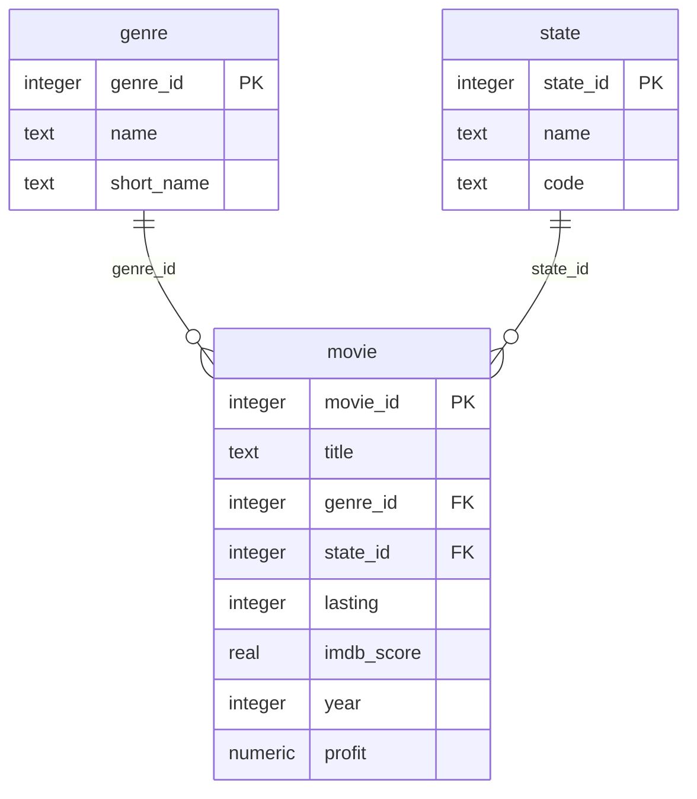

# 04 - Databases with SQLite

SQLite is a relational DBMS that needs no installation and no server: a database is a single file,
and the library that works with it is a part of Python.

## The databases of the course

```text
cd database
python create_databases.py
```

creates the two databases from the SQL scripts:

| Database | Design | Scripts |
|---|---|---|
| `VanityFair01/VanityFair01.db` | everything about a film in one table, `movie` | `create-tables.sql`, `insert-table-data.sql` |
| `VanityFair02/VanityFair02.db` | genres and states in tables of their own, referenced by foreign keys; a view | `create-tables.sql`, `create-views.sql`, `insert-table-data.sql` |



The files `queries.sql` contain the queries of the lecture *Introduction to SQL*. Execute them one by one in a tool
for SQLite - for example the command-line shell `sqlite3`:

```text
sqlite3 VanityFair02/VanityFair02.db
sqlite> .headers on
sqlite> .mode column
sqlite> SELECT title, year FROM movie WHERE year < 1995;
sqlite> .quit
```

Some of the queries change the data. To get the original databases back, run `create_databases.py` again.

## Using a database from Python

| Sample | How it works |
|---|---|
| `01-sqlite-with-sql` | the program sends SQL statements itself, with the module `sqlite3` |
| `02-sqlite-with-model` | the program works with objects of the class `Actor`; the library SQLModel writes the SQL |

```text
cd 01-sqlite-with-sql
python main.py
```

Both programs create their database (`actors.db`) on the first run, show the rows of the table `actor`,
and add one row. Run them several times.
